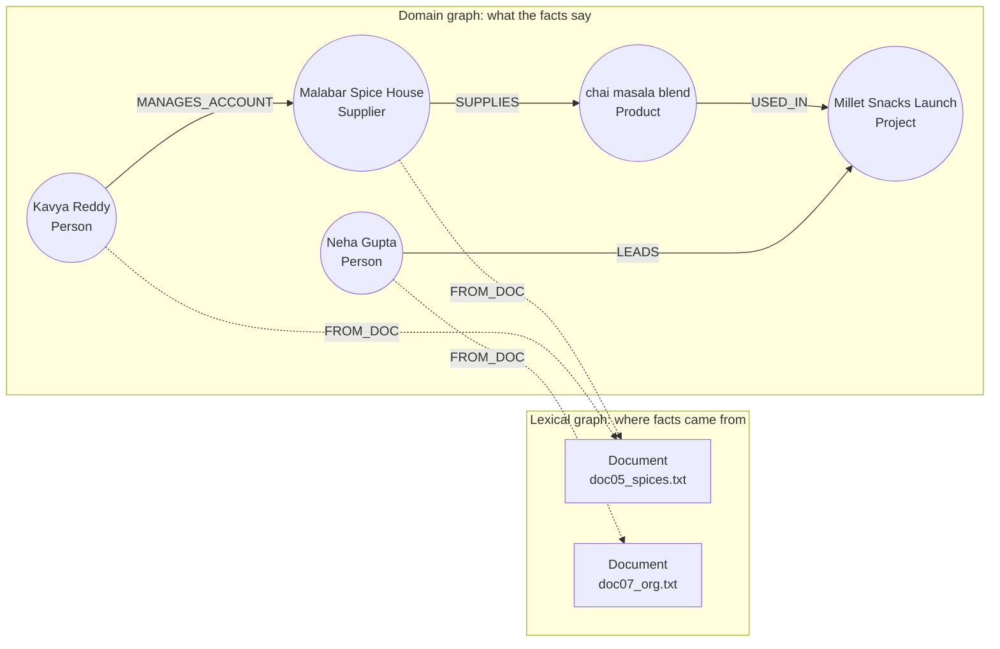

# Building a Knowledge Graph from Text with an LLM: The Complete Guide

> 📚 **Before you start**
>
> - [Entity and Relation Extraction with LLMs](../05-digitising-unstructured-data/entity-and-relation-extraction-with-llms.md): the ontology-driven prompt, validation against domain and range, and provenance. This lesson runs that over a whole folder of documents.
> - [Entity Resolution and Deduplication](../05-digitising-unstructured-data/entity-resolution-and-deduplication.md): why "Neha" and "Neha Gupta" must become one node.
> - [Cypher Basics: MATCH, CREATE and MERGE](../04-neo4j-and-cypher/cypher-basics-match-create-and-merge.md): multi-hop questions as walks along relationships.
> - Chunks and retrieval in ordinary RAG: [Retrieval-Augmented Generation (RAG) › Introduction to RAG](../../retrieval-augmented-generation-rag/course.md#m2).

## Introduction

Ask anyone at Kiran Foods *"who should I call if the spice supply for the Millet Snacks Launch slips?"* and you'll get a different answer from each person, because the answer is spread across a supplier review, a packaging note, an org chart and an account list. Each document holds one or two links of the chain. Nobody holds the chain.

Module 5 pulled facts out of one email or one invoice at a time. This lesson does it for a **whole collection of documents** and assembles the result into a single knowledge graph that can answer the question above in one walk: *Millet Snacks Launch ← used in ← chai masala blend ← supplied by ← Malabar Spice House ← account managed by ← Kavya Reddy*.

Running extraction over many documents raises problems a single email never did: the same entity named five ways in five files, facts that need to point back to their source, documents that get updated or deleted, and a bill for thousands of LLM calls. By the end of this lesson you'll be able to build a graph from a document folder with an LLM, merge entities across documents, keep provenance so every fact can be traced and removed, check the graph's quality, and recognise the same steps inside tools like LangChain's `LLMGraphTransformer` and Neo4j's `SimpleKGPipeline`.

> 💡 **Key Insight**
>
> A graph built from text is two graphs in one: a **domain graph** of entities and relationships, and a **lexical graph** of documents and chunks, joined by "this fact came from this chunk" links. The domain graph answers questions; the lexical graph makes every answer traceable, lets you delete facts when their source is deleted, and lets retrieval fall back to the original text.

---

## Core Explanation

### 1. The shape of the result

Here's what we're building, using two of the Kiran Foods documents:



The solid arrows are facts. The dotted arrows are **provenance**: which document mentioned the entity. In a real store, relationships carry provenance too (a `sources` list property), as you'll build below.

The pipeline that produces it:

![Knowledge graph construction pipeline. A folder of documents is split into chunks. An LLM extracts entities and relationships from each chunk, guided by the ontology. A validator rejects facts with unknown types or wrong direction. Entity resolution merges name variants across documents. The results are merged into the graph with provenance links to their chunks, followed by quality checks for orphans, single mentions and relation counts. New or deleted documents update the graph incrementally through the provenance links](/img/diagrams/knowledge-graphs-ontologies-and-unstructured-data/kg-construction.svg)
*Every box is something you've already built once in module 5; the new work is running it over a folder and joining the results.*

### 2. The documents

Eight short internal documents: notes, a status update, an org note and a risk register. Real collections are bigger and messier, but these hold all the problems at a readable size.

```python
import json
import re
from collections import Counter, defaultdict

DOCS = {
    "doc01_supplier_review.txt": "Quarterly supplier review, September 2026. Deccan Millets in Hyderabad supplies ragi flour "
        "and jowar flour for the Millet Snacks Launch. Ravi Iyer manages the Deccan Millets account. Deliveries were on time.",
    "doc02_cold_chain.txt": "Cold Chain Upgrade status. Suresh Nair leads the Cold Chain Upgrade. FrostLine Cold Chain in Pune "
        "provides reefer trucks for the project. Farhan Shaikh manages the FrostLine account. There is an invoice on hold "
        "from FrostLine because its total does not add up.",
    "doc03_export.txt": "Export to UAE plan. Lakshmi Menon leads the Export to UAE project. Saurashtra Groundnut supplies "
        "groundnut kernels for it and has moved its packing unit to Gondal. Nashik Agro Pack supplies export cartons "
        "for the export project.",
    "doc04_packaging.txt": "Packaging note from Neha. Nashik Agro Pack supplies snack pouches for the Millet Snacks Launch. "
        "Nashik Agro Pack also supplies cartons to Malabar Spice House.",
    "doc05_spices.txt": "Malabar Spice House in Kochi supplies the chai masala blend for the Millet Snacks Launch. "
        "Kavya Reddy manages the Malabar Spice House account.",
    "doc06_quality.txt": "Quality incident, August 2026. A batch of ragi flour from Deccan Millets failed the moisture test. "
        "Deepak Joshi investigated the moisture test failure in the R&D lab. The batch was replaced within a week.",
    "doc07_org.txt": "Neha Gupta leads the Millet Snacks Launch. Deepak Joshi works on the Millet Snacks Launch as food "
        "scientist. Farhan Shaikh and Kavya Reddy report to Ravi Iyer, Head of Procurement.",
    "doc08_risk.txt": "Risk register. Monsoon crop risk: the Millet Snacks Launch depends on the ragi harvest, and if it "
        "fails Deccan Millets may raise prices.",
}
print(len(DOCS), "documents,", sum(len(t.split()) for t in DOCS.values()), "words")
```

Output:

```
8 documents, 246 words
```

These documents are short enough to send whole, so each document is one chunk here. For long documents you'd split first, exactly as in section 8 of the extraction lesson, and every ID below would be a chunk ID such as `doc03#c2` instead of a document name.

### 3. The ontology: what the graph may contain

The extraction ontology grows a little from module 5: projects, people and an `Issue` type for things that go wrong. Each relation lists its allowed (domain, range) pairs:

```python
ONTOLOGY = {
    "entity_types": ["Person", "Project", "Supplier", "Product", "Place", "Issue"],
    "relation_types": {
        "LEADS":           [("Person", "Project")],
        "WORKS_ON":        [("Person", "Project")],
        "REPORTS_TO":      [("Person", "Person")],
        "MANAGES_ACCOUNT": [("Person", "Supplier")],
        "SUPPLIES":        [("Supplier", "Product")],
        "SUPPLIES_TO":     [("Supplier", "Supplier")],
        "USED_IN":         [("Product", "Project")],
        "LOCATED_IN":      [("Supplier", "Place")],
        "AFFECTS":         [("Issue", "Supplier"), ("Issue", "Product"), ("Issue", "Project")],
        "INVESTIGATED":    [("Person", "Issue")],
    },
}
schema_lines = [f"(:{d})-[:{rel}]->(:{r})" for rel, pairs in ONTOLOGY["relation_types"].items() for d, r in pairs]
print("\n".join(schema_lines))
```

Output:

```
(:Person)-[:LEADS]->(:Project)
(:Person)-[:WORKS_ON]->(:Project)
(:Person)-[:REPORTS_TO]->(:Person)
(:Person)-[:MANAGES_ACCOUNT]->(:Supplier)
(:Supplier)-[:SUPPLIES]->(:Product)
(:Supplier)-[:SUPPLIES_TO]->(:Supplier)
(:Product)-[:USED_IN]->(:Project)
(:Supplier)-[:LOCATED_IN]->(:Place)
(:Issue)-[:AFFECTS]->(:Supplier)
(:Issue)-[:AFFECTS]->(:Product)
(:Issue)-[:AFFECTS]->(:Project)
(:Person)-[:INVESTIGATED]->(:Issue)
```

That pattern list is how the ontology appears in the extraction prompt (and, in a later lesson, in a text-to-Cypher prompt). Writing it in Cypher's own arrow notation is a useful trick: models have seen a lot of Cypher and read `(:Person)-[:LEADS]->(:Project)` unambiguously.

### 4. Extract from every document

The prompt is the one from module 5, with the schema lines above in place of the relation list. A pretend model returns, for each document, the triples a real model produced. Each triple is `[subject, subject type, relation, object, object type]`, a compact format that saves output tokens on large runs. Read doc02's answer closely: it contains a mistake.

```python
from langchain_core.language_models.fake_chat_models import FakeListChatModel

def prompt_for(doc_text):
    return ("Extract a knowledge graph from the text. Allowed patterns:\n" + "\n".join(schema_lines) +
            "\nReturn JSON: {\"triples\": [[subject, subject_type, RELATION, object, object_type], ...]}. "
            "Use names as written in the text. Only facts the text states.\n\nText:\n<<<\n" + doc_text + "\n>>>")

REPLIES = {
    "doc01_supplier_review.txt": [
        ["Deccan Millets", "Supplier", "LOCATED_IN", "Hyderabad", "Place"],
        ["Deccan Millets", "Supplier", "SUPPLIES", "ragi flour", "Product"],
        ["Deccan Millets", "Supplier", "SUPPLIES", "jowar flour", "Product"],
        ["ragi flour", "Product", "USED_IN", "Millet Snacks Launch", "Project"],
        ["jowar flour", "Product", "USED_IN", "Millet Snacks Launch", "Project"],
        ["Ravi Iyer", "Person", "MANAGES_ACCOUNT", "Deccan Millets", "Supplier"]],
    "doc02_cold_chain.txt": [
        ["Cold Chain Upgrade", "Project", "LEADS", "Suresh Nair", "Person"],
        ["FrostLine Cold Chain", "Supplier", "LOCATED_IN", "Pune", "Place"],
        ["FrostLine Cold Chain", "Supplier", "SUPPLIES", "reefer trucks", "Product"],
        ["reefer trucks", "Product", "USED_IN", "Cold Chain Upgrade", "Project"],
        ["Farhan Shaikh", "Person", "MANAGES_ACCOUNT", "FrostLine", "Supplier"],
        ["invoice on hold", "Issue", "AFFECTS", "FrostLine", "Supplier"]],
    "doc03_export.txt": [
        ["Lakshmi Menon", "Person", "LEADS", "Export to UAE", "Project"],
        ["Saurashtra Groundnut", "Supplier", "SUPPLIES", "groundnut kernels", "Product"],
        ["groundnut kernels", "Product", "USED_IN", "Export to UAE", "Project"],
        ["Saurashtra Groundnut", "Supplier", "LOCATED_IN", "Gondal", "Place"],
        ["Nashik Agro Pack", "Supplier", "SUPPLIES", "export cartons", "Product"],
        ["export cartons", "Product", "USED_IN", "the export project", "Project"]],
    "doc04_packaging.txt": [
        ["Nashik Agro Pack", "Supplier", "SUPPLIES", "snack pouches", "Product"],
        ["snack pouches", "Product", "USED_IN", "Millet Snacks Launch", "Project"],
        ["Nashik Agro Pack", "Supplier", "SUPPLIES_TO", "Malabar Spice House", "Supplier"]],
    "doc05_spices.txt": [
        ["Malabar Spice House", "Supplier", "LOCATED_IN", "Kochi", "Place"],
        ["Malabar Spice House", "Supplier", "SUPPLIES", "chai masala blend", "Product"],
        ["chai masala blend", "Product", "USED_IN", "Millet Snacks Launch", "Project"],
        ["Kavya Reddy", "Person", "MANAGES_ACCOUNT", "Malabar Spice House", "Supplier"]],
    "doc06_quality.txt": [
        ["moisture test failure", "Issue", "AFFECTS", "ragi flour", "Product"],
        ["moisture test failure", "Issue", "AFFECTS", "Deccan Millets", "Supplier"],
        ["Deepak Joshi", "Person", "INVESTIGATED", "moisture test failure", "Issue"]],
    "doc07_org.txt": [
        ["Neha Gupta", "Person", "LEADS", "Millet Snacks Launch", "Project"],
        ["Deepak Joshi", "Person", "WORKS_ON", "Millet Snacks Launch", "Project"],
        ["Farhan Shaikh", "Person", "REPORTS_TO", "Ravi Iyer", "Person"],
        ["Kavya Reddy", "Person", "REPORTS_TO", "Ravi Iyer", "Person"]],
    "doc08_risk.txt": [
        ["Monsoon crop risk", "Issue", "AFFECTS", "Millet Snacks Launch", "Project"],
        ["Monsoon crop risk", "Issue", "AFFECTS", "Deccan Millets", "Supplier"]],
}
llm = FakeListChatModel(responses=[json.dumps({"triples": REPLIES[d]}) for d in DOCS])

extracted = {}
for doc_id, text in DOCS.items():
    extracted[doc_id] = json.loads(llm.invoke(prompt_for(text)).content)["triples"]
print(sum(len(t) for t in extracted.values()), "raw triples from", len(extracted), "LLM calls")
```

Output:

```
34 raw triples from 8 LLM calls
```

One LLM call per chunk is the cost model to remember: a 10,000-page document collection split into 1,000-word chunks is several thousand calls, each sending the prompt plus the chunk and receiving a few hundred tokens back. Extraction is usually a one-time cost per document, so it's affordable, but it's worth estimating before you start (exercise 3).

### 5. Validate each triple

The same two checks as module 5, adapted to the compact format: the (domain, range) pair must be allowed, and both names must actually appear in the document (a cheap grounding check that catches invented entities):

```python
def flat(text):
    return " ".join(text.split()).lower()

def validate(triple, doc_text):
    s, s_type, rel, o, o_type = triple
    if rel not in ONTOLOGY["relation_types"]:
        return f"unknown relation {rel}"
    if (s_type, o_type) not in ONTOLOGY["relation_types"][rel]:
        allowed = ", ".join(f"{d}->{r}" for d, r in ONTOLOGY["relation_types"][rel])
        return f"{rel} must go {allowed}, not {s_type}->{o_type}"
    for name in (s, o):
        if flat(name) not in flat(doc_text):
            return f"{name!r} is not in the document"
    return None

accepted = []                                 # (s, s_type, rel, o, o_type, doc_id)
for doc_id, triples in extracted.items():
    for t in triples:
        problem = validate(t, DOCS[doc_id])
        if problem:
            print(f"rejected from {doc_id}: {t[0]} {t[2]} {t[3]} -> {problem}")
        else:
            accepted.append((*t, doc_id))
print(len(accepted), "triples accepted")
```

Output:

```
rejected from doc02_cold_chain.txt: Cold Chain Upgrade LEADS Suresh Nair -> LEADS must go Person->Project, not Project->Person
33 triples accepted
```

The model wrote "Cold Chain Upgrade LEADS Suresh Nair", reversing the arrow. It's a common mistake when a sentence puts the project first ("Cold Chain Upgrade status. Suresh Nair leads..."). For a direction error with exactly one allowed pair, an automatic fix is safe: swap the ends and log it. Anything else should be rejected.

```python
s, s_type, rel, o, o_type = REPLIES["doc02_cold_chain.txt"][0]
swapped = [o, o_type, rel, s, s_type]
if validate(swapped, DOCS["doc02_cold_chain.txt"]) is None:
    accepted.append((*swapped, "doc02_cold_chain.txt"))
    print("auto-fixed by swapping:", swapped[0], rel, swapped[3])
print(len(accepted), "triples accepted")
```

Output:

```
auto-fixed by swapping: Suresh Nair LEADS Cold Chain Upgrade
34 triples accepted
```

### 6. Resolve entities across documents

Each document was extracted on its own, so nothing stopped the model from naming one entity differently in different documents. List the names by type and look for duplicates:

```python
names_by_type = defaultdict(set)
for s, st, _, o, ot, _ in accepted:
    names_by_type[st].add(s)
    names_by_type[ot].add(o)
for typ in ONTOLOGY["entity_types"]:
    print(f"{typ:<9} {sorted(names_by_type[typ])}")
```

Output:

```
Person    ['Deepak Joshi', 'Farhan Shaikh', 'Kavya Reddy', 'Lakshmi Menon', 'Neha Gupta', 'Ravi Iyer', 'Suresh Nair']
Project   ['Cold Chain Upgrade', 'Export to UAE', 'Millet Snacks Launch', 'the export project']
Supplier  ['Deccan Millets', 'FrostLine', 'FrostLine Cold Chain', 'Malabar Spice House', 'Nashik Agro Pack', 'Saurashtra Groundnut']
Product   ['chai masala blend', 'export cartons', 'groundnut kernels', 'jowar flour', 'ragi flour', 'reefer trucks', 'snack pouches']
Place     ['Gondal', 'Hyderabad', 'Kochi', 'Pune']
Issue     ['Monsoon crop risk', 'invoice on hold', 'moisture test failure']
```

Two duplicates to merge: `FrostLine` with `FrostLine Cold Chain`, and `the export project` with `Export to UAE`. With no identifiers in this text, resolution uses the name rules from module 5 plus one rule that suits short internal documents: **a short name whose words all appear in exactly one longer name of the same type refers to that entity**. Generic words like "the" and "project" are ignored.

```python
GENERIC = {"the", "a", "project", "account", "company"}

def words(name):
    return {w for w in re.findall(r"[a-z0-9]+", name.lower()) if w not in GENERIC}

def resolve_names(names):
    """Map every name to a canonical name of the same type."""
    canonical = {}
    by_length = sorted(names, key=lambda n: (-len(words(n)), n))
    for name in by_length:
        containing = [c for c in set(canonical.values()) if words(name) <= words(c)]
        canonical[name] = containing[0] if len(containing) == 1 else name
    return canonical

CANON = {}
for typ, names in names_by_type.items():
    for name, target in resolve_names(names).items():
        CANON[(name, typ)] = target
        if name != target:
            print(f"{typ}: {name!r} -> {target!r}")
```

Output:

```
Supplier: 'FrostLine' -> 'FrostLine Cold Chain'
Project: 'the export project' -> 'Export to UAE'
```

The rule found both duplicates. It's deliberately narrow: it only merges inside one type, and only when exactly one candidate fits, so "Nashik" alone would never be merged if there were two suppliers from Nashik. In larger collections you'd use the full pipeline from the entity resolution lesson, with blocking, scores and a review step.

### 7. Build the graph, with provenance on everything

Now merge everything into one graph. Each node records which documents mentioned it, and each relationship records which documents stated it. Merging on (canonical name, type) is the in-memory equivalent of Cypher's `MERGE`, so a fact stated in two documents becomes one relationship with two sources, not two relationships.

```python
nodes = {}                                     # (name, type) -> {"sources": set()}
edges = {}                                     # (s_key, rel, o_key) -> {"sources": set()}

def add_triple(s, st, rel, o, ot, doc_id):
    s_key, o_key = (CANON[(s, st)], st), (CANON[(o, ot)], ot)
    for key in (s_key, o_key):
        nodes.setdefault(key, {"sources": set()})["sources"].add(doc_id)
    edges.setdefault((s_key, rel, o_key), {"sources": set()})["sources"].add(doc_id)

for t in accepted:
    add_triple(*t)

print(len(nodes), "nodes,", len(edges), "relationships")
print("nodes per type:", dict(sorted(Counter(t for _, t in nodes).items())))
print("relationships per type:", dict(sorted(Counter(r for _, r, _ in edges).items())))
```

Output:

```
29 nodes, 34 relationships
nodes per type: {'Issue': 3, 'Person': 7, 'Place': 4, 'Product': 7, 'Project': 3, 'Supplier': 5}
relationships per type: {'AFFECTS': 5, 'INVESTIGATED': 1, 'LEADS': 3, 'LOCATED_IN': 4, 'MANAGES_ACCOUNT': 3, 'REPORTS_TO': 2, 'SUPPLIES': 7, 'SUPPLIES_TO': 1, 'USED_IN': 7, 'WORKS_ON': 1}
```

### 8. Ask a multi-hop question

Here's the question from the introduction: *who should I call if the spice supply for the Millet Snacks Launch slips?* As a walk: from the project, back along `USED_IN` to products, back along `SUPPLIES` to suppliers, back along `MANAGES_ACCOUNT` to people. In Cypher it would be:

```cypher
MATCH (person:Person)-[:MANAGES_ACCOUNT]->(s:Supplier)-[:SUPPLIES]->(prod:Product)-[:USED_IN]->(:Project {name: 'Millet Snacks Launch'})
RETURN prod.name, s.name, person.name
```

The same walk over our in-memory graph, printing the sources for each answer:

```python
def incoming(target, rel):
    return [(s, data["sources"]) for (s, r, o), data in edges.items() if o == target and r == rel]

project = ("Millet Snacks Launch", "Project")
for product, src1 in sorted(incoming(project, "USED_IN")):
    for supplier, src2 in sorted(incoming(product, "SUPPLIES")):
        managers = incoming(supplier, "MANAGES_ACCOUNT")
        who = ", ".join(p[0] for p, _ in managers) or "nobody recorded"
        docs = sorted(src1 | src2 | set().union(*[s for _, s in managers]))
        print(f"{product[0]:<18} <- {supplier[0]:<20} <- {who:<14} sources: {docs}")
```

Output:

```
chai masala blend  <- Malabar Spice House  <- Kavya Reddy    sources: ['doc05_spices.txt']
jowar flour        <- Deccan Millets       <- Ravi Iyer      sources: ['doc01_supplier_review.txt']
ragi flour         <- Deccan Millets       <- Ravi Iyer      sources: ['doc01_supplier_review.txt']
snack pouches      <- Nashik Agro Pack     <- nobody recorded sources: ['doc04_packaging.txt']
```

For the spice blend the answer is Kavya Reddy, from one document. The full table answers the broader question too: every input to the launch, who supplies it, who to call, and which documents say so. Notice what made this possible: the facts came from **three different documents** (doc01, doc04 and doc05), which no single retrieved chunk could have covered. The empty cell is useful too: no document says who manages the Nashik Agro Pack account, a gap someone should fill.

### 9. Check the graph's quality

A graph built by an LLM needs routine health checks, the way a database needs constraints. Three cheap ones:

```python
degree = Counter()
for (s, _, o) in edges:
    degree[s] += 1
    degree[o] += 1

single_source = [k for k, v in nodes.items() if len(v["sources"]) == 1 and degree[k] == 1]
print("orphan nodes (no relationships):", [k for k in nodes if degree[k] == 0])
print("leaf nodes seen in only one document:", sorted(name for name, _ in single_source))
print("suppliers with no account manager:",
      sorted(k[0] for k in nodes if k[1] == "Supplier" and not incoming(k, "MANAGES_ACCOUNT")))
```

Output:

```
orphan nodes (no relationships): []
leaf nodes seen in only one document: ['Gondal', 'Hyderabad', 'Kochi', 'Lakshmi Menon', 'Neha Gupta', 'Pune', 'Suresh Nair', 'invoice on hold']
suppliers with no account manager: ['Nashik Agro Pack', 'Saurashtra Groundnut']
```

- **Orphans** usually mean an entity was extracted without any relation, often a sign of a failed relation extraction.
- **Leaves seen once** are candidates for duplicates (a slightly different name that didn't resolve) or for facts that need a second source before anyone relies on them.
- **Domain rules** (every supplier should have an account manager) turn the graph into a to-do list for the business. These are exactly the SHACL-style shapes from module 3.

### 10. Keep the graph in step with the documents

Documents change. Because every fact knows its sources, an update is simple: when a document is deleted or replaced, remove it from every `sources` set and delete whatever is left with no source at all.

```python
def remove_document(doc_id):
    removed = 0
    for key in list(edges):
        edges[key]["sources"].discard(doc_id)
        if not edges[key]["sources"]:
            del edges[key]
            removed += 1
    for key in list(nodes):
        nodes[key]["sources"].discard(doc_id)
        if not nodes[key]["sources"]:
            del nodes[key]
    return removed

print("relationships removed with doc06:", remove_document("doc06_quality.txt"))
print("moisture test failure still in graph?", ("moisture test failure", "Issue") in nodes)
print("Deccan Millets still in graph?", ("Deccan Millets", "Supplier") in nodes, "| sources:",
      sorted(nodes[("Deccan Millets", "Supplier")]["sources"]))
```

Output:

```
relationships removed with doc06: 3
moisture test failure still in graph? False
Deccan Millets still in graph? True | sources: ['doc01_supplier_review.txt', 'doc08_risk.txt']
```

The quality incident vanished with its only source, while Deccan Millets, mentioned in two other documents, stayed. Without provenance you'd have to rebuild the whole graph to delete one document correctly, which is also what data-protection rules (such as India's DPDP Act, for personal data) can require you to be able to do.

In Neo4j, the lexical graph makes this a query. Documents and chunks are nodes, and each extracted entity links to the chunks it came from:

```cypher
// Lexical graph written alongside the domain graph
MERGE (d:Document {id: $doc_id})
MERGE (c:Chunk {id: $chunk_id}) SET c.text = $chunk_text
MERGE (c)-[:FROM_DOCUMENT]->(d)
WITH c
UNWIND $entities AS e
MERGE (n:__Entity__ {name: e.name}) SET n:$(e.type)
MERGE (n)-[:FROM_CHUNK]->(c)
```

(`SET n:$(e.type)` sets a label from a parameter, which recent Neo4j versions support; on older versions, APOC's `apoc.create.addLabels` does the same.)

### 11. The same pipeline in real tools

You rarely write all of this by hand at scale. Two widely used open-source options do the same steps you just built. LangChain's graph transformer extracts nodes and relationships restricted to an allowed list, and `Neo4jGraph.add_graph_documents` writes them with optional source links:

```python
# not-run: needs langchain-experimental, langchain-neo4j, langchain-anthropic, a Neo4j server and an API key
from langchain_anthropic import ChatAnthropic
from langchain_core.documents import Document
from langchain_experimental.graph_transformers import LLMGraphTransformer
from langchain_neo4j import Neo4jGraph

transformer = LLMGraphTransformer(
    llm=ChatAnthropic(model="claude-opus-5-5", temperature=0),
    allowed_nodes=ONTOLOGY["entity_types"],
    allowed_relationships=[(d, rel, r) for rel, pairs in ONTOLOGY["relation_types"].items() for d, r in pairs],
)
docs = [Document(page_content=text, metadata={"source": doc_id}) for doc_id, text in DOCS.items()]
graph_docs = transformer.convert_to_graph_documents(docs)

graph = Neo4jGraph(url="bolt://localhost:7687", username="neo4j", password="...")
graph.add_graph_documents(graph_docs, include_source=True, baseEntityLabel=True)
```

Neo4j's own `neo4j-graphrag` package wraps chunking, extraction, entity resolution and writing into one pipeline object:

```python
# not-run: needs neo4j-graphrag with the anthropic and openai extras, a Neo4j server and API keys
import asyncio
import neo4j
from neo4j_graphrag.embeddings.openai import OpenAIEmbeddings
from neo4j_graphrag.experimental.pipeline.kg_builder import SimpleKGPipeline
from neo4j_graphrag.llm import AnthropicLLM

driver = neo4j.GraphDatabase.driver("bolt://localhost:7687", auth=("neo4j", "..."))
pipeline = SimpleKGPipeline(
    llm=AnthropicLLM(model_name="claude-opus-5-5", model_params={"max_tokens": 4000}),
    driver=driver,
    embedder=OpenAIEmbeddings(),          # chunks get embeddings too, for vector search later
    entities=ONTOLOGY["entity_types"],
    relations=list(ONTOLOGY["relation_types"]),
    from_pdf=False,
)
for doc_id, text in DOCS.items():
    asyncio.run(pipeline.run_async(text=text))
```

| Tool | What it gives you | What you still own |
|---|---|---|
| LangChain `LLMGraphTransformer` | Prompting and parsing for nodes and relationships, with allowed types | Validation, resolution, provenance policy, updates |
| Neo4j `SimpleKGPipeline` | Chunking, extraction, a lexical graph with chunks, embeddings, basic entity merging | The ontology, quality checks, deletions |
| Neo4j LLM Graph Builder (a web app) | Upload files and see a graph, no code | Suitable for exploring, not a production pipeline |
| Microsoft GraphRAG | Extraction plus community detection and summaries, built for question answering | The next lesson |

---

## Try It Yourself

1. **Add a document.** A new note arrives: `"doc09_spices_update.txt": "From October, Kavya Reddy also manages the Nashik Agro Pack account."` Write its triple, validate it, add it with `add_triple`, and rerun the "suppliers with no account manager" check.
2. **Two sources for one fact.** If doc05 and a new doc10 both say Malabar Spice House supplies the chai masala blend, how many `SUPPLIES` relationships does the graph hold for that pair, and what are its sources? Check with code.
3. **Estimate the bill.** A collection has 4,000 pages at about 500 words per page. Chunks are 800 words with 100 words of overlap. The prompt is 600 tokens, a word is about 1.3 tokens, and each reply is about 300 tokens. Roughly how many calls and how many input and output tokens is one full extraction run?

<details>
<summary>Show answers</summary>

**1.**

```python
DOCS["doc09_spices_update.txt"] = "From October, Kavya Reddy also manages the Nashik Agro Pack account."
new = ["Kavya Reddy", "Person", "MANAGES_ACCOUNT", "Nashik Agro Pack", "Supplier"]
print("problem:", validate(new, DOCS["doc09_spices_update.txt"]))
add_triple(*new, "doc09_spices_update.txt")
print("suppliers with no account manager:",
      sorted(k[0] for k in nodes if k[1] == "Supplier" and not incoming(k, "MANAGES_ACCOUNT")))
```

Output:

```
problem: None
suppliers with no account manager: ['Saurashtra Groundnut']
```

The gap the quality check found is closed by a new document, with no rebuild. (Saurashtra Groundnut's manager isn't in any of our documents; the module 4 graph says it's Farhan.)

**2.** One relationship with two sources, because the key is (subject, relation, object):

```python
add_triple("Malabar Spice House", "Supplier", "SUPPLIES", "chai masala blend", "Product", "doc10_audit.txt")
key = (("Malabar Spice House", "Supplier"), "SUPPLIES", ("chai masala blend", "Product"))
print(sum(1 for k in edges if k == key), "relationship, sources:", sorted(edges[key]["sources"]))
```

Output:

```
1 relationship, sources: ['doc05_spices.txt', 'doc10_audit.txt']
```

A fact with two independent sources is also more trustworthy, which is a signal you can use when ranking answers.

**3.**

```python
words_total = 4000 * 500
chunks = -(-words_total // (800 - 100))                    # ceiling division: each chunk advances 700 words
tokens_in = chunks * (600 + 800 * 1.3)
tokens_out = chunks * 300
print(f"{chunks} calls, {tokens_in / 1e6:.1f}M input tokens, {tokens_out / 1e6:.2f}M output tokens")
```

Output:

```
2858 calls, 4.7M input tokens, 0.86M output tokens
```

Multiply by your model's price per million tokens for a budget. The prompt is a big share of the input, which is why long schemas are worth trimming, and why the same prompt prefix should be cached when the API supports it.

</details>

---

## Real-World Examples

- **Enterprise knowledge graphs** built from wikis, tickets and design documents, so that agents and people can ask "which services depend on this database?" across thousands of pages.
- **Investigative journalism and due diligence**: building people-company-address graphs from leaked documents and registries to follow ownership chains.
- **Life sciences**: graphs of genes, proteins, drugs and diseases extracted from research literature, with every edge linked to the paper and sentence it came from.
- **Customer support**: product, version, symptom and fix graphs built from tickets and forum threads, refreshed daily as tickets arrive.
- **Legal**: contract graphs linking parties, obligations, dates and governing law, where the clause text is the provenance for every fact.

---

## Common Misconceptions

### "Just let the LLM build the graph; it knows what's important"

Without an ontology you get many names for one relation and nodes for every noun. The allowed types decide whether the graph can be queried at all.

### "Extraction errors average out in a big graph"

They accumulate. A reversed relation or a duplicate node changes query answers. Validate every triple and run quality checks after every load.

### "Provenance is optional metadata"

It's what lets you explain an answer, delete a document correctly and weigh facts by how many sources state them. Add it from the first load; it's very hard to add later.

### "Build the graph once"

Documents change daily. Design for incremental updates (merge on stable keys, remove by source) from the start.

---

## Interview Relevance

Expect *"How would you build a knowledge graph from a company's documents with an LLM?"* or *"What goes wrong when you use LLMs to build knowledge graphs?"* A strong answer covers: an ontology that fixes node and relation types, chunking with overlap, per-chunk extraction with schema-constrained output, validation (domain/range, grounding) with logged auto-fixes, cross-document entity resolution, `MERGE` on stable keys, a lexical graph (documents and chunks) linked to the domain graph for provenance, quality checks (orphans, single-source leaves, domain rules), incremental updates and deletions by source, cost estimation, and tools such as `LLMGraphTransformer` and `SimpleKGPipeline`.

---

## Key Takeaways

- **Build two graphs at once**: a domain graph of entities and relations and a lexical graph of documents and chunks, linked by provenance.
- **Run the module 5 steps at scale**: ontology-guided extraction per chunk, validation with safe auto-fixes, then resolution across documents.
- **Merge on (canonical name, type)** so repeated facts become one relationship with several sources.
- **Check the graph like a database**: orphans, single-source leaves and domain rules turn into a to-do list.
- **Provenance makes updates and deletions exact**, and multi-hop questions across documents become simple walks.

---

**Up next:** [GraphRAG](graphrag.md)
