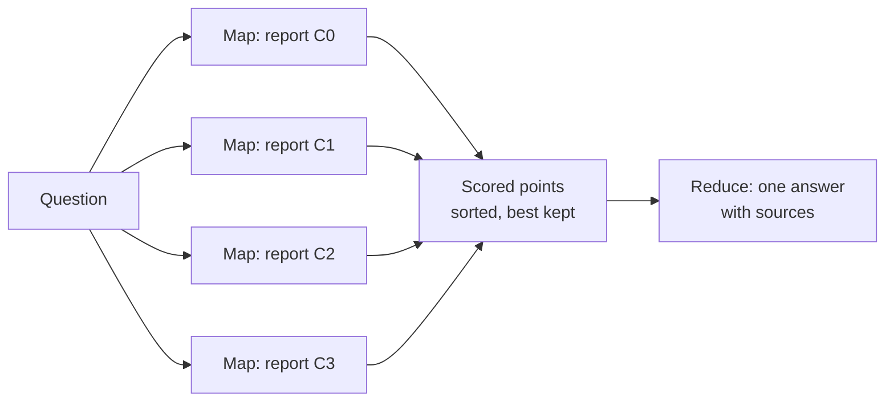

# GraphRAG: The Complete Guide

> 📚 **Before you start**
>
> - [Building a Knowledge Graph from Text with an LLM](building-a-knowledge-graph-from-text-with-an-llm.md): the Kiran Foods document graph with provenance, which this lesson retrieves from.
> - [Graph Algorithms: Paths, Centrality and Communities](../04-neo4j-and-cypher/graph-algorithms-paths-centrality-and-communities.md): breadth-first search, modularity and community detection.
> - How ordinary RAG works (embed chunks, retrieve the most similar, put them in the prompt): [Retrieval-Augmented Generation (RAG) › Introduction to RAG](../../retrieval-augmented-generation-rag/course.md#m2) and [Embeddings and Vector Databases](../../retrieval-augmented-generation-rag/course.md#m3).

## Introduction

Give a new manager a stack of 500 internal documents and two questions. First: *"If the ragi harvest fails, who needs to know?"* Second: *"What are the main risks across our projects right now?"*

A good manager answers the first by following links: ragi goes into the Millet Snacks Launch, Neha leads it, Deccan Millets grows it, Ravi manages that account. They answer the second by reading everything, grouping it into themes in their head, and summarising each theme. Neither answer comes from finding the two or three paragraphs that *sound most like* the question.

Yet that's exactly what ordinary RAG does: embed the question, fetch the most similar chunks, and hope the answer is inside them. It works brilliantly for "what does our leave policy say about maternity leave?" and poorly for the two questions above. **GraphRAG** is the family of techniques that retrieve from a knowledge graph built from the documents, so that retrieval can **follow links** (local search) and **summarise themes** (global search).

By the end of this lesson you'll be able to show where vector retrieval fails, build GraphRAG's local search (link entities, expand neighbourhoods, assemble context with sources) and global search (detect communities, write community reports, answer with map-reduce), explain Microsoft's GraphRAG pipeline and its query modes, and judge when the extra indexing cost is worth it.

> 💡 **Key Insight**
>
> GraphRAG moves work from query time to indexing time. Before any question is asked, an LLM turns the documents into a graph and the graph into summarised **communities**. Then a question can start from the entities it mentions and walk outwards (local search), or read the community summaries instead of every chunk (global search). You pay once at indexing for answers that plain similarity search can't reach.

---

## Core Explanation

### 1. Two questions ordinary RAG gets wrong

We'll use the eight Kiran Foods documents from the last lesson, and the graph built from them. First, a plain vector RAG baseline. To stay runnable offline, the "embedding" here is a word-count vector (a real system would use an embedding model; the failure we're about to see is the same):

```python
import json
import re
from collections import Counter, defaultdict, deque

import numpy as np

DOCS = {
    "doc01_supplier_review.txt": "Quarterly supplier review, September 2026. Deccan Millets in Hyderabad supplies ragi flour and jowar flour for the Millet Snacks Launch. Ravi Iyer manages the Deccan Millets account. Deliveries were on time.",
    "doc02_cold_chain.txt": "Cold Chain Upgrade status. Suresh Nair leads the Cold Chain Upgrade. FrostLine Cold Chain in Pune provides reefer trucks for the project. Farhan Shaikh manages the FrostLine account. There is an invoice on hold from FrostLine because its total does not add up.",
    "doc03_export.txt": "Export to UAE plan. Lakshmi Menon leads the Export to UAE project. Saurashtra Groundnut supplies groundnut kernels for it and has moved its packing unit to Gondal. Nashik Agro Pack supplies export cartons for the export project.",
    "doc04_packaging.txt": "Packaging note from Neha. Nashik Agro Pack supplies snack pouches for the Millet Snacks Launch. Nashik Agro Pack also supplies cartons to Malabar Spice House.",
    "doc05_spices.txt": "Malabar Spice House in Kochi supplies the chai masala blend for the Millet Snacks Launch. Kavya Reddy manages the Malabar Spice House account.",
    "doc06_quality.txt": "Quality incident, August 2026. A batch of ragi flour from Deccan Millets failed the moisture test. Deepak Joshi investigated the moisture test failure in the R&D lab. The batch was replaced within a week.",
    "doc07_org.txt": "Neha Gupta leads the Millet Snacks Launch. Deepak Joshi works on the Millet Snacks Launch as food scientist. Farhan Shaikh and Kavya Reddy report to Ravi Iyer, Head of Procurement.",
    "doc08_risk.txt": "Risk register. Monsoon crop risk: the Millet Snacks Launch depends on the ragi harvest, and if it fails Deccan Millets may raise prices.",
}
STOP = {"the", "a", "an", "and", "of", "for", "in", "to", "is", "it", "its", "if", "our", "who", "what", "are",
        "from", "as", "was", "were", "has", "be", "needs", "know", "across", "right", "now", "main", "there", "does", "not"}

def tokens(text):
    words = [w for w in re.findall(r"[a-z0-9]+", text.lower()) if w not in STOP]
    return [w[:-1] if len(w) > 4 and w.endswith("s") and not w.endswith("ss") else w for w in words]  # crude plural fix

VOCAB = sorted({w for t in DOCS.values() for w in tokens(t)})

def embed(text):
    v = np.array([Counter(tokens(text))[w] for w in VOCAB], dtype=float)
    return v / (np.linalg.norm(v) or 1.0)

DOC_IDS = list(DOCS)
DOC_VECS = np.stack([embed(DOCS[d]) for d in DOC_IDS])

def vector_search(question, k=2):
    scores = DOC_VECS @ embed(question)
    order = np.argsort(-scores, kind="stable")[:k]
    return [(DOC_IDS[i], round(float(scores[i]), 2)) for i in order]

Q_LOCAL = "If the ragi harvest fails, who needs to know?"
Q_GLOBAL = "What are the main risks across our projects and suppliers right now?"
print("local question ->", vector_search(Q_LOCAL))
print("global question ->", vector_search(Q_GLOBAL))
```

Output:

```
local question -> [('doc08_risk.txt', 0.37), ('doc06_quality.txt', 0.1)]
global question -> [('doc08_risk.txt', 0.25), ('doc03_export.txt', 0.17)]
```

For the local question, retrieval found the risk register and the quality incident, both about ragi. But the people who need to know are in **other** documents: who leads the launch (doc07) and who manages Deccan Millets (doc01). Those documents don't mention a harvest, so they don't look similar. The answer needs a **chain** of facts across documents, and similarity can only find the first link.

For the global question, retrieval found the risk register (the word "risk") and one more document. But the invoice on hold (doc02) and the failed moisture test (doc06) are risks too, written without the word. A question about the **whole collection** can't be answered from the top two chunks, and raising *k* to 50 just floods the prompt.

### 2. The GraphRAG idea

The approach Microsoft Research published in 2024 (and released as the open-source `graphrag` package) made the idea concrete. Indexing does far more than embed chunks:

![GraphRAG in two phases. Indexing: documents are split into text units, an LLM extracts entities and relationships with descriptions, duplicate descriptions are summarised, the Leiden algorithm groups entities into a hierarchy of communities, and an LLM writes a report for each community; text units and descriptions are also embedded. Querying: local search starts from entities named in the question and gathers their neighbours, relationships and source text; global search sends the question to every community report, collects scored points in a map step and combines the best in a reduce step; DRIFT search starts global and drills down locally; basic search is plain vector RAG](/img/diagrams/knowledge-graphs-ontologies-and-unstructured-data/graphrag.svg)
*Indexing is where the money goes: every text unit and every community passes through an LLM once. Querying then chooses how much of that structure to use.*

| Query mode | Starts from | Good for |
|---|---|---|
| **Local search** | Entities mentioned in the question, then their neighbourhood | Specific questions that need connected facts ("who needs to know if...") |
| **Global search** | All community reports, in map-reduce | Whole-collection questions ("main themes", "main risks") |
| **DRIFT search** | Community reports to set direction, then local search to drill in | Specific questions that also need wider context |
| **Basic search** | Plain vector search over text units | A baseline; simple look-up questions |

The rest of this lesson builds local and global search by hand on the Kiran Foods graph, so you can see every piece.

### 3. The graph we retrieve from

This is the graph from the last lesson (after validation and entity resolution), with the source document of every fact:

```python
TRIPLES = [
    ("Deccan Millets", "LOCATED_IN", "Hyderabad", "doc01_supplier_review.txt"),
    ("Deccan Millets", "SUPPLIES", "ragi flour", "doc01_supplier_review.txt"),
    ("Deccan Millets", "SUPPLIES", "jowar flour", "doc01_supplier_review.txt"),
    ("ragi flour", "USED_IN", "Millet Snacks Launch", "doc01_supplier_review.txt"),
    ("jowar flour", "USED_IN", "Millet Snacks Launch", "doc01_supplier_review.txt"),
    ("Ravi Iyer", "MANAGES_ACCOUNT", "Deccan Millets", "doc01_supplier_review.txt"),
    ("Suresh Nair", "LEADS", "Cold Chain Upgrade", "doc02_cold_chain.txt"),
    ("FrostLine Cold Chain", "LOCATED_IN", "Pune", "doc02_cold_chain.txt"),
    ("FrostLine Cold Chain", "SUPPLIES", "reefer trucks", "doc02_cold_chain.txt"),
    ("reefer trucks", "USED_IN", "Cold Chain Upgrade", "doc02_cold_chain.txt"),
    ("Farhan Shaikh", "MANAGES_ACCOUNT", "FrostLine Cold Chain", "doc02_cold_chain.txt"),
    ("invoice on hold", "AFFECTS", "FrostLine Cold Chain", "doc02_cold_chain.txt"),
    ("Lakshmi Menon", "LEADS", "Export to UAE", "doc03_export.txt"),
    ("Saurashtra Groundnut", "SUPPLIES", "groundnut kernels", "doc03_export.txt"),
    ("groundnut kernels", "USED_IN", "Export to UAE", "doc03_export.txt"),
    ("Saurashtra Groundnut", "LOCATED_IN", "Gondal", "doc03_export.txt"),
    ("Nashik Agro Pack", "SUPPLIES", "export cartons", "doc03_export.txt"),
    ("export cartons", "USED_IN", "Export to UAE", "doc03_export.txt"),
    ("Nashik Agro Pack", "SUPPLIES", "snack pouches", "doc04_packaging.txt"),
    ("snack pouches", "USED_IN", "Millet Snacks Launch", "doc04_packaging.txt"),
    ("Nashik Agro Pack", "SUPPLIES_TO", "Malabar Spice House", "doc04_packaging.txt"),
    ("Malabar Spice House", "LOCATED_IN", "Kochi", "doc05_spices.txt"),
    ("Malabar Spice House", "SUPPLIES", "chai masala blend", "doc05_spices.txt"),
    ("chai masala blend", "USED_IN", "Millet Snacks Launch", "doc05_spices.txt"),
    ("Kavya Reddy", "MANAGES_ACCOUNT", "Malabar Spice House", "doc05_spices.txt"),
    ("moisture test failure", "AFFECTS", "ragi flour", "doc06_quality.txt"),
    ("moisture test failure", "AFFECTS", "Deccan Millets", "doc06_quality.txt"),
    ("Deepak Joshi", "INVESTIGATED", "moisture test failure", "doc06_quality.txt"),
    ("Neha Gupta", "LEADS", "Millet Snacks Launch", "doc07_org.txt"),
    ("Deepak Joshi", "WORKS_ON", "Millet Snacks Launch", "doc07_org.txt"),
    ("Farhan Shaikh", "REPORTS_TO", "Ravi Iyer", "doc07_org.txt"),
    ("Kavya Reddy", "REPORTS_TO", "Ravi Iyer", "doc07_org.txt"),
    ("Monsoon crop risk", "AFFECTS", "Millet Snacks Launch", "doc08_risk.txt"),
    ("Monsoon crop risk", "AFFECTS", "Deccan Millets", "doc08_risk.txt"),
]
neighbours = defaultdict(set)
for s, _, o, _ in TRIPLES:
    neighbours[s].add(o)
    neighbours[o].add(s)
ENTITIES = sorted(neighbours)
print(len(ENTITIES), "entities,", len(TRIPLES), "relationships")
```

Output:

```
29 entities, 34 relationships
```

### 4. Local search, step by step

Local search has four steps: **link** the question to entities, **expand** to their neighbourhood, **assemble** a context from facts and source text, and **generate**.

**Step 1: entity linking.** Find graph entities the question mentions. Real systems embed entity names and descriptions and search them by vector; word overlap is enough here:

```python
def link_entities(question):
    q = set(tokens(question))
    return [e for e in ENTITIES if q & set(tokens(e))]

seeds = link_entities(Q_LOCAL)
print("seed entities:", seeds)
```

Output:

```
seed entities: ['ragi flour']
```

**Step 2: expand.** Breadth-first search from the seeds, up to two hops, recording how far each entity is:

```python
def expand(seeds, hops=2):
    distance = {s: 0 for s in seeds}
    queue = deque(seeds)
    while queue:
        node = queue.popleft()
        if distance[node] == hops:
            continue
        for nb in sorted(neighbours[node]):
            if nb not in distance:
                distance[nb] = distance[node] + 1
                queue.append(nb)
    return distance

dist = expand(seeds)
for d in range(3):
    print(f"hop {d}:", sorted(e for e, h in dist.items() if h == d))
```

Output:

```
hop 0: ['ragi flour']
hop 1: ['Deccan Millets', 'Millet Snacks Launch', 'moisture test failure']
hop 2: ['Deepak Joshi', 'Hyderabad', 'Monsoon crop risk', 'Neha Gupta', 'Ravi Iyer', 'chai masala blend', 'jowar flour', 'snack pouches']
```

Two hops from ragi flour reach the launch, its leader, the supplier, the supplier's account manager, both issues and the scientist who investigated one. Three hops would reach most of the graph, which is why the hop limit (and, in real systems, a token budget) matters.

**Step 3: assemble the context.** Collect the relationships between entities in the neighbourhood, ordered so that facts closest to the seed come first, and attach the source documents (GraphRAG calls them **text units**) that the facts came from:

```python
def local_context(question, hops=2, max_facts=12):
    dist = expand(link_entities(question), hops)
    facts = [(max(dist[s], dist[o]), s, r, o, src) for s, r, o, src in TRIPLES if s in dist and o in dist]
    facts.sort()
    facts = facts[:max_facts]
    sources = sorted({src for *_, src in facts})
    lines = ["## Facts"] + [f"- {s} {r} {o}  [{src.split('_')[0]}]" for _, s, r, o, src in facts]
    lines += ["## Sources"] + [f"[{src.split('_')[0]}] {DOCS[src]}" for src in sources]
    return "\n".join(lines), sources

context, sources = local_context(Q_LOCAL)
print(context)
```

Output:

```
## Facts
- Deccan Millets SUPPLIES ragi flour  [doc01]
- moisture test failure AFFECTS Deccan Millets  [doc06]
- moisture test failure AFFECTS ragi flour  [doc06]
- ragi flour USED_IN Millet Snacks Launch  [doc01]
- Deccan Millets LOCATED_IN Hyderabad  [doc01]
- Deccan Millets SUPPLIES jowar flour  [doc01]
- Deepak Joshi INVESTIGATED moisture test failure  [doc06]
- Deepak Joshi WORKS_ON Millet Snacks Launch  [doc07]
- Monsoon crop risk AFFECTS Deccan Millets  [doc08]
- Monsoon crop risk AFFECTS Millet Snacks Launch  [doc08]
- Neha Gupta LEADS Millet Snacks Launch  [doc07]
- Ravi Iyer MANAGES_ACCOUNT Deccan Millets  [doc01]
## Sources
[doc01] Quarterly supplier review, September 2026. Deccan Millets in Hyderabad supplies ragi flour and jowar flour for the Millet Snacks Launch. Ravi Iyer manages the Deccan Millets account. Deliveries were on time.
[doc06] Quality incident, August 2026. A batch of ragi flour from Deccan Millets failed the moisture test. Deepak Joshi investigated the moisture test failure in the R&D lab. The batch was replaced within a week.
[doc07] Neha Gupta leads the Millet Snacks Launch. Deepak Joshi works on the Millet Snacks Launch as food scientist. Farhan Shaikh and Kavya Reddy report to Ravi Iyer, Head of Procurement.
[doc08] Risk register. Monsoon crop risk: the Millet Snacks Launch depends on the ragi harvest, and if it fails Deccan Millets may raise prices.
```

Compare this with the vector baseline. The context now includes the leader of the launch (doc07) and the Deccan Millets account manager (doc01), neither of which looked similar to the question. Every fact carries a source tag, so the answer can cite its evidence.

**Step 4: generate.** The prompt is the question plus this context, with an instruction to cite sources. The pretend model returns the answer a real model gave:

```python
from langchain_core.language_models.fake_chat_models import FakeListChatModel

local_llm = FakeListChatModel(responses=[
    "Tell three people: Neha Gupta, who leads the Millet Snacks Launch that depends on the ragi harvest [doc07, doc08]; "
    "Ravi Iyer, who manages the Deccan Millets account, the ragi flour supplier that may raise prices [doc01, doc08]; "
    "and Deepak Joshi, who works on the launch and investigated the last ragi quality problem [doc06, doc07]."])
prompt = ("Answer using only the context. Cite sources in square brackets.\n\n"
          f"{context}\n\nQuestion: {Q_LOCAL}")
print(local_llm.invoke(prompt).content)
```

Output:

```
Tell three people: Neha Gupta, who leads the Millet Snacks Launch that depends on the ragi harvest [doc07, doc08]; Ravi Iyer, who manages the Deccan Millets account, the ragi flour supplier that may raise prices [doc01, doc08]; and Deepak Joshi, who works on the launch and investigated the last ragi quality problem [doc06, doc07].
```

### 5. Global search, part 1: communities

A whole-collection question needs a different approach. Reading every chunk at query time is too slow and too expensive. GraphRAG's answer is to **group the graph into communities** at indexing time and summarise each one. A community is a set of entities more connected to each other than to the rest, which in a company graph usually means a project, a team or a supply chain.

Microsoft's GraphRAG uses the **Leiden** algorithm, which optimises **modularity** (the score from the graph algorithms lesson) and produces a hierarchy of communities. Here is a simpler algorithm with the same goal: start with every entity alone, and repeatedly merge the two connected groups whose merger raises modularity the most, until no merger helps.

```python
EDGES = {tuple(sorted((s, o))) for s, _, o, _ in TRIPLES}
DEGREE = {e: len(neighbours[e]) for e in ENTITIES}
M = len(EDGES)

def links_between(a, b):
    return sum(1 for x, y in EDGES if (x in a and y in b) or (x in b and y in a))

def greedy_communities():
    groups = [{e} for e in ENTITIES]
    while True:
        best = None
        for i in range(len(groups)):
            for j in range(i + 1, len(groups)):
                links = links_between(groups[i], groups[j])
                if not links:
                    continue
                da, db = sum(DEGREE[e] for e in groups[i]), sum(DEGREE[e] for e in groups[j])
                gain = links / M - da * db / (2 * M * M)          # change in modularity if merged
                if gain > 1e-12 and (best is None or gain > best[0]):
                    best = (gain, i, j)
        if best is None:
            return sorted((sorted(g) for g in groups), key=len, reverse=True)
        _, i, j = best
        groups[i] |= groups[j]
        del groups[j]

COMMUNITIES = greedy_communities()
for n, members in enumerate(COMMUNITIES):
    print(f"C{n}:", members)
```

Output:

```
C0: ['Deccan Millets', 'Deepak Joshi', 'Hyderabad', 'Millet Snacks Launch', 'Monsoon crop risk', 'Neha Gupta', 'jowar flour', 'moisture test failure', 'ragi flour']
C1: ['Export to UAE', 'Gondal', 'Lakshmi Menon', 'Nashik Agro Pack', 'Saurashtra Groundnut', 'export cartons', 'groundnut kernels', 'snack pouches']
C2: ['Cold Chain Upgrade', 'FrostLine Cold Chain', 'Pune', 'Suresh Nair', 'invoice on hold', 'reefer trucks']
C3: ['Farhan Shaikh', 'Kavya Reddy', 'Kochi', 'Malabar Spice House', 'Ravi Iyer', 'chai masala blend']
```

Four readable groups appear without anyone defining them: the millet supply for the launch with its risks, the export project, the cold-chain project, and the procurement team with the spice supply. Leiden does the same at scale and, by running again on each community, builds levels: a few big communities at the top, many small ones below. Global search can then pick a level: high levels are cheaper and broader, low levels more detailed.

### 6. Global search, part 2: community reports

For each community, an LLM writes a **community report** at indexing time. In Microsoft's GraphRAG a report is structured JSON, roughly like this one for C0:

```json
{
  "title": "Millet Snacks Launch and its ragi supply",
  "summary": "The Millet Snacks Launch, led by Neha Gupta, depends on ragi and jowar flour from Deccan Millets in Hyderabad. Two issues affect this chain: a failed moisture test on a ragi batch and the monsoon crop risk.",
  "rating": 7.5,
  "rating_explanation": "High impact: the launch depends on one supplier exposed to two separate risks.",
  "findings": [
    {"summary": "Single-supplier dependence", "explanation": "Both flours come from Deccan Millets [doc01]."},
    {"summary": "Quality incident", "explanation": "A ragi batch failed the moisture test and was replaced within a week [doc06]."},
    {"summary": "Monsoon risk", "explanation": "A failed ragi harvest could raise Deccan Millets' prices [doc08]."}
  ]
}
```

To stay runnable, we'll write simpler reports from the graph itself: the community's members and all facts inside it, with sources. This is also what the LLM receives as input when it writes the real report.

```python
def community_report(members):
    inside = [(s, r, o, src) for s, r, o, src in TRIPLES if s in members and o in members]
    hub = max(members, key=lambda e: (DEGREE[e], e))
    lines = [f"Community around {hub} ({len(members)} entities)"]
    lines += [f"- {s} {r} {o} [{src.split('_')[0]}]" for s, r, o, src in inside]
    return "\n".join(lines)

REPORTS = [community_report(set(c)) for c in COMMUNITIES]
print(REPORTS[2])
```

Output:

```
Community around FrostLine Cold Chain (6 entities)
- Suresh Nair LEADS Cold Chain Upgrade [doc02]
- FrostLine Cold Chain LOCATED_IN Pune [doc02]
- FrostLine Cold Chain SUPPLIES reefer trucks [doc02]
- reefer trucks USED_IN Cold Chain Upgrade [doc02]
- invoice on hold AFFECTS FrostLine Cold Chain [doc02]
```

### 7. Global search, part 3: map and reduce

Global search answers a question in two LLM stages:

1. **Map**: send the question with *each* community report separately. The model returns the points from that report that help answer it, each with an importance score (0 means "nothing relevant here").
2. **Reduce**: collect all points, sort by score, keep the best that fit the token budget, and ask the model for one final answer from them.



```python
MAP_REPLIES = [
    {"points": [{"description": "The Millet Snacks Launch depends on ragi from one supplier, Deccan Millets, which faces monsoon crop risk [doc08].", "score": 90},
                {"description": "A ragi batch from Deccan Millets failed the moisture test in August [doc06].", "score": 70}]},
    {"points": [{"description": "Nashik Agro Pack and Saurashtra Groundnut, which supply the Export to UAE project, have no account manager recorded [doc03, doc04].", "score": 30}]},
    {"points": [{"description": "An invoice from FrostLine Cold Chain, the reefer truck supplier for the Cold Chain Upgrade, is on hold because its total does not add up [doc02].", "score": 60}]},
    {"points": []},
]
map_llm = FakeListChatModel(responses=[json.dumps(r) for r in MAP_REPLIES])

points = []
for n, report in enumerate(REPORTS):
    reply = json.loads(map_llm.invoke(
        "From this community report, list points that help answer the question, each with a score 0-100. "
        f'Return JSON {{"points": [...]}}.\n\nReport:\n{report}\n\nQuestion: {Q_GLOBAL}').content)
    for p in reply["points"]:
        points.append((p["score"], f"C{n}", p["description"]))
    print(f"map C{n}: {len(reply['points'])} point(s)")

points.sort(reverse=True)
for score, community, text in points:
    print(f"{score:>3} {community} {text}")
```

Output:

```
map C0: 2 point(s)
map C1: 1 point(s)
map C2: 1 point(s)
map C3: 0 point(s)
 90 C0 The Millet Snacks Launch depends on ragi from one supplier, Deccan Millets, which faces monsoon crop risk [doc08].
 70 C0 A ragi batch from Deccan Millets failed the moisture test in August [doc06].
 60 C2 An invoice from FrostLine Cold Chain, the reefer truck supplier for the Cold Chain Upgrade, is on hold because its total does not add up [doc02].
 30 C1 Nashik Agro Pack and Saurashtra Groundnut, which supply the Export to UAE project, have no account manager recorded [doc03, doc04].
```

The procurement-team community (C3) contributed nothing, which is the point of scores: irrelevant communities drop out instead of diluting the context. The reduce step writes the final answer from the sorted points:

```python
reduce_llm = FakeListChatModel(responses=[
    "Three risks stand out. (1) Supply concentration with a weather exposure: the Millet Snacks Launch relies on ragi "
    "from Deccan Millets alone, and a poor monsoon harvest could raise prices [doc08]; the same supplier had a ragi "
    "batch fail the moisture test in August [doc06]. (2) A billing dispute with FrostLine Cold Chain, whose trucks the "
    "Cold Chain Upgrade needs, has an invoice on hold [doc02]. (3) A governance gap: no account manager is recorded "
    "for Nashik Agro Pack or Saurashtra Groundnut, the two suppliers of the Export to UAE project [doc03, doc04]."])
best = "\n".join(f"- ({score}) {text}" for score, _, text in points[:5])
print(reduce_llm.invoke(f"Combine these points into one answer.\n{best}\n\nQuestion: {Q_GLOBAL}").content)
```

Output:

```
Three risks stand out. (1) Supply concentration with a weather exposure: the Millet Snacks Launch relies on ragi from Deccan Millets alone, and a poor monsoon harvest could raise prices [doc08]; the same supplier had a ragi batch fail the moisture test in August [doc06]. (2) A billing dispute with FrostLine Cold Chain, whose trucks the Cold Chain Upgrade needs, has an invoice on hold [doc02]. (3) A governance gap: no account manager is recorded for Nashik Agro Pack or Saurashtra Groundnut, the two suppliers of the Export to UAE project [doc03, doc04].
```

Notice the third risk. It's not written anywhere as a risk; it emerged from the graph's structure (suppliers with no `MANAGES_ACCOUNT` link) once the export community's facts were summarised together. That kind of answer is out of reach for chunk retrieval.

### 8. Costs, and when GraphRAG is worth it

GraphRAG isn't free, and the indexing bill surprises people:

| Cost | Vector RAG | GraphRAG |
|---|---|---|
| Indexing | Embed each chunk (cheap) | LLM extraction per chunk, description summaries, a report per community at every level (many LLM calls) |
| Local query | One retrieval, one LLM call | Entity linking, graph expansion, one LLM call |
| Global query | Not really possible | One LLM call per community report at the chosen level, plus reduce |
| Updating | Embed new chunks | Extract new chunks, re-detect communities, rewrite affected reports |

Ways teams reduce the cost: use a smaller, cheaper model for extraction and report writing; run global search at a high community level (fewer, larger reports); and use lazier variants. Microsoft Research's **LazyGraphRAG** defers most LLM summarisation to query time, so indexing costs about as much as vector RAG while keeping much of the benefit for global questions.

When to choose what:

- Mostly **look-up questions** ("what is the policy on X?"): vector RAG, perhaps with hybrid keyword search. GraphRAG adds cost without much gain.
- **Connected questions** across documents ("who is affected if...", "which suppliers of X also..."): local graph retrieval, often combined with vectors (the next lesson).
- **Sensemaking over a corpus** ("main themes", "emerging risks", "what changed this quarter"): global search over community reports.
- **Exact numbers and filters** ("how many suppliers in Gujarat"): neither; generate a database query instead (text-to-Cypher, two lessons from now).

### 9. Running Microsoft GraphRAG

The `graphrag` package runs the whole pipeline from a folder of text files. The project is set up with `init`, indexed with `index`, and queried with `query` and a method:

```bash
pip install graphrag
graphrag init --root ./kiran                 # writes settings.yaml, .env and default prompts
# put the .txt documents in ./kiran/input/, set the model and API key in settings.yaml and .env
graphrag index --root ./kiran                # extraction, communities, reports, embeddings
graphrag query "What are the main risks across our projects and suppliers?" --root ./kiran --method global
graphrag query "If the ragi harvest fails, who needs to know?" --root ./kiran --method local
```

Example output (the answer text, abridged):

```
## Key risks
- **Supply concentration**: the Millet Snacks Launch depends on Deccan Millets for ragi, which is exposed to
  monsoon crop risk and had a failed moisture test [Data: Reports (0, 2)].
- **Billing dispute**: an invoice from FrostLine Cold Chain is on hold [Data: Reports (3)].
```

Two practical notes. The default prompts are generic; GraphRAG includes a **prompt tuning** step that adapts the extraction prompts to your domain, and for a business domain you'll get better graphs by giving it your own entity types (in effect, your ontology). And the index is a set of tables (entities, relationships, communities, reports, text units) that you can load into Neo4j to query the same graph with Cypher.

Other implementations of the same ideas: Neo4j's `neo4j-graphrag` package (retrievers that combine vector search with Cypher expansion), LangChain and LlamaIndex graph retrievers, and several open-source "light" GraphRAG variants that skip community reports to save cost.

---

## Try It Yourself

1. **More hops.** Run `local_context(Q_LOCAL, hops=3)`. How many facts and sources do you get, compared with two hops? What does that tell you about choosing the hop limit?
2. **A new local question.** Use `link_entities` and `local_context` for *"Who handles the FrostLine account and what is wrong with it?"* Which seeds are found and which documents end up in the context?
3. **Score the baseline.** For the global question, the relevant documents are doc02, doc04, doc06 and doc08. What fraction does `vector_search(Q_GLOBAL, k=4)` retrieve, and what fraction do the sources of the community points cover?

<details>
<summary>Show answers</summary>

**1.**

```python
for hops in (1, 2, 3):
    ctx, srcs = local_context(Q_LOCAL, hops=hops, max_facts=100)
    n_facts = sum(1 for line in ctx.splitlines() if line.startswith("- "))
    print(f"hops={hops}: {n_facts} facts from {len(srcs)} documents")
```

Output:

```
hops=1: 4 facts from 2 documents
hops=2: 15 facts from 6 documents
hops=3: 21 facts from 6 documents
```

One hop misses the people. Three hops adds six more facts, all further from the question (other products of the launch, reporting lines), and on a real graph each extra hop multiplies the context. Two is a common default, with a fact limit or token budget on top, and ranking by distance so the closest facts survive the cut.

**2.**

```python
q = "Who handles the FrostLine account and what is wrong with it?"
print("seeds:", link_entities(q))
ctx, srcs = local_context(q, hops=1)
print(ctx.split("## Sources")[0])
print("sources:", srcs)
```

Output:

```
seeds: ['FrostLine Cold Chain']
## Facts
- Farhan Shaikh MANAGES_ACCOUNT FrostLine Cold Chain  [doc02]
- FrostLine Cold Chain LOCATED_IN Pune  [doc02]
- FrostLine Cold Chain SUPPLIES reefer trucks  [doc02]
- invoice on hold AFFECTS FrostLine Cold Chain  [doc02]

sources: ['doc02_cold_chain.txt']
```

One hop is enough here: the account manager and the issue are both direct neighbours.

**3.**

```python
relevant = {"doc02_cold_chain.txt", "doc04_packaging.txt", "doc06_quality.txt", "doc08_risk.txt"}
got = {d for d, _ in vector_search(Q_GLOBAL, k=4)}
print("vector recall@4:", len(got & relevant) / len(relevant), sorted(got))
cited = set(re.findall(r"doc\d+", " ".join(text for _, _, text in points)))
print("community points cover:", sorted(cited))
```

Output:

```
vector recall@4: 0.5 ['doc01_supplier_review.txt', 'doc02_cold_chain.txt', 'doc03_export.txt', 'doc08_risk.txt']
community points cover: ['doc02', 'doc03', 'doc04', 'doc06', 'doc08']
```

Even with four chunks, vector search finds only half of the relevant documents for a whole-collection question, while the community points cite all four (and doc03, which completes the picture of the export suppliers).

</details>

---

## Real-World Examples

- **Intelligence and investigations**: analysts ask global questions over thousands of reports ("what networks are active in this region?"), the use case GraphRAG was first designed for.
- **Enterprise knowledge assistants** that answer "who should I talk to about X?" by walking people-project-system graphs built from documents.
- **Supply-chain risk** monitoring: suppliers, sites, products and incidents extracted from news and internal reports, with community summaries per supply chain.
- **Research literature**: themes across hundreds of papers ("what methods are used for X, and where do findings disagree?").
- **Customer feedback**: global search across reviews and tickets to surface themes, with local search to drill into one product.

---

## Common Misconceptions

### "GraphRAG replaces vector RAG"

It complements it. Look-up questions are still answered best by vector or hybrid search; most production systems combine both, as the next lesson shows.

### "GraphRAG just means putting graph facts in the prompt"

That's part of local search. The distinctive part of Microsoft's GraphRAG is global search over community reports, which answers questions about a whole collection.

### "The graph makes answers correct"

The graph is built by an LLM and inherits its extraction errors. Validation, provenance and citations still matter, and answers should cite text units, not just entities.

### "Indexing is a one-off cost"

New documents change communities and reports. Budget for incremental updates, or choose a lazier variant.

---

## Interview Relevance

Expect *"What is GraphRAG and when would you use it over standard RAG?"* or *"How does GraphRAG answer global questions?"* A strong answer explains where vector retrieval fails (multi-hop and whole-corpus questions), the indexing pipeline (extraction with descriptions, community detection with Leiden, community reports, embeddings), local search (entity linking, neighbourhood expansion, context with text units), global search (map-reduce over community reports with scored points), DRIFT and basic search, the indexing cost and cheaper variants such as LazyGraphRAG, and a decision rule for when each retrieval style fits.

---

## Key Takeaways

- **Vector retrieval finds similar text**; it misses facts linked across documents and can't summarise a whole collection.
- **Local search** links the question to entities, expands a few hops, and assembles facts plus their source text with citations.
- **Global search** answers whole-collection questions by map-reduce over community reports written at indexing time.
- **Communities come from modularity-based clustering** (Leiden in practice) and form a hierarchy you can query at different levels.
- **GraphRAG trades indexing cost for answer quality** on connected and global questions; use it where those questions matter.

---

**Up next:** [Hybrid Retrieval: Graphs plus Vectors](hybrid-retrieval-graphs-plus-vectors.md)
