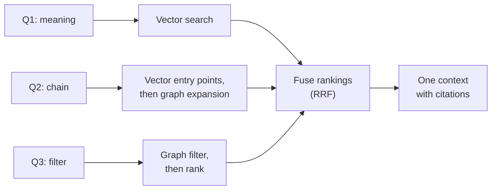

# Hybrid Retrieval: Graphs plus Vectors: The Complete Guide

> 📚 **Before you start**
>
> - [GraphRAG](graphrag.md): local search (link, expand, assemble) and why vector retrieval misses connected facts.
> - [Building a Knowledge Graph from Text with an LLM](building-a-knowledge-graph-from-text-with-an-llm.md): the lexical graph, where every entity links back to the chunks that mention it.
> - [Knowledge Graphs vs Relational Databases vs Vector Stores](../02-entities-and-relationships/knowledge-graphs-vs-relational-databases-vs-vector-stores.md): what each kind of store is good at.
> - Embeddings, similarity search and keyword-plus-vector hybrid search: [Retrieval-Augmented Generation (RAG) › Embeddings and Vector Databases](../../retrieval-augmented-generation-rag/course.md#m3) and [Implementing RAG](../../retrieval-augmented-generation-rag/course.md#m6).

## Introduction

Think of how you'd find a good electrician in a new city. You might search online for "reliable electrician near me" (a fuzzy, meaning-based search), then ask, "has anyone in our building's WhatsApp group used them?" (a relationship check). Neither alone is enough: the search finds candidates you couldn't have named, and the relationships tell you which ones to trust.

Retrieval for agents works the same way. **Vectors** are good at fuzzy meaning: "quality problems with flour" finds a note about a "failed moisture test" even though they share almost no words. **Graphs** are good at relationships and exact constraints: "the account manager of the supplier of reefer trucks" or "suppliers located in Maharashtra". Real questions usually need both, and the last lesson's local search quietly relied on a weak form of the first (word overlap to find seed entities).

This lesson builds **hybrid retrieval** properly. By the end you'll be able to use vector search to find entry points and the graph to expand from them, use the graph to filter before ranking by similarity, merge separate ranked lists with reciprocal rank fusion, assemble the result into one context with citations, and write the same patterns in Neo4j with a vector index and Cypher.

> 💡 **Key Insight**
>
> Let each store do what it's good at, and connect them through the chunks. Vectors find *which passages* are about the question; the lexical graph says *which entities* those passages mention; the domain graph says *what those entities are connected to*. Hybrid retrieval is just walking that bridge in whichever direction the question needs.

---

## Core Explanation

### 1. Three questions, three kinds of need

We'll test every retriever on three questions about the Kiran Foods documents:

| Question | What it needs |
|---|---|
| Q1 *"Have we had any quality problems with flour?"* | **Meaning**: the note says "failed the moisture test", not "quality problem" |
| Q2 *"Who manages the account of the company that provides our reefer trucks?"* | **A relationship chain**: reefer trucks → supplier → account manager |
| Q3 *"Which of our suppliers are in Maharashtra, and what do they provide?"* | **An exact filter**: a property (state) that no passage states in words |



### 2. Chunks, a stand-in embedding, and the graph

This time we split the documents into sentences, so retrieval works at passage level. For embeddings, real systems call an embedding model. To keep this runnable offline we use a **pretend embedding model**: word counts, plus a small table of related words standing in for what a real model learns (that "problem", "failed" and "incident" are about issues, for example). The table is the only thing "smart" about it, and it's enough to show the behaviour.

```python
import re
from collections import Counter, defaultdict

import numpy as np

DOCS = {
    "doc01": "Quarterly supplier review, September 2026. Deccan Millets in Hyderabad supplies ragi flour and jowar flour for the Millet Snacks Launch. Ravi Iyer manages the Deccan Millets account. Deliveries were on time.",
    "doc02": "Cold Chain Upgrade status. Suresh Nair leads the Cold Chain Upgrade. FrostLine Cold Chain in Pune provides reefer trucks for the project. Farhan Shaikh manages the FrostLine account. There is an invoice on hold from FrostLine because its total does not add up.",
    "doc03": "Export to UAE plan. Lakshmi Menon leads the Export to UAE project. Saurashtra Groundnut supplies groundnut kernels for it and has moved its packing unit to Gondal. Nashik Agro Pack supplies export cartons for the export project.",
    "doc04": "Packaging note from Neha. Nashik Agro Pack supplies snack pouches for the Millet Snacks Launch. Nashik Agro Pack also supplies cartons to Malabar Spice House.",
    "doc05": "Malabar Spice House in Kochi supplies the chai masala blend for the Millet Snacks Launch. Kavya Reddy manages the Malabar Spice House account.",
    "doc06": "Quality incident, August 2026. A batch of ragi flour from Deccan Millets failed the moisture test. Deepak Joshi investigated the moisture test failure in the R&D lab. The batch was replaced within a week.",
    "doc07": "Neha Gupta leads the Millet Snacks Launch. Deepak Joshi works on the Millet Snacks Launch as food scientist. Farhan Shaikh and Kavya Reddy report to Ravi Iyer, Head of Procurement.",
    "doc08": "Risk register. Monsoon crop risk: the Millet Snacks Launch depends on the ragi harvest, and if it fails Deccan Millets may raise prices.",
}
CHUNKS = {}
for doc_id, text in DOCS.items():
    for i, sentence in enumerate(re.split(r"(?<=\.)\s+", text)):
        CHUNKS[f"{doc_id}#s{i}"] = sentence

STOP = {"the", "a", "an", "and", "of", "for", "in", "to", "is", "it", "its", "if", "our", "we", "who", "what", "which",
        "are", "from", "as", "was", "were", "has", "have", "had", "any", "be", "do", "they", "there", "does", "not", "with"}
RELATED = {  # what a real embedding model learns from data; here, a hand-made stand-in
    "problem": "issue", "problems": "issue", "failed": "issue", "failure": "issue", "incident": "issue",
    "hold": "issue", "risk": "issue", "quality": "issue", "flour": "grain", "ragi": "grain", "jowar": "grain",
    "provides": "supply", "supplies": "supply", "supplier": "supply", "suppliers": "supply", "provide": "supply",
    "company": "organisation", "manages": "manage", "manage": "manage",
}

def features(text):
    words = [w for w in re.findall(r"[a-z0-9]+", text.lower()) if w not in STOP]
    return words + [RELATED[w] for w in words if w in RELATED]

VOCAB = sorted({f for t in CHUNKS.values() for f in features(t)} | set(RELATED.values()))

def embed(text):
    v = np.array([Counter(features(text))[f] for f in VOCAB], dtype=float)
    return v / (np.linalg.norm(v) or 1.0)

CHUNK_IDS = list(CHUNKS)
MATRIX = np.stack([embed(CHUNKS[c]) for c in CHUNK_IDS])
print(len(CHUNKS), "chunks; vectors of length", MATRIX.shape[1])
print("example:", "doc06#s1 ->", CHUNKS["doc06#s1"])
```

Output:

```
27 chunks; vectors of length 113
example: doc06#s1 -> A batch of ragi flour from Deccan Millets failed the moisture test.
```

Now the graph from the last two lessons, plus the **lexical links**: which chunk mentions which entity. Places also carry a `state` property, the kind of structured fact that isn't written in any sentence.

```python
TRIPLES = [
    ("Deccan Millets", "LOCATED_IN", "Hyderabad"), ("Deccan Millets", "SUPPLIES", "ragi flour"),
    ("Deccan Millets", "SUPPLIES", "jowar flour"), ("ragi flour", "USED_IN", "Millet Snacks Launch"),
    ("jowar flour", "USED_IN", "Millet Snacks Launch"), ("Ravi Iyer", "MANAGES_ACCOUNT", "Deccan Millets"),
    ("Suresh Nair", "LEADS", "Cold Chain Upgrade"), ("FrostLine Cold Chain", "LOCATED_IN", "Pune"),
    ("FrostLine Cold Chain", "SUPPLIES", "reefer trucks"), ("reefer trucks", "USED_IN", "Cold Chain Upgrade"),
    ("Farhan Shaikh", "MANAGES_ACCOUNT", "FrostLine Cold Chain"), ("invoice on hold", "AFFECTS", "FrostLine Cold Chain"),
    ("Lakshmi Menon", "LEADS", "Export to UAE"), ("Saurashtra Groundnut", "SUPPLIES", "groundnut kernels"),
    ("groundnut kernels", "USED_IN", "Export to UAE"), ("Saurashtra Groundnut", "LOCATED_IN", "Gondal"),
    ("Nashik Agro Pack", "SUPPLIES", "export cartons"), ("export cartons", "USED_IN", "Export to UAE"),
    ("Nashik Agro Pack", "SUPPLIES", "snack pouches"), ("snack pouches", "USED_IN", "Millet Snacks Launch"),
    ("Nashik Agro Pack", "SUPPLIES_TO", "Malabar Spice House"), ("Malabar Spice House", "LOCATED_IN", "Kochi"),
    ("Malabar Spice House", "SUPPLIES", "chai masala blend"), ("chai masala blend", "USED_IN", "Millet Snacks Launch"),
    ("Kavya Reddy", "MANAGES_ACCOUNT", "Malabar Spice House"), ("moisture test failure", "AFFECTS", "ragi flour"),
    ("Deepak Joshi", "INVESTIGATED", "moisture test failure"), ("Neha Gupta", "LEADS", "Millet Snacks Launch"),
    ("Monsoon crop risk", "AFFECTS", "Millet Snacks Launch"), ("Monsoon crop risk", "AFFECTS", "Deccan Millets"),
]
TYPE = {"Supplier": ["Deccan Millets", "FrostLine Cold Chain", "Saurashtra Groundnut", "Nashik Agro Pack", "Malabar Spice House"],
        "Place": ["Hyderabad", "Pune", "Gondal", "Kochi"]}
STATE = {"Hyderabad": "Telangana", "Pune": "Maharashtra", "Gondal": "Gujarat", "Kochi": "Kerala"}
ENTITIES = sorted({s for s, _, _ in TRIPLES} | {o for _, _, o in TRIPLES})

ALIASES = {"FrostLine": "FrostLine Cold Chain"}           # resolved in the construction lesson
MENTIONS = defaultdict(set)                                  # chunk id -> entities it mentions
for cid, text in CHUNKS.items():
    for name in ENTITIES + list(ALIASES):
        if name.lower() in text.lower():
            MENTIONS[cid].add(ALIASES.get(name, name))
CHUNKS_OF = defaultdict(set)                                 # entity -> chunks that mention it
for cid, ents in MENTIONS.items():
    for e in ents:
        CHUNKS_OF[e].add(cid)
print("doc02#s3 mentions:", sorted(MENTIONS["doc02#s3"]))
print("FrostLine Cold Chain is mentioned in:", sorted(CHUNKS_OF["FrostLine Cold Chain"]))
```

Output:

```
doc02#s3 mentions: ['Farhan Shaikh', 'FrostLine Cold Chain']
FrostLine Cold Chain is mentioned in: ['doc02#s2', 'doc02#s3', 'doc02#s4']
```

`MENTIONS` and `CHUNKS_OF` are the bridge between the two worlds. In Neo4j they're the `(entity)-[:FROM_CHUNK]->(chunk)` relationships of the lexical graph.

### 3. Vector search alone

```python
def vector_search(question, k=3):
    scores = MATRIX @ embed(question)
    order = np.argsort(-scores, kind="stable")[:k]
    return [(CHUNK_IDS[i], round(float(scores[i]), 2)) for i in order]

QUESTIONS = {
    "Q1": "Have we had any quality problems with flour?",
    "Q2": "Who manages the account of the company that provides our reefer trucks?",
    "Q3": "Which of our suppliers are in Maharashtra, and what do they provide?",
}
for qid, q in QUESTIONS.items():
    print(qid, q)
    for cid, score in vector_search(q):
        print(f"   {score:.2f} {cid}: {CHUNKS[cid]}")
```

Output:

```
Q1 Have we had any quality problems with flour?
   0.67 doc06#s0: Quality incident, August 2026.
   0.52 doc06#s1: A batch of ragi flour from Deccan Millets failed the moisture test.
   0.44 doc08#s0: Risk register.
Q2 Who manages the account of the company that provides our reefer trucks?
   0.47 doc02#s2: FrostLine Cold Chain in Pune provides reefer trucks for the project.
   0.43 doc02#s3: Farhan Shaikh manages the FrostLine account.
   0.40 doc01#s2: Ravi Iyer manages the Deccan Millets account.
Q3 Which of our suppliers are in Maharashtra, and what do they provide?
   0.41 doc01#s0: Quarterly supplier review, September 2026.
   0.33 doc02#s2: FrostLine Cold Chain in Pune provides reefer trucks for the project.
   0.32 doc04#s1: Nashik Agro Pack supplies snack pouches for the Millet Snacks Launch.
```

Read the three results:

- **Q1** works well. The quality-incident and moisture-test sentences rank at the top although they never say "quality problem"; that's what meaning-based search is for.
- **Q2** looks fine, but only by luck. Farhan's sentence ranks second because it's short and shares "manages" and "account" with the question, just ahead of Ravi's sentence about a different supplier. Nothing in similarity connects "the company that provides our reefer trucks" to FrostLine. Ask the same thing in other words and the luck runs out:

```python
for cid, score in vector_search("Who looks after the account of our reefer truck supplier?", k=4):
    print(f"   {score:.2f} {cid}: {CHUNKS[cid]}")
```

Output:

```
   0.41 doc01#s0: Quarterly supplier review, September 2026.
   0.33 doc02#s2: FrostLine Cold Chain in Pune provides reefer trucks for the project.
   0.20 doc02#s3: Farhan Shaikh manages the FrostLine account.
   0.19 doc01#s2: Ravi Iyer manages the Deccan Millets account.
```

  A heading wins, and the answer drops to third, barely ahead of the wrong supplier's account manager.
- **Q3** can't be trusted. No sentence says "Maharashtra"; FrostLine's sentence appears only because it contains "provide", and Nashik Agro Pack appears because it contains "supplies". The fact that Pune is in Maharashtra lives in the graph as a property, not in the text.

### 4. Pattern 1: vector entry points, then graph expansion

For Q2, use vector search only to find **where to start**, then follow the graph. The steps: take the top passages, look up the entities they mention, collect the facts one hop around those entities, and fetch the passages that support those facts.

```python
def facts_about(entities):
    return [(s, r, o) for s, r, o in TRIPLES if s in entities or o in entities]

def vector_then_graph(question, k=1):
    entry = [cid for cid, _ in vector_search(question, k)]
    seeds = set().union(*(MENTIONS[c] for c in entry))
    facts = facts_about(seeds)
    support = sorted({c for s, _, o in facts for c in CHUNKS_OF[s] & CHUNKS_OF[o]})
    return entry, seeds, facts, support

entry, seeds, facts, support = vector_then_graph(QUESTIONS["Q2"])
print("entry passage:", entry, "->", sorted(seeds))
for f in facts:
    print("  fact:", *f)
print("supporting passages:", support)
```

Output:

```
entry passage: ['doc02#s2'] -> ['FrostLine Cold Chain', 'Pune', 'reefer trucks']
  fact: FrostLine Cold Chain LOCATED_IN Pune
  fact: FrostLine Cold Chain SUPPLIES reefer trucks
  fact: reefer trucks USED_IN Cold Chain Upgrade
  fact: Farhan Shaikh MANAGES_ACCOUNT FrostLine Cold Chain
  fact: invoice on hold AFFECTS FrostLine Cold Chain
supporting passages: ['doc02#s2', 'doc02#s3', 'doc02#s4']
```

The entry passage named FrostLine Cold Chain; one hop in the graph gives `Farhan Shaikh MANAGES_ACCOUNT FrostLine Cold Chain`, which is the answer, and the supporting passage `doc02#s3` that a citation can point to. Using only the *top* passage as entry point (`k=1`) keeps the expansion focused; in practice you take a few and cap the number of facts.

### 5. Pattern 2: graph filter, then rank

For Q3, the graph does the heavy lifting: find suppliers whose location is a place in Maharashtra, then gather what they supply. If many entities passed the filter, you'd rank their passages by vector similarity to the question; here the filter is already decisive.

```python
def suppliers_in_state(state):
    places = {p for p in TYPE["Place"] if STATE[p] == state}
    return sorted(s for s, r, o in TRIPLES if r == "LOCATED_IN" and o in places)

def graph_filter_then_rank(question, state, k=3):
    found = suppliers_in_state(state)
    facts = [(s, r, o) for s, r, o in TRIPLES if s in found and r == "SUPPLIES"]
    candidates = sorted(set().union(*(CHUNKS_OF[s] for s in found)))
    q = embed(question)
    ranked = sorted(candidates, key=lambda c: -float(MATRIX[CHUNK_IDS.index(c)] @ q))[:k]
    return found, facts, ranked

found, facts, ranked = graph_filter_then_rank(QUESTIONS["Q3"], "Maharashtra")
print("suppliers in Maharashtra:", found)
print("they supply:", [o for _, _, o in facts])
print("best passages:", [(c, CHUNKS[c]) for c in ranked[:2]])
```

Output:

```
suppliers in Maharashtra: ['FrostLine Cold Chain']
they supply: ['reefer trucks']
best passages: [('doc02#s2', 'FrostLine Cold Chain in Pune provides reefer trucks for the project.'), ('doc02#s3', 'Farhan Shaikh manages the FrostLine account.')]
```

The answer (FrostLine Cold Chain, which provides reefer trucks) came from a fact no passage states: Pune's state. This is also how you apply **access control and metadata filters** in hybrid systems: the graph (or a metadata index) decides what's allowed or relevant, and similarity only ranks inside that set.

Notice one gap in the answer, too: Nashik Agro Pack is in Nashik, Maharashtra, but no document gives its location, so the graph doesn't know. Hybrid retrieval can only be as complete as the graph; a missing `LOCATED_IN` is a data quality task, not a retrieval bug.

### 6. Pattern 3: run both, then fuse the rankings

Often you don't know in advance which retriever suits a question. Run them in parallel and merge their ranked lists. The standard way to merge lists whose scores aren't comparable (cosine similarity versus graph distance) is **reciprocal rank fusion (RRF)**: each item scores the sum of 1 / (k + rank) over the lists it appears in, with k usually 60. Ranks matter; raw scores don't.

```python
def graph_ranking(question, hops_from_top=1):
    """Passages ranked by how close their entities are to the entities in the top vector hit."""
    _, seeds, facts, support = vector_then_graph(question, k=hops_from_top)
    ranked = support + sorted(c for c in CHUNKS if MENTIONS[c] & seeds and c not in support)
    return ranked

def rrf(*rankings, k=60):
    scores = defaultdict(float)
    for ranking in rankings:
        for rank, item in enumerate(ranking, start=1):
            scores[item] += 1 / (k + rank)
    return sorted(scores, key=lambda item: (-scores[item], item))

q = QUESTIONS["Q2"]
vec = [c for c, _ in vector_search(q, k=6)]
graph = graph_ranking(q)
fused = rrf(vec, graph)
print("vector :", vec[:4])
print("graph  :", graph[:4])
print("fused  :", fused[:4])
print("\ntop fused passage:", CHUNKS[fused[0]])
```

Output:

```
vector : ['doc02#s2', 'doc02#s3', 'doc01#s2', 'doc05#s1']
graph  : ['doc02#s2', 'doc02#s3', 'doc02#s4']
fused  : ['doc02#s2', 'doc02#s3', 'doc01#s2', 'doc02#s4']

top fused passage: FrostLine Cold Chain in Pune provides reefer trucks for the project.
```

The two passages both retrievers agree on (the reefer-truck sentence and Farhan's account) lead the fused list with a clear margin. The invoice-on-hold passage, which only the graph found, enters the top four, and the wrong-supplier passage keeps a place only because vector search ranked it. With the luckier wording of Q2 the lists happened to agree; fusion makes the result hold up when they don't. RRF is simple, needs no tuning, and is the default fusion method in many search engines; a **reranker** (a model that scores each question-passage pair directly) can be applied after fusion when you need more precision.

### 7. Assembling one context

Whatever the retrieval pattern, the LLM should receive one well-organised context: graph facts (short, precise) first, then the supporting passages (for wording and detail), each with an ID it can cite.

```python
def build_context(facts, passages, max_words=120):
    lines, used = ["## Facts from the knowledge graph"], 0
    for s, r, o in facts:
        lines.append(f"- {s} {r} {o}")
    lines.append("## Passages")
    for cid in passages:
        words = len(CHUNKS[cid].split())
        if used + words > max_words:
            break
        lines.append(f"[{cid}] {CHUNKS[cid]}")
        used += words
    return "\n".join(lines)

_, _, facts, support = vector_then_graph(QUESTIONS["Q2"])
print(build_context([f for f in facts if f[1] in ("MANAGES_ACCOUNT", "SUPPLIES")], support))
```

Output:

```
## Facts from the knowledge graph
- FrostLine Cold Chain SUPPLIES reefer trucks
- Farhan Shaikh MANAGES_ACCOUNT FrostLine Cold Chain
## Passages
[doc02#s2] FrostLine Cold Chain in Pune provides reefer trucks for the project.
[doc02#s3] Farhan Shaikh manages the FrostLine account.
[doc02#s4] There is an invoice on hold from FrostLine because its total does not add up.
```

Facts are cheap in tokens and unambiguous; passages let the model quote and let a reader verify. A word (or token) budget keeps the context bounded however much the graph expands.

### 8. The same patterns in Neo4j

Neo4j stores vectors as node properties and indexes them, so the whole hybrid query can be **one Cypher statement**: a vector search to find chunks, then a graph pattern from those chunks.

```cypher
// Once: a vector index on chunk embeddings (1536 dimensions for a typical embedding model)
CREATE VECTOR INDEX chunk_embedding IF NOT EXISTS
FOR (c:Chunk) ON c.embedding
OPTIONS {indexConfig: {`vector.dimensions`: 1536, `vector.similarity_function`: 'cosine'}};

// Pattern 1: vector entry points, then one hop of graph expansion
CALL db.index.vector.queryNodes('chunk_embedding', 3, $question_embedding) YIELD node AS chunk, score
MATCH (e)-[:FROM_CHUNK]->(chunk)
MATCH (e)-[r]-(neighbour)
WHERE type(r) <> 'FROM_CHUNK'
RETURN chunk.text AS passage, score,
       collect(DISTINCT e.name + ' ' + type(r) + ' ' + neighbour.name) AS facts
ORDER BY score DESC;
```

```cypher
// Pattern 2: graph filter first, then rank the remaining chunks by similarity
MATCH (s:Supplier)-[:LOCATED_IN]->(:Place {state: 'Maharashtra'})
MATCH (s)-[:FROM_CHUNK]->(chunk:Chunk)
WITH DISTINCT s, chunk, vector.similarity.cosine(chunk.embedding, $question_embedding) AS score
RETURN s.name, chunk.text, score
ORDER BY score DESC LIMIT 5;
```

Neo4j also has full-text (keyword) indexes (`CREATE FULLTEXT INDEX ... ON EACH [c.text]`, queried with `db.index.fulltext.queryNodes`), so keyword, vector and graph retrieval can all live in one database. The `neo4j-graphrag` package packages pattern 1 as a retriever: you give it the vector index and the Cypher to run from each matched node:

```python
# not-run: needs neo4j-graphrag, a Neo4j server with the index above, and an embedding API key
import neo4j
from neo4j_graphrag.embeddings.openai import OpenAIEmbeddings
from neo4j_graphrag.retrievers import VectorCypherRetriever

driver = neo4j.GraphDatabase.driver("bolt://localhost:7687", auth=("neo4j", "..."))
retriever = VectorCypherRetriever(
    driver,
    index_name="chunk_embedding",
    embedder=OpenAIEmbeddings(),
    retrieval_query="""
        WITH node AS chunk, score
        MATCH (e)-[:FROM_CHUNK]->(chunk)
        OPTIONAL MATCH (e)-[r]-(nb) WHERE type(r) <> 'FROM_CHUNK'
        RETURN chunk.text AS passage, score, collect(DISTINCT e.name + ' ' + type(r) + ' ' + nb.name) AS facts
    """,
)
result = retriever.search(query_text=QUESTIONS["Q2"], top_k=3)
for item in result.items:
    print(item.content)
```

Example output:

```
<Record passage='FrostLine Cold Chain in Pune provides reefer trucks for the project.' score=0.83 facts=['FrostLine Cold Chain SUPPLIES reefer trucks', 'Farhan Shaikh MANAGES_ACCOUNT FrostLine Cold Chain', ...]>
```

### 9. Choosing a pattern

| Question shape | Pattern | Why |
|---|---|---|
| Fuzzy, descriptive ("any quality problems?") | Vector (plus keyword) | Meaning matters; structure doesn't |
| Starts vague, ends relational ("who manages the supplier of X?") | Vector → graph expansion | Vectors find the entry; the graph follows the chain |
| Constraint on structured facts ("suppliers in Maharashtra", "projects led by Neha") | Graph filter → rank | The constraint lives in properties and relations, not text |
| Unknown shape, or mixed | Parallel + RRF | Robust default; let fusion sort it out |
| Counting, sums, exact lists ("how many suppliers per state?") | A generated query (next lesson) | Retrieval returns passages; aggregation needs a query language |

An agent doesn't have to choose once. With the retrievers exposed as **tools**, the agent picks per question, which is where the next lessons are heading.

---

## Try It Yourself

1. **Q1 through the graph.** Run `vector_then_graph` on Q1. Which entities become seeds, and does the graph expansion add anything useful for that question?
2. **Kerala instead.** Use `graph_filter_then_rank` for *"Which of our suppliers are in Kerala?"*. What comes back?
3. **RRF by hand.** An item is ranked 1st by the vector list and absent from the graph list. Another is 3rd in the vector list and 1st in the graph list. With k = 60, which scores higher?

<details>
<summary>Show answers</summary>

**1.**

```python
entry, seeds, facts, support = vector_then_graph(QUESTIONS["Q1"], k=1)
print("k=1:", entry, sorted(seeds))
entry, seeds, facts, support = vector_then_graph(QUESTIONS["Q1"], k=2)
print("k=2:", entry, sorted(seeds))
for f in facts:
    print("  ", *f)
```

Output:

```
k=1: ['doc06#s0'] []
k=2: ['doc06#s0', 'doc06#s1'] ['Deccan Millets', 'ragi flour']
   Deccan Millets LOCATED_IN Hyderabad
   Deccan Millets SUPPLIES ragi flour
   Deccan Millets SUPPLIES jowar flour
   ragi flour USED_IN Millet Snacks Launch
   Ravi Iyer MANAGES_ACCOUNT Deccan Millets
   moisture test failure AFFECTS ragi flour
   Monsoon crop risk AFFECTS Deccan Millets
```

With `k=1` the only entry point is the heading "Quality incident, August 2026.", which mentions no entity, so there's nothing to expand: headings make poor entry points, and taking two or three hits is safer. With `k=2` the expansion adds context (who supplies the flour, who manages the account, the monsoon risk) that a good answer might mention, but the core answer was already in the vector hits. For descriptive questions the graph is a bonus, not a necessity.

**2.**

```python
found, facts, ranked = graph_filter_then_rank("Which of our suppliers are in Kerala?", "Kerala")
print(found, [o for _, _, o in facts], ranked)
```

Output:

```
['Malabar Spice House'] ['chai masala blend'] ['doc04#s2', 'doc05#s0', 'doc05#s1']
```

**3.**

```python
print("1st in vector only:", round(1 / 61, 4))
print("3rd in vector, 1st in graph:", round(1 / 63 + 1 / 61, 4))
```

Output:

```
1st in vector only: 0.0164
3rd in vector, 1st in graph: 0.0323
```

Agreement between retrievers beats a single first place, which is exactly why fusion works.

</details>

---

## Real-World Examples

- **Enterprise search assistants** combine vector search over documents with a people-and-project graph, so "who knows about X?" returns people connected to the relevant documents.
- **E-commerce search** uses vectors for "something warm for a Himalayan trek" and a product graph for constraints (in stock, ships to this pincode, compatible with this model).
- **Healthcare question answering** retrieves literature passages by meaning, then uses a medical knowledge graph to check drug-condition relationships and contraindications.
- **Financial research** finds news passages by similarity, then expands through an ownership graph to find exposed subsidiaries and parents.
- **Customer support** retrieves similar tickets by vector, then follows the product-component graph to related known issues and fixes.

---

## Common Misconceptions

### "Hybrid search means keyword plus vector"

That's one kind of hybrid (lexical plus semantic). Graph plus vector is another; the strongest systems combine all three.

### "Just put everything in the vector store, including the facts"

Facts embedded as text lose their structure: you can't filter by state or follow a chain. Keep structured facts in a graph and link them to the text.

### "RRF needs tuned weights"

Its strength is that it doesn't: it uses ranks, not scores. Weights and rerankers are optional refinements.

### "More graph expansion always helps"

Each hop multiplies the facts. Expand from the best entry points only, cap facts by budget, and rank by distance from the question.

---

## Interview Relevance

A typical question: *"How would you combine a knowledge graph with a vector database for retrieval?"* A strong answer names the bridge (chunks linked to the entities they mention), the three patterns (vector entry then graph expansion; graph filter then vector ranking; parallel retrieval with reciprocal rank fusion), how to assemble facts and passages into one cited context under a token budget, how it looks in Neo4j (vector index, `db.index.vector.queryNodes`, a Cypher expansion, `VectorCypherRetriever`), and when to fall back to generated queries for aggregation.

---

## Key Takeaways

- **Vectors handle meaning, graphs handle relationships and exact constraints**; real questions often need both.
- **Chunks are the bridge**: the lexical graph links each passage to the entities it mentions.
- **Three patterns**: vector → graph expansion, graph filter → rank, and parallel retrieval fused with RRF.
- **Assemble one context** of facts first, passages second, with IDs to cite and a budget to stay within.
- **Neo4j can do it in one query** with a vector index plus Cypher; an agent can choose the pattern per question.

---

**Up next:** [Text-to-Cypher Agents](text-to-cypher-agents.md)
