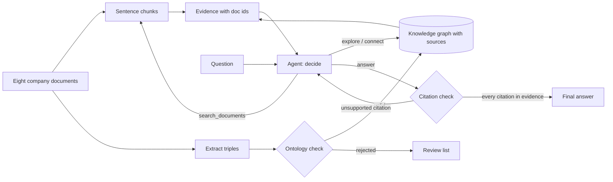
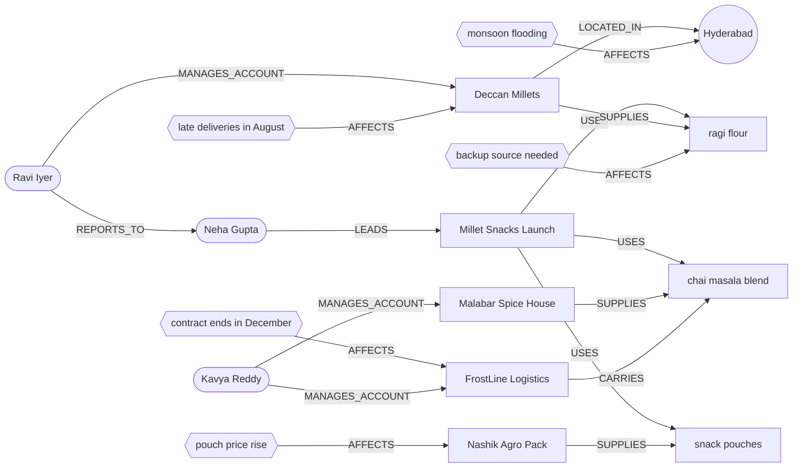

# Lab: A GraphRAG agent over company documents

> 📚 **Before you start**
>
> This lab puts the whole module together. You'll use:
> - [Building a Knowledge Graph from Text with an LLM](building-a-knowledge-graph-from-text-with-an-llm.md): extraction, validation against an ontology, provenance.
> - [GraphRAG](graphrag.md) and [Hybrid Retrieval: Graphs plus Vectors](hybrid-retrieval-graphs-plus-vectors.md): entity linking, neighbourhood expansion, text search as a second route.
> - [Text-to-Cypher Agents](text-to-cypher-agents.md): a LangGraph loop with a check step and a retry limit.
> - [Ontology-Grounded Agents](ontology-grounded-agents.md): domain and range checks before anything enters the graph.
>
> Everything runs locally with `langgraph` and `langchain-core`. The model is a scripted stand-in (`FakeListChatModel`) whose replies are what a real model wrote for these prompts, so you can see every step; the last step shows the two lines that switch to Claude.

## What You'll Build

Kiran Foods, the snack maker you've followed through this course, has a launch coming: the **Millet Snacks Launch**. Its head of product, Neha Gupta, asks questions like *"What could delay the launch?"*. The answer is spread across a project brief, two supplier reviews, a logistics note, a risk register and some meeting minutes. No single paragraph says it.

You'll build an agent that answers such questions with citations, and measure whether the graph actually helps.



> 💡 **Key Insight**
>
> A GraphRAG agent isn't one clever retriever. It's a **loop** that picks the right route per step (text search to find a starting point, graph tools to follow connections) and a **check** at the end that refuses any claim it can't trace back to a document. The graph earns its place on questions whose answer is spread across documents; you'll measure exactly that.

---

## Step 1: The documents

Eight short documents, each with an id. Real ones would come out of the parsing pipeline from module 5; the ids are what every citation will point to.

```python
import json
import re
from collections import deque

DOCS = {
    "doc01": "Supplier review: Deccan Millets in Hyderabad supplies ragi flour and jowar flour. "
             "Ravi Iyer manages the Deccan Millets account. Two deliveries were late in August "
             "because of monsoon flooding.",
    "doc02": "Project brief: the Millet Snacks Launch is led by Neha Gupta and goes on sale on 15 November. "
             "The launch recipe uses ragi flour and chai masala blend, packed in snack pouches.",
    "doc03": "Supplier review: Malabar Spice House in Kochi supplies chai masala blend. "
             "Kavya Reddy manages the Malabar Spice House account. Quality scores were excellent this quarter.",
    "doc04": "Packaging note: Nashik Agro Pack supplies snack pouches. Farhan Shaikh manages the "
             "Nashik Agro Pack account. Nashik Agro Pack raised pouch prices by 8 percent from October.",
    "doc05": "Risk register: monsoon flooding around Hyderabad threatens grain deliveries every year. "
             "The cold-chain contract with FrostLine Logistics ends in December and is not yet renewed.",
    "doc06": "Team page: Ravi Iyer reports to Neha Gupta. Kavya Reddy and Farhan Shaikh work in procurement.",
    "doc07": "Logistics note: FrostLine Logistics carries chai masala blend from Kochi to the Pune factory. "
             "Kavya Reddy manages the FrostLine Logistics account.",
    "doc08": "Meeting minutes: Neha Gupta asked procurement to line up a backup source of ragi flour before launch.",
}

CHUNKS = []                                   # (doc id, sentence)
for doc_id, text in DOCS.items():
    for sentence in re.split(r"(?<=\.) ", text):
        CHUNKS.append((doc_id, sentence))
print(len(DOCS), "documents,", len(CHUNKS), "sentence chunks")
print(CHUNKS[0])
```

Output:

```
8 documents, 18 sentence chunks
('doc01', 'Supplier review: Deccan Millets in Hyderabad supplies ragi flour and jowar flour.')
```

## Step 2: Extract, check against the ontology, and build the graph

The extraction prompt from lesson 6.1 turns each document into typed triples. Here are the model's replies for all eight documents. Look closely at `doc03`: the model also wrote `Kavya Reddy SUPPLIES chai masala blend`, a classic extraction slip (two facts in one sentence blurred together).

```python
ONTOLOGY = {   # relation: (allowed subject types, allowed object types)
    "SUPPLIES": ({"Supplier"}, {"Product"}),
    "CARRIES": ({"Supplier"}, {"Product"}),
    "MANAGES_ACCOUNT": ({"Person"}, {"Supplier"}),
    "LOCATED_IN": ({"Supplier"}, {"Place"}),
    "LEADS": ({"Person"}, {"Project"}),
    "USES": ({"Project"}, {"Product"}),
    "REPORTS_TO": ({"Person"}, {"Person"}),
    "AFFECTS": ({"Issue"}, {"Supplier", "Product", "Place", "Project"}),
}

EXTRACTED = {
    "doc01": {"entities": {"Deccan Millets": "Supplier", "Hyderabad": "Place", "ragi flour": "Product",
                           "jowar flour": "Product", "Ravi Iyer": "Person",
                           "late deliveries in August": "Issue"},
              "triples": [["Deccan Millets", "LOCATED_IN", "Hyderabad"], ["Deccan Millets", "SUPPLIES", "ragi flour"],
                          ["Deccan Millets", "SUPPLIES", "jowar flour"], ["Ravi Iyer", "MANAGES_ACCOUNT", "Deccan Millets"],
                          ["late deliveries in August", "AFFECTS", "Deccan Millets"]]},
    "doc02": {"entities": {"Millet Snacks Launch": "Project", "Neha Gupta": "Person", "ragi flour": "Product",
                           "chai masala blend": "Product", "snack pouches": "Product"},
              "triples": [["Neha Gupta", "LEADS", "Millet Snacks Launch"], ["Millet Snacks Launch", "USES", "ragi flour"],
                          ["Millet Snacks Launch", "USES", "chai masala blend"],
                          ["Millet Snacks Launch", "USES", "snack pouches"]]},
    "doc03": {"entities": {"Malabar Spice House": "Supplier", "Kochi": "Place", "chai masala blend": "Product",
                           "Kavya Reddy": "Person"},
              "triples": [["Malabar Spice House", "LOCATED_IN", "Kochi"],
                          ["Malabar Spice House", "SUPPLIES", "chai masala blend"],
                          ["Kavya Reddy", "MANAGES_ACCOUNT", "Malabar Spice House"],
                          ["Kavya Reddy", "SUPPLIES", "chai masala blend"]]},
    "doc04": {"entities": {"Nashik Agro Pack": "Supplier", "snack pouches": "Product", "Farhan Shaikh": "Person",
                           "pouch price rise of 8 percent": "Issue"},
              "triples": [["Nashik Agro Pack", "SUPPLIES", "snack pouches"],
                          ["Farhan Shaikh", "MANAGES_ACCOUNT", "Nashik Agro Pack"],
                          ["pouch price rise of 8 percent", "AFFECTS", "Nashik Agro Pack"]]},
    "doc05": {"entities": {"monsoon flooding": "Issue", "Hyderabad": "Place", "FrostLine Logistics": "Supplier",
                           "cold-chain contract ends in December": "Issue"},
              "triples": [["monsoon flooding", "AFFECTS", "Hyderabad"],
                          ["cold-chain contract ends in December", "AFFECTS", "FrostLine Logistics"]]},
    "doc06": {"entities": {"Ravi Iyer": "Person", "Neha Gupta": "Person"},
              "triples": [["Ravi Iyer", "REPORTS_TO", "Neha Gupta"]]},
    "doc07": {"entities": {"FrostLine Logistics": "Supplier", "chai masala blend": "Product", "Kavya Reddy": "Person"},
              "triples": [["FrostLine Logistics", "CARRIES", "chai masala blend"],
                          ["Kavya Reddy", "MANAGES_ACCOUNT", "FrostLine Logistics"]]},
    "doc08": {"entities": {"backup source of ragi flour needed": "Issue", "ragi flour": "Product"},
              "triples": [["backup source of ragi flour needed", "AFFECTS", "ragi flour"]]},
}

TYPES, EDGES, REJECTED = {}, {}, []           # EDGES: (subject, relation, object) -> set of doc ids
for doc_id, out in EXTRACTED.items():
    TYPES.update(out["entities"])
    for s, rel, o in out["triples"]:
        subj_ok, obj_ok = ONTOLOGY[rel]
        if out["entities"][s] in subj_ok and out["entities"][o] in obj_ok:
            EDGES.setdefault((s, rel, o), set()).add(doc_id)
        else:
            REJECTED.append((doc_id, s, rel, o, f"{rel} needs {sorted(subj_ok)} -> {sorted(obj_ok)}, "
                                                 f"got {out['entities'][s]} -> {out['entities'][o]}"))

print(len(TYPES), "entities,", len(EDGES), "relationships")
for r in REJECTED:
    print("rejected:", r)
print("ragi flour is mentioned by:", sorted({d for (s, _, o), docs in EDGES.items() if "ragi flour" in (s, o) for d in docs}))
```

Output:

```
20 entities, 21 relationships
rejected: ('doc03', 'Kavya Reddy', 'SUPPLIES', 'chai masala blend', "SUPPLIES needs ['Supplier'] -> ['Product'], got Person -> Product")
ragi flour is mentioned by: ['doc01', 'doc02', 'doc08']
```

The bad triple never reaches the graph, and it lands on a review list with the reason. Every edge carries the set of documents that state it; that set is what citations come from.

Here's the graph you just built, drawn small. Notice how the launch connects to the risks only through suppliers and products: no document links them directly.



## Step 3: Three tools

The agent gets three tools, each returning evidence lines tagged with document ids:

- `search_documents(query)`: text search over sentence chunks. It stands in for the vector search of the earlier lessons; it scores by shared words, which is enough to find starting points.
- `explore(entity, hops)`: everything within a few hops of an entity in the graph.
- `connect(a, b)`: the shortest chain of relationships between two entities.

```python
STOP = set("the a an and of in to is by on for from with what who which how could be are was were this that our".split())

def words(text):
    return {w for w in re.findall(r"[a-z]+", text.lower()) if w not in STOP}

def search_documents(query, k=3):
    scored = sorted(CHUNKS, key=lambda c: -len(words(query) & words(c[1])))
    return [f"[{d}] {s}" for d, s in scored[:k] if words(query) & words(s)]

NEIGHBOURS = {}
for (s, rel, o), docs in EDGES.items():
    NEIGHBOURS.setdefault(s, []).append((s, rel, o, docs))
    NEIGHBOURS.setdefault(o, []).append((s, rel, o, docs))

def fact(s, rel, o, docs):
    return f"[{','.join(sorted(docs))}] {s} {rel} {o}"

def explore(entity, hops=2):
    seen, frontier, lines = {entity}, [entity], []
    for _ in range(hops):
        nxt = []
        for node in frontier:
            for s, rel, o, docs in NEIGHBOURS.get(node, []):
                line = fact(s, rel, o, docs)
                if line not in lines:
                    lines.append(line)
                other = o if node == s else s
                if other not in seen and TYPES[other] != "Person":    # don't fan out through people
                    seen.add(other)
                    nxt.append(other)
        frontier = nxt
    return lines

def connect(a, b):
    previous, queue = {a: None}, deque([a])
    while queue:
        node = queue.popleft()
        if node == b:
            break
        for s, rel, o, docs in NEIGHBOURS.get(node, []):
            other = o if node == s else s
            if other not in previous:
                previous[other] = (node, fact(s, rel, o, docs))
                queue.append(other)
    if b not in previous:
        return [f"no connection between {a} and {b}"]
    path, node = [], b
    while previous[node]:
        node, line = previous[node]
        path.append(line)
    return path[::-1]

print("search_documents('What could delay the launch?'):")
for line in search_documents("What could delay the launch?"):
    print("  ", line)
print("explore('ragi flour', hops=2):")
for line in explore("ragi flour"):
    print("  ", line)
print("connect('Ravi Iyer', 'Millet Snacks Launch'):")
for line in connect("Ravi Iyer", "Millet Snacks Launch"):
    print("  ", line)
```

Output:

```
search_documents('What could delay the launch?'):
   [doc02] Project brief: the Millet Snacks Launch is led by Neha Gupta and goes on sale on 15 November.
   [doc02] The launch recipe uses ragi flour and chai masala blend, packed in snack pouches.
   [doc08] Meeting minutes: Neha Gupta asked procurement to line up a backup source of ragi flour before launch.
explore('ragi flour', hops=2):
   [doc01] Deccan Millets SUPPLIES ragi flour
   [doc02] Millet Snacks Launch USES ragi flour
   [doc08] backup source of ragi flour needed AFFECTS ragi flour
   [doc01] Deccan Millets LOCATED_IN Hyderabad
   [doc01] Deccan Millets SUPPLIES jowar flour
   [doc01] Ravi Iyer MANAGES_ACCOUNT Deccan Millets
   [doc01] late deliveries in August AFFECTS Deccan Millets
   [doc02] Neha Gupta LEADS Millet Snacks Launch
   [doc02] Millet Snacks Launch USES chai masala blend
   [doc02] Millet Snacks Launch USES snack pouches
connect('Ravi Iyer', 'Millet Snacks Launch'):
   [doc06] Ravi Iyer REPORTS_TO Neha Gupta
   [doc02] Neha Gupta LEADS Millet Snacks Launch
```

Look at what text search alone found for the launch question: sentences containing the word "launch". Only the minutes hint at a problem; nothing about flooding, late deliveries or the FrostLine contract, because those sentences never mention the launch. The graph tools reach the risks by walking from the launch's ingredients to their suppliers and the issues attached to them. Note the small design choice in `explore`: it doesn't fan out *through* people, otherwise two hops from anything would pull in the whole team.

## Step 4: The agent loop in LangGraph

The loop has three nodes:

- **decide**: the model sees the question, the tool descriptions and the evidence so far, and replies with JSON, either a tool call or a final answer with `[docNN]` citations.
- **act**: runs the tool and appends its lines to the evidence.
- **check**: every cited document must appear in the gathered evidence. If not, the model is told which citations are unsupported and decides again. After `MAX_STEPS` the agent stops and says what it found.

```python
from typing import TypedDict
from langchain_core.language_models.fake_chat_models import FakeListChatModel
from langgraph.graph import END, START, StateGraph

TOOLS = {"search_documents": search_documents, "explore": explore, "connect": connect}
MAX_STEPS = 6

SYSTEM = """You answer questions about Kiran Foods using tools. Reply with JSON only:
{"tool": "search_documents", "args": {"query": "..."}}  text search over documents
{"tool": "explore", "args": {"entity": "...", "hops": 2}}  facts around an entity in the knowledge graph
{"tool": "connect", "args": {"a": "...", "b": "..."}}  shortest chain of facts between two entities
{"answer": "..."}  final answer; cite every claim with [docNN] taken from the evidence
Graph entities include: """ + ", ".join(sorted(t for t in TYPES if TYPES[t] != "Issue"))

class AgentState(TypedDict):
    question: str
    evidence: list
    feedback: str
    steps: int
    action: dict
    answer: str

def make_agent(llm):
    def decide(state):
        evidence = "\n".join(state["evidence"]) or "(none yet)"
        prompt = f"{SYSTEM}\n\nQuestion: {state['question']}\nEvidence so far:\n{evidence}\n{state['feedback']}"
        return {"action": json.loads(llm.invoke(prompt).content), "steps": state["steps"] + 1}

    def act(state):
        tool, args = state["action"]["tool"], state["action"]["args"]
        new = [line for line in TOOLS[tool](**args) if line not in state["evidence"]]
        return {"evidence": state["evidence"] + new}

    def check(state):
        answer = state["action"]["answer"]
        cited = set(re.findall(r"doc\d+", answer))
        seen = set(re.findall(r"doc\d+", " ".join(state["evidence"])))
        if not cited:
            return {"feedback": "Your answer has no citations. Cite evidence with [docNN]."}
        if cited - seen:
            return {"feedback": f"Unsupported citations {sorted(cited - seen)}: cite only documents in the evidence."}
        return {"answer": answer, "feedback": ""}

    def route_after_decide(state):
        if state["steps"] > MAX_STEPS:
            return "stop"
        return "act" if "tool" in state["action"] else "check"

    def route_after_check(state):
        return END if state["answer"] else "decide"

    def stop(state):
        return {"answer": "I couldn't finish within the step limit. Evidence gathered:\n" + "\n".join(state["evidence"])}

    g = StateGraph(AgentState)
    g.add_node("decide", decide)
    g.add_node("act", act)
    g.add_node("check", check)
    g.add_node("stop", stop)
    g.add_edge(START, "decide")
    g.add_conditional_edges("decide", route_after_decide, ["act", "check", "stop"])
    g.add_edge("act", "decide")
    g.add_conditional_edges("check", route_after_check, ["decide", END])
    g.add_edge("stop", END)
    return g.compile()

def ask(question, replies, show=True):
    agent = make_agent(FakeListChatModel(responses=[json.dumps(r) for r in replies]))
    state = {"question": question, "evidence": [], "feedback": "", "steps": 0, "action": {}, "answer": ""}
    for update in agent.stream(state, stream_mode="updates"):
        for node, change in update.items():
            state.update(change)
            if show and node == "decide":
                print(f"decide -> {json.dumps(change['action'])[:110]}")
            if show and node == "act":
                print(f"act    -> evidence now {len(state['evidence'])} lines")
            if show and node == "check" and change.get("feedback"):
                print(f"check  -> {change['feedback']}")
    return state

print(list(make_agent(FakeListChatModel(responses=["{}"])).get_graph().nodes))
```

Output:

```
['__start__', 'decide', 'act', 'check', 'stop', '__end__']
```

Now Neha's question. The scripted replies are the model's moves: search to find what "the launch" is called in the graph, explore three hops out from the launch, then look closer at Hyderabad (where the ragi flour supplier is, and which the first exploration only reached at its edge), then answer. Its first answer cites `doc09`, a document that doesn't exist (models do invent ids); the check sends it back.

```python
q1 = "What could delay the Millet Snacks Launch?"
q1_replies = [
    {"tool": "search_documents", "args": {"query": "Millet Snacks Launch"}},
    {"tool": "explore", "args": {"entity": "Millet Snacks Launch", "hops": 3}},
    {"tool": "explore", "args": {"entity": "Hyderabad", "hops": 1}},
    {"answer": "Three things: ragi flour from Deccan Millets, delayed by monsoon flooding [doc01][doc05] "
               "with no backup source yet [doc08][doc09]; and chai masala blend shipping via FrostLine, "
               "whose contract ends in December [doc05][doc07]."},
    {"answer": "The biggest risk is ragi flour. Deccan Millets in Hyderabad supplies it [doc01], two deliveries were "
               "late in August because of monsoon flooding [doc01], and flooding there recurs every year [doc05]; "
               "a backup source has been requested but not yet found [doc08]. Second, chai masala blend reaches the "
               "factory via FrostLine Logistics [doc07], whose cold-chain contract ends in December and isn't renewed "
               "[doc05], a month after the 15 November launch [doc02]. Snack pouches cost 8 percent more from "
               "October [doc04], a cost issue rather than a delay."},
]
result = ask(q1, q1_replies)
print("\nANSWER:\n" + result["answer"])
```

Output:

```
decide -> {"tool": "search_documents", "args": {"query": "Millet Snacks Launch"}}
act    -> evidence now 3 lines
decide -> {"tool": "explore", "args": {"entity": "Millet Snacks Launch", "hops": 3}}
act    -> evidence now 22 lines
decide -> {"tool": "explore", "args": {"entity": "Hyderabad", "hops": 1}}
act    -> evidence now 23 lines
decide -> {"answer": "Three things: ragi flour from Deccan Millets, delayed by monsoon flooding [doc01][doc05] with no b
check  -> Unsupported citations ['doc09']: cite only documents in the evidence.
decide -> {"answer": "The biggest risk is ragi flour. Deccan Millets in Hyderabad supplies it [doc01], two deliveries we

ANSWER:
The biggest risk is ragi flour. Deccan Millets in Hyderabad supplies it [doc01], two deliveries were late in August because of monsoon flooding [doc01], and flooding there recurs every year [doc05]; a backup source has been requested but not yet found [doc08]. Second, chai masala blend reaches the factory via FrostLine Logistics [doc07], whose cold-chain contract ends in December and isn't renewed [doc05], a month after the 15 November launch [doc02]. Snack pouches cost 8 percent more from October [doc04], a cost issue rather than a delay.
```

Every claim in the final answer points to a document the agent actually retrieved, and the answer combines six documents that mostly never mention each other. That is the job vector search alone can't do.

## Step 5: Measure it against a text-only baseline

A demo isn't evidence. Take three questions with **gold documents** (the documents a complete answer needs) and compare **context recall**, the share of gold documents that made it into the evidence, for:

- **Text only**: `search_documents(question, k=5)`, the classic RAG retrieval.
- **Agent**: the documents in the agent's evidence after its tool calls.

```python
EVAL = [
    {"q": q1, "gold": {"doc01", "doc02", "doc05", "doc07", "doc08"}, "replies": q1_replies},
    {"q": "Who should Neha talk to about the chai masala blend?",
     "gold": {"doc03", "doc07"},
     "replies": [{"tool": "explore", "args": {"entity": "chai masala blend", "hops": 2}},
                 {"answer": "Kavya Reddy: she manages both Malabar Spice House, which supplies it [doc03], and "
                            "FrostLine Logistics, which carries it [doc07]."}]},
    {"q": "How is Ravi Iyer connected to the Millet Snacks Launch?",
     "gold": {"doc01", "doc02", "doc06"},
     "replies": [{"tool": "connect", "args": {"a": "Ravi Iyer", "b": "Millet Snacks Launch"}},
                 {"tool": "explore", "args": {"entity": "Ravi Iyer", "hops": 1}},
                 {"answer": "Two ways: he manages Deccan Millets [doc01], which supplies the launch's ragi flour "
                            "[doc01][doc02], and he reports to Neha Gupta [doc06], who leads the launch [doc02]."}]},
]

def docs_in(lines):
    return set(re.findall(r"doc\d+", " ".join(lines)))

print(f"{'question':<58}{'text only':>10}{'agent':>8}")
totals = [0, 0]
for case in EVAL:
    text_docs = docs_in(search_documents(case["q"], k=5))
    agent_docs = docs_in(ask(case["q"], case["replies"], show=False)["evidence"])
    recall = [len(d & case["gold"]) / len(case["gold"]) for d in (text_docs, agent_docs)]
    totals = [t + r for t, r in zip(totals, recall)]
    print(f"{case['q']:<58}{recall[0]:>10.2f}{recall[1]:>8.2f}")
print(f"{'average':<58}{totals[0] / len(EVAL):>10.2f}{totals[1] / len(EVAL):>8.2f}")
```

Output:

```
question                                                   text only   agent
What could delay the Millet Snacks Launch?                      0.40    1.00
Who should Neha talk to about the chai masala blend?            1.00    1.00
How is Ravi Iyer connected to the Millet Snacks Launch?         1.00    1.00
average                                                         0.80    1.00
```

The result is more interesting than "graph wins". On the two questions whose answers sit in a couple of documents that use the question's own words, text search with five chunks already finds everything. On the launch question, whose answer is spread over five documents linked only through suppliers and products, text search finds two of them and the agent finds all five. That's the pattern you'll see on real data: graphs pay off on connecting questions, not on look-ups. Two honest caveats belong next to this table in any write-up:

- The agent's tool choices here are scripted. With a real model, run each question several times and report the average, because tool choices vary.
- Three questions is a smoke test. A real evaluation set has dozens of questions written by the people who'll use the agent, with gold documents checked by them too. Context recall measures retrieval only; also grade the answers (faithfulness to the evidence, completeness) as you did in the RAG course.

## Step 6: Loading it into Neo4j and switching to Claude

The same graph as Cypher, with sources kept on each relationship, so the `explore` and `connect` tools can become Cypher queries over a real database:

```python
def to_cypher(limit=4):
    lines = []
    for (s, rel, o), docs in sorted(EDGES.items())[:limit]:
        lines.append(f"MERGE (a:{TYPES[s]} {{name: {json.dumps(s)}}}) MERGE (b:{TYPES[o]} {{name: {json.dumps(o)}}}) "
                     f"MERGE (a)-[r:{rel}]->(b) SET r.sources = {json.dumps(sorted(docs))};")
    return "\n".join(lines)

print(to_cypher())
```

Output:

```
MERGE (a:Supplier {name: "Deccan Millets"}) MERGE (b:Place {name: "Hyderabad"}) MERGE (a)-[r:LOCATED_IN]->(b) SET r.sources = ["doc01"];
MERGE (a:Supplier {name: "Deccan Millets"}) MERGE (b:Product {name: "jowar flour"}) MERGE (a)-[r:SUPPLIES]->(b) SET r.sources = ["doc01"];
MERGE (a:Supplier {name: "Deccan Millets"}) MERGE (b:Product {name: "ragi flour"}) MERGE (a)-[r:SUPPLIES]->(b) SET r.sources = ["doc01"];
MERGE (a:Person {name: "Farhan Shaikh"}) MERGE (b:Supplier {name: "Nashik Agro Pack"}) MERGE (a)-[r:MANAGES_ACCOUNT]->(b) SET r.sources = ["doc04"];
```

In Neo4j, `connect` becomes a `shortestPath` query and `explore` a variable-length match:

```cypher
// connect('Ravi Iyer', 'Millet Snacks Launch')
MATCH p = shortestPath((a {name: $a})-[*..6]-(b {name: $b}))
RETURN [r IN relationships(p) | [startNode(r).name, type(r), endNode(r).name, r.sources]] AS chain;

// explore('ragi flour', 2)
MATCH (n {name: $entity})-[r*1..2]-(m)
UNWIND r AS rel
RETURN DISTINCT startNode(rel).name, type(rel), endNode(rel).name, rel.sources LIMIT 50;
```

To put Claude in charge of the decisions, give it the three functions as tools. LangChain's `create_agent` builds the model-tools loop for you; keep the citation check as a step after it (or as middleware), because the prebuilt loop doesn't know your citation rules.

```python
# not-run: needs the langchain and langchain-anthropic packages and an API key
from langchain.agents import create_agent

agent = create_agent(
    model="anthropic:claude-opus-5-5",
    tools=[search_documents, explore, connect],
    system_prompt="Answer questions about Kiran Foods. Use explore and connect to follow connections "
                  "between documents. Cite every claim with the [docNN] ids that appear in tool results.",
)
result = agent.invoke({"messages": [{"role": "user", "content": "What could delay the Millet Snacks Launch?"}]})
print(result["messages"][-1].content)
```

Example output:

```
The main risk is ragi flour: Deccan Millets, which supplies it, had two late deliveries in August
because of monsoon flooding [doc01], a recurring problem around Hyderabad [doc05], and no backup
source has been found yet [doc08]. FrostLine's cold-chain contract for chai masala blend also ends
in December without renewal [doc05][doc07].
```

Give each tool a docstring before you do this: `create_agent` uses the function's name, docstring and type hints as the tool description the model reads.

---

## Try It Yourself

1. **A new document arrives.** Add `doc09`: *"Supplier review: Annapurna Grains in Indore can supply ragi flour from January."* with entities `Annapurna Grains` (Supplier), `Indore` (Place), `ragi flour` (Product) and triples `LOCATED_IN` and `SUPPLIES`. Rebuild the graph and run `explore("ragi flour", 1)`. What new fact appears, and which document does it cite?
2. **Catch a made-up claim.** Run the Ravi Iyer question with a final answer that cites `[doc04]`. What does the check do, and why is checking citations against *evidence* (not against all documents) the right rule?
3. **Where text search wins.** Write a question the text-only baseline answers perfectly. What does it have in common with the questions where the graph helped less?

<details>
<summary>Show answers</summary>

**1.**

```python
DOCS["doc09"] = "Supplier review: Annapurna Grains in Indore can supply ragi flour from January."
EXTRACTED["doc09"] = {"entities": {"Annapurna Grains": "Supplier", "Indore": "Place", "ragi flour": "Product"},
                      "triples": [["Annapurna Grains", "LOCATED_IN", "Indore"], ["Annapurna Grains", "SUPPLIES", "ragi flour"]]}
for s, rel, o in EXTRACTED["doc09"]["triples"]:
    TYPES.update(EXTRACTED["doc09"]["entities"])
    EDGES.setdefault((s, rel, o), set()).add("doc09")
    NEIGHBOURS.setdefault(s, []).append((s, rel, o, EDGES[(s, rel, o)]))
    NEIGHBOURS.setdefault(o, []).append((s, rel, o, EDGES[(s, rel, o)]))
for line in explore("ragi flour", 1):
    print(line)
```

Output:

```
[doc01] Deccan Millets SUPPLIES ragi flour
[doc02] Millet Snacks Launch USES ragi flour
[doc08] backup source of ragi flour needed AFFECTS ragi flour
[doc09] Annapurna Grains SUPPLIES ragi flour
```

The graph grows one document at a time without rebuilding anything, and the new supplier is immediately reachable from the launch through ragi flour. (It isn't from January in the graph: dates like that belong on the relationship as a property, `{from: "2027-01"}`, which is a good next extension.)

**2.**

```python
bad = [{"tool": "connect", "args": {"a": "Ravi Iyer", "b": "Millet Snacks Launch"}},
       {"answer": "He reports to Neha Gupta [doc06] and handles pouch pricing for the launch [doc04]."},
       {"answer": "He reports to Neha Gupta [doc06], who leads the launch [doc02]."}]
print(ask("How is Ravi Iyer connected to the Millet Snacks Launch?", bad)["answer"])
```

Output:

```
decide -> {"tool": "connect", "args": {"a": "Ravi Iyer", "b": "Millet Snacks Launch"}}
act    -> evidence now 2 lines
decide -> {"answer": "He reports to Neha Gupta [doc06] and handles pouch pricing for the launch [doc04]."}
check  -> Unsupported citations ['doc04']: cite only documents in the evidence.
decide -> {"answer": "He reports to Neha Gupta [doc06], who leads the launch [doc02]."}
He reports to Neha Gupta [doc06], who leads the launch [doc02].
```

`doc04` exists, but the agent never retrieved it, so nothing it read supports the claim. Checking against the *evidence* catches answers that cite real documents for things they don't say, which is the commoner failure. (It still can't catch a correct id attached to a wrong claim; for that, add an LLM grader that compares each sentence with the cited evidence.)

**3.** A question whose answer sits in one sentence that shares words with the question works perfectly with text search:

```python
case = {"q": "How much did Nashik Agro Pack raise pouch prices?", "gold": {"doc04"}}
print(search_documents(case["q"], k=1))
```

Output:

```
['[doc04] Nashik Agro Pack raised pouch prices by 8 percent from October.']
```

Single-document, keyword-rich questions don't need a graph. That's why the agent has both routes and why the evaluation set should include both kinds of question: a graph that helps multi-hop questions but slows down simple ones is a trade-off you want to see in the numbers.

</details>

---

## What You've Learned

- How to turn documents into a **graph with sources** on every edge, with an ontology check that sends bad triples to a review list.
- How to give an agent **complementary tools**: text search for entry points, neighbourhood exploration and shortest paths for connections.
- How to build the **decide, act, check** loop in LangGraph, with a step limit and a citation check that rejects claims the evidence doesn't support.
- How to **measure** whether the graph helps, with gold documents and context recall against a text-only baseline, and what such a small test can and can't show.
- How the same design moves to **Neo4j** (MERGE with sources, shortest paths) and to **Claude** (`create_agent` with the three tools).

That completes the course. You can now read and design ontologies, model and query graphs in Neo4j, turn documents into clean structured data, and build agents that reason over the result. The next course looks at the other half of an agent's knowledge, the context it carries from step to step, including knowledge graphs used as long-term memory.

---

**Up next:** [Context Engineering and Agent Memory: How This Course Works](../../context-engineering-and-agent-memory/01-start-here/how-this-course-works.md)
