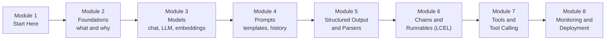

# How This Course Works

> 📚 **Before you start**
>
> - [Generative AI and LLM Foundations](../../generative-ai-and-llm-foundations/course.md), especially [Lab: Your First LLM API Call](../../generative-ai-and-llm-foundations/03-how-llms-work/lab-your-first-llm-api-call.md), [System Prompts and Roles](../../generative-ai-and-llm-foundations/04-prompting-and-structured-output/system-prompts-and-roles.md) and [Structured JSON Output](../../generative-ai-and-llm-foundations/04-prompting-and-structured-output/structured-json-output.md). This course assumes you know what a prompt, a message role, a token and a JSON schema are.
> - Python comfortable enough to read classes, type hints and decorators, from [Python Programming](../../python-programming/course.md#m7).

## Introduction

In the last course you called a language model directly: you built a list of messages, sent it, read the reply, and wrote your own code to validate JSON and retry failures. That is the right way to learn. But think about what a real app needs on top of one call. A support bot for an online saree shop has to fill the same prompt with a different customer's question each time, keep the chat history, turn the model's reply into a Python object your code can trust, look up the order status in a database when the customer asks "where is my parcel?", and log every step so you can see why it answered badly on Tuesday night.

You could write all of that glue yourself. Many teams did, and each team wrote it slightly differently. **LangChain** is an open-source Python (and JavaScript) library that gives that glue standard shapes: one way to talk to any model, one way to write prompt templates, one way to get structured output, one way to describe a tool, and one way to snap these pieces into a pipeline. Learn it once and you can switch from Claude to a local open-source model by changing one line.

This short article tells you what the course covers, how it is organised, what to install, and how the code examples run without an API key.

> 💡 **Key Insight**
>
> LangChain does not make the model smarter. It gives every piece around the model (prompts, models, parsers, tools, pipelines) the **same interface**, so the pieces can be swapped, combined, traced and deployed in a standard way. Everything in this course is an example of that one idea.

---

## What You Will Learn

By the end of this course you will be able to:

- **Explain what LangChain is**, which problems it solves, how its packages fit together (`langchain-core`, `langchain`, provider packages, LangGraph, LangSmith), and when you don't need it.
- **Talk to any model** through one interface: chat models, the older text-in-text-out LLMs, embedding models, and open-source models from Hugging Face.
- **Build prompts properly** with `PromptTemplate`, `ChatPromptTemplate`, message objects and `MessagesPlaceholder` for chat history.
- **Get structured data out of a model** with `with_structured_output` (using `TypedDict`, Pydantic or JSON Schema), and with output parsers when a model can't do it natively.
- **Compose pipelines with LCEL**, the `|` operator, and the runnable building blocks: sequences, parallel branches, passthroughs, lambdas and branches. Use them to generate synthetic data and to manage chat memory.
- **Give models tools**: write custom tools, use built-in ones, bind them with `bind_tools`, run the calls, and hide sensitive arguments from the model.
- **Monitor and deploy**: trace every step with LangSmith, and serve a chain as an HTTP API, both the older LangServe way and the current options.

### The course at a glance



| Module | The question it answers | You build |
|---|---|---|
| **2. LangChain Foundations** | What is LangChain, what are its parts, and how do I set up a project safely? | A project skeleton with keys loaded from `.env` |
| **3. Models** | How do I call any model (hosted or open-source) the same way, and what are embeddings for? | A model-agnostic `ask()` and a tiny semantic search |
| **4. Prompts** | How do I write prompts once and fill them many times, including chat history? | A prompt-templated assistant for a train-enquiry desk |
| **5. Structured Output and Output Parsers** | How do I get typed, validated data instead of free text? | A review extractor for an electronics shop |
| **6. Chains and Runnables** | How do I connect steps into pipelines that can run in sequence, in parallel or by condition? | A multi-step LCEL pipeline |
| **7. Tools and Tool Calling** | How does a model ask my code to do something, and how do I run that safely? | A currency converter that calls tools |
| **8. Monitoring and Deployment** | How do I see what my chain did, and serve it to other apps? | A chain served over HTTP and traced |

Why this order? Every pipeline you will build has the same skeleton: **prompt → model → output handling**, sometimes with **tools** in the middle. Modules 3, 4 and 5 teach those three parts one at a time. Module 6 then shows the glue that joins them (and explains why each part could be joined so easily). Module 7 adds tools, which needs everything before it: messages, structured arguments and pipelines. Module 8 is about running what you built in front of real users.

### Where this course sits

This course comes straight after [Generative AI and LLM Foundations](../../generative-ai-and-llm-foundations/course.md) and before two courses that use it constantly:

- [Retrieval-Augmented Generation (RAG)](../../retrieval-augmented-generation-rag/course.md) uses LangChain's document loaders, text splitters, vector stores and retrievers on top of the models, prompts and chains you learn here.
- [LangGraph Complete Guide](../../langgraph-complete-guide/course.md) builds agents and long-running workflows as graphs, with LangChain models, messages and tools inside every node.

Agents (a model calling tools in a loop until a task is done) get a short preview in Module 7, and a full treatment in [Agentic AI Fundamentals](../../agentic-ai-fundamentals/course.md) and the LangGraph course.

---

## What You Need Before Starting

- **The LLM basics** from the previous course: messages and roles, tokens and context windows, temperature, and why model output must be validated.
- **Python**: functions, classes, type hints, decorators and dictionaries. **Pydantic** models help a lot in Module 5; the [Validation and Schemas module](../../apis-and-apps-fastapi-streamlit-and-docker/course.md#m4) of the APIs course covers them, and Module 5 re-explains what it uses.
- **FastAPI basics** help in Module 8, from [APIs and FastAPI Fundamentals](../../apis-and-apps-fastapi-streamlit-and-docker/course.md#m2).

### Installing LangChain

```bash
python -m venv .venv
source .venv/bin/activate          # on Windows: .venv\Scripts\activate
pip install langchain langchain-anthropic python-dotenv
```

`langchain` brings `langchain-core` (and LangGraph, which its agents run on) with it. `langchain-anthropic` is the package that talks to Claude; other providers have their own packages (Module 2 explains the split). Check what you got:

```bash
python -c "import importlib.metadata as m; print(m.version('langchain'), m.version('langchain-core'))"
```

Example output:

```
1.4.6 1.6.12
```

The examples on this site were tested with **langchain-core 1.6** (the runnable code) and written against **LangChain 1.4** (the `# not-run:` examples). LangChain 1.0 shipped in October 2025 and removed or moved many older APIs, so a tutorial written before then often won't run as-is. When a lesson shows an older API you will still meet in real code bases, it says so and shows the current replacement.

### Do I need an API key?

**No, not for the runnable code.** `langchain-core` ships **fake models** that return scripted replies, and every runnable example in this course uses one of them (or a tiny fake built on top of them). The code runs offline, for free, and prints exactly the output shown under it.

Code that needs a real model, a key, a network connection or a package this site doesn't install is marked like this, and is followed by an *example* output instead of a checked one:

```python
# not-run: needs `pip install langchain langchain-anthropic` and ANTHROPIC_API_KEY
from langchain.chat_models import init_chat_model

model = init_chat_model("anthropic:claude-opus-5-5")
print(model.invoke("Say namaste in one word.").text)
```

Example output:

```
Namaste!
```

Swap the fake for the real model when you have a key; the rest of the code stays the same. That swap being one line is, in fact, the whole point of LangChain.

---

## How Every Lesson Is Built

| Section | What it gives you |
|---|---|
| **Before you start** | Links to the earlier lessons this one depends on. |
| **Introduction** | Why the topic matters, with an everyday example. |
| **Key Insight** | The one idea to remember. |
| **Core Explanation** | The topic step by step, from the simplest case to the advanced one, with diagrams, tables and runnable code. |
| **Try It Yourself** | Small exercises, with answers hidden in a fold. |
| **Real-World Examples** | Where you will meet the idea in real products. |
| **Common Misconceptions** | Mistakes almost everyone makes, corrected. |
| **Interview Relevance** | What interviewers ask and what a strong answer covers. |
| **Key Takeaways** | A one-minute summary for revision. |

**Labs** are guided builds from an empty file to something that works. This course has five: a prompt-templated assistant, a review extractor, a multi-step pipeline, a tool-calling currency converter, and a chain served over HTTP.

---

## How to Get the Most Out of It

1. **Run every example yourself.** Paste the blocks of a lesson into one file, in order, and run it. Then change one thing and predict what will happen.
2. **Print the intermediate objects.** LangChain's power comes from standard objects (messages, prompt values, documents, tool calls). Print them, look at their fields, and the "magic" disappears.
3. **Read the official docs alongside.** LangChain moves fast. When an import fails on a newer version, the docs at docs.langchain.com and the API reference will have the new name.
4. **Swap in a real model once per module.** The fake models teach the shapes; a real model teaches you how messy real outputs are.

---

## Common Misconceptions

### "LangChain is an AI model"

It isn't. LangChain contains no model. It is a library of standard interfaces and integrations that **calls** models made by Anthropic, OpenAI, Google, Meta, Mistral and others.

### "I have to use LangChain to build an LLM app"

No. Plenty of good apps call a provider SDK directly, as you did in the previous course. LangChain earns its place when you want to swap providers, compose many steps, use its large set of integrations, or get tracing and deployment tools for free. Module 2 discusses when to skip it.

### "Old LangChain tutorials still apply"

Partly. The ideas (prompts, models, parsers, chains, tools) are the same, but many classes such as `LLMChain` and `ConversationBufferMemory` moved to a legacy package in LangChain 1.0. This course teaches the current APIs and points out the old names so you can read older code.

---

## Key Takeaways

- **LangChain gives every part of an LLM app the same interface**, so parts can be swapped and composed.
- **The course follows the shape of every pipeline**: models, then prompts, then structured output, then the glue (chains), then tools, then monitoring and deployment.
- **All runnable code works offline** with fake models; real-model code is marked `# not-run:`.
- **The examples target LangChain 1.x** (langchain-core 1.6, langchain 1.4); older tutorials often use moved or removed APIs.
- **RAG and LangGraph come next** and both build directly on this course.

---

**Up next:** [What is LangChain?](../02-langchain-foundations/what-is-langchain.md)
