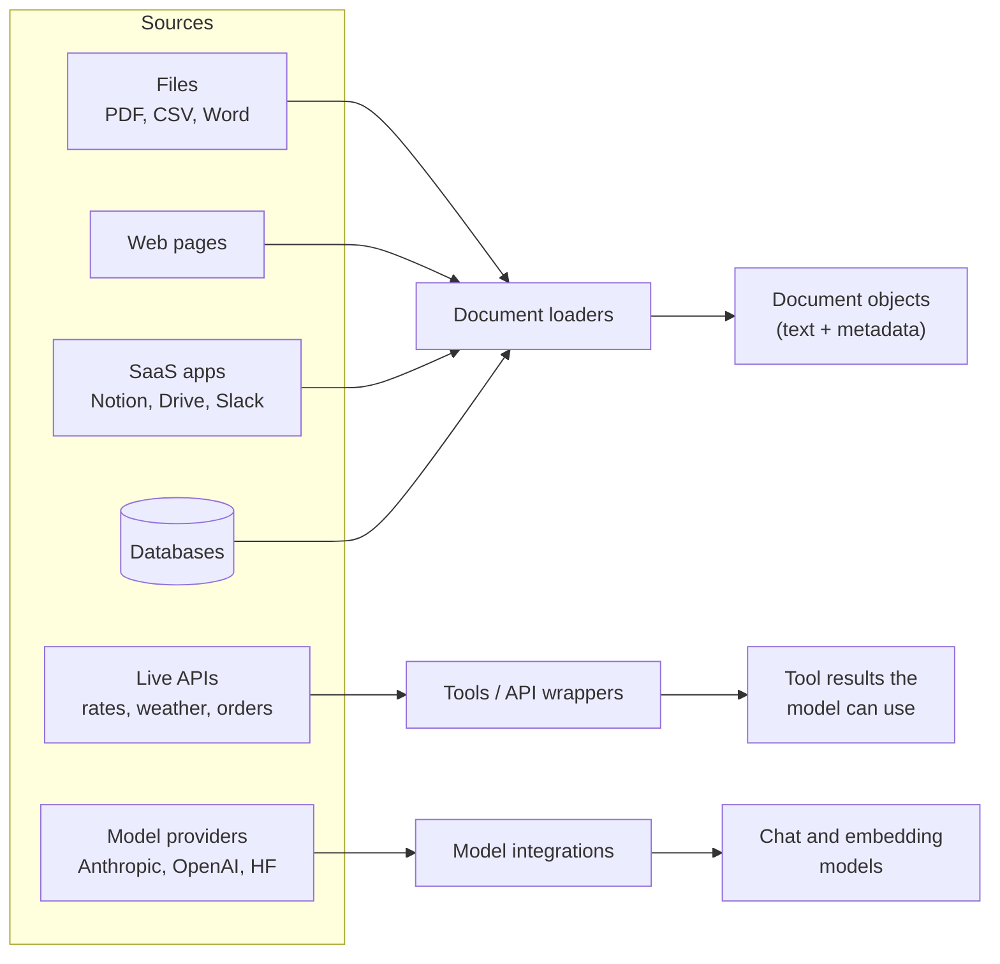

# Data Connectors and API Integrations: The Complete Guide

> 📚 **Before you start**
>
> - [LangChain Components](langchain-components.md), for `Document`s, tools and the idea of standard hand-offs.
> - [What is an API?](../../apis-and-apps-fastapi-streamlit-and-docker/course.md#m2), for HTTP requests, JSON responses and status codes.

## Introduction

A model on its own is like a very well-read new employee who has been locked in a room with no phone and no computer. Ask about Ashoka or photosynthesis and they're brilliant. Ask "what did customer #4411 order last week?" or "what's the dollar rate today?" and they can only guess, because that information lives **outside** the room: in your PDFs, your database, your CRM, a currency API.

Useful LLM apps are mostly about **getting the right outside information into the room** (and, sometimes, letting the model reach out and act). LangChain's biggest practical strength is its library of ready-made connectors for exactly this: hundreds of **document loaders** for files and services, **integrations** for model providers, vector databases and search engines, and **tools** that wrap external APIs.

In this lesson you'll learn the three ways outside data and services connect to a LangChain app, write your own document loader and API connector (running against a pretend API so it works offline), and learn how to find, judge and safely use an integration you've never seen before.

> 💡 **Key Insight**
>
> Every connector, no matter the source, ends in a **standard LangChain object**: a loader returns `Document`s, a provider integration is a chat or embedding model, an API wrapper becomes a tool or a runnable. Once data has been turned into one of those objects, the rest of your app doesn't care where it came from.

---

## Core Explanation

### 1. Three ways the outside world connects



| Connection type | Direction | When it runs | Example |
|---|---|---|---|
| **Document loaders** (data connectors) | Data flows **in**, usually ahead of time | When you build your knowledge base, or on a schedule | Load 200 policy PDFs into a vector store |
| **Tools and API wrappers** | The model **reaches out** during a conversation | On demand, when the model asks | Fetch today's USD→INR rate |
| **Model and service integrations** | Your app talks to a provider | Every model call, every search | Call Claude; store vectors in Pinecone |

The rest of this lesson takes them in that order.

### 2. Document loaders: from anything to `Document`

A **document loader** reads data from some source and returns a list of `Document` objects. Every loader, whatever it reads, follows the same interface (`BaseLoader` in `langchain_core.document_loaders`):

| Method | What it does |
|---|---|
| `load()` | Read everything and return a list of `Document`s |
| `lazy_load()` | Yield `Document`s one at a time (for big sources, so memory stays small) |
| `alazy_load()` | The async version of `lazy_load()` |

There are loaders for almost everything. A few you'll meet often, all from the `langchain-community` package unless noted:

| Source | Loader | Notes |
|---|---|---|
| PDF | `PyPDFLoader`, `PyMuPDFLoader` | One `Document` per page by default |
| Web page | `WebBaseLoader` | Fetches HTML and extracts text |
| CSV | `CSVLoader` | One `Document` per row |
| A folder of files | `DirectoryLoader` | Picks a loader per file type |
| Word, PowerPoint, many formats | `UnstructuredLoader` (in `langchain-unstructured`) | Uses the Unstructured library |
| YouTube transcripts | `YoutubeLoader` | Used in the RAG course's project |
| Notion, Google Drive, Confluence, Slack | Dedicated loaders | Need that service's API credentials |

A loader in real code is two lines:

```python
# not-run: needs `pip install langchain-community pypdf` and a PDF file
from langchain_community.document_loaders import PyPDFLoader

pages = PyPDFLoader("leave-policy-2026.pdf").load()
print(len(pages), pages[0].metadata)
```

Example output:

```
12 {'source': 'leave-policy-2026.pdf', 'page': 0, 'total_pages': 12}
```

The [RAG course](../../retrieval-augmented-generation-rag/course.md#m5) covers PDF, web, CSV and directory loaders in depth, along with `load()` vs `lazy_load()` and how to split long documents. Here we focus on the idea, by writing a loader ourselves.

### 3. Writing your own loader

Suppose a coaching institute in Kota keeps its FAQ as a CSV export from a spreadsheet. No special loader is needed: subclass `BaseLoader` and implement `lazy_load()`. (We read from a string here so the example needs no file.)

```python
import csv, io
from langchain_core.document_loaders import BaseLoader
from langchain_core.documents import Document

FAQ_CSV = """question,answer,category
When do JEE batches start?,The 2027 JEE batch starts on 5 April.,admissions
Is there a hostel?,Yes. Boys' and girls' hostels are 400 m from the campus.,facilities
What are the fees?,"₹1,45,000 per year including study material.",fees
"""

class FAQLoader(BaseLoader):
    """Turns each FAQ row into one Document."""
    def __init__(self, csv_text, source="faq.csv"):
        self.csv_text, self.source = csv_text, source

    def lazy_load(self):
        for i, row in enumerate(csv.DictReader(io.StringIO(self.csv_text))):
            yield Document(
                page_content=f"Q: {row['question']}\nA: {row['answer']}",
                metadata={"source": self.source, "row": i, "category": row["category"]},
            )

docs = FAQLoader(FAQ_CSV).load()          # load() comes free from BaseLoader
print(len(docs), "documents")
print(docs[2].page_content)
print(docs[2].metadata)
```

Output:

```
3 documents
Q: What are the fees?
A: ₹1,45,000 per year including study material.
{'source': 'faq.csv', 'row': 2, 'category': 'fees'}
```

Two design choices matter here, and they apply to every loader you write or pick:

- **What becomes `page_content`.** This is what gets embedded and shown to the model. Putting both question and answer in it means a search for "hostel" finds the right row.
- **What goes in `metadata`.** This is never shown to the model unless you choose to, but it lets you filter ("only `fees` questions"), cite sources ("from faq.csv, row 2") and debug.

A small real-world trap is hiding in the data too: the fee answer is wrapped in double quotes because "₹1,45,000" contains commas. Without the quotes, the CSV reader would split it into extra columns and the answer would be cut to "₹1". Always check a few loaded documents by eye before trusting a loader.

Because you only wrote `lazy_load()`, you also got `load()` for free, and the loader can stream rows one by one from a big file:

```python
for doc in FAQLoader(FAQ_CSV).lazy_load():
    print(doc.metadata["row"], doc.metadata["category"])
```

Output:

```
0 admissions
1 facilities
2 fees
```

### 4. Connecting to a live API

Loaders are for data you can collect ahead of time. Some data changes by the minute (prices, order status, exchange rates), so you fetch it **when you need it**. That means calling an HTTP API.

To keep this offline, we'll build a pretend exchange-rate API with `httpx.MockTransport`, which lets an `httpx.Client` answer requests from a Python function instead of the network. Your connector code is identical to what you'd write against a real API; only the transport is fake.

```python
import httpx

def fake_rates_api(request: httpx.Request) -> httpx.Response:
    """Pretends to be https://api.example-rates.in/v1/latest?base=USD"""
    if request.headers.get("x-api-key") != "demo-key":
        return httpx.Response(401, json={"error": "invalid API key"})
    base = request.url.params.get("base", "USD")
    rates = {"USD": {"INR": 88.42, "EUR": 0.86}, "EUR": {"INR": 102.81, "USD": 1.16}}
    if base not in rates:
        return httpx.Response(404, json={"error": f"unknown base currency {base}"})
    return httpx.Response(200, json={"base": base, "date": "2026-10-17", "rates": rates[base]})

http = httpx.Client(base_url="https://api.example-rates.in/v1",
                    transport=httpx.MockTransport(fake_rates_api),
                    headers={"x-api-key": "demo-key"}, timeout=10)

resp = http.get("/latest", params={"base": "USD"})
print(resp.status_code, resp.json())
```

Output:

```
200 {'base': 'USD', 'date': '2026-10-17', 'rates': {'INR': 88.42, 'EUR': 0.86}}
```

(The rates are made up for the example.) A thin **API wrapper** class keeps HTTP details (base URL, key, timeouts, error handling) in one place, so the rest of the app just asks for a rate:

```python
class RatesAPIWrapper:
    """Small wrapper around the rates API. One place for URLs, keys and errors."""
    def __init__(self, client):
        self.client = client

    def latest(self, base: str) -> dict:
        resp = self.client.get("/latest", params={"base": base.upper()})
        if resp.status_code != 200:
            raise ValueError(f"rates API error {resp.status_code}: {resp.json()['error']}")
        return resp.json()

rates_api = RatesAPIWrapper(http)
print(rates_api.latest("eur")["rates"])
try:
    rates_api.latest("JPY")
except ValueError as e:
    print(e)
```

Output:

```
{'INR': 102.81, 'USD': 1.16}
rates API error 404: unknown base currency JPY
```

LangChain's own integrations follow the same pattern: `langchain-community` has many `...APIWrapper` classes (for Wikipedia, search engines, SQL databases and more) that hold the connection details, and tools that expose them to a model.

### 5. Exposing the API to LangChain: as a tool or as a runnable

Now plug the wrapper into LangChain. There are two ways, and the difference is **who decides when to call it**.

**As a tool**: the model decides. You describe the API and the model asks for it when a question needs it (Module 7 covers how).

```python
from langchain_core.tools import tool

@tool
def get_exchange_rate(base: str, target: str) -> str:
    """Get today's exchange rate from one currency to another, e.g. base='USD', target='INR'."""
    data = rates_api.latest(base)
    rate = data["rates"].get(target.upper())
    if rate is None:
        return f"No rate available from {base} to {target}."
    return f"1 {base.upper()} = {rate} {target.upper()} (as of {data['date']})"

print(get_exchange_rate.invoke({"base": "usd", "target": "inr"}))
```

Output:

```
1 USD = 88.42 INR (as of 2026-10-17)
```

**As a runnable step**: your code decides. The API is called every time, as one step in a pipeline. `RunnableLambda` turns a plain function into a runnable (you'll study it in [Module 6](../../langchain-complete-guide/course.md#m6)):

```python
from langchain_core.runnables import RunnableLambda

fetch_rates = RunnableLambda(lambda base: rates_api.latest(base))
format_line = RunnableLambda(lambda d: f"{d['base']} today: " + ", ".join(f"{k} {v}" for k, v in sorted(d["rates"].items())))
daily_rates = fetch_rates | format_line
print(daily_rates.invoke("USD"))
```

Output:

```
USD today: EUR 0.86, INR 88.42
```

| | API as a **tool** | API as a **pipeline step** |
|---|---|---|
| Who decides to call it | The model | Your code, every time |
| Good for | Chat assistants where only some questions need it | Fixed workflows ("every morning, fetch rates and write a summary") |
| Cost | Only called when needed | Always called |
| Risk | The model might call it wrongly or not at all | Predictable |

### 6. API data as documents

Sometimes API data *should* go into your knowledge base. A support team might load every resolved ticket from their helpdesk API into a vector store each night. That's simply a loader whose `lazy_load()` pages through an API:

```python
def fake_helpdesk_api(request):
    page = int(request.url.params.get("page", "1"))
    tickets = {
        1: [{"id": 101, "title": "Refund not received", "resolution": "Refund re-sent via UPI."}],
        2: [{"id": 102, "title": "Wrong size delivered", "resolution": "Exchange pickup booked."}],
    }
    return httpx.Response(200, json={"tickets": tickets.get(page, []), "has_more": page < 2})

class HelpdeskLoader(BaseLoader):
    def __init__(self, client):
        self.client = client

    def lazy_load(self):
        page = 1
        while True:
            body = self.client.get("/tickets", params={"page": page, "status": "resolved"}).json()
            for t in body["tickets"]:
                yield Document(f"{t['title']}. Resolution: {t['resolution']}",
                               metadata={"source": "helpdesk", "ticket_id": t["id"]})
            if not body["has_more"]:
                break
            page += 1

helpdesk = httpx.Client(base_url="https://helpdesk.example.in/api", transport=httpx.MockTransport(fake_helpdesk_api))
for d in HelpdeskLoader(helpdesk).lazy_load():
    print(d.metadata["ticket_id"], "|", d.page_content)
```

Output:

```
101 | Refund not received. Resolution: Refund re-sent via UPI.
102 | Wrong size delivered. Resolution: Exchange pickup booked.
```

Paging (`has_more`) is the detail that turns a demo into a real connector: real APIs rarely return everything in one response.

### 7. Model and service integrations

The third kind of connector is the integration that lets LangChain talk to **providers**: model APIs, embedding APIs, vector databases, search engines. You don't write these; you install them. Each lives in a **provider package** when the provider maintains one, or in `langchain-community` otherwise:

| You want | Install | Import |
|---|---|---|
| Claude models | `langchain-anthropic` | `from langchain_anthropic import ChatAnthropic` |
| OpenAI models and embeddings | `langchain-openai` | `from langchain_openai import ChatOpenAI, OpenAIEmbeddings` |
| Google Gemini | `langchain-google-genai` | `from langchain_google_genai import ChatGoogleGenerativeAI` |
| Hugging Face models | `langchain-huggingface` | `from langchain_huggingface import ChatHuggingFace` |
| Local models via Ollama | `langchain-ollama` | `from langchain_ollama import ChatOllama` |
| Chroma vector store | `langchain-chroma` | `from langchain_chroma import Chroma` |
| Tavily web search | `langchain-tavily` | `from langchain_tavily import TavilySearch` |

The full list (hundreds of entries) is on the integrations pages of the LangChain docs. Because every one of them implements a `langchain-core` interface, they're interchangeable within their category.

### 8. Choosing an integration you've never used

When you need to connect something new, check these before writing code:

| Question | Why it matters |
|---|---|
| **Is there a dedicated package** (`langchain-<provider>`)? | Dedicated packages are usually maintained by the provider and LangChain together, and are updated fastest |
| **Or is it in `langchain-community`?** | Fine to use, but quality and maintenance vary; read the source if it's critical |
| **Which credentials does it need**, and from which environment variables? | So you can set them safely (next lesson) |
| **Does it support `lazy_load` / async / paging?** | Matters once data gets big |
| **What does it put in `metadata`?** | You'll want a source and an ID for citations and updates |
| **Is a 20-line custom loader simpler?** | Often yes, as you saw above |

### 9. Connector safety

Connecting a model to data and APIs raises real risks:

- **Keys**: never hard-code API keys; load them from the environment. The next lesson sets this up properly.
- **Least privilege**: give the connector a read-only key when it only needs to read.
- **Untrusted content**: a loaded web page or ticket may contain text like "ignore your instructions and…". Loaded data is **data**, not instructions; keep it clearly separated in prompts, as you learned in [Prompting Fundamentals](../../generative-ai-and-llm-foundations/04-prompting-and-structured-output/prompting-fundamentals.md).
- **Personal data**: loaders happily read customer names, phone numbers and Aadhaar numbers. Decide what you're allowed to send to a model provider before you load it.
- **Timeouts and errors**: every external call can hang or fail. Set timeouts (we passed `timeout=10`) and turn errors into clear messages.

---

## Try It Yourself

1. **A notes loader.** Write `NotesLoader(text)` that splits a string on blank lines and yields one `Document` per paragraph, with `metadata={"paragraph": i}`. Load `"Chai is ₹20.\n\nCoffee is ₹25.\n\nSamosa is ₹15."` and print the count and the last document's metadata.
2. **Handle a bad key.** Create a client for `fake_rates_api` with the header `x-api-key: wrong` and call `RatesAPIWrapper(...).latest("USD")`. What happens?
3. **Tool or step?** For each, say whether the API should be a tool or a pipeline step: (a) a WhatsApp bot answering "where's my order?"; (b) a nightly job that fetches the day's sales and writes a summary; (c) a travel assistant that sometimes needs train availability.

<details>
<summary>Show answers</summary>

**1.**

```python
class NotesLoader(BaseLoader):
    def __init__(self, text):
        self.text = text

    def lazy_load(self):
        for i, para in enumerate(p for p in self.text.split("\n\n") if p.strip()):
            yield Document(para.strip(), metadata={"paragraph": i})

notes = NotesLoader("Chai is ₹20.\n\nCoffee is ₹25.\n\nSamosa is ₹15.").load()
print(len(notes), notes[-1].metadata)
```

Output:

```
3 {'paragraph': 2}
```

**2.**

```python
bad = httpx.Client(base_url="https://api.example-rates.in/v1", transport=httpx.MockTransport(fake_rates_api),
                   headers={"x-api-key": "wrong"})
try:
    RatesAPIWrapper(bad).latest("USD")
except ValueError as e:
    print(e)
```

Output:

```
rates API error 401: invalid API key
```

The wrapper turns the HTTP 401 into a clear error message instead of a confusing `KeyError` later.

**3.** (a) Tool, or a step if *every* message is about orders; most bots get mixed questions, so a tool. (b) Pipeline step: it runs every night regardless. (c) Tool: only some conversations need it.

</details>

---

## Real-World Examples

- **HR assistants** load the employee handbook (PDF loader), the holiday calendar (CSV loader) and policy pages from Confluence into one knowledge base.
- **Fintech chatbots** expose live APIs (account balance, exchange rates) as tools, with read-only keys and strict validation.
- **Customer-support copilots** load resolved tickets from Zendesk or Freshdesk every night so new tickets can be answered from past resolutions.
- **News summarisers** use web loaders on a list of URLs each morning and run a fixed summarise pipeline.

---

## Common Misconceptions

### "LangChain connectors fetch live data automatically"

A loader runs when you call it. If you load documents once and never reload, your knowledge base goes stale. Live data needs either scheduled reloading or a tool that fetches on demand.

### "Every source needs a special LangChain loader"

Anything you can read in Python can become `Document`s with a 15-line `BaseLoader` subclass. Use built-in loaders when they save time, not because you must.

### "The model can browse my database once it's connected"

The model only ever sees text you put in its context or tool results you return. It has no direct access to anything; your code decides what to fetch and what to show.

### "Metadata is optional decoration"

Metadata is how you cite sources, filter by category or date, update or delete stale documents, and debug retrieval. Plan it as carefully as the content.

---

## Interview Relevance

*"How do you get external data into an LLM application?"* A strong answer separates **ingestion** (document loaders turning files, web pages and SaaS data into `Document` objects with content and metadata, usually ahead of time, then indexing them), **on-demand access** (APIs wrapped as tools the model can call, or as fixed pipeline steps), and **provider integrations** (model, embedding and vector-store packages). Mention the `BaseLoader` interface (`load`, `lazy_load`), writing custom loaders, paging and timeouts for APIs, credentials from environment variables, least-privilege keys, and treating loaded content as untrusted data.

---

## Key Takeaways

- **Three kinds of connectors**: loaders bring data in, tools let the model reach out, integrations connect providers.
- **Every loader returns `Document`s** with `page_content` and `metadata`, through the same `load()` / `lazy_load()` interface.
- **A custom loader is small**: subclass `BaseLoader` and yield documents from `lazy_load()`.
- **Wrap APIs once** (URL, key, timeout, errors) and expose them as a tool or a pipeline step depending on who should decide when to call them.
- **Treat connected data carefully**: keys from the environment, least privilege, untrusted content, personal data.

---

**Up next:** [Setting Up a LangChain Project and API Keys](setting-up-a-langchain-project-and-api-keys.md)
