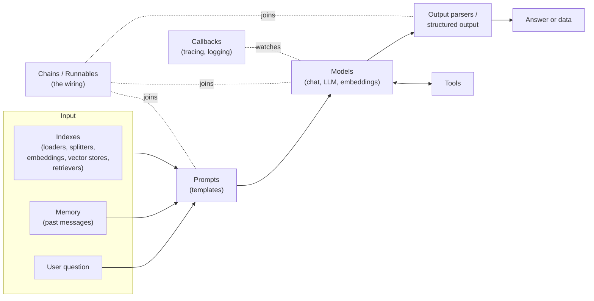

# LangChain Components: The Complete Guide

> 📚 **Before you start**
>
> - [What is LangChain?](what-is-langchain.md), for the idea of standard interfaces and the package split.
> - [Tokens and Context Windows](../../generative-ai-and-llm-foundations/03-how-llms-work/tokens-and-context-windows.md), for why you can't paste every document into a prompt.

## Introduction

Walk into a busy restaurant kitchen in Chennai at lunchtime. There's a person on the tandoor, one on rice, one on chutneys, a runner who carries plates, someone who keeps the order slips, and a head chef who decides who does what next. Each station has a clear job and a clear hand-off: the slip comes in a fixed format, the plate goes out on a fixed counter. Nobody needs to know how the tandoor works to use its naan.

LangChain is organised the same way. It has a handful of **components**, each with one job and a standard hand-off. When people say "LangChain has six components" (models, prompts, chains, memory, indexes, agents) they are naming these stations. In LangChain 1.x a few more deserve their own name: output parsers, tools and callbacks.

This lesson is a guided tour of every component: what it does, what its input and output look like, and where you'll study it in depth. By the end you'll be able to look at any LangChain app and name the role of every line, which makes the rest of the course a matter of filling in detail.

> 💡 **Key Insight**
>
> Every LangChain component has **one job, a standard input and a standard output**. An app is just components handing their output to the next one. Learn the hand-offs (messages, prompt values, documents, tool calls) and you can read any LangChain code.

---

## Core Explanation

### 1. The components at a glance



| Component | Its one job | Standard input → output | Deep dive |
|---|---|---|---|
| **Models** | Talk to an AI model | messages → `AIMessage` (chat); text → text (LLM); text → vector (embeddings) | [Module 3](../../langchain-complete-guide/course.md#m3) |
| **Prompts** | Build the model's input from variables | dict → prompt value | [Module 4](../../langchain-complete-guide/course.md#m4) |
| **Output parsers and structured output** | Turn the model's reply into usable data | `AIMessage` → str / dict / object | [Module 5](../../langchain-complete-guide/course.md#m5) |
| **Chains (runnables)** | Join components into a pipeline | anything → anything | [Module 6](../../langchain-complete-guide/course.md#m6) |
| **Memory** | Keep the conversation so far | past messages → messages to include | [Module 6](../../langchain-complete-guide/course.md#m6) |
| **Indexes** | Find the right pieces of your own data | query → list of `Document`s | [RAG course](../../retrieval-augmented-generation-rag/course.md#m5) |
| **Tools** | Let a model ask your code to act | tool call → result | [Module 7](../../langchain-complete-guide/course.md#m7) |
| **Agents** | Let a model choose tools in a loop | goal → actions and an answer | [LangGraph course](../../langgraph-complete-guide/course.md#m5) |
| **Callbacks** | Observe every step (logging, tracing) | events → your handler | [Module 8](../../langchain-complete-guide/course.md#m8) |

Now let's meet each one with a small, real-looking example. All examples run offline with fake models.

### 2. Models: the engine

A **model component** wraps one AI model behind a standard interface. There are three kinds:

- **Chat models** take a list of messages and return a message. This is what you'll use almost all the time.
- **LLMs** (in LangChain's naming) take a plain string and return a plain string. It's the older style; [LLMs vs Chat Models](../03-models/llms-vs-chat-models.md) explains the difference.
- **Embedding models** turn text into a vector of numbers, used for search.

```python
from langchain_core.language_models.fake_chat_models import FakeListChatModel
from langchain_core.messages import HumanMessage

chat = FakeListChatModel(responses=["Idli and sambar are ₹60."])
reply = chat.invoke([HumanMessage("Price of idli sambar?")])
print(type(reply).__name__, "->", reply.content)
```

Output:

```
AIMessage -> Idli and sambar are ₹60.
```

### 3. Messages: the currency between components

Before going further, meet the objects that flow between most components. A **message** is a small object with a role and content. `langchain-core` has one class per role:

| Class | Role | Who writes it |
|---|---|---|
| `SystemMessage` | system | You: instructions for the whole conversation |
| `HumanMessage` | user | The person using your app |
| `AIMessage` | assistant | The model (it may also contain tool calls) |
| `ToolMessage` | tool | Your code: the result of a tool the model asked for |

```python
from langchain_core.messages import SystemMessage, AIMessage

conversation = [
    SystemMessage("You are a polite waiter at Saravana Mess."),
    HumanMessage("Is the filter coffee strong?"),
    AIMessage("Yes, it's made with fresh decoction and a 70:30 coffee-chicory blend."),
]
for m in conversation:
    print(f"{m.type:>6}: {m.content}")
```

Output:

```
system: You are a polite waiter at Saravana Mess.
 human: Is the filter coffee strong?
    ai: Yes, it's made with fresh decoction and a 70:30 coffee-chicory blend.
```

These are the same roles you met in [System Prompts and Roles](../../generative-ai-and-llm-foundations/04-prompting-and-structured-output/system-prompts-and-roles.md), as Python objects. Each provider package converts them into its own API format, which is why your code never has to.

### 4. Prompts: the order slip

A **prompt template** is a reusable prompt with blanks. You fill it with a dict of values and get back a ready-to-send prompt.

```python
from langchain_core.prompts import ChatPromptTemplate

prompt = ChatPromptTemplate.from_messages([
    ("system", "You are a polite waiter at {restaurant}."),
    ("human", "{question}"),
])
filled = prompt.invoke({"restaurant": "Saravana Mess", "question": "Is the filter coffee strong?"})
for m in filled.to_messages():
    print(f"{m.type:>6}: {m.content}")
```

Output:

```
system: You are a polite waiter at Saravana Mess.
 human: Is the filter coffee strong?
```

Templates keep prompts in one place, make their variables explicit, and can be versioned and tested. Module 4 covers them in depth.

### 5. Output parsers and structured output: the plating

Models return messages, but your code usually wants a string, a dict or a typed object. An **output parser** converts the model's message into that. The simplest one pulls out the text:

```python
from langchain_core.output_parsers import StrOutputParser, CommaSeparatedListOutputParser

print(repr(StrOutputParser().invoke(AIMessage("Filter coffee, ₹25."))))
print(CommaSeparatedListOutputParser().invoke(AIMessage("idli, dosa, vada, pongal")))
```

Output:

```
'Filter coffee, ₹25.'
['idli', 'dosa', 'vada', 'pongal']
```

Modern models can also return structured data directly through **structured output** (`model.with_structured_output(schema)`), which Module 5 compares with parsers.

### 6. Chains and runnables: the wiring

A **chain** joins components so the output of one flows into the next. In current LangChain you build chains with the **LangChain Expression Language (LCEL)**: the `|` operator between **runnables** (anything with `.invoke()`).

```python
chat = FakeListChatModel(responses=["Yes, it's strong: fresh decoction, 70:30 blend."])
chain = prompt | chat | StrOutputParser()
print(chain.invoke({"restaurant": "Saravana Mess", "question": "Is the filter coffee strong?"}))
```

Output:

```
Yes, it's strong: fresh decoction, 70:30 blend.
```

The older way was to use ready-made chain classes such as `LLMChain`; those now live in `langchain-classic`. Module 6 covers chains, LCEL and every runnable building block.

### 7. Memory: the order book

Models don't remember anything between calls. Each call sees only what you send. **Memory** is whatever you do to keep earlier turns and include them next time. In its simplest form that is just a Python list of messages that grows by two after every exchange:

```python
history = []
history.append(HumanMessage("Table for 4 at 8 pm, please."))
history.append(AIMessage("Booked: table for 4 at 8 pm."))
history.append(HumanMessage("Make it 5 people."))
print([f"{m.type}: {m.content}" for m in history])
```

Output:

```
['human: Table for 4 at 8 pm, please.', 'ai: Booked: table for 4 at 8 pm.', 'human: Make it 5 people.']
```

Without the history, "make it 5 people" means nothing to the model. You'll plug history into prompts in [MessagesPlaceholder and Chat History](../04-prompts/messagesplaceholder-and-chat-history.md) and compare memory strategies in [Memory Management](../06-chains-and-runnables/memory-management.md). Older LangChain code used memory *classes* for this (`ConversationBufferMemory`, and later `InMemoryChatMessageHistory`); the first moved to `langchain-classic` in 1.0 and the second was deprecated in langchain-core 1.6.4. For anything long-running, LangGraph's persistence now does this job.

### 8. Indexes: the pantry

A model knows only what it was trained on, and its context window is limited. **Indexes** are the components that let it use *your* data: find the few relevant pieces and put them in the prompt. They form a pipeline of their own:

| Piece | Job | Example |
|---|---|---|
| **Document loader** | Read data from a source into `Document` objects | PDF, web page, CSV, Notion, Google Drive |
| **Text splitter** | Cut long documents into chunks | 1,000-character chunks with overlap |
| **Embedding model** | Turn each chunk into a vector | Voyage, OpenAI or Hugging Face embeddings |
| **Vector store** | Store vectors and search by similarity | Chroma, FAISS, Pinecone, in-memory |
| **Retriever** | Given a query, return the most relevant documents | `vector_store.as_retriever()` |

The unit that flows through all of them is the **`Document`**: some text plus a metadata dict.

```python
from langchain_core.documents import Document

menu = [
    Document("Filter coffee ₹25, made with 70:30 coffee-chicory.", metadata={"section": "drinks"}),
    Document("Masala dosa ₹80, served with sambar and two chutneys.", metadata={"section": "tiffin"}),
    Document("Mini meals ₹150, available 12 to 3 pm.", metadata={"section": "lunch"}),
]

def tiny_retriever(query):
    """Keyword matching, just to show the shape: query in, Documents out."""
    words = set(query.lower().split())
    return [d for d in menu if words & set(d.page_content.lower().replace(",", "").split())]

for doc in tiny_retriever("when are meals available"):
    print(doc.metadata["section"], "|", doc.page_content)
```

Output:

```
lunch | Mini meals ₹150, available 12 to 3 pm.
```

Real retrievers search by meaning using embeddings, which you'll meet in [Embedding Models](../03-models/embedding-models.md) and use fully in the [RAG course](../../retrieval-augmented-generation-rag/course.md#m5).

### 9. Tools: the phone to the supplier

A **tool** is a function the model can ask your code to run: look up an order, check the weather, convert a currency. You describe it (name, purpose, arguments), the model decides when to call it, and your code runs it.

```python
from langchain_core.tools import tool

@tool
def table_available(time: str, people: int) -> bool:
    """Check whether a table for this many people is free at this time (24h, like '20:00')."""
    return people <= 6 and time >= "19:00"

print(table_available.name)
print(table_available.description)
print(table_available.args)
print(table_available.invoke({"time": "20:00", "people": 5}))
```

Output:

```
table_available
Check whether a table for this many people is free at this time (24h, like '20:00').
{'time': {'title': 'Time', 'type': 'string'}, 'people': {'title': 'People', 'type': 'integer'}}
True
```

Look at what the `@tool` decorator produced: a name, a description taken from the docstring, and an argument schema taken from the type hints. That's exactly what a model needs in order to call it. Module 7 covers tools end to end.

### 10. Agents: the head chef

An **agent** is a model that uses tools **in a loop**: it decides on a tool call, your code runs it, the result goes back to the model, and it decides again, until the task is done. In LangChain 1.x you create one with `create_agent`, which runs on LangGraph:

```python
# not-run: needs `pip install langchain langchain-anthropic` and ANTHROPIC_API_KEY
from langchain.agents import create_agent

agent = create_agent(
    model="anthropic:claude-opus-5-5",
    tools=[table_available],
    system_prompt="You take table bookings for Saravana Mess.",
)
result = agent.invoke({"messages": [{"role": "user", "content": "Can 5 of us come at 8 pm?"}]})
print(result["messages"][-1].text)
```

Example output:

```
Yes, a table for 5 is available at 8 pm. Shall I book it for you?
```

This course teaches the pieces an agent is made of (models, messages, tools, tool calling). Building and controlling agents is the subject of [Agentic AI Fundamentals](../../agentic-ai-fundamentals/course.md) and the [LangGraph course](../../langgraph-complete-guide/course.md#m5).

### 11. Callbacks: the CCTV

**Callbacks** let you watch every step without changing it: when a chain starts, when a model starts and ends, when a tool runs. Logging, streaming to a UI and tracing in LangSmith are all built on them. Here's a tiny handler that reports each model call:

```python
from langchain_core.callbacks import BaseCallbackHandler

class CallLogger(BaseCallbackHandler):
    def on_chat_model_start(self, serialized, messages, **kwargs):
        print(f"model called with {len(messages[0])} message(s)")
    def on_llm_end(self, response, **kwargs):
        print("model replied:", response.generations[0][0].text)

chat = FakeListChatModel(responses=["Booked for 5 at 8 pm."])
chain = prompt | chat | StrOutputParser()
chain.invoke({"restaurant": "Saravana Mess", "question": "Book 5 at 8 pm"}, config={"callbacks": [CallLogger()]})
```

Output:

```
model called with 2 message(s)
model replied: Booked for 5 at 8 pm.
```

You passed the handler once to the whole chain, and it reached the model inside. Module 8 builds on this to explain how LangSmith traces work.

### 12. Putting all the stations together

Here is a tiny but complete app that uses most components at once: a retriever finds menu items, a prompt combines them with the history and the question, a model answers, and a parser returns text.

```python
from langchain_core.prompts import MessagesPlaceholder

qa_prompt = ChatPromptTemplate.from_messages([
    ("system", "You answer menu questions for Saravana Mess using only this menu:\n{menu}"),
    MessagesPlaceholder("history"),
    ("human", "{question}"),
])
chat = FakeListChatModel(responses=["Mini meals are served from 12 to 3 pm, for ₹150."])
chain = qa_prompt | chat | StrOutputParser()

question = "when are meals available"
found = tiny_retriever(question)
answer = chain.invoke({
    "menu": "\n".join(d.page_content for d in found),
    "history": history,
    "question": question,
})
print("Menu lines used:", len(found))
print("History messages sent:", len(history))
print("Answer:", answer)
```

Output:

```
Menu lines used: 1
History messages sent: 3
Answer: Mini meals are served from 12 to 3 pm, for ₹150.
```

Every line maps to a station: **index** (retriever), **memory** (history), **prompt**, **model**, **parser**, joined by a **chain**. You'll rebuild this kind of app properly, piece by piece, over the next modules.

---

## Try It Yourself

1. **Label the code.** For each line, name the component: `ChatPromptTemplate.from_messages(...)`, `history.append(HumanMessage(...))`, `StrOutputParser()`, `@tool`, `Document(...)`, `prompt | chat`.
2. **Add a document.** Add a "Rava kesari ₹40, a sweet made with semolina" document to `menu` and show that `tiny_retriever("is kesari sweet")` finds it.
3. **Write a tool.** Write a tool `bill_total(items: list[str]) -> int` that adds up prices from the dict `{"coffee": 25, "dosa": 80, "meals": 150}` and print its argument schema and the result for `["coffee", "dosa"]`.

<details>
<summary>Show answers</summary>

**1.** Prompt template; memory (a growing list of messages); output parser; tool; the unit used by indexes (a document); a chain (LCEL).

**2.**

```python
menu.append(Document("Rava kesari ₹40, a sweet made with semolina.", metadata={"section": "sweets"}))
print([d.metadata["section"] for d in tiny_retriever("is kesari sweet")])
```

Output:

```
['sweets']
```

**3.**

```python
PRICES = {"coffee": 25, "dosa": 80, "meals": 150}

@tool
def bill_total(items: list[str]) -> int:
    """Add up the price in rupees of the ordered items."""
    return sum(PRICES[i] for i in items)

print(bill_total.args)
print(bill_total.invoke({"items": ["coffee", "dosa"]}))
```

Output:

```
{'items': {'items': {'type': 'string'}, 'title': 'Items', 'type': 'array'}}
105
```

</details>

---

## Real-World Examples

- **A bank's FAQ bot** uses loaders and a vector store (indexes) for policy documents, a prompt template with a strict system message, a chat model, and a structured output with `answer` and `needs_human` fields.
- **An e-commerce order assistant** adds tools (`get_order_status`, `start_return`) and keeps chat history per customer session.
- **A meeting-notes summariser** is a pure chain: loader → splitter → prompt → model → parser, with callbacks sending traces to LangSmith.
- **A coding assistant** is an agent: a model with file-reading and test-running tools in a loop, built on LangGraph.

---

## Common Misconceptions

### "Memory is something the model has"

The model is stateless. "Memory" is always your code (or LangGraph) storing messages and sending them again. That's why long chats get more expensive: every turn re-sends the history.

### "Indexes means a database index"

In LangChain's vocabulary, "indexes" is the umbrella name for the components that prepare and search your own documents: loaders, splitters, embeddings, vector stores and retrievers.

### "Agents are a separate thing from the other components"

An agent is built *from* the other components: a chat model, a prompt, tools and memory, wired in a loop. Understanding the components is how you understand agents.

### "Chains are a class you instantiate"

They used to be (`LLMChain` and friends). In current LangChain a chain is just runnables joined with `|`. The old classes still work through `langchain-classic`, but new code shouldn't use them.

---

## Interview Relevance

*"What are the main components of LangChain?"* A strong answer lists models (chat, LLM, embeddings), prompts (templates), output parsers and structured output, chains via LCEL and runnables, memory (chat history), indexes (document loaders, text splitters, embeddings, vector stores, retrievers), tools, agents and callbacks, and explains the **hand-offs**: messages between prompts and models, `Document`s between loaders and retrievers, tool calls between models and tools. Mention that in 1.x memory is usually explicit message history (or LangGraph persistence for agents), chains are LCEL compositions, and agents come from `create_agent` on LangGraph.

---

## Key Takeaways

- **Each component has one job** and a standard input and output, like stations in a kitchen.
- **Messages** (`SystemMessage`, `HumanMessage`, `AIMessage`, `ToolMessage`) and **`Document`s** are the main objects passed between components.
- **Prompts → models → parsers** is the core path; **chains** wire it, **memory** and **indexes** feed it, **tools** extend it.
- **Agents** are a model plus tools in a loop, built from the same components.
- **Callbacks** observe every step, which is how logging and LangSmith tracing work.

---

**Up next:** [Data Connectors and API Integrations](data-connectors-and-api-integrations.md)
