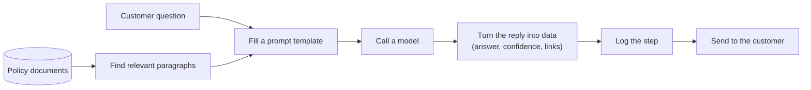
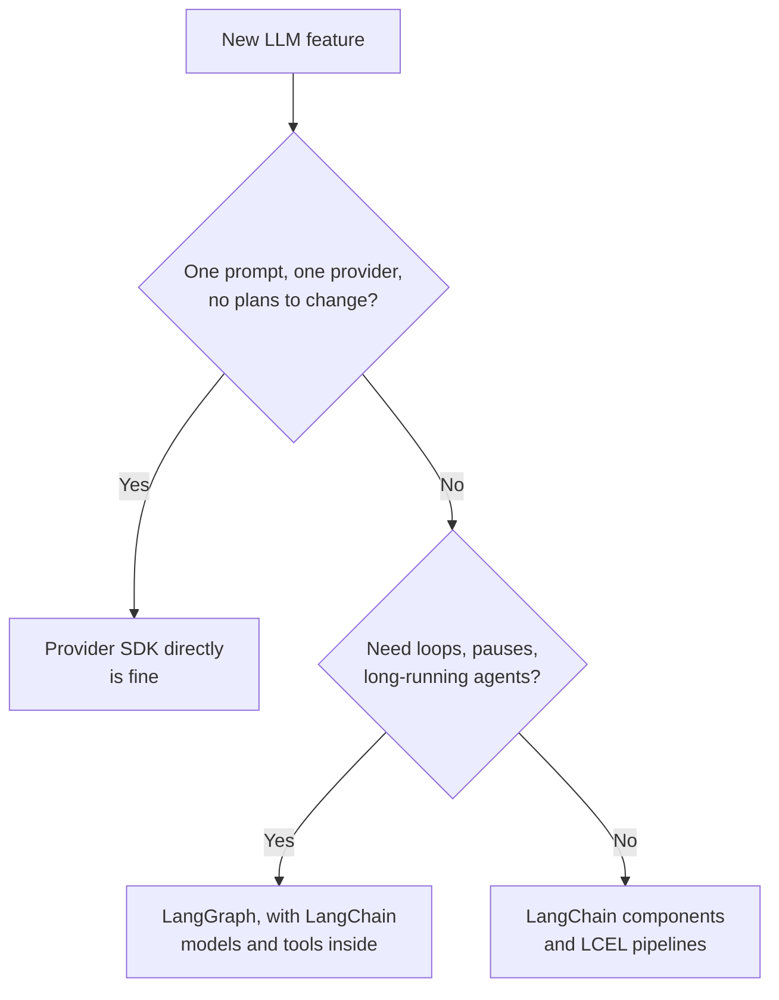

# What is LangChain?: The Complete Guide

> 📚 **Before you start**
>
> - [How This Course Works](../01-start-here/how-this-course-works.md), for how the code examples run offline.
> - [Lab: Your First LLM API Call](../../generative-ai-and-llm-foundations/03-how-llms-work/lab-your-first-llm-api-call.md), where you called a model directly and met the fake chat model.
> - [The GenAI Project Lifecycle](../../generative-ai-and-llm-foundations/05-advances-and-applications/the-genai-project-lifecycle.md), for what a real LLM project needs beyond one call.

## Introduction

Think of a dabbawala in Mumbai. Every morning thousands of tiffins travel from homes to offices, through trains, handcarts and bicycles, and almost none go to the wrong desk. The trick isn't faster trains. It's a **shared system**: every tiffin has the same kind of box and the same coded markings, so any dabbawala can pick up any box, hand it to the next person, and know where it goes.

Building an LLM app without a framework is like every family inventing its own tiffin box. Your code calls Anthropic one way and OpenAI another way. One prompt is an f-string, another is a dictionary. One step returns text, another returns JSON, another returns a list. Every connection between steps is custom code, and changing one step breaks the next.

**LangChain** is the shared system. It is an open-source library, started by Harrison Chase in late 2022 and now maintained by the company LangChain, Inc., that gives every part of an LLM application a **standard shape**: models, prompts, output parsers, tools, retrievers and the pipelines that join them. By the end of this lesson you will know what problem LangChain solves, what it actually contains, how its packages and sister products (LangGraph and LangSmith) fit together, what changed in version 1.0, and when you should *not* use it.

> 💡 **Key Insight**
>
> LangChain is a set of **standard interfaces plus hundreds of integrations** for building LLM apps. Because every model, prompt, parser and tool speaks the same interface, you can **swap** any piece (Claude for a local Llama, one vector database for another) and **compose** pieces into pipelines, without rewriting the code around them.

---

## Core Explanation

### 1. The problem: an LLM app is mostly glue

Look at what a small "answer questions about our return policy" app does on every request:



Only one box is the model. Everything else is **glue code**: templating, retrieval, parsing, logging, retries, swapping providers. In the previous course you wrote this glue by hand, and it worked. The trouble starts when the app grows:

| Pain without a framework | What it looks like in code |
|---|---|
| **Every provider has its own SDK** | `client.messages.create(...)` for Anthropic, `client.chat.completions.create(...)` for OpenAI, different response shapes |
| **Prompts are scattered strings** | f-strings in ten files, no way to list their variables or test them |
| **Output handling is ad hoc** | `json.loads` with a try/except in one place, regex in another |
| **Steps don't fit together** | Step 2 expects a dict, step 1 returns a string; every join is custom |
| **No visibility** | When an answer is wrong, you don't know which step went wrong |
| **Integrations are a project each** | Reading PDFs, calling a search API or a vector database means learning another library every time |

### 2. The answer: standard interfaces

LangChain's answer is to define a small number of **interfaces** (agreed shapes) and make everything implement them:

| Interface | Standard input | Standard output | Example implementations |
|---|---|---|---|
| **Chat model** | A list of messages | An `AIMessage` | `ChatAnthropic`, `ChatOpenAI`, `ChatHuggingFace`, `ChatOllama` |
| **Prompt template** | A dict of variables | A prompt value (messages or text) | `PromptTemplate`, `ChatPromptTemplate` |
| **Output parser** | A model's message | Python data (str, dict, object) | `StrOutputParser`, `JsonOutputParser`, `PydanticOutputParser` |
| **Tool** | Arguments the model chose | A result to send back | `@tool` functions, search tools, database tools |
| **Embedding model** | Text | A list of numbers (a vector) | Voyage, OpenAI, Hugging Face embeddings |
| **Retriever** | A query string | A list of `Document`s | Vector-store retrievers, search retrievers |

And on top of all of them sits one more interface, the **Runnable**: every one of those components can be called with `.invoke()`, `.batch()` and `.stream()`, and any two can be joined with the `|` operator into a pipeline. You'll study runnables properly in [Module 6](../../langchain-complete-guide/course.md#m6); for now, just notice that the same three method names work on everything.

### 3. Seeing the difference in code

Here is the "glue by hand" style: a pretend provider SDK with its own response shape, and our own code to dig the text out.

```python
# A pretend provider SDK, with its own way of doing things.
class PretendProviderClient:
    def create(self, system, user_text):
        return {"output": [{"kind": "text", "value": f"(answer to: {user_text})"}], "tokens": 42}

client = PretendProviderClient()
raw = client.create(system="You answer questions about Chai Junction's menu.",
                    user_text="Do you have masala chai?")
answer = raw["output"][0]["value"]          # we must know this provider's response shape
print(answer)
```

Output:

```
(answer to: Do you have masala chai?)
```

Every provider needs its own version of that last line. Now the same thing with LangChain's standard chat-model interface. `FakeListChatModel` is a chat model from `langchain-core` that replies with scripted text, so this runs without a key:

```python
from langchain_core.language_models.fake_chat_models import FakeListChatModel
from langchain_core.messages import SystemMessage, HumanMessage

model = FakeListChatModel(responses=["Yes, masala chai is ₹30 a cup."])

messages = [
    SystemMessage("You answer questions about Chai Junction's menu."),
    HumanMessage("Do you have masala chai?"),
]
reply = model.invoke(messages)
print(type(reply).__name__)
print(reply.content)
```

Output:

```
AIMessage
Yes, masala chai is ₹30 a cup.
```

The input is a list of standard message objects; the output is a standard `AIMessage`. A real Claude model, a GPT model and a local Llama all accept the same list and return the same type. That means the rest of your app doesn't care which model is behind it:

```python
def answer_question(chat_model, question):
    """Works with ANY LangChain chat model."""
    reply = chat_model.invoke([
        SystemMessage("You answer questions about Chai Junction's menu."),
        HumanMessage(question),
    ])
    return reply.content

model_a = FakeListChatModel(responses=["Yes, masala chai is ₹30 a cup."])
model_b = FakeListChatModel(responses=["Masala chai: available all day, ₹30."])

for name, m in [("model A", model_a), ("model B", model_b)]:
    print(name, "->", answer_question(m, "Do you have masala chai?"))
```

Output:

```
model A -> Yes, masala chai is ₹30 a cup.
model B -> Masala chai: available all day, ₹30.
```

With real models, the swap looks like this. Only the line that creates the model changes:

```python
# not-run: needs `pip install langchain langchain-anthropic langchain-openai` and both API keys
from langchain.chat_models import init_chat_model

claude = init_chat_model("anthropic:claude-opus-5-5")
gpt = init_chat_model("openai:gpt-5.5")

print(answer_question(claude, "Do you have masala chai?"))
print(answer_question(gpt, "Do you have masala chai?"))
```

Example output:

```
Yes! Our masala chai is freshly brewed with ginger and cardamom, ₹30 a cup.
Yes, we serve masala chai all day. A cup is ₹30.
```

### 4. Composing pieces into a pipeline

The second big idea is **composition**. Because every component is a runnable, you can join them with `|`, and the output of one becomes the input of the next. Here a prompt template, a model and an output parser form a pipeline (LangChain calls a pipeline a **chain**):

```python
from langchain_core.prompts import ChatPromptTemplate
from langchain_core.output_parsers import StrOutputParser

prompt = ChatPromptTemplate.from_messages([
    ("system", "You answer questions about {shop}'s menu in one sentence."),
    ("human", "{question}"),
])
model = FakeListChatModel(responses=["Yes, masala chai is ₹30 a cup."])
chain = prompt | model | StrOutputParser()

print(chain.invoke({"shop": "Chai Junction", "question": "Do you have masala chai?"}))
```

Output:

```
Yes, masala chai is ₹30 a cup.
```

Three lines describe the whole flow: fill the template, call the model, pull out the text. Each piece is explained in its own module: prompt templates in [Module 4](../../langchain-complete-guide/course.md#m4), parsers in [Module 5](../../langchain-complete-guide/course.md#m5), and the `|` operator in [Module 6](../../langchain-complete-guide/course.md#m6). The name **LangChain** comes from exactly this: *chaining* language-model steps together.

### 5. What's in the box: the packages

LangChain isn't one package. Since version 0.1 (early 2024) it has been split so you install only what you need, and LangChain 1.0 (October 2025) tidied the split further.


*Your app talks to `langchain-core` interfaces. Provider packages implement them. LangGraph, LangSmith and serving tools sit around everything.*

| Package | What it contains | When you install it |
|---|---|---|
| **`langchain-core`** | The interfaces and base classes: messages, prompt templates, output parsers, runnables, the tool interface, documents, embeddings and vector-store interfaces | Always (it comes with everything else) |
| **`langchain`** | Higher-level helpers: `init_chat_model` (create any model from a string), `create_agent` (a ready-made tool-calling agent) and middleware for agents | Most apps |
| **Provider packages** | One per provider: `langchain-anthropic`, `langchain-openai`, `langchain-google-genai`, `langchain-huggingface`, `langchain-ollama`, and many more | One for each provider you use |
| **`langchain-community`** | Community-maintained integrations: hundreds of document loaders, tools and vector stores that don't have their own package | When you need one of those integrations |
| **`langchain-classic`** | Legacy APIs moved out of `langchain` in 1.0: old chain classes like `LLMChain`, old memory classes, the indexing API and more | Only to keep old code running |
| **`langgraph`** | A library for agents and workflows as graphs, with loops, state, persistence and human approval | When you need loops or long-running agents |
| **`langsmith`** | The client for LangSmith, a hosted platform for tracing, evaluation and prompt management | When you want observability (Module 8) |

Your code imports interfaces from `langchain_core` (or their re-exports in `langchain`) and concrete classes from provider packages:

```python
# not-run: needs `pip install langchain langchain-anthropic`
from langchain_core.prompts import ChatPromptTemplate      # interface, from core
from langchain_anthropic import ChatAnthropic              # implementation, from a provider package
from langchain.chat_models import init_chat_model          # helper, from langchain
from langchain.messages import HumanMessage                # re-export of langchain_core.messages
```

### 6. LangChain, LangGraph and LangSmith

The three names come from the same company and are easy to mix up:

| Product | What it is | Analogy |
|---|---|---|
| **LangChain** | Open-source library of components and integrations | The standard tiffin box and its markings |
| **LangGraph** | Open-source library for stateful, looping workflows and agents built from those components | The route plan: which station, which train, what if a train is late |
| **LangSmith** | A platform (hosted or self-hosted) to trace, evaluate, monitor and deploy LLM apps | The control room that sees every tiffin's journey |

You can use LangChain components without LangGraph (this whole course mostly does), LangGraph without LangChain components, and LangSmith with either, or with plain Python. In LangChain 1.x the ready-made agent (`create_agent`) is itself built on LangGraph, which is why installing `langchain` also installs `langgraph`.

### 7. What changed in LangChain 1.0

If you read tutorials from 2023 and 2024, you'll see classes that no longer exist in `langchain`. Version 1.0 (October 2025) focused the main package and moved the rest:

| Before 1.0 | In 1.x |
|---|---|
| `LLMChain`, `SequentialChain`, `ConversationChain` | Moved to `langchain-classic`; use LCEL pipelines (`prompt \| model \| parser`) instead |
| `ConversationBufferMemory` and other memory classes | Moved to `langchain-classic`; manage message history yourself or use LangGraph persistence |
| `initialize_agent`, `AgentExecutor` | Replaced by `create_agent` (built on LangGraph) |
| `from langchain import hub` | `from langchain_classic import hub`, or LangSmith's own client |
| Message text via `.content` only | `.content` still works; `.text` (a property) and `.content_blocks` (provider-neutral blocks) were added |
| Python 3.8 or 3.9 | Python 3.10 or newer |

The core ideas (models, prompts, parsers, tools, runnables) didn't change, which is why learning them is a good long-term investment.

### 8. Strengths and honest weaknesses

| Strengths | Weaknesses people complain about |
|---|---|
| One interface for 100+ model providers | An extra layer between you and the provider's newest feature |
| Huge library of integrations (loaders, vector stores, tools) | Integrations vary in quality, especially community ones |
| Pipelines get batching, streaming and async for free | Abstractions can hide what's actually sent to the model |
| First-class tracing with LangSmith | The API moved fast; old tutorials break |
| Same concepts in Python and JavaScript | Stack traces through many layers can be long |

Most of these weaknesses are solved by the habits this course teaches: print what you send, trace every run, and pin your package versions.

### 9. When to use LangChain, and when not to



Use LangChain when you want to switch or compare providers, compose several steps, use its integrations (loaders, vector stores, tools), or get tracing and evaluation through LangSmith. Skip it for a one-off script that calls one model once, or when you need a brand-new provider feature on the day it launches (provider SDKs get them first, LangChain usually follows within days).

---

## Try It Yourself

1. **Swap the model.** Write a function `menu_bot(model, question)` that sends a system message and a human message and returns the reply text. Call it with two different `FakeListChatModel`s and show that the function body never changes.
2. **Inspect the reply.** Call a `FakeListChatModel` and print the reply's class name, its `.content` and its `.text`. Are they the same here?
3. **Name the package.** For each import, say which package it comes from: `ChatPromptTemplate`, `ChatAnthropic`, `init_chat_model`, `LLMChain`.

<details>
<summary>Show answers</summary>

**1.**

```python
def menu_bot(model, question):
    reply = model.invoke([SystemMessage("You are Chai Junction's menu assistant."), HumanMessage(question)])
    return reply.content

print(menu_bot(FakeListChatModel(responses=["Samosa is ₹20."]), "Samosa price?"))
print(menu_bot(FakeListChatModel(responses=["₹20 per samosa."]), "Samosa price?"))
```

Output:

```
Samosa is ₹20.
₹20 per samosa.
```

**2.**

```python
reply = FakeListChatModel(responses=["Open 7 am to 10 pm."]).invoke("When are you open?")
print(type(reply).__name__, "|", reply.content, "|", reply.text)
```

Output:

```
AIMessage | Open 7 am to 10 pm. | Open 7 am to 10 pm.
```

They match for a plain text reply. They differ when content is a list of blocks (for example text plus a tool call); `.text` then joins only the text parts. Notice too that `invoke` accepted a plain string: chat models turn it into a single human message.

**3.** `ChatPromptTemplate` comes from `langchain-core` (an interface). `ChatAnthropic` from `langchain-anthropic` (a provider package). `init_chat_model` from `langchain`. `LLMChain` from `langchain-classic` (legacy).

</details>

---

## Real-World Examples

- **Customer-support assistants** at e-commerce companies use LangChain to template prompts with order data, call a model, and parse a structured reply (answer, intent, escalate yes or no).
- **Internal document Q&A** ("what's our leave policy?") is the classic LangChain use case: loaders read PDFs and wiki pages, a vector store indexes them, and a chain answers with citations. You'll build one in the [RAG course](../../retrieval-augmented-generation-rag/course.md).
- **Model comparison**: teams run the same chain against three providers to compare quality and cost before choosing one, which is trivial when only the model line changes.
- **Agents in production** are often LangGraph graphs whose nodes use LangChain models and tools, traced in LangSmith.

---

## Common Misconceptions

### "LangChain is a model or an API you pay for"

LangChain the library is free and open source (MIT licence). You pay the model providers you call, and optionally LangSmith if you use its hosted features.

### "LangChain and LangGraph are competitors"

They are designed to work together. LangChain provides the components; LangGraph orchestrates them when the flow needs loops, state or pauses. The LangGraph course starts by explaining exactly where one ends and the other begins.

### "Using LangChain locks me in"

It does the opposite for models: your code depends on LangChain's interfaces, not on one provider. You do depend on LangChain itself, which is why pinning versions matters.

### "Everything in an old tutorial is wrong now"

The concepts carry over. What changed is mostly *where* things live (legacy classes moved to `langchain-classic`) and *which* pattern is recommended (LCEL pipelines instead of chain classes, `create_agent` instead of `AgentExecutor`).

---

## Interview Relevance

*"What is LangChain and why would you use it?"* A strong answer: an open-source framework that standardises the parts of an LLM app (chat models, prompts, output parsers, tools, retrievers, embeddings) behind common interfaces, all of which are Runnables you can invoke, batch, stream and compose with `|` (LCEL). Benefits: provider independence, composition, a large integration library, built-in streaming and async, and tracing through LangSmith. Mention the package split (`langchain-core`, `langchain`, provider packages, `langchain-community`, `langchain-classic`), how LangGraph (orchestration) and LangSmith (observability) relate, and honest trade-offs (abstraction overhead, API churn). Bonus: what changed in 1.0 (legacy chains and memory moved to `langchain-classic`, `create_agent` replaced `AgentExecutor`).

---

## Key Takeaways

- **LangChain is glue with standard shapes**: every model, prompt, parser and tool follows a common interface.
- **Standard interfaces mean easy swapping**: change one line to move from one model provider to another.
- **Runnables mean easy composing**: `prompt | model | parser` is a complete pipeline.
- **It's a family of packages**: `langchain-core` for interfaces, `langchain` for helpers, provider packages for integrations, `langchain-classic` for legacy code.
- **LangGraph orchestrates, LangSmith observes**; all three work together but are separate.

---

**Up next:** [LangChain Components](langchain-components.md)
