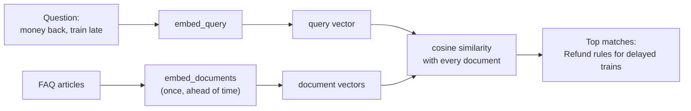

# Embedding Models: The Complete Guide

> 📚 **Before you start**
>
> - [Chat Models](chat-models.md), for the standard model interface and batching.
> - [Word Embeddings](../../nlp-for-machine-learning/course.md#m5) in NLP for Machine Learning, for the idea that words can be vectors. This lesson re-explains what it needs.
> - [What is a Large Language Model?](../../generative-ai-and-llm-foundations/03-how-llms-work/what-is-a-large-language-model.md), where tokens became vectors inside the model.

## Introduction

A passenger types into the IRCTC help bot: *"my train came 5 hours late, can I get my money back?"* Your FAQ has an article titled **"Refund rules for delayed trains (TDR filing)"**. Not one word overlaps: *late* vs *delayed*, *money back* vs *refund*. A keyword search finds nothing. A human sees instantly that they mean the same thing.

**Embedding models** give software that human ability. An embedding model turns a piece of text into a list of numbers (a **vector**) such that texts with **similar meanings get similar vectors**. "Money back for a late train" and "refund rules for delayed trains" land close together; "tatkal booking timings" lands far away. Compare vectors and you're comparing meanings.

Embeddings are the engine of semantic search, recommendations, de-duplication, clustering and, above all, **retrieval-augmented generation (RAG)**, the subject of the next course. In this lesson you'll learn LangChain's `Embeddings` interface, see exactly what an embedding looks like, measure similarity yourself, build a tiny semantic search with a vector store, and learn how to choose a real embedding model.

> 💡 **Key Insight**
>
> An embedding model is a **meaning-to-coordinates** function. LangChain gives every embedding model the same two methods, `embed_query(text)` and `embed_documents(texts)`, so the search code you write works with any provider. Similar meaning means nearby vectors, and "nearby" is measured with **cosine similarity**.

---

## Core Explanation

### 1. What an embedding looks like

An embedding is just a fixed-length list of floating-point numbers. Real models produce between a few hundred and a few thousand numbers per text. A real one, cut short:

```
"refund rules for delayed trains"
→ [0.0213, -0.0487, 0.0112, 0.0645, -0.0031, ..., 0.0179]     (1,024 numbers)
```

No single number means anything a human can name; the **pattern** across all of them encodes meaning. Two facts matter:

- **Every text gets the same length** of vector from a given model, whether it's three words or three paragraphs.
- **Vectors from different models can't be compared.** A vector from one model is meaningless in another model's space. Embed your documents and your queries with the same model.

### 2. The `Embeddings` interface

Every embedding model in LangChain implements `Embeddings` from `langchain_core.embeddings`:

| Method | Input | Output | Used for |
|---|---|---|---|
| `embed_documents(texts)` | A list of strings | A list of vectors | Indexing your documents |
| `embed_query(text)` | One string | One vector | Embedding the user's search |
| `aembed_documents`, `aembed_query` | Same, async | Same | Web servers |

Why two methods instead of one? Some models embed questions and passages slightly differently (they're trained on question → answer pairs), and providers such as Voyage and Cohere take an "input type" for this. The two methods let each integration do the right thing, and your code doesn't need to know.

`langchain-core` ships `DeterministicFakeEmbedding`, which turns text into a fixed random-looking vector (the same text always gives the same vector). It's ideal for tests:

```python
from langchain_core.embeddings import DeterministicFakeEmbedding

fake = DeterministicFakeEmbedding(size=8)
v = fake.embed_query("refund rules for delayed trains")
print(len(v), [round(float(x), 3) for x in v])
print(fake.embed_query("refund rules for delayed trains") == v)
```

Output:

```
8 [-1.586, 0.28, -1.459, -0.908, 0.733, 0.505, 1.391, -0.078]
True
```

But a fake embedding knows nothing about meaning. To *see* meaning, let's build a tiny embedding model of our own.

### 3. A toy embedding model you can read

Real models learn hundreds of hidden "meaning directions" from billions of sentences. Ours will have just five, chosen by hand, and a small synonym list. Each text's vector counts how strongly it touches each direction:

```python
import math
from langchain_core.embeddings import Embeddings

CONCEPTS = ["money", "delay", "booking", "food", "cancel"]
SYNONYMS = {
    "money": {"refund", "money", "fare", "charges", "paid", "back", "tdr"},
    "delay": {"late", "delayed", "delay", "hours", "running"},
    "booking": {"book", "booking", "tatkal", "ticket", "reservation", "pnr"},
    "food": {"food", "meal", "veg", "pantry", "catering", "thali"},
    "cancel": {"cancel", "cancelled", "cancellation", "missed"},
}

class ToyEmbeddings(Embeddings):
    """Five hand-made meaning directions. Real models learn ~1,000 of them."""
    def _embed(self, text):
        words = [w.strip(",.?!()") for w in text.lower().split()]
        vec = [sum(w in SYNONYMS[c] for w in words) for c in CONCEPTS]
        norm = math.sqrt(sum(x * x for x in vec)) or 1.0
        return [round(x / norm, 3) for x in vec]          # scale to length 1

    def embed_documents(self, texts):
        return [self._embed(t) for t in texts]

    def embed_query(self, text):
        return self._embed(text)

toy = ToyEmbeddings()
for text in ["my train came 5 hours late, can I get my money back?",
             "Refund rules for delayed trains (TDR filing)",
             "Tatkal booking timings"]:
    print(f"{toy.embed_query(text)}  <- {text}")
```

Output:

```
[0.707, 0.707, 0.0, 0.0, 0.0]  <- my train came 5 hours late, can I get my money back?
[0.894, 0.447, 0.0, 0.0, 0.0]  <- Refund rules for delayed trains (TDR filing)
[0.0, 0.0, 1.0, 0.0, 0.0]  <- Tatkal booking timings
```

Read the vectors as `[money, delay, booking, food, cancel]`. The passenger's question and the refund article both point mostly at *money* and *delay*, even though they share no words. The tatkal article points somewhere else entirely. Because `ToyEmbeddings` implements the `Embeddings` interface, everything LangChain builds on embeddings (vector stores, retrievers) accepts it.

### 4. Measuring "nearby": cosine similarity

To compare two vectors we use **cosine similarity**: the cosine of the angle between them. It's 1 when they point the same way, 0 when they're unrelated (at right angles), and negative when they point in opposite directions. For vectors scaled to length 1 (most embedding models do this), it's just the dot product.

```python
import numpy as np

def cosine(a, b):
    a, b = np.array(a), np.array(b)
    return float(a @ b / (np.linalg.norm(a) * np.linalg.norm(b)))

q = toy.embed_query("my train came 5 hours late, can I get my money back?")
faq = {
    "Refund rules for delayed trains (TDR filing)": None,
    "Tatkal booking timings": None,
    "Ordering veg meals from the pantry car": None,
    "How to cancel a ticket and the cancellation charges": None,
}
scores = {title: cosine(q, toy.embed_query(title)) for title in faq}
for title, s in sorted(scores.items(), key=lambda kv: -kv[1]):
    print(f"{s:.3f}  {title}")
```

Output:

```
0.949  Refund rules for delayed trains (TDR filing)
0.289  How to cancel a ticket and the cancellation charges
0.000  Tatkal booking timings
0.000  Ordering veg meals from the pantry car
```

The refund article wins clearly. The cancellation article gets partial credit (it mentions *charges*, a money word), which is realistic: related topics score in between.



Other measures you'll see are **dot product** (same as cosine for length-1 vectors) and **Euclidean distance** (smaller is closer). Vector databases let you choose; use what the embedding model's documentation recommends, usually cosine.

### 5. A semantic search with a vector store

Computing similarity against every document by hand gets slow and messy. A **vector store** keeps documents with their vectors and finds the nearest ones for you. `langchain-core` includes a simple `InMemoryVectorStore`:

```python
from langchain_core.vectorstores import InMemoryVectorStore
from langchain_core.documents import Document

store = InMemoryVectorStore(embedding=toy)
store.add_documents([
    Document("Refund rules for delayed trains (TDR filing)", metadata={"id": "faq-12"}),
    Document("Tatkal booking timings", metadata={"id": "faq-03"}),
    Document("Ordering veg meals from the pantry car", metadata={"id": "faq-27"}),
    Document("How to cancel a ticket and the cancellation charges", metadata={"id": "faq-08"}),
])

for doc, score in store.similarity_search_with_score("train running late, want fare back", k=2):
    print(f"{score:.3f}  {doc.metadata['id']}  {doc.page_content}")
```

Output:

```
0.949  faq-12  Refund rules for delayed trains (TDR filing)
0.289  faq-08  How to cancel a ticket and the cancellation charges
```

`add_documents` called `embed_documents` once for all four; the search called `embed_query` for the question. Swap `toy` for a real model and the code stays the same. The in-memory store is for learning and tests; real apps use Chroma, FAISS, pgvector, Pinecone and others, which the [RAG course](../../retrieval-augmented-generation-rag/course.md#m4) compares in depth.

A store can also hand you a **retriever**, the standard "query in, documents out" component you met in [LangChain Components](../02-langchain-foundations/langchain-components.md):

```python
retriever = store.as_retriever(search_kwargs={"k": 1})
print(retriever.invoke("is there veg thali on the train")[0].page_content)
```

Output:

```
Ordering veg meals from the pantry car
```

### 6. Real embedding models

Here's how you'd create real ones. Anthropic doesn't offer its own embedding model and points developers to **Voyage AI**; other common choices are OpenAI, Google, Cohere and open-source models from Hugging Face.

```python
# not-run: needs `pip install langchain langchain-openai` and OPENAI_API_KEY
from langchain.embeddings import init_embeddings

emb = init_embeddings("openai:text-embedding-3-small")
v = emb.embed_query("refund rules for delayed trains")
print(len(v), [round(x, 4) for x in v[:4]])
```

Example output:

```
1536 [0.0213, -0.0487, 0.0112, 0.0645]
```

```python
# not-run: needs `pip install langchain-voyageai` and VOYAGE_API_KEY
from langchain_voyageai import VoyageAIEmbeddings

emb = VoyageAIEmbeddings(model="voyage-3.5")
vectors = emb.embed_documents(["Refund rules for delayed trains", "Tatkal booking timings"])
```

```python
# not-run: needs `pip install langchain-huggingface sentence-transformers` (downloads the model once, runs locally)
from langchain_huggingface import HuggingFaceEmbeddings

emb = HuggingFaceEmbeddings(model_name="sentence-transformers/all-MiniLM-L6-v2")
print(len(emb.embed_query("refund rules for delayed trains")))     # 384
```

| Model family | Runs where | Typical dimensions | Notes |
|---|---|---|---|
| OpenAI `text-embedding-3-small` / `-large` | API | 1,536 / 3,072 | Can be shortened with a `dimensions` setting |
| Voyage (`voyage-3.5` and newer) | API | 1,024 by default | Recommended by Anthropic; has domain models (code, finance, law) |
| Google Gemini embeddings | API | Up to 3,072 | Strong multilingual support |
| Cohere Embed | API | 1,024 or more | Supports query vs document input types |
| `all-MiniLM-L6-v2` | Your machine | 384 | Small, fast, English, good for learning |
| BGE, E5, GTE, multilingual-e5 | Your machine | 384 to 1,024 | Strong open-source options, some multilingual |

Model names and sizes change; check the provider's docs for current versions.

### 7. Choosing an embedding model

| Question | Why it matters |
|---|---|
| **Which languages?** | For Hindi, Tamil or mixed Hinglish text, pick a multilingual model and test it on your own examples |
| **Hosted or local?** | Local models keep data in-house and cost nothing per call, but need a machine to run on |
| **How many dimensions?** | More dimensions can capture more nuance, but cost more storage and slightly slower search; 384 to 1,536 is typical |
| **Maximum input length?** | Text beyond a model's limit (often 512 to 8,000 tokens) is cut off; this is why documents are split into chunks |
| **Domain?** | Legal, medical or code text may need a specialised model |
| **How does it score on *your* data?** | Public leaderboards such as MTEB are a starting point; a 50-question test on your own data is what decides |

Two rules that save painful re-work:

- **Changing the embedding model means re-embedding everything.** Store which model (and version) produced each index.
- **Embed queries and documents with the same model** (and the same settings, such as dimensions).

### 8. Cost, speed and caching

Embedding is cheap compared with chat generation, but it adds up when you index millions of chunks:

- **Batch**: `embed_documents` sends many texts per request, which is far faster than one call per text. Integrations usually split large lists into provider-sized batches for you.
- **Embed once**: document vectors are computed when you index, not on every question. Only the query is embedded per request.
- **Cache**: if you re-index often, cache vectors by text so unchanged documents aren't embedded again. (`CacheBackedEmbeddings` did this in older LangChain and now lives in `langchain-classic`; a dict keyed by a hash of the text works too.)

Here's the caching idea in a few lines:

```python
import hashlib

class CachedEmbeddings(Embeddings):
    def __init__(self, inner):
        self.inner, self.cache, self.calls = inner, {}, 0

    def embed_documents(self, texts):
        missing = [t for t in texts if hashlib.sha256(t.encode()).hexdigest() not in self.cache]
        if missing:
            self.calls += 1
            for t, v in zip(missing, self.inner.embed_documents(missing)):
                self.cache[hashlib.sha256(t.encode()).hexdigest()] = v
        return [self.cache[hashlib.sha256(t.encode()).hexdigest()] for t in texts]

    def embed_query(self, text):
        return self.inner.embed_query(text)

cached = CachedEmbeddings(toy)
cached.embed_documents(["Tatkal booking timings", "Refund rules for delayed trains"])
cached.embed_documents(["Tatkal booking timings", "Refund rules for delayed trains", "Veg thali menu"])
print("calls to the real model:", cached.calls, "| cached texts:", len(cached.cache))
```

Output:

```
calls to the real model: 2 | cached texts: 3
```

The second call only embedded the one new text.

### 9. Beyond search

The same vectors power more than search:

| Use | How embeddings help |
|---|---|
| **Semantic search and RAG** | Find passages by meaning, then give them to a chat model |
| **De-duplication** | Two support tickets with similarity above 0.95 are probably the same issue |
| **Clustering** | Group thousands of app reviews into themes |
| **Classification** | Compare a text with example vectors for each label |
| **Recommendations** | "Users who read this article also liked…" by nearby vectors |
| **Semantic caching** | Reuse a stored answer when a new question is nearly identical to an old one |

---

## Try It Yourself

1. **Add a concept.** Add a `"luggage"` concept to the toy model with the words `{"luggage", "bag", "baggage", "suitcase"}`, then search for "lost my bag on the train" among the FAQ titles plus "Reporting lost baggage". Which comes first?
2. **Similarity by hand.** Compute the cosine similarity of `[1, 0]` and `[0.6, 0.8]` with the `cosine` function. Then explain why it equals the dot product here.
3. **Same model rule.** Embed "refund" with `ToyEmbeddings` (5 numbers) and with `DeterministicFakeEmbedding(size=5)`. Why is comparing these two vectors meaningless even though both have 5 numbers?

<details>
<summary>Show answers</summary>

**1.**

```python
CONCEPTS.append("luggage")
SYNONYMS["luggage"] = {"luggage", "bag", "baggage", "suitcase"}

titles = list(faq) + ["Reporting lost baggage"]
q = toy.embed_query("lost my bag on the train")
best = max(titles, key=lambda t: cosine(q, toy.embed_query(t)))
print(best, "|", len(q), "dimensions now")
```

Output:

```
Reporting lost baggage | 6 dimensions now
```

Adding a dimension changed the shape of *every* vector, which is why changing a real embedding model means re-embedding all your documents.

**2.**

```python
print(round(cosine([1, 0], [0.6, 0.8]), 3))
```

Output:

```
0.6
```

Both vectors already have length 1 (0.6² + 0.8² = 1), so the division by their lengths divides by 1, leaving the dot product 1 × 0.6 + 0 × 0.8 = 0.6.

**3.** The two models map text into different spaces. Position 1 in the toy model means "money"; position 1 in the fake model means nothing in particular. Vectors are only comparable when they come from the same model.

</details>

---

## Real-World Examples

- **E-commerce search** ("kurta for a summer wedding") uses embeddings to find products whose descriptions never contain those exact words.
- **Support deflection**: before a ticket is created, the help desk embeds the question and suggests the three nearest help articles.
- **News and legal research** tools cluster similar documents and flag near-duplicates using similarity thresholds.
- **RAG chatbots** over company documents, which you'll build in the next course, are embeddings plus a vector store plus a chat model.

---

## Common Misconceptions

### "Embedding models are just smaller chat models"

They're trained for a different job: placing texts so that similar meanings are close. They don't generate text at all, and a chat model's API doesn't give you its internal vectors.

### "Higher similarity means the document answers the question"

Similarity means "about the same thing". A passage can be very similar and still not contain the answer. That's why RAG systems often add a second step (reranking) and always let the chat model decide.

### "More dimensions is always better"

Bigger vectors cost more to store and search, and a well-trained smaller model often beats a bigger one on your data. Measure.

### "I can switch embedding models later without re-indexing"

Every stored vector belongs to the model that made it. A new model needs a full re-embed.

---

## Interview Relevance

*"What are embeddings and how do you use them in LangChain?"* A strong answer: an embedding model maps text to a fixed-length vector where semantic similarity becomes geometric closeness, usually measured by cosine similarity. LangChain's `Embeddings` interface has `embed_documents` (for indexing) and `embed_query` (for searching), so vector stores and retrievers work with any provider (OpenAI, Voyage, Cohere, Google, Hugging Face via `init_embeddings` or provider classes). Discuss choosing a model (language, domain, dimensions, max input length, hosted vs local, evaluation on your own data), the "same model for queries and documents" rule, re-embedding when switching models, batching and caching, and uses beyond RAG (dedup, clustering, classification, semantic caching).

---

## Key Takeaways

- **An embedding is a vector that encodes meaning**; similar texts get nearby vectors.
- **LangChain's `Embeddings` interface** has `embed_documents` for indexing and `embed_query` for searching, the same for every provider.
- **Cosine similarity** measures closeness; for length-1 vectors it's the dot product.
- **Vector stores** keep documents with their vectors and return the nearest ones; `as_retriever()` turns them into a retriever.
- **Choose models by testing on your own data**, embed queries and documents with the same model, and re-embed everything if you switch.

---

**Up next:** [Open-Source Models with Hugging Face](open-source-models-with-hugging-face.md)
