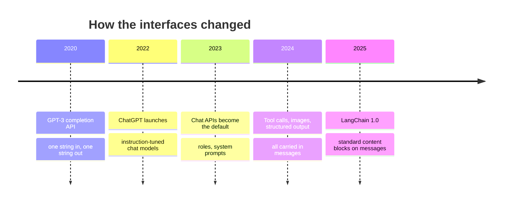

# LLMs vs Chat Models: The Complete Guide

> 📚 **Before you start**
>
> - [LangChain Components](../02-langchain-foundations/langchain-components.md), for message classes and the model component.
> - [What is a Large Language Model?](../../generative-ai-and-llm-foundations/03-how-llms-work/what-is-a-large-language-model.md), for next-token prediction, pretraining and instruction tuning.

## Introduction

Imagine two ways to ask a shopkeeper for something. In the first, you hand over a half-written note: *"Two kilos of basmati rice, one packet of…"* and the shopkeeper finishes the sentence. In the second, you have a conversation: you say what you want, the shopkeeper replies, you clarify, and both of you know who said what.

Language models have been offered through both styles. The older style is **text completion**: you send one string, the model continues it. The newer style is **chat**: you send a list of messages with roles (system, user, assistant), and the model replies with a message. LangChain names these two interfaces **LLMs** and **chat models**.

The names are confusing, because both are large language models underneath. This lesson clears it up: what each interface takes and returns, how LangChain converts between them, why chat models won, and how to recognise the old style in code you inherit. You'll also meet the third model type, embeddings, which the next lessons cover in depth.

> 💡 **Key Insight**
>
> In LangChain, **"LLM" means an interface, not a kind of model**: string in, string out. A **chat model** takes a list of role-tagged messages and returns an `AIMessage` that can carry text, tool calls and usage data. Every modern model is offered as a chat model, so new code should use chat models.

---

## Core Explanation

### 1. The three model interfaces


*Three interfaces, three jobs. Generation uses chat models; search uses embeddings; the plain-text LLM interface mostly appears in older code.*

| Interface | Base class in `langchain-core` | Input | Output | Used for |
|---|---|---|---|---|
| **LLM** | `BaseLLM` (and `LLM`) | A string | A string | Old completion-style models, some local runtimes |
| **Chat model** | `BaseChatModel` | A list of messages (or a string) | An `AIMessage` | Almost all generation today |
| **Embedding model** | `Embeddings` | Text | A list of floats | Search, similarity, clustering |

### 2. The LLM interface: string in, string out

`langchain-core` includes `FakeListLLM`, a scripted LLM, so we can see the interface offline:

```python
from langchain_core.language_models.fake import FakeListLLM

llm = FakeListLLM(responses=[" Thiruvananthapuram."])
out = llm.invoke("The capital of Kerala is")
print(type(out).__name__, repr(out))
```

Output:

```
str ' Thiruvananthapuram.'
```

A plain Python string. Note the leading space: a completion model **continues** your text, so its output often starts mid-sentence. This is how GPT-3 and other early models were used in 2020 to 2022: you wrote the beginning of a document and the model wrote the rest.

### 3. The chat model interface: messages in, a message out

```python
from langchain_core.language_models.fake_chat_models import FakeListChatModel
from langchain_core.messages import SystemMessage, HumanMessage

chat = FakeListChatModel(responses=["The capital of Kerala is Thiruvananthapuram."])
reply = chat.invoke([
    SystemMessage("You are a geography tutor for Class 8 students."),
    HumanMessage("What is the capital of Kerala?"),
])
print(type(reply).__name__)
print(reply.content)
```

Output:

```
AIMessage
The capital of Kerala is Thiruvananthapuram.
```

The reply is a **message object**, not a string. That matters because a modern reply is more than text. An `AIMessage` has these fields:

| Field | What it holds |
|---|---|
| `content` | The text (or a list of content blocks: text, images, reasoning…) |
| `text` | Just the text parts joined, as a convenient property |
| `tool_calls` | Tools the model wants your code to run (Module 7) |
| `usage_metadata` | Token counts: input, output, total |
| `response_metadata` | Provider details: model name, stop reason |
| `id` | An identifier for this message |

A plain string has no room for tool calls or token counts, which is one big reason chat models replaced LLMs.

### 4. Why chat models won

Three changes in the models themselves made chat the standard interface:

1. **Instruction tuning and preference training.** Modern models are trained on conversations with roles, as you saw in [What is a Large Language Model?](../../generative-ai-and-llm-foundations/03-how-llms-work/what-is-a-large-language-model.md). They behave best when the input looks like a conversation.
2. **Roles give structure and safety.** A separate system role lets you set rules that the model treats differently from user text, which completion prompts couldn't express.
3. **Messages carry more than text.** Images, tool calls, tool results and reasoning all fit into structured messages.

Providers followed. Anthropic's API is the Messages API, OpenAI marked its old Completions endpoint as legacy, and newer models are only offered through chat-style APIs. LangChain's docs now say the same: use chat models for new work.



### 5. LangChain converts between the two

Here's a detail that confuses people: you can pass a **string** to a chat model and **messages** to an LLM. LangChain converts them for you. To see the conversion, let's build a tiny LLM that simply returns the prompt it received:

```python
from langchain_core.language_models.llms import LLM

class EchoLLM(LLM):
    """An LLM that returns exactly the text it was given, to show what it receives."""
    @property
    def _llm_type(self):
        return "echo"

    def _call(self, prompt, stop=None, run_manager=None, **kwargs):
        return prompt

echo = EchoLLM()
print(echo.invoke([
    SystemMessage("You are a geography tutor."),
    HumanMessage("What is the capital of Kerala?"),
]))
```

Output:

```
System: You are a geography tutor.
Human: What is the capital of Kerala?
```

When an LLM gets messages, LangChain **flattens them into one string** with role labels. The model sees plain text and has to guess where its answer should go; the clean separation of roles is lost.

The other way round, a string sent to a chat model becomes a single `HumanMessage`. `ParrotFakeChatModel` (another fake in `langchain-core`) replies with the last message it received, so we can see what arrived:

```python
from langchain_core.language_models.fake_chat_models import ParrotFakeChatModel

parrot = ParrotFakeChatModel()
received = parrot.invoke("What is the capital of Kerala?")
print(type(received).__name__, "|", received.content)
```

Output:

```
HumanMessage | What is the capital of Kerala?
```

(A real chat model would return an `AIMessage`; the parrot hands back the message it received so we can inspect it.) The string became a user message. Both conversions are convenient, but be explicit in real code: send messages to chat models, so you control the roles.

### 6. Same interface on top: both are runnables

Both kinds of model share the runnable methods, so code that calls `invoke`, `batch` or `stream` works with either:

```python
questions = ["Capital of Kerala?", "Capital of Assam?"]

llm = FakeListLLM(responses=["Thiruvananthapuram", "Dispur"])
chat = FakeListChatModel(responses=["Thiruvananthapuram", "Dispur"])

print("LLM batch :", llm.batch(questions))
print("Chat batch:", [m.content for m in chat.batch(questions)])
```

Output:

```
LLM batch : ['Thiruvananthapuram', 'Dispur']
Chat batch: ['Thiruvananthapuram', 'Dispur']
```

The difference is only in the output type: strings from the LLM, messages from the chat model. An output parser such as `StrOutputParser` smooths this over in pipelines, as you'll see in [Module 5](../../langchain-complete-guide/course.md#m5).

### 7. Base models vs instruction-tuned models

There is a real distinction hiding behind the LLM-vs-chat naming, and it's about the **model**, not the interface:

| | Base (pretrained) model | Instruction-tuned (chat) model |
|---|---|---|
| Trained to | Continue any text | Follow instructions in a conversation |
| Ask it "What is the capital of Kerala?" | Might continue with more questions: "What is the capital of Goa? What is..." | Answers the question |
| Typical interface | Completion (LLM) | Chat |
| Where you meet it | Open-weight research releases, fine-tuning starting points | Every commercial API, most open-weight releases |

Open-weight families such as Llama, Qwen and Gemma often publish both a base version and an "Instruct" version. When you run one locally through Hugging Face (two lessons from now), pick the Instruct version for chat-style use.

### 8. Recognising the old style in existing code

You'll inherit code written in the LLM style. Here's how to spot it and what to write instead:

| Old (LLM style) | Current (chat style) |
|---|---|
| `from langchain_openai import OpenAI` | `from langchain_openai import ChatOpenAI` |
| `from langchain_community.llms import ...` | the provider's chat class, or `init_chat_model("provider:model")` |
| `llm("Translate to Hindi: hello")` (calling the object) | `chat.invoke([HumanMessage("Translate to Hindi: hello")])` |
| `PromptTemplate` with a big string containing "System:" and "Human:" labels | `ChatPromptTemplate.from_messages([("system", ...), ("human", ...)])` |
| `result` is a `str` | `result` is an `AIMessage`; use `.text` or a parser |
| `LLMChain(llm=..., prompt=...)` | `prompt | chat | StrOutputParser()` |

```python
# not-run: needs `pip install langchain-openai` and OPENAI_API_KEY; shown to compare styles
from langchain_openai import OpenAI, ChatOpenAI

old = OpenAI(model="gpt-3.5-turbo-instruct")   # legacy completion class; providers are retiring such models
print(old.invoke("The capital of Kerala is"))           # -> ' Thiruvananthapuram.'

new = ChatOpenAI(model="gpt-5.5")                       # chat interface
print(new.invoke("What is the capital of Kerala?").text)
```

Example output:

```
 Thiruvananthapuram.
The capital of Kerala is Thiruvananthapuram.
```

### 9. When you might still use the LLM interface

- **Some local runtimes and older wrappers** expose only text generation (for example a raw Hugging Face text-generation pipeline). LangChain lets you wrap these in a chat interface, as you'll see in [Open-Source Models with Hugging Face](../../langchain-complete-guide/course.md#m3).
- **Pure text continuation** tasks with a base model, such as autocomplete in an editor.
- **Reading legacy code**, which is by far the most common reason.

For everything else, use a chat model.

---

## Try It Yourself

1. **See the flattening.** Send `[SystemMessage("Answer in Hindi."), HumanMessage("Good morning")]` to `EchoLLM` and print the result. What is lost compared with sending the same list to a chat model?
2. **Type check.** Write `def get_text(result)` that returns the text whether `result` came from an LLM (a `str`) or a chat model (an `AIMessage`). Test it on both fakes.
3. **Spot the style.** Is each line LLM style or chat style? (a) `OpenAI(model=...)`; (b) `init_chat_model("anthropic:claude-opus-5-5")`; (c) `reply.usage_metadata`; (d) `llm("Hello")`.

<details>
<summary>Show answers</summary>

**1.**

```python
print(echo.invoke([SystemMessage("Answer in Hindi."), HumanMessage("Good morning")]))
```

Output:

```
System: Answer in Hindi.
Human: Good morning
```

The model receives one block of text. Nothing marks "System:" as rules with higher authority than "Human:"; they're just words. A chat model receives them as separate, role-tagged messages, which it was trained to treat differently.

**2.**

```python
def get_text(result):
    return result if isinstance(result, str) else result.text

print(get_text(FakeListLLM(responses=["Dispur"]).invoke("Capital of Assam?")))
print(get_text(FakeListChatModel(responses=["Dispur"]).invoke("Capital of Assam?")))
```

Output:

```
Dispur
Dispur
```

In a pipeline you'd put `StrOutputParser()` after the model instead; it does exactly this.

**3.** (a) LLM style (the legacy completion class). (b) Chat style. (c) Chat style (only messages carry usage metadata). (d) LLM style, and an old one: calling the object directly was removed in favour of `.invoke()`.

</details>

---

## Real-World Examples

- **Migration projects**: teams upgrading LangChain apps from 2023 replace `OpenAI(...)` completion classes and `LLMChain` with chat models and LCEL pipelines, usually improving quality because instruction-tuned chat models follow prompts better.
- **Code autocomplete** tools still use completion-style calls on code models, because the task genuinely is "continue this text".
- **Local deployments** often start with a raw text-generation pipeline and wrap it as a chat model so the rest of the app uses one interface.

---

## Common Misconceptions

### "LLMs and chat models are different kinds of AI"

Both are large language models. "LLM" and "chat model" in LangChain name two **interfaces**. The same underlying model can sit behind either.

### "Chat models are only for chatbots"

"Chat" describes the input format (role-tagged messages), not the app. Summarisation, extraction, classification and agents all use chat models.

### "Passing a string to a chat model is wrong"

It works: LangChain wraps it in a `HumanMessage`. It's just less explicit than building the message list yourself, and you can't add a system message that way.

### "`.content` is always a string"

For a plain text reply it is. When a reply includes several blocks (reasoning, text, tool use), `content` can be a list. Use `.text` when you just want the text.

---

## Interview Relevance

*"What's the difference between an LLM and a chat model in LangChain?"* A strong answer: both wrap large language models; the LLM interface is string in, string out (completion style, `BaseLLM`), the chat model interface is a list of role-tagged messages in and an `AIMessage` out (`BaseChatModel`), which can carry tool calls, usage metadata and multimodal content. Chat models are the standard because modern models are instruction-tuned on conversations and providers expose chat APIs; LangChain converts between the two (flattening messages to text, or wrapping a string as a `HumanMessage`). Bonus: distinguish base and instruction-tuned models, and mention migrating legacy `OpenAI` / `LLMChain` code to `ChatModel` plus LCEL.

---

## Key Takeaways

- **"LLM" in LangChain means the string-in, string-out interface**; "chat model" means messages in, `AIMessage` out.
- **Chat models are the default** for all new work: they keep roles separate and carry tool calls, usage data and rich content.
- **LangChain converts** messages to flattened text for LLMs and strings to `HumanMessage` for chat models; be explicit anyway.
- **Base vs instruction-tuned** is the real model-level difference; choose Instruct models for chat-style use.
- **Both interfaces are runnables**, so `invoke`, `batch` and `stream` work on either.

---

**Up next:** [Chat Models](chat-models.md)
