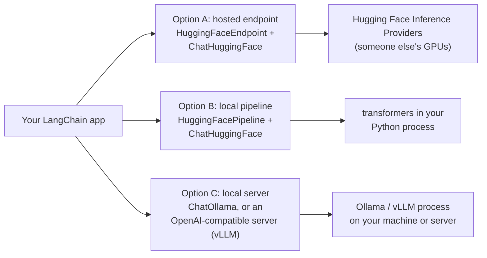

# Open-Source Models with Hugging Face: The Complete Guide

> 📚 **Before you start**
>
> - [Chat Models](chat-models.md) and [LLMs vs Chat Models](llms-vs-chat-models.md), for the two generation interfaces and base vs instruction-tuned models.
> - [Embedding Models](embedding-models.md), where you met local Hugging Face embeddings.
> - [Foundation Models](../../generative-ai-and-llm-foundations/02-fundamentals-of-generative-ai/foundation-models.md), for open-weight vs closed models.

## Introduction

A hospital in Pune wants a chatbot that summarises discharge notes. Legal says patient data must never leave the hospital's own servers. A school in rural Odisha wants an offline Odia tutor on a laptop with patchy internet. A startup wants to cut its model bill for a simple classification task that runs a million times a day. All three end up at the same place: **open-weight models**, whose weights you can download and run yourself.

**Hugging Face** is the main home of these models: a hub hosting hundreds of thousands of them (Llama, Qwen, Mistral, Gemma, DeepSeek, Phi and many more), plus the `transformers` library to run them and hosted services to call them without your own GPU. LangChain connects to all of it through the `langchain-huggingface` package, and to local runtimes like Ollama through their own packages, so an open model slots into the same chains as Claude.

This lesson explains what "open-source" means for models, how to pick one and size the hardware, the three ways to run one from LangChain (hosted endpoint, local pipeline, local server), why chat templates matter, and how to decide between open and hosted models.

> 💡 **Key Insight**
>
> An open-weight model becomes **just another chat model** in LangChain: `ChatHuggingFace`, `ChatOllama` or an OpenAI-compatible endpoint all return `AIMessage`s, so your prompts, parsers and chains don't change. What changes is **who runs the model** (you or a provider), and with it cost, privacy, speed and quality.

---

## Core Explanation

### 1. What "open" means for a model

A model has three parts that can each be open or closed: the **weights** (the learned numbers), the **training code**, and the **training data**. Most "open-source models" are really **open-weight**: you can download and run the weights, but the data usually isn't published.

| | Closed (API-only) | Open-weight |
|---|---|---|
| Examples | Claude, GPT, Gemini | Llama, Qwen, Mistral, Gemma, DeepSeek, Phi |
| You get | An API endpoint | The weight files |
| Runs on | The provider's servers | Your laptop, your servers, or any host you choose |
| Data leaves your network? | Yes (to the provider) | Not if you run it yourself |
| Cost model | Per token | Per hour of hardware (or per token from a host) |
| Customising | Prompting; some fine-tuning services | Full fine-tuning, quantisation, anything |

**Licences differ, and they matter.** Some models use permissive licences like Apache 2.0 or MIT (Mistral's and Qwen's open releases mostly do); others use custom licences with conditions (Llama's community licence, Gemma's terms). Read the licence on the model card before shipping a product.

### 2. Reading a Hugging Face model page

Every model on the Hub has an ID like `organisation/model-name` and a **model card**. Before choosing one, check:

| On the model card | What to look for |
|---|---|
| **Model ID** | e.g. `Qwen/Qwen3-8B` or `meta-llama/Llama-3.1-8B-Instruct` |
| **Size** | Parameters: 1B, 8B, 70B… which decides hardware |
| **Base or Instruct** | For chat, choose the **Instruct**/chat version |
| **Licence** | Commercial use allowed? Any conditions? Some models are "gated" until you accept terms |
| **Context length** | How many tokens it can read at once |
| **Languages** | Does it handle Hindi, Tamil, Bengali well? Test it |
| **Task** | `text-generation` for chat models, `feature-extraction` / sentence-similarity for embeddings |

### 3. Will it fit? Sizing the hardware

A model's weights must fit in memory (GPU memory, ideally). The rough rule: **parameters × bytes per parameter**, plus some headroom for the context.

```python
def weights_gb(params_billion, bits):
    return params_billion * 1e9 * bits / 8 / 1e9

print(f"{'model':<8}{'16-bit':>9}{'8-bit':>9}{'4-bit':>9}   (GB of memory for the weights alone)")
for size in [1, 3, 8, 14, 70]:
    print(f"{str(size) + 'B':<8}" + "".join(f"{weights_gb(size, b):>9.1f}" for b in (16, 8, 4)))
```

Output:

```
model      16-bit    8-bit    4-bit   (GB of memory for the weights alone)
1B            2.0      1.0      0.5
3B            6.0      3.0      1.5
8B           16.0      8.0      4.0
14B          28.0     14.0      7.0
70B         140.0     70.0     35.0
```

**Quantisation** stores weights with fewer bits (8-bit, 4-bit), shrinking memory a lot for a small loss in quality. That's how an 8B model runs on a laptop with 8 GB to spare. Add 20 to 30 percent on top for the context (the "KV cache"), more for long prompts.

| Hardware | Comfortable model sizes |
|---|---|
| Laptop CPU, 16 GB RAM | 1B to 8B, 4-bit (slow but usable) |
| Apple Silicon Mac, 16 to 32 GB | 8B to 14B, 4-bit |
| One 24 GB GPU | 8B at 16-bit; 14B to 32B at 4-bit |
| One 80 GB GPU | 70B at 8-bit, or smaller models with many users |

### 4. Three ways to run an open model from LangChain



| Option | Needs | Good for |
|---|---|---|
| **A. Hosted endpoint** | A Hugging Face token; no GPU | Trying many open models quickly; pay-per-use |
| **B. Local pipeline** | `transformers`, `torch`, enough RAM/GPU | Experiments, notebooks, small models, full control |
| **C. Local server** | Ollama or vLLM running as a separate process | Apps: one server, many clients, fast, easy to swap models |

Install the integration first:

```bash
pip install langchain-huggingface
export HUGGINGFACEHUB_API_TOKEN="hf_..."     # from Hugging Face → Settings → Access tokens
```

**Option A: a hosted endpoint.** `HuggingFaceEndpoint` calls a model hosted through Hugging Face's Inference Providers; `ChatHuggingFace` wraps it as a chat model:

```python
# not-run: needs `pip install langchain-huggingface` and HUGGINGFACEHUB_API_TOKEN
from langchain_huggingface import HuggingFaceEndpoint, ChatHuggingFace

llm = HuggingFaceEndpoint(
    repo_id="Qwen/Qwen3-8B",
    task="text-generation",
    max_new_tokens=256,
    provider="auto",              # let Hugging Face pick an inference provider
)
chat = ChatHuggingFace(llm=llm)
print(chat.invoke("In one sentence, what is a PNR number?").text)
```

Example output:

```
A PNR (Passenger Name Record) number is a unique 10-digit code that identifies your railway booking and its passengers.
```

**Option B: a local pipeline.** `HuggingFacePipeline` downloads the model and runs it in your Python process with `transformers`:

```python
# not-run: needs `pip install langchain-huggingface transformers torch` and downloads ~1 GB on first run
from langchain_huggingface import HuggingFacePipeline, ChatHuggingFace

llm = HuggingFacePipeline.from_model_id(
    model_id="Qwen/Qwen2.5-0.5B-Instruct",       # tiny, runs on a laptop CPU
    task="text-generation",
    pipeline_kwargs={"max_new_tokens": 128},
)
chat = ChatHuggingFace(llm=llm)
print(chat.invoke("Give me two tips for a long train journey.").text)
```

**Option C: a local server with Ollama.** Ollama is a popular app that downloads and serves quantised open models with one command (`ollama pull qwen3:8b`). LangChain talks to it through `langchain-ollama`:

```python
# not-run: needs Ollama running locally (`ollama pull qwen3:8b`) and `pip install langchain-ollama`
from langchain_ollama import ChatOllama

chat = ChatOllama(model="qwen3:8b", temperature=0)
print(chat.invoke("Translate to Hindi: Your train is on platform 4.").text)
```

Many serving tools (vLLM, llama.cpp's server, LM Studio, and Ollama too) also expose an **OpenAI-compatible** API. Any of them can then be used through `ChatOpenAI` with a `base_url`:

```python
# not-run: needs a vLLM server on localhost:8000 and `pip install langchain-openai`
from langchain_openai import ChatOpenAI

chat = ChatOpenAI(model="Qwen/Qwen3-8B", base_url="http://localhost:8000/v1", api_key="not-needed")
```

### 5. Chat templates: why `ChatHuggingFace` exists

An open model is, underneath, a text-in, text-out model (the **LLM** interface from two lessons ago). Instruct models were trained on conversations written in a very specific format, with **special tokens** marking where each role starts and ends. This format is the model's **chat template**, and every model family has its own. If you send the wrong format, quality drops sharply.

Here's roughly what a Llama 3 style template does to a conversation:

```python
from langchain_core.messages import SystemMessage, HumanMessage

def llama3_style_template(messages):
    """A simplified Llama 3 style chat template, to show the idea."""
    role = {"system": "system", "human": "user", "ai": "assistant"}
    text = "<|begin_of_text|>"
    for m in messages:
        text += f"<|start_header_id|>{role[m.type]}<|end_header_id|>\n\n{m.content}<|eot_id|>"
    return text + "<|start_header_id|>assistant<|end_header_id|>\n\n"   # the model writes from here

print(llama3_style_template([
    SystemMessage("You are a polite railway assistant."),
    HumanMessage("Is the Duronto running late?"),
]))
```

Output:

```
<|begin_of_text|><|start_header_id|>system<|end_header_id|>

You are a polite railway assistant.<|eot_id|><|start_header_id|>user<|end_header_id|>

Is the Duronto running late?<|eot_id|><|start_header_id|>assistant<|end_header_id|>
```

Compare that with the plain "System: … Human: …" flattening you saw in [LLMs vs Chat Models](llms-vs-chat-models.md). `ChatHuggingFace` takes your messages and applies **the model's own chat template** (read from its tokenizer on the Hub), so you always write ordinary `SystemMessage`/`HumanMessage` objects and the model always sees the format it was trained on. That's why you wrap `HuggingFaceEndpoint` or `HuggingFacePipeline` in `ChatHuggingFace` instead of using them raw.

### 6. Wrapping any local model yourself

Sometimes your model runs behind something LangChain has no integration for: an in-house inference server, a model on a phone, a research script. You can wrap any text generator as a LangChain model by subclassing `LLM` (or `SimpleChatModel`) and implementing one method. Here a stand-in function plays the part of a local model:

```python
from langchain_core.language_models.llms import LLM
from langchain_core.prompts import PromptTemplate
from langchain_core.output_parsers import StrOutputParser

def in_house_generate(prompt: str, max_new_tokens: int = 64) -> str:
    """Stand-in for a call to your own model server."""
    return "Tip 1: carry a chain lock for your luggage. Tip 2: download offline maps before you leave."

class InHouseLLM(LLM):
    max_new_tokens: int = 64

    @property
    def _llm_type(self):
        return "in-house"

    def _call(self, prompt, stop=None, run_manager=None, **kwargs):
        return in_house_generate(prompt, self.max_new_tokens)

prompt = PromptTemplate.from_template("Give two short tips for a {journey}.")
chain = prompt | InHouseLLM(max_new_tokens=80) | StrOutputParser()
print(chain.invoke({"journey": "36-hour train journey"}))
```

Output:

```
Tip 1: carry a chain lock for your luggage. Tip 2: download offline maps before you leave.
```

It now works with every other LangChain component: prompts, parsers, batching, streaming, fallbacks, tracing.

### 7. Open-source embeddings

Embeddings are where open models shine most: small, fast, free to run, and often as good as hosted ones for search. You saw `HuggingFaceEmbeddings` in the last lesson:

```python
# not-run: needs `pip install langchain-huggingface sentence-transformers`
from langchain_huggingface import HuggingFaceEmbeddings

emb = HuggingFaceEmbeddings(model_name="intfloat/multilingual-e5-small")   # handles Hindi and other languages
vectors = emb.embed_documents(["ट्रेन लेट है, रिफंड कैसे मिलेगा?", "Refund rules for delayed trains"])
```

A common, cost-effective architecture is **open embeddings + hosted chat model**: embeddings run locally on every document for free, and only the final answer uses a paid model.

### 8. Open or hosted? Deciding

| Factor | Favours open-weight | Favours hosted (Claude, GPT, Gemini) |
|---|---|---|
| **Data privacy and residency** | Data must stay on your servers | Provider terms and regions are acceptable |
| **Quality on hard tasks** | | The strongest reasoning and coding models are hosted |
| **Volume and cost** | Very high volume of a simple task, steady load | Spiky or low volume (no idle GPUs to pay for) |
| **Latency control** | You control the hardware and location | |
| **Offline use** | Must work without internet | |
| **Customisation** | You need to fine-tune deeply | |
| **Operations effort** | You have people to run GPUs | You want no infrastructure |

Many real systems mix both: a small open model for classification or routing, a hosted model for the hard parts, and LangChain making both look the same.

```python
from langchain_core.language_models.fake_chat_models import FakeListChatModel

# Stand-ins: in production, `small_local` would be ChatOllama(...) and `strong_hosted` init_chat_model("anthropic:...").
small_local = FakeListChatModel(responses=["easy"])
strong_hosted = FakeListChatModel(responses=["(detailed answer from the hosted model)"])

def route(question):
    difficulty = small_local.invoke(f"Reply 'easy' or 'hard': {question}").content
    return "small local model" if difficulty == "easy" else "strong hosted model"

print(route("What time does the Shatabdi leave?"))
```

Output:

```
small local model
```

You'll build proper routers with structured output in Module 5 and conditional chains in Module 6.

---

## Try It Yourself

1. **Size it.** Using `weights_gb`, how much memory do the weights of a 32B model need at 4-bit? Would it fit on a 24 GB GPU with 25 percent headroom for context?
2. **Write a template.** Write `chatml_template(messages)` for the ChatML format used by several model families: each message becomes `<|im_start|>{role}\n{content}<|im_end|>\n` (roles `system`, `user`, `assistant`), ending with `<|im_start|>assistant\n`. Print it for a system and a user message.
3. **Choose.** For each, pick open-weight or hosted and give one reason: (a) a bank's internal tool summarising customer complaints that must not leave its data centre; (b) a startup's first prototype of a coding assistant; (c) an offline Odia reading tutor.

<details>
<summary>Show answers</summary>

**1.**

```python
need = weights_gb(32, 4) * 1.25
print(f"{weights_gb(32, 4):.1f} GB weights, about {need:.1f} GB with headroom ->", "fits" if need <= 24 else "does not fit")
```

Output:

```
16.0 GB weights, about 20.0 GB with headroom -> fits
```

It fits, though long contexts or many parallel users would push it over.

**2.**

```python
def chatml_template(messages):
    role = {"system": "system", "human": "user", "ai": "assistant"}
    text = "".join(f"<|im_start|>{role[m.type]}\n{m.content}<|im_end|>\n" for m in messages)
    return text + "<|im_start|>assistant\n"

print(chatml_template([SystemMessage("You are a tutor."), HumanMessage("What is 7 x 8?")]))
```

Output:

```
<|im_start|>system
You are a tutor.<|im_end|>
<|im_start|>user
What is 7 x 8?<|im_end|>
<|im_start|>assistant
```

**3.** (a) Open-weight, run in the bank's data centre: data residency rules decide it. (b) Hosted: the best coding quality and no infrastructure while you find out if the product works. (c) Open-weight on the device: it must work offline (check the model's Odia quality first).

</details>

---

## Real-World Examples

- **Hospitals and banks** run open models like Llama or Qwen on their own GPUs for summarisation and extraction, so sensitive data never leaves.
- **Indian-language startups** fine-tune open models on Hindi, Tamil or Bengali data, which closed models don't allow to the same depth.
- **Developers** run Ollama on their laptops to build and test LangChain apps offline, then switch the model string to a hosted model in production.
- **High-volume pipelines** (tagging millions of product listings) use a small open model on rented GPUs, which can be far cheaper than per-token pricing at that scale.

---

## Common Misconceptions

### "Open-source models are free"

The weights are free; running them isn't. GPUs, electricity, engineers and monitoring cost money. At low volume, hosted APIs are usually cheaper.

### "Open models are always worse"

The best hosted models still lead on the hardest reasoning tasks, but open models are excellent for many everyday jobs (classification, extraction, summarisation, embeddings), especially after fine-tuning.

### "Any open model can be used commercially"

Licences vary. Some are permissive (Apache 2.0, MIT), some have conditions or usage policies. Always read the licence on the model card.

### "I can send messages to an open model as plain text"

You can, but quality drops if the text doesn't follow the model's chat template. Use `ChatHuggingFace` (or a server like Ollama that applies the template for you).

---

## Interview Relevance

*"How would you use an open-source model in a LangChain app, and when would you choose one?"* A strong answer: pick an Instruct model on Hugging Face (check size, licence, context length, languages); estimate memory as parameters × bytes per parameter and use quantisation to fit; run it via `HuggingFaceEndpoint` (hosted Inference Providers) or `HuggingFacePipeline` (local `transformers`), wrapped in `ChatHuggingFace` so the model's chat template is applied, or via a local server (`ChatOllama`, or vLLM through `ChatOpenAI(base_url=...)`). Because it's a standard chat model, the rest of the chain is unchanged. Choose open-weight for privacy, offline use, deep customisation or very high steady volume; hosted for top quality, low operations effort and spiky load; and often combine them.

---

## Key Takeaways

- **Open-weight models** can be downloaded and run anywhere; check the **licence** and pick the **Instruct** version for chat.
- **Memory ≈ parameters × bytes per parameter**; quantisation (8-bit, 4-bit) makes big models fit.
- **Three ways to run them**: hosted endpoint (`HuggingFaceEndpoint`), local pipeline (`HuggingFacePipeline`), or a local server (Ollama, vLLM).
- **`ChatHuggingFace` applies the model's chat template**, so you keep writing normal messages.
- **To LangChain it's just another chat model**, so you can mix open and hosted models in one app.

---

**Up next:** [Static vs Dynamic Prompts](../04-prompts/static-vs-dynamic-prompts.md)
