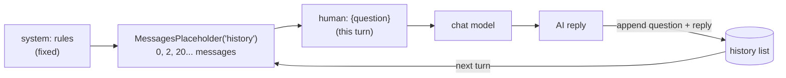

# MessagesPlaceholder and Chat History: The Complete Guide

> 📚 **Before you start**
>
> - [ChatPromptTemplate and Messages](chatprompttemplate-and-messages.md), for message classes and chat templates.
> - [Tokens and Context Windows](../../generative-ai-and-llm-foundations/03-how-llms-work/tokens-and-context-windows.md), for why long conversations get expensive and eventually don't fit.
> - [Session State](../../apis-and-apps-fastapi-streamlit-and-docker/07-state-and-responsiveness/session-state.md), helpful for the chat-app example at the end.

## Introduction

Call a bank's helpline, explain your problem to the first agent, get transferred, and the second agent says: "Can you explain the problem from the beginning?" Infuriating. The second agent had no **history**.

Every call to a chat model is like that transfer. The model remembers **nothing** from earlier calls. When a user asks "and what about the AC 2-tier fare?", the model only understands "and" if your app sends the earlier turns along with the new question. Chat history is something **your code** keeps and resends.

`ChatPromptTemplate` from the last lesson has fixed slots for single values. History is different: it's a **list of messages** whose length changes every turn. `MessagesPlaceholder` is the slot for exactly that. In this lesson you'll build a working multi-turn chat with a placeholder, keep separate histories for separate users, save and reload them as JSON, and keep long conversations within the context window by trimming.

> 💡 **Key Insight**
>
> The model is stateless; **memory is a list of messages your code stores and resends**. A `MessagesPlaceholder` marks where that list goes inside a chat template, between the system rules and the new question. Everything else about chat memory (per-user storage, trimming, summarising) is deciding *which* messages to put in that list.

---

## Core Explanation

### 1. Proof that the model forgets

Let's use a model that replies with how many messages it received, so we can see exactly what it was given. `SimpleChatModel` (from [Chat Models](../03-models/chat-models.md)) makes this easy:

```python
from langchain_core.language_models import SimpleChatModel

class CountingModel(SimpleChatModel):
    """Replies with what it can see, to show how much context arrived."""
    @property
    def _llm_type(self):
        return "counting"

    def _call(self, messages, stop=None, run_manager=None, **kwargs):
        roles = [m.type for m in messages]
        return f"I received {len(messages)} message(s): {roles}"

model = CountingModel()
print(model.invoke("My name is Kavya. I'm travelling Pune to Delhi.").content)
print(model.invoke("What's my name?").content)
```

Output:

```
I received 1 message(s): ['human']
I received 1 message(s): ['human']
```

The second call saw one message: "What's my name?" and nothing else. A real model would have to say it doesn't know.

### 2. `MessagesPlaceholder`: a slot for a list of messages

```python
from langchain_core.prompts import ChatPromptTemplate, MessagesPlaceholder
from langchain_core.messages import HumanMessage, AIMessage

prompt = ChatPromptTemplate.from_messages([
    ("system", "You are a friendly IRCTC travel assistant."),
    MessagesPlaceholder("history"),
    ("human", "{question}"),
])
print(prompt.input_variables)

history = [
    HumanMessage("My name is Kavya. I'm travelling Pune to Delhi."),
    AIMessage("Nice to meet you, Kavya! Which date are you travelling?"),
]
for m in prompt.invoke({"history": history, "question": "What's my name?"}).to_messages():
    print(f"{m.type:>6} | {m.content}")
```

Output:

```
['history', 'question']
system | You are a friendly IRCTC travel assistant.
 human | My name is Kavya. I'm travelling Pune to Delhi.
    ai | Nice to meet you, Kavya! Which date are you travelling?
 human | What's my name?
```

The placeholder expanded into however many messages `history` held: two here, twenty later. That's the whole trick.



There's also a shorthand: the tuple `("placeholder", "{history}")` creates the same placeholder, marked optional:

```python
short = ChatPromptTemplate.from_messages([
    ("system", "You are a friendly IRCTC travel assistant."),
    ("placeholder", "{history}"),
    ("human", "{question}"),
])
print(len(short.invoke({"question": "Hi!"}).to_messages()), "messages when history is left out")
```

Output:

```
2 messages when history is left out
```

### 3. Optional placeholders and what they accept

By default a `MessagesPlaceholder` is **required**: forgetting it raises an error, which catches bugs. On the very first turn you can pass an empty list, or make the slot optional:

```python
optional_prompt = ChatPromptTemplate.from_messages([
    ("system", "You are a friendly IRCTC travel assistant."),
    MessagesPlaceholder("history", optional=True),
    ("human", "{question}"),
])
print(optional_prompt.input_variables, optional_prompt.optional_variables)
```

Output:

```
['question'] ['history']
```

The placeholder accepts message objects, `(role, text)` tuples, or role/content dicts, and converts them all to messages. That's handy when history comes from a database or a web front end as JSON:

```python
from_web = [{"role": "user", "content": "Pune to Delhi on 3 Nov"},
            {"role": "assistant", "content": "The Pune-Delhi Duronto runs that day."}]
msgs = prompt.invoke({"history": from_web, "question": "What's the fare?"}).to_messages()
print([type(m).__name__ for m in msgs])
```

Output:

```
['SystemMessage', 'HumanMessage', 'AIMessage', 'HumanMessage']
```

### 4. A working multi-turn chat

Now put it together: after each turn, append the user's question and the model's reply to the history.

```python
from langchain_core.language_models.fake_chat_models import FakeListChatModel

chat_model = FakeListChatModel(responses=[
    "Nice to meet you, Kavya! Which date are you travelling?",
    "Got it, 3 November. The Pune-Delhi Duronto has 3A seats available.",
    "Your name is Kavya, and you're travelling Pune to Delhi on 3 November.",
])
chain = prompt | chat_model

history = []
def chat(question):
    reply = chain.invoke({"history": history, "question": question})
    history.extend([HumanMessage(question), reply])     # remember both sides
    return reply.content

for q in ["My name is Kavya. I'm travelling Pune to Delhi.", "On 3 November.", "Remind me of my trip details?"]:
    print("User:", q)
    print("Bot :", chat(q))
print("Messages stored:", len(history))
```

Output:

```
User: My name is Kavya. I'm travelling Pune to Delhi.
Bot : Nice to meet you, Kavya! Which date are you travelling?
User: On 3 November.
Bot : Got it, 3 November. The Pune-Delhi Duronto has 3A seats available.
User: Remind me of my trip details?
Bot : Your name is Kavya, and you're travelling Pune to Delhi on 3 November.
Messages stored: 6
```

(The fake's replies are scripted, so they'd be the same without history. Let's prove history really reaches the model by swapping in the counting model.)

```python
history = []
chain = prompt | CountingModel()
for q in ["My name is Kavya.", "On 3 November.", "What's my name?"]:
    print(chat(q))
```

Output:

```
I received 2 message(s): ['system', 'human']
I received 4 message(s): ['system', 'human', 'ai', 'human']
I received 6 message(s): ['system', 'human', 'ai', 'human', 'ai', 'human']
```

Each turn, the model receives everything said so far. That's what makes the third question answerable.

### 5. One history per user (sessions)

A real app serves many users at once, and Kavya's history must never leak into Rahul's chat. Store one list per **session id** (a user id, a chat id, a browser session):

```python
store = {}            # session_id -> list of messages (in production: a database)

def chat_in_session(session_id, question):
    history = store.setdefault(session_id, [])
    reply = (prompt | CountingModel()).invoke({"history": history, "question": question})
    history.extend([HumanMessage(question), reply])
    return reply.content

chat_in_session("kavya-01", "My name is Kavya.")
chat_in_session("rahul-07", "Hi, I'm Rahul.")
print("kavya:", chat_in_session("kavya-01", "What's my name?"))
print("rahul:", chat_in_session("rahul-07", "What's my name?"))
print({sid: len(msgs) for sid, msgs in store.items()})
```

Output:

```
kavya: I received 4 message(s): ['system', 'human', 'ai', 'human']
rahul: I received 4 message(s): ['system', 'human', 'ai', 'human']
{'kavya-01': 4, 'rahul-07': 4}
```

Each session sees only its own turns. In production the dict becomes a table in Redis, Postgres or SQLite, keyed by session id.

Older LangChain code wraps this pattern in classes: `ConversationBufferMemory` (now in `langchain-classic`), and later `RunnableWithMessageHistory` with `InMemoryChatMessageHistory`. Both of the latter were deprecated in langchain-core 1.6 in favour of LangGraph's persistence, which saves the conversation per `thread_id` automatically. You'll compare these approaches in [Memory Management](../../langchain-complete-guide/course.md#m6) and use LangGraph's version in the [LangGraph course](../../langgraph-complete-guide/course.md#m6). The plain list you just wrote is exactly what they manage for you.

### 6. Saving and loading history as JSON

To store history in a database or file, convert messages to plain dicts and back. `langchain-core` has helpers for this:

```python
import json
from langchain_core.messages import messages_to_dict, messages_from_dict

saved = json.dumps(messages_to_dict(store["kavya-01"]))
print(saved[:90] + "...")

restored = messages_from_dict(json.loads(saved))
print([f"{m.type}: {m.content[:20]}" for m in restored])
```

Output:

```
[{"type": "human", "data": {"content": "My name is Kavya.", "additional_kwargs": {}, "resp...
['human: My name is Kavya.', 'ai: I received 2 message', "human: What's my name?", 'ai: I received 4 message']
```

The round trip keeps each message's type, so the restored list goes straight back into the placeholder.

### 7. Long conversations: trimming the history

History grows by two messages every turn. After a long chat it costs more tokens on every call, slows replies down and eventually exceeds the context window. The simplest fix is to **trim**: send only the most recent part. `trim_messages` does this carefully, keeping whole turns and starting on a human message so the conversation still makes sense:

```python
from langchain_core.messages import trim_messages

long_history = []
for i in range(1, 7):
    long_history += [HumanMessage(f"Question {i}"), AIMessage(f"Answer {i}")]

recent = trim_messages(
    long_history,
    max_tokens=4,            # here a "token" is one message, because of token_counter=len below
    token_counter=len,       # count messages; with a real model, pass the model to count real tokens
    strategy="last",         # keep the most recent messages
    start_on="human",        # never start on a dangling AI reply
)
print([m.content for m in recent])
```

Output:

```
['Question 5', 'Answer 5', 'Question 6', 'Answer 6']
```

With a real model, pass `token_counter=model` (or `count_tokens_approximately` from `langchain_core.messages.utils`) and a real token budget such as `max_tokens=3000`. Trimming fits neatly in front of the prompt:

```python
def trimmed_chat(question, history, budget=4):
    window = trim_messages(history, max_tokens=budget, token_counter=len, strategy="last", start_on="human")
    return (prompt | CountingModel()).invoke({"history": window, "question": question}).content

print(trimmed_chat("Question 7", long_history))
```

Output:

```
I received 6 message(s): ['system', 'human', 'ai', 'human', 'ai', 'human']
```

The stored history still has all 12 messages; only the window sent to the model is trimmed. The trade-off: anything older is forgotten. Summarising old turns instead of dropping them is covered in [Memory Management](../../langchain-complete-guide/course.md#m6).

### 8. Placeholders for more than chat history

A `MessagesPlaceholder` is a slot for **any** list of messages, not just past chat:

| Placeholder name | What goes in it |
|---|---|
| `history` | Earlier conversation turns |
| `examples` | Few-shot example pairs chosen per request |
| `agent_scratchpad` | An agent's tool calls and tool results so far (older agent code uses this name) |
| `context_messages` | Pre-built messages with retrieved documents |

Wherever a variable-length list of messages must appear in a fixed position, a placeholder is the tool.

---

## Try It Yourself

1. **Window of two turns.** Using `trim_messages` with `token_counter=len`, keep the last two **turns** (four messages) of `long_history`, but always keep a system message that you put at the start. Hint: add `SystemMessage("rules")` at the front and pass `include_system=True`.
2. **Required vs optional.** What happens if you invoke the original `prompt` (required placeholder) with only `{"question": "Hi"}`? Catch the error and print its type.
3. **Reset a session.** Write `reset(session_id)` that clears one user's history in `store` without touching others, and show the message counts afterwards.

<details>
<summary>Show answers</summary>

**1.**

```python
from langchain_core.messages import SystemMessage

with_system = [SystemMessage("rules")] + long_history
window = trim_messages(with_system, max_tokens=5, token_counter=len, strategy="last",
                       start_on="human", include_system=True)
print([m.content for m in window])
```

Output:

```
['rules', 'Question 5', 'Answer 5', 'Question 6', 'Answer 6']
```

The budget of 5 covers the system message plus two full turns.

**2.**

```python
try:
    prompt.invoke({"question": "Hi"})
except Exception as e:
    print(type(e).__name__)
```

Output:

```
KeyError
```

A required placeholder must be given (an empty list is fine). Making it optional, or using the `("placeholder", "{history}")` shorthand, removes the error.

**3.**

```python
def reset(session_id):
    store[session_id] = []

reset("rahul-07")
print({sid: len(msgs) for sid, msgs in store.items()})
```

Output:

```
{'kavya-01': 4, 'rahul-07': 0}
```

</details>

---

## Real-World Examples

- **Every chat product** (support widgets, banking assistants, tutoring apps) stores messages per conversation id and resends a window of them each turn.
- **WhatsApp business bots** keep history per phone number in Redis with an expiry, so a conversation "forgets" after a day of silence.
- **Cost control**: teams cap history by tokens with `trim_messages` and summarise anything older, keeping per-turn cost flat.
- **Agents** keep their tool calls and results in a message list too; LangGraph stores it per thread with checkpointers.

---

## Common Misconceptions

### "The model remembers the conversation"

It doesn't. Each call is independent; the app resends the history. That's why history length directly drives cost.

### "Chat history means sending everything forever"

Long histories must be trimmed or summarised, both for cost and to fit the context window. What you keep is a design decision.

### "Putting history in the system message as text is the same"

Pasting old turns into one big text block loses the role structure. A placeholder keeps them as real human and AI messages, which models handle best.

### "One global history list is fine for a demo, so it's fine in production"

A single list mixes every user's conversation together, a privacy bug. Always key history by session.

---

## Interview Relevance

*"How do you add conversation memory to a LangChain chat app?"* A strong answer: models are stateless, so the app stores messages and resends them; `MessagesPlaceholder("history")` (or `("placeholder", "{history}")`) in a `ChatPromptTemplate` marks where the list goes; after each turn append the human message and AI reply; store histories per session id in a database (serialise with `messages_to_dict`/`messages_from_dict`); control growth with `trim_messages` (token budget, `strategy="last"`, `start_on="human"`, `include_system`) or summarisation. Mention that `ConversationBufferMemory` is legacy (`langchain-classic`), `RunnableWithMessageHistory` is deprecated, and LangGraph checkpointers with `thread_id` are the current approach for persistent conversations and agents.

---

## Key Takeaways

- **Models are stateless**: chat memory is a list of messages your app stores and resends.
- **`MessagesPlaceholder("history")`** is the slot for that list inside a `ChatPromptTemplate`; `("placeholder", "{history}")` is an optional shorthand.
- **Keep one history per session**, and serialise it with `messages_to_dict` / `messages_from_dict`.
- **Trim long histories** with `trim_messages` so cost and context stay under control.
- **Legacy memory classes** wrapped this same pattern; LangGraph persistence is the modern way for long-running chats.

---

**Up next:** [Lab: A prompt-templated assistant](lab-a-prompt-templated-assistant.md)
