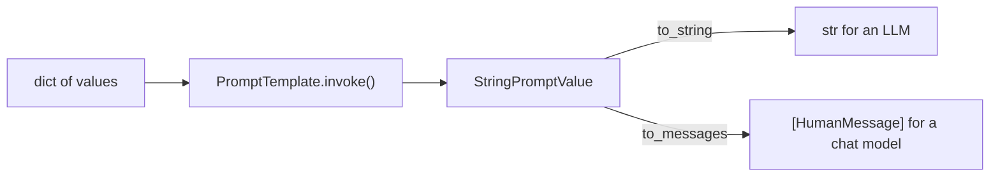

# Prompt Templates: The Complete Guide

> 📚 **Before you start**
>
> - [Static vs Dynamic Prompts](static-vs-dynamic-prompts.md), for why templates beat hand-made strings.
> - [Prompting Fundamentals](../../generative-ai-and-llm-foundations/04-prompting-and-structured-output/prompting-fundamentals.md), for few-shot examples.

## Introduction

Every Indian office has a drawer of templates: the leave application, the rent agreement, the "no objection certificate". Nobody rewrites a rent agreement from scratch; you take the standard one, fill in the names, the address, the rent and the date, and maybe fix a clause that never changes (the city's stamp-duty rules) in advance. The template carries years of tested wording; the blanks carry today's details.

`PromptTemplate` is that drawer for prompts. In the last lesson you saw why templates beat f-strings. In this lesson you'll learn the class properly: creating templates, inspecting and filling them, the prompt value they produce, partially filling them, combining them, three template syntaxes, few-shot templates that carry examples, and how to store and version templates in a real project.

> 💡 **Key Insight**
>
> A `PromptTemplate` is a **runnable that turns a dict into a prompt value**. Everything else (listing variables, partial filling, combining, few-shot examples) is a convenience on top of that one job. Because it's a runnable, a template is the natural first step of every chain.

---

## Core Explanation

### 1. Creating a template

The usual way is `PromptTemplate.from_template`, which finds the `{slots}` for you:

```python
from langchain_core.prompts import PromptTemplate

leave = PromptTemplate.from_template(
    "Write a polite leave application to {manager} for {days} days of leave "
    "from {start_date}, because {reason}. Keep it under 120 words."
)
print(leave.input_variables)
print(leave.template[:40] + "...")
```

Output:

```
['days', 'manager', 'reason', 'start_date']
Write a polite leave application to {man...
```

You can also use the constructor and name the variables yourself. LangChain then checks that the names match the template:

```python
leave2 = PromptTemplate(
    template="Write a polite leave application to {manager} for {days} days of leave.",
    input_variables=["manager", "days"],
)
print(leave2.input_variables)
```

Output:

```
['days', 'manager']
```

`from_template` is shorter and can't get the list wrong, so prefer it.

### 2. Filling a template: `invoke`, `format` and the prompt value

There are two ways to fill a template:

```python
values = {"manager": "Ms. Iyer", "days": 3, "start_date": "4 November", "reason": "my sister's wedding in Kochi"}

text = leave.format(**values)                 # returns a plain str
pv = leave.invoke(values)                     # returns a PromptValue (the runnable way)

print(type(text).__name__, "|", text[:60])
print(type(pv).__name__)
print(pv.to_string() == text)
print(pv.to_messages())
```

Output:

```
str | Write a polite leave application to Ms. Iyer for 3 days of l
StringPromptValue
True
[HumanMessage(content="Write a polite leave application to Ms. Iyer for 3 days of leave from 4 November, because my sister's wedding in Kochi. Keep it under 120 words.", additional_kwargs={}, response_metadata={})]
```

`invoke` returns a **prompt value**, a small object that can become either a **string** (for LLM-interface models) or a **list of messages** (for chat models). This is why the same template works with both kinds of model, and why you'll normally use `invoke` (or put the template in a chain) rather than `format`.



### 3. Templates in a chain

Put a template in front of a model with `|` and the prompt value flows straight in:

```python
from langchain_core.language_models.fake_chat_models import FakeListChatModel

model = FakeListChatModel(responses=["Dear Ms. Iyer, I request leave for 3 days from 4 November..."])
chain = leave | model
print(chain.invoke(values).content)
```

Output:

```
Dear Ms. Iyer, I request leave for 3 days from 4 November...
```

`batch` works on the whole chain, so you can generate many filled prompts and replies in one go. (The `|` operator gets its own lesson in [Module 6](../../langchain-complete-guide/course.md#m6).)

### 4. Partial templates: fix some values in advance

Often some values are known early (the company name, today's date) and the rest arrive later. `.partial()` returns a **new** template with those slots filled:

```python
notice = PromptTemplate.from_template(
    "You write notices for {company}. Today is {date}.\nWrite a short notice about: {topic}"
)
saffron_notice = notice.partial(company="Saffron Softech, Pune")
print(saffron_notice.input_variables)
print(saffron_notice.invoke({"date": "17 Oct 2026", "topic": "Diwali holidays"}).to_string())
```

Output:

```
['date', 'topic']
You write notices for Saffron Softech, Pune. Today is 17 Oct 2026.
Write a short notice about: Diwali holidays
```

A partial value can also be a **function**, called every time the template is filled. That's how you keep "today's date" current without passing it on each call:

```python
from datetime import date

def today():
    return date(2026, 10, 17).strftime("%d %b %Y")       # fixed here so the output is reproducible

dated_notice = notice.partial(company="Saffron Softech, Pune", date=today)
print(dated_notice.input_variables)
print(dated_notice.invoke({"topic": "office closed on Diwali"}).to_string().splitlines()[0])
```

Output:

```
['topic']
You write notices for Saffron Softech, Pune. Today is 17 Oct 2026.
```

(In real code `today` would return `date.today()`.)

### 5. Combining templates

Templates can be joined with `+`, which is handy for building a prompt from reusable parts (a shared rules block plus a task-specific block):

```python
rules = PromptTemplate.from_template("Rules: reply in {language}; never invent dates.\n")
task = PromptTemplate.from_template("Task: summarise this circular for parents: {circular}")
combined = rules + task
print(combined.input_variables)
print(combined.invoke({"language": "English", "circular": "School closed 20-24 Oct for Diwali."}).to_string())
```

Output:

```
['circular', 'language']
Rules: reply in English; never invent dates.
Task: summarise this circular for parents: School closed 20-24 Oct for Diwali.
```

### 6. Literal braces and other template syntaxes

By default templates use Python's f-string style (`{name}`), so literal braces must be doubled, just as with `str.format`:

```python
json_prompt = PromptTemplate.from_template(
    'Classify the complaint. Reply only with JSON like {{"category": "billing"}}.\nComplaint: {text}'
)
print(json_prompt.input_variables)
print(json_prompt.format(text="Charged twice for one recharge"))
```

Output:

```
['text']
Classify the complaint. Reply only with JSON like {"category": "billing"}.
Complaint: Charged twice for one recharge
```

If your prompt contains a lot of braces (code, JSON examples), you can switch syntax with `template_format`:

| `template_format` | Slot syntax | Notes |
|---|---|---|
| `"f-string"` (default) | `{name}` | Double literal braces: `{{` `}}` |
| `"mustache"` | `{{name}}` | Single braces are left alone, so JSON is easy |
| `"jinja2"` | `{{ name }}`, plus `` loops | Needs the `jinja2` package. Never use with templates from untrusted sources |

```python
mustache = PromptTemplate.from_template(
    'Reply only with JSON like {"category": "billing"}.\nComplaint: {{text}}',
    template_format="mustache",
)
print(mustache.invoke({"text": "App crashes on UPI payment"}).to_string())
```

Output:

```
Reply only with JSON like {"category": "billing"}.
Complaint: App crashes on UPI payment
```

**Security note:** a template is code-like. Write templates yourself; never build a template from user input (put user input in a **value**, not in the template text). This matters most for `jinja2`, which can run logic.

### 7. Few-shot templates

Showing the model a few examples of input → output is one of the strongest prompting techniques ([Prompting Fundamentals](../../generative-ai-and-llm-foundations/04-prompting-and-structured-output/prompting-fundamentals.md) explained why). `FewShotPromptTemplate` formats a list of examples with an example template and places them between a prefix and a suffix:

```python
from langchain_core.prompts import FewShotPromptTemplate

examples = [
    {"complaint": "Refund of ₹499 not received after 10 days", "category": "billing"},
    {"complaint": "Delivery boy was rude at the gate", "category": "delivery"},
    {"complaint": "App logs me out every time I open it", "category": "app"},
]
example_prompt = PromptTemplate.from_template("Complaint: {complaint}\nCategory: {category}")

few_shot = FewShotPromptTemplate(
    examples=examples,
    example_prompt=example_prompt,
    prefix="Classify each complaint as billing, delivery or app.",
    suffix="Complaint: {complaint}\nCategory:",
    input_variables=["complaint"],
    example_separator="\n\n",
)
print(few_shot.invoke({"complaint": "Paid by UPI but order shows unpaid"}).to_string())
```

Output:

```
Classify each complaint as billing, delivery or app.

Complaint: Refund of ₹499 not received after 10 days
Category: billing

Complaint: Delivery boy was rude at the gate
Category: delivery

Complaint: App logs me out every time I open it
Category: app

Complaint: Paid by UPI but order shows unpaid
Category:
```

When you have hundreds of examples, you don't want all of them in every prompt. An **example selector** picks the most relevant few for each input (for example, by embedding similarity, using the embeddings from [Embedding Models](../03-models/embedding-models.md)), and is passed as `example_selector=` instead of `examples=`. For chat models, the equivalent class is `FewShotChatMessagePromptTemplate`, which turns each example into a human/AI message pair; you'll meet message templates in the next lesson.

### 8. Where templates live in a real project

Prompts are part of your product, so treat them like code:

| Practice | How |
|---|---|
| **Keep them in one place** | A `prompts.py` module (or a `prompts/` folder of text files) instead of strings scattered through the code |
| **Version them** | Git history; name versions (`summary_v3`) when you compare them |
| **Test them** | Check variables and filled output in unit tests (with fake models), and quality with evaluations |
| **Store as text, load as templates** | Keep long templates in `.txt` files and load with `PromptTemplate.from_template(path.read_text())` |
| **Use a prompt hub if you need one** | LangSmith can store prompts with versions and let non-developers edit them (Module 8) |

Older tutorials use `template.save("prompt.json")` and `load_prompt(...)`; those methods are deprecated in langchain-core 1.x. Plain text files or LangSmith are the current options.

A unit test for a template is quick and catches the most common bug (a renamed variable):

```python
def test_leave_template():
    assert set(leave.input_variables) == {"manager", "days", "start_date", "reason"}
    text = leave.format(**values)
    assert "Ms. Iyer" in text and "{" not in text
    return "ok"

print(test_leave_template())
```

Output:

```
ok
```

---

## Try It Yourself

1. **Partial with a function.** Create a template `"Good {time_of_day}, {name}! Your order {order_id} is on its way."` where `time_of_day` is filled by a function returning `"evening"`. Print its remaining `input_variables` and a filled example.
2. **Combine and count.** Combine a rules template with `{tone}` and a task template with `{product}` and `{audience}`. How many input variables does the combined template have?
3. **Few-shot for sentiment.** Build a `FewShotPromptTemplate` with two examples (`"Battery lasts all day" → positive`, `"Screen cracked in a week" → negative`) and print the prompt for `"Camera is decent for the price"`.

<details>
<summary>Show answers</summary>

**1.**

```python
greet = PromptTemplate.from_template("Good {time_of_day}, {name}! Your order {order_id} is on its way.")
greet_now = greet.partial(time_of_day=lambda: "evening")
print(greet_now.input_variables)
print(greet_now.format(name="Arjun", order_id="OD-7781"))
```

Output:

```
['name', 'order_id']
Good evening, Arjun! Your order OD-7781 is on its way.
```

**2.**

```python
r = PromptTemplate.from_template("Write in a {tone} tone.\n")
t = PromptTemplate.from_template("Describe {product} for {audience}.")
print((r + t).input_variables)
```

Output:

```
['audience', 'product', 'tone']
```

Three: the union of both templates' variables.

**3.**

```python
sentiment = FewShotPromptTemplate(
    examples=[{"review": "Battery lasts all day", "label": "positive"},
              {"review": "Screen cracked in a week", "label": "negative"}],
    example_prompt=PromptTemplate.from_template("Review: {review}\nSentiment: {label}"),
    prefix="Label the sentiment of each review.",
    suffix="Review: {review}\nSentiment:",
    input_variables=["review"],
    example_separator="\n\n",
)
print(sentiment.format(review="Camera is decent for the price"))
```

Output:

```
Label the sentiment of each review.

Review: Battery lasts all day
Sentiment: positive

Review: Screen cracked in a week
Sentiment: negative

Review: Camera is decent for the price
Sentiment:
```

</details>

---

## Real-World Examples

- **Marketing teams** keep product-description templates with partials for the brand voice, and fill product attributes from the catalogue.
- **Support platforms** combine a shared "company rules" template with per-task templates (summarise ticket, draft reply, classify).
- **Classification services** use few-shot templates with an example selector that pulls the most similar past tickets as examples.
- **Prompt engineers** keep templates in text files under version control and run evaluation suites whenever one changes.

---

## Common Misconceptions

### "`format` and `invoke` do the same thing"

`format` returns a string. `invoke` returns a prompt value, which can become a string or chat messages and fits into chains. Use `invoke` in pipelines.

### "Partial means the template is incomplete and unusable"

A partial template is a normal template with fewer variables left to fill. It's the clean way to fix shared values once.

### "More few-shot examples are always better"

Examples cost tokens on every call and can bias the model towards copying them. Three to five well-chosen, varied examples usually beat twenty random ones.

### "It's fine to let users edit templates in production"

Only through a controlled process (a prompt hub with review and versions). Letting raw user text become template text invites injection, and with `jinja2`, code execution risks.

---

## Interview Relevance

*"How do prompt templates work in LangChain?"* A strong answer: `PromptTemplate.from_template` parses `{variables}` into `input_variables`; `invoke(dict)` returns a `PromptValue` that converts to a string or messages, so it works with LLMs and chat models and composes in LCEL chains; `format` returns a plain string. Mention `.partial()` (static values or functions such as the current date), combining templates with `+`, escaping braces or using `mustache`/`jinja2` formats (and the security caveat), `FewShotPromptTemplate` with example selectors for dynamic few-shot, and managing templates as versioned, tested code (text files or a prompt hub such as LangSmith).

---

## Key Takeaways

- **`PromptTemplate.from_template`** builds a template and finds its variables automatically.
- **`invoke` returns a prompt value** that works for both LLMs and chat models; `format` returns a string.
- **`.partial()`** fixes some values (or functions, like today's date) in advance; **`+`** combines templates.
- **Braces need care**: double them, or use `mustache`; never turn user input into template text.
- **`FewShotPromptTemplate`** inserts examples (or selected examples) between a prefix and a suffix.

---

**Up next:** [ChatPromptTemplate and Messages](chatprompttemplate-and-messages.md)
