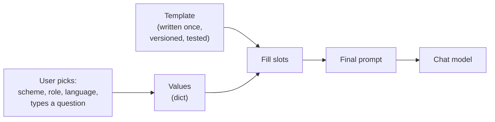

# Static vs Dynamic Prompts: The Complete Guide

> 📚 **Before you start**
>
> - [Prompting Fundamentals](../../generative-ai-and-llm-foundations/04-prompting-and-structured-output/prompting-fundamentals.md), especially "Prompts are code: templates and versions".
> - [System Prompts and Roles](../../generative-ai-and-llm-foundations/04-prompting-and-structured-output/system-prompts-and-roles.md), especially "Static and dynamic parts".
> - [Chat Models](../03-models/chat-models.md), for sending messages to a model.

## Introduction

Picture a government help kiosk at a district office. Version one is a blank notepad: citizens write whatever they like, and the clerk tries to make sense of it. "PM kisan money not come what do" gets a different answer from every clerk. Version two is a **printed form**: *Scheme: ☐ PM-KISAN ☐ Ayushman Bharat ☐ Ujjwala. Your role: ☐ farmer ☐ student ☐ senior citizen. Language: ☐ Hindi ☐ English. Question: ______*. Same clerks, far better answers, because the form collects exactly what's needed, in a predictable shape.

Prompts work the same way. A **static prompt** is a fixed piece of text, often typed in full by the user every time. A **dynamic prompt** is a **template** written once by the developer, with slots that are filled at run time from user choices, data and context. Real LLM apps almost always use dynamic prompts.

This lesson explains the difference, why static prompts break down in apps, what the dynamic parts of a prompt usually are, the problems with building prompts by hand with f-strings, and how LangChain's prompt templates solve them. You'll build a small "explain a government scheme" prompt both ways and see the difference.

> 💡 **Key Insight**
>
> In an app, the **developer owns the prompt** and the **user supplies values**. A dynamic prompt is a template with named slots: write and test the wording once, then fill it safely with different values on every call. That's what makes prompt quality consistent, testable and secure.

---

## Core Explanation

### 1. Static prompts

A **static prompt** is text that doesn't change between calls. It comes in two flavours:

- **A fixed instruction** written by the developer and used as-is every time, such as a system prompt: *"You are a polite assistant for the PM-KISAN helpline. Answer in simple language."*
- **A free-text prompt** typed by the user each time, as in a chat app: *"explain pm kisan to a farmer in hindi in 5 lines"*.

The first kind is fine and common. The second kind is what you use when **you** are the user of a chat app. Inside **your own application**, letting users write the whole prompt causes problems:

| Problem | Example |
|---|---|
| **Inconsistent quality** | One user writes a detailed request, another writes "pm kisan??". Answers vary wildly |
| **Missing information** | The user forgets to say their language or who they are |
| **No control over format** | You need a 5-bullet answer for your UI; the user didn't ask for one |
| **Untestable** | You can't build a test set when every prompt is different |
| **Prompt injection** | The user writes "ignore your rules and..." and the model sees it as instructions |

### 2. Dynamic prompts

A **dynamic prompt** separates two things:

1. **The template**: the wording, written and tested by the developer, with named slots.
2. **The values**: what changes per call, filled into the slots at run time.



Here's the kiosk example as a template with slots, using nothing but Python's `str.format` for now:

```python
SCHEME_TEMPLATE = (
    "Explain the government scheme '{scheme}' to a {role}.\n"
    "Answer in {language}, in at most {max_points} short bullet points.\n"
    "Then answer their question: {question}"
)

values = {"scheme": "PM-KISAN", "role": "small farmer", "language": "Hindi",
          "max_points": 4, "question": "When does the next instalment come?"}
print(SCHEME_TEMPLATE.format(**values))
```

Output:

```
Explain the government scheme 'PM-KISAN' to a small farmer.
Answer in Hindi, in at most 4 short bullet points.
Then answer their question: When does the next instalment come?
```

Now a second user, with different choices, gets the same carefully written wording:

```python
print(SCHEME_TEMPLATE.format(scheme="Ayushman Bharat", role="senior citizen", language="English",
                             max_points=3, question="Does it cover cataract surgery?"))
```

Output:

```
Explain the government scheme 'Ayushman Bharat' to a senior citizen.
Answer in English, in at most 3 short bullet points.
Then answer their question: Does it cover cataract surgery?
```

In a UI, the slots become dropdowns and a text box, exactly like the printed kiosk form. With Streamlit (from [Widgets and Layout](../../apis-and-apps-fastapi-streamlit-and-docker/06-streamlit-basics/widgets-and-layout.md)) that's a few lines:

```python
# not-run: needs `pip install streamlit langchain langchain-anthropic` and ANTHROPIC_API_KEY; run with `streamlit run app.py`
import streamlit as st
from langchain.chat_models import init_chat_model

model = init_chat_model("anthropic:claude-opus-5-5", temperature=0)
scheme = st.selectbox("Scheme", ["PM-KISAN", "Ayushman Bharat", "PM Ujjwala Yojana"])
role = st.selectbox("You are a", ["small farmer", "student", "senior citizen"])
language = st.selectbox("Language", ["Hindi", "English", "Marathi"])
question = st.text_input("Your question")
if st.button("Explain") and question:
    prompt = SCHEME_TEMPLATE.format(scheme=scheme, role=role, language=language, max_points=4, question=question)
    st.write(model.invoke(prompt).text)
```

### 3. What usually changes in a prompt

Most real prompts are a mix: a large static part plus several dynamic parts. The common dynamic parts are:

| Dynamic part | Where it comes from | Example |
|---|---|---|
| **User choices** | Dropdowns, settings | Language, tone, length |
| **User input** | Text box, chat message | "Does it cover cataract surgery?" |
| **Retrieved context** | Search over documents (RAG) | The relevant paragraphs of the Ayushman Bharat guidelines |
| **User profile** | Your database | "The user is 67 and lives in Nagpur" |
| **Conversation history** | Earlier messages | The last 6 turns |
| **Live facts** | Code at run time | Today's date, the current instalment number |
| **Examples** | A pool of examples, selected per input | Two solved examples similar to this question |

A useful habit: **put the static part first and the dynamic part last.** Providers can cache a long, unchanging prefix (prompt caching), which makes calls cheaper and faster, and the model sees your stable instructions before the variable details. [System Prompts and Roles](../../generative-ai-and-llm-foundations/04-prompting-and-structured-output/system-prompts-and-roles.md) covered this layout.

### 4. Why f-strings and `str.format` aren't enough

Hand-made templates work for one prompt. In an app with dozens, they cause bugs:

**Missing values fail late and vaguely.** A forgotten key raises a bare `KeyError` at call time, far from where the template was written:

```python
try:
    SCHEME_TEMPLATE.format(scheme="PM-KISAN", role="farmer", language="Hindi", question="Eligibility?")
except KeyError as e:
    print("KeyError:", e)
```

Output:

```
KeyError: 'max_points'
```

**You can't ask a template what it needs.** To build a form or validate input, you want the list of slot names. With a plain string you have to parse it yourself:

```python
import string

print(sorted({name for _, name, _, _ in string.Formatter().parse(SCHEME_TEMPLATE) if name}))
```

Output:

```
['language', 'max_points', 'question', 'role', 'scheme']
```

**Braces in the text clash with slots.** Ask for JSON in a prompt and its `{` `}` are mistaken for slots:

```python
json_template = 'Reply as JSON like {"scheme": "...", "eligible": true}. Question: {question}'
try:
    json_template.format(question="Am I eligible?")
except (KeyError, ValueError, IndexError) as e:
    print(type(e).__name__, e)
```

Output:

```
KeyError '"scheme"'
```

The fix is to double literal braces (`{{` and `}}`), which is easy to forget. [Prompting Fundamentals](../../generative-ai-and-llm-foundations/04-prompting-and-structured-output/prompting-fundamentals.md) used `string.Template` to dodge this.

**Strings don't compose with the rest of your app.** A string can't be piped into a model, batched, traced or turned into a list of chat messages with roles. Every one of those is glue code you'd write yourself.

### 5. LangChain's answer: prompt templates

LangChain's **prompt templates** are templates as objects. A quick preview (the next lesson covers them fully):

```python
from langchain_core.prompts import PromptTemplate

scheme_prompt = PromptTemplate.from_template(SCHEME_TEMPLATE)
print("Needs:", scheme_prompt.input_variables)

filled = scheme_prompt.invoke(values)
print(type(filled).__name__)
print(filled.to_string().splitlines()[0])
```

Output:

```
Needs: ['language', 'max_points', 'question', 'role', 'scheme']
StringPromptValue
Explain the government scheme 'PM-KISAN' to a small farmer.
```

The template knows its own variables, and filling it returns a **prompt value**, an object that can become either a plain string or a list of chat messages depending on which model receives it. A missing variable is reported clearly, naming what's missing and what was given:

```python
try:
    scheme_prompt.invoke({"scheme": "PM-KISAN"})
except KeyError as e:
    message = str(e)
    print(message[:message.index("{")].strip())          # the message names the missing set...
    print("Missing:", sorted(set(scheme_prompt.input_variables) - {"scheme"}))   # ...shown sorted here
```

Output:

```
"Input to PromptTemplate is missing variables
Missing: ['language', 'max_points', 'question', 'role']
```

And because a prompt template is a runnable, it plugs straight into a model:

```python
from langchain_core.language_models.fake_chat_models import FakeListChatModel

model = FakeListChatModel(responses=["• PM-KISAN gives ₹6,000 a year in three instalments of ₹2,000…"])
chain = scheme_prompt | model
print(chain.invoke(values).content)
```

Output:

```
• PM-KISAN gives ₹6,000 a year in three instalments of ₹2,000…
```

| Need | f-string / `str.format` | LangChain prompt template |
|---|---|---|
| List the variables | Parse it yourself | `.input_variables` |
| Clear error for missing values | Bare `KeyError` | Names missing and expected variables |
| Chat roles (system, human) | Build message dicts by hand | `ChatPromptTemplate` |
| Insert a whole chat history | Manual list handling | `MessagesPlaceholder` |
| Fix some values in advance | Wrapper functions | `.partial(...)` |
| Pipe into a model, batch, trace | Glue code | `prompt | model` |

### 6. Dynamic doesn't mean "let the user write the instructions"

The point of a dynamic prompt is that **user input fills a slot; it never becomes the instructions**. Two practical rules:

- **Constrain what you can.** Use dropdowns or validated values for slots like language and length, so only allowed values reach the prompt.
- **Mark free text as data.** When a slot holds free text (a question, a document), put it in a clearly labelled section, ideally in its own message, so the model treats it as content to work on, not commands to obey.

```python
ALLOWED_LANGUAGES = {"Hindi", "English", "Marathi", "Tamil"}

def safe_values(raw):
    if raw["language"] not in ALLOWED_LANGUAGES:
        raise ValueError(f"Unsupported language: {raw['language']}")
    points = int(raw.get("max_points", 4))
    return {**raw, "max_points": max(1, min(points, 8)), "question": raw["question"].strip()[:500]}

print(safe_values({"scheme": "PM-KISAN", "role": "farmer", "language": "Hindi",
                   "max_points": "50", "question": "  Eligibility?  "}))
```

Output:

```
{'scheme': 'PM-KISAN', 'role': 'farmer', 'language': 'Hindi', 'max_points': 8, 'question': 'Eligibility?'}
```

The user asked for 50 bullet points; the app allowed 8. Templates plus validated values put the developer in charge.

---

## Try It Yourself

1. **Spot static and dynamic.** In this system prompt, which parts are static and which should be dynamic? *"You are the help desk for Mumbai Metro Line 3. Today is 17 October 2026. The user's preferred language is Marathi. Never share staff phone numbers."*
2. **Escape the braces.** Fix `json_template` so that `.format(question="Am I eligible?")` works and the output still contains `{"scheme": "...", "eligible": true}`.
3. **Template from scratch.** Turn this static prompt into a `PromptTemplate` with three variables and print its `input_variables`: *"Write a 3-line WhatsApp message in Hindi inviting my neighbours to a Diwali puja at 7 pm."*

<details>
<summary>Show answers</summary>

**1.** Static: the role (help desk for Line 3) and the rule about phone numbers. Dynamic: the date and the user's language. Keep the static lines first so they can be cached, and fill the date and language from code.

**2.**

```python
json_template = 'Reply as JSON like {{"scheme": "...", "eligible": true}}. Question: {question}'
print(json_template.format(question="Am I eligible?"))
```

Output:

```
Reply as JSON like {"scheme": "...", "eligible": true}. Question: Am I eligible?
```

**3.**

```python
invite = PromptTemplate.from_template(
    "Write a {lines}-line WhatsApp message in {language} inviting my neighbours to a {occasion}."
)
print(invite.input_variables)
print(invite.invoke({"lines": 3, "language": "Hindi", "occasion": "Diwali puja at 7 pm"}).to_string())
```

Output:

```
['language', 'lines', 'occasion']
Write a 3-line WhatsApp message in Hindi inviting my neighbours to a Diwali puja at 7 pm.
```

</details>

---

## Real-World Examples

- **Research summarisers** let users pick a paper, an explanation style (beginner, technical, maths-heavy) and a length from dropdowns, then fill a carefully tested template.
- **E-commerce listing tools** fill a template with product attributes (fabric, colour, occasion) from the catalogue database to write descriptions in several languages.
- **Customer-support bots** use a static system prompt plus dynamic slots for the customer's name, plan, order history and retrieved help articles.
- **Ed-tech apps** fill a "generate practice questions" template with class, subject, chapter and difficulty chosen by the teacher.

---

## Common Misconceptions

### "Dynamic prompts are only for chatbots"

Any app that calls a model with varying data uses them: summarisers, extractors, classifiers, report generators. Chat is just one case.

### "Static prompts are bad"

Fixed instructions (system prompts, rules) are essential and should be as stable as possible. What breaks down is asking **users** to write the whole prompt inside your product.

### "Templates make prompt injection impossible"

They help by keeping user text in its slot, but a model can still be influenced by text inside a slot. Validation, clear separation of data, and checks on the output are still needed.

### "f-strings are fine, templates are overkill"

For one throwaway prompt, yes. For an app with many prompts, chat roles, history and testing, template objects save real time and bugs.

---

## Interview Relevance

*"What's the difference between static and dynamic prompts, and how do you manage prompts in an LLM app?"* A strong answer: a static prompt is fixed text (fine for system rules, poor as user-written prompts in an app); a dynamic prompt is a developer-written template whose slots are filled at run time with user choices, input, retrieved context, profile data, history and live facts. Explain why (consistency, testability, format control, security), the pitfalls of f-strings (late `KeyError`, brace clashes, no variable list, no composition), and LangChain's `PromptTemplate` / `ChatPromptTemplate` with `input_variables`, clear errors, partials, `MessagesPlaceholder` and piping into models. Mention keeping static content first for prompt caching, and validating slot values.

---

## Key Takeaways

- **Static prompts** are fixed text; good for rules, poor when users must write whole prompts in your app.
- **Dynamic prompts** are templates with named slots, filled at run time from user choices, input, context and data.
- **Put the static part first** and the dynamic part last, for caching and clarity.
- **f-strings break down at scale**: late errors, brace clashes, no variable list, no composition.
- **LangChain prompt templates** know their variables, fail clearly, and plug straight into models.

---

**Up next:** [Prompt Templates](prompt-templates.md)
