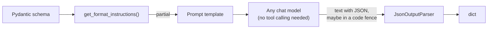

# JsonOutputParser and StructuredOutputParser: The Complete Guide

> 📚 **Before you start**
>
> - [StrOutputParser](stroutputparser.md), for what output parsers are and how format instructions reach the prompt.
> - [Structured Output with Pydantic and JSON Schema](structured-output-with-pydantic-and-json-schema.md), for schemas and the native route.
> - [Structured JSON Output](../../generative-ai-and-llm-foundations/04-prompting-and-structured-output/structured-json-output.md), for the ways model JSON breaks.

## Introduction

A small ed-tech startup in Kota runs its quiz generator on an open-source model served from its own GPU box, to keep costs down. The model is good at writing questions, but its server has no tool calling and no native structured output. `with_structured_output` isn't available. Yet the app still needs every quiz as JSON: question, four options, the correct answer, a one-line explanation.

This is where the **parser route** earns its keep. You tell the model, in the prompt, exactly what JSON to write (**format instructions**), and a **JSON output parser** pulls the JSON out of whatever the model replies, tolerating code fences and stray text, and returns a Python `dict`. It even works while the reply is still streaming, handing you a growing, partially filled dict.

This lesson covers `JsonOutputParser` in depth (with and without a schema, streaming, errors) and the older `StructuredOutputParser` with `ResponseSchema`, which you'll meet in tutorials and existing code, along with what to use instead today.

> 💡 **Key Insight**
>
> `JsonOutputParser` is the **parser route for dicts**: put its format instructions in the prompt, put the parser after the model, and get a `dict` from any model that can write JSON in text. It doesn't validate values (it's the parser equivalent of a `TypedDict`), but it can **stream partial JSON**, which nothing else does as easily.

---

## Core Explanation

### 1. `JsonOutputParser` on a reply

Models asked for JSON often wrap it in a Markdown code fence or add a sentence before it. The parser copes with both:

```python
from langchain_core.output_parsers import JsonOutputParser
from langchain_core.messages import AIMessage

parser = JsonOutputParser()
replies = [
    '{"question": "What is the SI unit of force?", "answer": "Newton"}',
    'Sure! Here is your question:\n```json\n{"question": "What is the SI unit of force?", "answer": "Newton"}\n```',
]
for r in replies:
    print(parser.invoke(AIMessage(r)))
```

Output:

```
{'question': 'What is the SI unit of force?', 'answer': 'Newton'}
{'question': 'What is the SI unit of force?', 'answer': 'Newton'}
```

The result is a plain `dict` (or a `list`, if the JSON is an array).

### 2. Format instructions: telling the model the shape

On its own, `JsonOutputParser()` only says "return JSON". Give it a Pydantic model as `pydantic_object` and its format instructions include the full JSON Schema, which tells the model exactly which keys to write:

```python
from typing import Literal
from pydantic import BaseModel, Field

class QuizQuestion(BaseModel):
    """One multiple-choice question for a JEE physics quiz."""
    question: str = Field(description="The question text")
    options: list[str] = Field(description="Exactly four answer options")
    correct_option: Literal["A", "B", "C", "D"] = Field(description="Letter of the correct option")
    explanation: str = Field(description="One-line explanation of the answer")

quiz_parser = JsonOutputParser(pydantic_object=QuizQuestion)
instructions = quiz_parser.get_format_instructions()
lines = instructions.splitlines()
print("\n".join(lines[:5]))
print("...")
print(lines[-2][:120] + "...")
```

Output:

```
STRICT OUTPUT FORMAT:
- Return only the JSON value that conforms to the schema. Do not include any additional text, explanations, headings, or separators.
- Do not wrap the JSON in Markdown or code fences (no ``` or ```json).
- Do not prepend or append any text (e.g., do not write "Here is the JSON:").
- The response must be a single top-level JSON value exactly as required by the schema (object/array/etc.), with no trailing commas or comments.
...
{"description": "One multiple-choice question for a JEE physics quiz.", "properties": {"question": {"description": "The ...
```

The instructions start with strict formatting rules (no code fences, no extra text), explain what "conforms to a JSON schema" means with a small example, and end with your schema, docstring and field descriptions included. You put them into the prompt with a partial, exactly as with the list parsers in the last lesson:

```python
from langchain_core.prompts import ChatPromptTemplate
from langchain_core.language_models.fake_chat_models import FakeListChatModel

prompt = ChatPromptTemplate.from_messages([
    ("system", "You write JEE-level physics quiz questions.\n{format_instructions}"),
    ("human", "Write one question on {topic}."),
]).partial(format_instructions=quiz_parser.get_format_instructions())

model = FakeListChatModel(responses=['''```json
{"question": "A 2 kg block accelerates at 3 m/s². What net force acts on it?",
 "options": ["1.5 N", "5 N", "6 N", "9 N"],
 "correct_option": "C",
 "explanation": "F = ma = 2 × 3 = 6 N."}
```'''])

chain = prompt | model | quiz_parser
q = chain.invoke({"topic": "Newton's second law"})
print(type(q).__name__, "|", q["correct_option"], "|", q["options"][2])
```

Output:

```
dict | C | 6 N
```



### 3. It returns a dict, not a validated object

Even with `pydantic_object`, `JsonOutputParser` only uses the schema for the **instructions**. It does not validate the result:

```python
sloppy = FakeListChatModel(responses=['{"question": "Unit of power?", "options": ["Watt", "Joule"], "correct_option": "E"}'])
q = (prompt | sloppy | quiz_parser).invoke({"topic": "power"})
print(q)
print("options:", len(q["options"]), "| correct_option valid:", q["correct_option"] in "ABCD", "| has explanation:", "explanation" in q)
```

Output:

```
{'question': 'Unit of power?', 'options': ['Watt', 'Joule'], 'correct_option': 'E'}
options: 2 | correct_option valid: False | has explanation: False
```

Two options instead of four, an invalid letter, a missing explanation, and no error. To get validation, either validate the dict yourself (`QuizQuestion.model_validate(q)`) or use `PydanticOutputParser`, the subject of the next lesson.

### 4. When the reply isn't JSON at all

If the model writes something that can't be parsed, the parser raises `OutputParserException`, which carries the text it failed on, so you can log it or retry:

```python
from langchain_core.exceptions import OutputParserException

broken = FakeListChatModel(responses=["Sorry, I can only help with physics questions about mechanics."])
try:
    (prompt | broken | quiz_parser).invoke({"topic": "organic chemistry"})
except OutputParserException as e:
    print(type(e).__name__)
    print("model said:", e.llm_output)
```

Output:

```
OutputParserException
model said: Sorry, I can only help with physics questions about mechanics.
```

Common failure causes and fixes:

| What the model did | Fix |
|---|---|
| Wrote prose instead of JSON | Clearer instructions; put format instructions at the end of the system message; lower temperature |
| JSON with trailing commas or comments | Mostly handled; otherwise retry with the error |
| Cut off mid-JSON (hit `max_tokens`) | Increase `max_tokens`; check the stop reason |
| Refused the task | That's a content issue, not a parsing one; handle it as an answer |

A simple recovery is `.with_retry()` on the model-plus-parser part, or the repair loop from the last lesson. (Older code uses `OutputFixingParser` and `RetryOutputParser`, which now live in `langchain-classic`; they send the bad output back to a model to fix.)

### 5. Streaming partial JSON

Here's the parser's special ability. When you **stream** a chain ending in `JsonOutputParser`, it parses the JSON **as it grows**, yielding a more complete dict each time something new can be read:

```python
stream_model = FakeListChatModel(responses=[
    '{"question": "Unit of power?", "options": ["Watt", "Joule", "Newton", "Pascal"], "correct_option": "A"}'
])
seen = []
for partial in (prompt | stream_model | quiz_parser).stream({"topic": "power"}):
    seen.append(partial)

print(len(seen), "updates")
for p in [seen[3], seen[len(seen) // 2], seen[-1]]:
    print(p)
```

Output:

```
42 updates
{'question': 'Un'}
{'question': 'Unit of power?', 'options': ['Watt', 'J']}
{'question': 'Unit of power?', 'options': ['Watt', 'Joule', 'Newton', 'Pascal'], 'correct_option': 'A'}
```

A quiz app can show the question the moment its text arrives, then the options as they fill in, instead of waiting for the whole object. (By default each update is the whole object so far; pass `diff=True` to get just the changes as JSON-patch operations.)

### 6. `StructuredOutputParser` and `ResponseSchema` (legacy)

Before tool calling was common, LangChain offered `StructuredOutputParser`: you listed fields as `ResponseSchema` objects (a name, a description and a type hint as text), and it produced format instructions and parsed a JSON reply into a dict. You'll see it in many 2023–2024 tutorials:

```python
# not-run: legacy API; needs `pip install langchain-classic`
from langchain_classic.output_parsers import ResponseSchema, StructuredOutputParser

schemas = [
    ResponseSchema(name="question", description="The quiz question"),
    ResponseSchema(name="answer", description="The correct answer"),
    ResponseSchema(name="difficulty", description="easy, medium or hard"),
]
parser = StructuredOutputParser.from_response_schemas(schemas)
print(parser.get_format_instructions())
print(parser.parse('```json\n{"question": "Unit of power?", "answer": "Watt", "difficulty": "easy"}\n```'))
```

Example output:

````
The output should be a markdown code snippet formatted in the following schema, including the leading and trailing "```json" and "```":

```json
{
	"question": string  // The quiz question
	"answer": string  // The correct answer
	"difficulty": string  // easy, medium or hard
}
```
{'question': 'Unit of power?', 'answer': 'Watt', 'difficulty': 'easy'}
````

Notice its limits: every field is described in free text, types are only hints, there's no nesting, no enums and no validation. In LangChain 1.x it lives in `langchain-classic`. Here's what to use instead:

| Old code | Use instead |
|---|---|
| `StructuredOutputParser` + `ResponseSchema`, model supports tool calling | `model.with_structured_output(TypedDict or Pydantic model)` |
| Same, model has no tool calling, dict is fine | `JsonOutputParser(pydantic_object=...)` |
| Same, and you need validation | `PydanticOutputParser` (next lesson) |

The `JsonOutputParser` equivalent of the snippet above runs on `langchain-core` alone:

```python
class QuickQuiz(BaseModel):
    question: str = Field(description="The quiz question")
    answer: str = Field(description="The correct answer")
    difficulty: Literal["easy", "medium", "hard"]

modern = JsonOutputParser(pydantic_object=QuickQuiz)
print(modern.invoke(AIMessage('```json\n{"question": "Unit of power?", "answer": "Watt", "difficulty": "easy"}\n```')))
```

Output:

```
{'question': 'Unit of power?', 'answer': 'Watt', 'difficulty': 'easy'}
```

### 7. Parser route vs native route, side by side

| | `JsonOutputParser` | `with_structured_output` |
|---|---|---|
| Needs tool calling / native JSON from the model | No | Yes |
| Schema reaches the model via | Prompt text (format instructions) | The API (tool definition or response schema) |
| Uses prompt tokens for the schema | Yes, every call | The API also counts them, but you don't write them |
| Validation | None | With Pydantic schemas |
| Streams partial objects | **Yes**, naturally | Possible, depending on the provider |
| Typical use | Local/older models; streaming UIs | The default with capable models |

---

## Try It Yourself

1. **Validate after parsing.** Take the `sloppy` result from section 3 and validate it with `QuizQuestion.model_validate(q)`. Print the number of errors and the fields they're on.
2. **Arrays.** Make a fake model reply with a JSON **list** of two quiz dicts inside a code fence, and parse it with `JsonOutputParser()`. What type comes back?
3. **First visible field.** While streaming the chain from section 5, print the first update that contains a complete `options` list of four items. Which update number is it?

<details>
<summary>Show answers</summary>

**1.**

```python
from pydantic import ValidationError

try:
    QuizQuestion.model_validate(q)
except ValidationError as e:
    print(len(e.errors()), "errors:", sorted({err["loc"][0] for err in e.errors()}))
```

Output:

```
2 errors: ['correct_option', 'explanation']
```

Pydantic caught the bad letter and the missing explanation. The two options passed because `list[str]` doesn't say "exactly four"; adding `Field(min_length=4, max_length=4)` would catch that too.

**2.**

```python
two = JsonOutputParser().invoke(AIMessage('```json\n[{"question": "Q1"}, {"question": "Q2"}]\n```'))
print(type(two).__name__, len(two))
```

Output:

```
list 2
```

**3.**

```python
for i, p in enumerate(seen):
    if len(p.get("options", [])) == 4 and p["options"][-1] == "Pascal":
        print("update", i, "->", p["options"])
        break
```

Output:

```
update 39 -> ['Watt', 'Joule', 'Newton', 'Pascal']
```

(With a real model, chunks are a few tokens each, so there are far fewer, bigger updates.)

</details>

---

## Real-World Examples

- **Self-hosted model deployments** without tool-calling support use `JsonOutputParser` with format instructions to get structured results.
- **Streaming forms and cards**: apps that show a product card or quiz question filling in live parse partial JSON as it streams.
- **Legacy migrations**: teams replacing `StructuredOutputParser` + `ResponseSchema` code move to `with_structured_output` with a Pydantic or TypedDict schema.
- **Batch data jobs** use the parser route with cheap local models, validating each dict afterwards and retrying failures.

---

## Common Misconceptions

### "JsonOutputParser with a pydantic_object validates the data"

It uses the schema only for format instructions. The result is an unvalidated dict.

### "The parser makes the model output JSON"

The **format instructions in the prompt** do that. The parser only reads what comes back. Forget the instructions and parsing fails much more often.

### "StructuredOutputParser is the recommended way to get structured data"

It was, in 2023. Today it's legacy (`langchain-classic`); use `with_structured_output`, or `JsonOutputParser`/`PydanticOutputParser` when the model lacks native support.

### "Streaming JSON isn't possible until the object is complete"

`JsonOutputParser` parses incomplete JSON and yields partial dicts as they grow.

---

## Interview Relevance

*"How do you get JSON from a model that doesn't support tool calling?"* A strong answer: use the parser route: `JsonOutputParser(pydantic_object=Schema)` produces format instructions (with the JSON Schema) that you inject into the prompt via a partial; the parser extracts JSON from the reply (handling code fences and surrounding text) and returns a dict, raising `OutputParserException` (with `llm_output`) on failure, which you handle with retries or a repair prompt. Mention that it doesn't validate (validate with Pydantic afterwards or use `PydanticOutputParser`), that it can stream partial JSON objects, and that `StructuredOutputParser`/`ResponseSchema` is legacy in `langchain-classic`, replaced by `with_structured_output` where the model supports it.

---

## Key Takeaways

- **`JsonOutputParser`** turns a reply containing JSON (even in a code fence) into a `dict` or `list`.
- **Format instructions** from `get_format_instructions()` (with a `pydantic_object` schema) must go into the prompt.
- **No validation**: check the dict yourself, or use `PydanticOutputParser`.
- **Failures raise `OutputParserException`** with the model's text in `llm_output`; retry or repair.
- **It streams partial JSON**; `StructuredOutputParser` + `ResponseSchema` is legacy, replaced by `with_structured_output` or these parsers.

---

**Up next:** [PydanticOutputParser](pydanticoutputparser.md)
