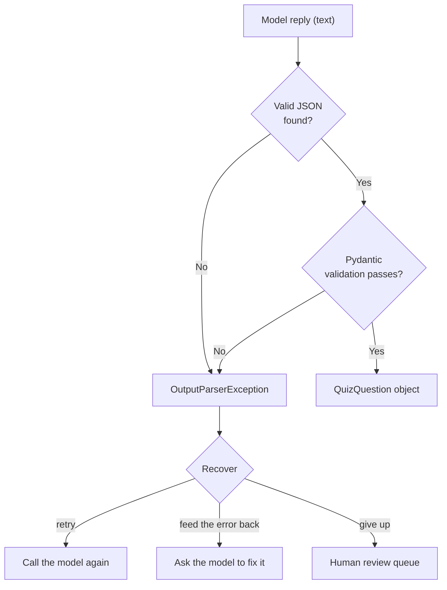
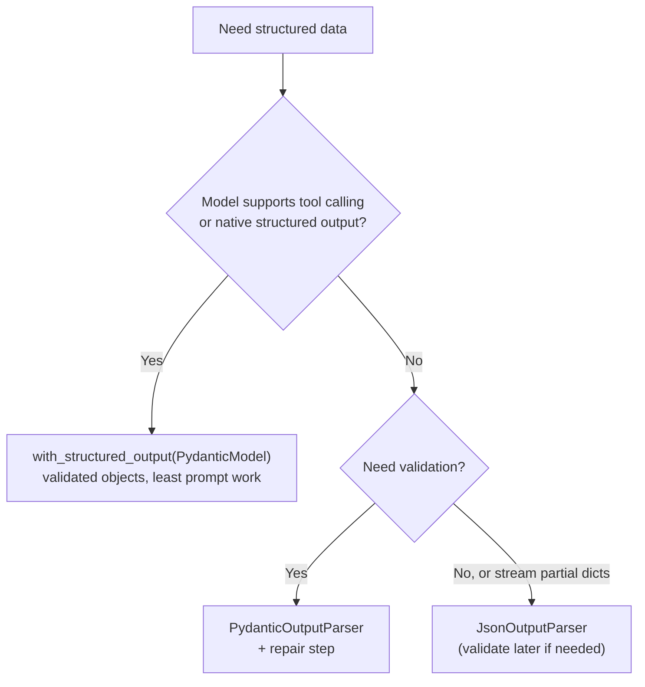

# PydanticOutputParser: The Complete Guide

> 📚 **Before you start**
>
> - [JsonOutputParser and StructuredOutputParser](jsonoutputparser-and-structuredoutputparser.md), for format instructions and the parser route.
> - [Structured Output with Pydantic and JSON Schema](structured-output-with-pydantic-and-json-schema.md), for Pydantic fields, constraints and validators.

## Introduction

Back to the Kota quiz startup from the last lesson. `JsonOutputParser` gave them dicts, and one Monday a batch of 2,000 questions went live with 37 questions that had only three options and 12 whose "correct answer" was option **E**. Students noticed before the team did. The parser had done its job (it parsed JSON); nobody had checked the **content**.

`PydanticOutputParser` closes that gap. It is the parser route with validation built in: it adds format instructions to your prompt, extracts the JSON from the reply, and then builds your **Pydantic model** from it, enforcing every type, constraint and validator. A bad question becomes an error you can catch and fix, instead of a bug students find.

This lesson covers how the parser works, where it fits next to `with_structured_output`, what its errors look like, and three ways to recover from a failure: retrying, feeding the error back to the model, and the legacy fixing parsers you'll meet in older code.

> 💡 **Key Insight**
>
> `PydanticOutputParser` = **format instructions + JSON extraction + Pydantic validation**. It works with any model that can write text, returns a typed, validated object, and turns bad output into an `OutputParserException` that your chain can catch and repair.

---

## Core Explanation

### 1. The schema and the parser

We'll make the quiz schema strict this time: exactly four options, a valid letter, an explanation, and a cross-field rule that the explanation must not be empty or copy the question.

```python
from typing import Literal
from pydantic import BaseModel, Field, model_validator
from langchain_core.output_parsers import PydanticOutputParser

class QuizQuestion(BaseModel):
    """One multiple-choice question for a JEE physics quiz."""
    question: str = Field(min_length=10, description="The question text")
    options: list[str] = Field(min_length=4, max_length=4, description="Exactly four answer options")
    correct_option: Literal["A", "B", "C", "D"] = Field(description="Letter of the correct option")
    explanation: str = Field(min_length=5, description="One-line explanation of the answer")

    @model_validator(mode="after")
    def options_are_distinct(self):
        if len(set(o.strip().lower() for o in self.options)) != 4:
            raise ValueError("the four options must all be different")
        return self

parser = PydanticOutputParser(pydantic_object=QuizQuestion)
print(parser.get_format_instructions().splitlines()[0])
```

Output:

```
The output should be formatted as a JSON instance that conforms to the JSON schema below.
```

Like `JsonOutputParser`, its format instructions contain your full JSON Schema, including the `minItems`/`maxItems` and the enum, so the model is told the rules up front.

### 2. In a chain

```python
from langchain_core.prompts import ChatPromptTemplate
from langchain_core.language_models.fake_chat_models import FakeListChatModel

prompt = ChatPromptTemplate.from_messages([
    ("system", "You write JEE-level physics quiz questions.\n{format_instructions}"),
    ("human", "Write one question on {topic}."),
]).partial(format_instructions=parser.get_format_instructions())

good_reply = ('{"question": "A 2 kg block accelerates at 3 m/s². What is the net force on it?", '
              '"options": ["1.5 N", "5 N", "6 N", "9 N"], "correct_option": "C", '
              '"explanation": "F = ma = 2 × 3 = 6 N."}')
chain = prompt | FakeListChatModel(responses=[good_reply]) | parser

q = chain.invoke({"topic": "Newton's second law"})
print(type(q).__name__)
print(q.options[ord(q.correct_option) - ord("A")], "|", q.explanation)
```

Output:

```
QuizQuestion
6 N | F = ma = 2 × 3 = 6 N.
```

A real `QuizQuestion` object, with attributes your editor knows about. Compare the three parser-route and native options you've now seen:

| | Returns | Validates | Needs tool calling / native JSON |
|---|---|---|---|
| `JsonOutputParser` | `dict` | No | No |
| `PydanticOutputParser` | Pydantic object | **Yes** | No |
| `with_structured_output(PydanticModel)` | Pydantic object | **Yes** | Yes |

So `PydanticOutputParser` is the choice when you need validated objects **and** your model can't do native structured output.

### 3. What a validation failure looks like

Here is the Monday bug: three options and the letter E.

```python
from langchain_core.exceptions import OutputParserException

bad_reply = ('{"question": "What is the SI unit of power?", "options": ["Watt", "Joule", "Newton"], '
             '"correct_option": "E", "explanation": "Power is energy per second, measured in watts."}')
try:
    (prompt | FakeListChatModel(responses=[bad_reply]) | parser).invoke({"topic": "power"})
except OutputParserException as e:
    print(type(e).__name__)
    print(str(e).splitlines()[0])
    print("the model wrote:", e.llm_output[:60] + "...")
```

Output:

```
OutputParserException
Failed to parse QuizQuestion from completion {"question": "What is the SI unit of power?", "options": ["Watt", "Joule", "Newton"], "correct_option": "E", "explanation": "Power is energy per second, measured in watts."}. Got: 2 validation errors for QuizQuestion
the model wrote: {"question": "What is the SI unit of power?", "options": ["W...
```

The exception says what failed ("2 validation errors") and keeps the raw text in `llm_output`. The same exception type is raised when the reply isn't JSON at all, so one `except` handles both.



### 4. Recovery 1: simple retry

Model output varies between calls, so sometimes simply asking again works. Every runnable has `.with_retry()`; here we retry the model-plus-parser part when parsing fails:

```python
flaky_model = FakeListChatModel(responses=[bad_reply, good_reply])     # bad first, good second
retrying = prompt | (flaky_model | parser).with_retry(
    retry_if_exception_type=(OutputParserException,), stop_after_attempt=3)

q = retrying.invoke({"topic": "Newton's second law"})
print("got a valid question:", q.correct_option, q.options)
```

Output:

```
got a valid question: C ['1.5 N', '5 N', '6 N', '9 N']
```

This is cheap to add, but blind: the model doesn't know what it did wrong, so with temperature 0 it may repeat the same mistake.

### 5. Recovery 2: feed the error back

Better: tell the model exactly what was wrong. Build a small "repair" step that sends the original request, the bad output and the validation errors, and asks for a corrected JSON:

```python
from pydantic import ValidationError

repair_prompt = ChatPromptTemplate.from_messages([
    ("system", "You fix JSON so it matches a schema. Reply with corrected JSON only.\n{format_instructions}"),
    ("human", "Your previous output:\n{bad_output}\n\nIt was rejected because:\n{errors}\n\nReturn the corrected JSON."),
]).partial(format_instructions=parser.get_format_instructions())

def explain_errors(text):
    """Turn a rejected reply into short, readable error lines for the model."""
    try:
        QuizQuestion.model_validate_json(text)
        return "unknown problem"
    except ValidationError as e:
        return "\n".join(f"- {'.'.join(map(str, err['loc'])) or 'object'}: {err['msg']}" for err in e.errors())

print(explain_errors(bad_reply))
```

Output:

```
- options: List should have at least 4 items after validation, not 3
- correct_option: Input should be 'A', 'B', 'C' or 'D'
```

Those lines are precise enough for a model to act on. Now the full generate-then-repair function:

```python
def generate_question(topic, model, repair_model, max_repairs=2):
    reply = (prompt | model).invoke({"topic": topic}).content
    for attempt in range(max_repairs + 1):
        try:
            return parser.parse(reply), attempt
        except OutputParserException:
            if attempt == max_repairs:
                raise
            reply = (repair_prompt | repair_model).invoke(
                {"bad_output": reply, "errors": explain_errors(reply)}).content

fixed_reply = ('{"question": "What is the SI unit of power?", "options": ["Watt", "Joule", "Newton", "Pascal"], '
               '"correct_option": "A", "explanation": "Power is energy per second, measured in watts."}')
q, repairs = generate_question("power", FakeListChatModel(responses=[bad_reply]),
                               FakeListChatModel(responses=[fixed_reply]))
print(f"valid after {repairs} repair(s): {q.correct_option} = {q.options[0]}")
```

Output:

```
valid after 1 repair(s): A = Watt
```

This is the same validate-explain-retry loop from [Lab: Reliable JSON Extraction](../../generative-ai-and-llm-foundations/04-prompting-and-structured-output/lab-reliable-json-extraction.md), now built from LangChain pieces. Cap the repairs (two is typical) and send anything still failing to a human.

### 6. Recovery 3: the legacy fixing parsers

Older LangChain shipped two wrappers that do recovery 2 automatically:

- `OutputFixingParser` sends the bad output and the error to a model and asks it to fix the format.
- `RetryOutputParser` re-sends the **original prompt** plus the bad output, so the model can redo the task with full context.

In LangChain 1.x they live in `langchain-classic`:

```python
# not-run: legacy API; needs `pip install langchain-classic langchain-anthropic` and ANTHROPIC_API_KEY
from langchain_classic.output_parsers import OutputFixingParser
from langchain.chat_models import init_chat_model

fixing_parser = OutputFixingParser.from_llm(parser=parser, llm=init_chat_model("anthropic:claude-opus-5-5"))
q = fixing_parser.parse(bad_reply)      # on failure, asks the model to repair, then parses again
```

They work, but a hand-written repair step like the one above is more transparent (you control the prompt and log the errors), and for models that support it, `with_structured_output` avoids most repairs in the first place.

### 7. Streaming

`PydanticOutputParser` validates objects, and a half-written object is usually invalid. When you stream a chain ending in this parser, it tries to validate the partial JSON after each chunk and only yields an object once the partial data **passes validation**:

```python
updates = list((prompt | FakeListChatModel(responses=[good_reply]) | parser).stream({"topic": "force"}))
print(len(updates), "updates")
print("first:", repr(updates[0].explanation))
print("last: ", repr(updates[-1].explanation))
```

Output:

```
10 updates
first: 'F = m'
last:  'F = ma = 2 × 3 = 6 N.'
```

Nothing was yielded while the question and options were being written, because a partial object without four options or an explanation fails validation. The first update came only when the last field, `explanation`, reached its minimum length of 5 characters; after that each chunk produced a slightly longer, still-valid object. So with strict schemas you get little or no early display, unlike `JsonOutputParser`'s growing partial dicts.

If you need live partial display **and** validation, stream with `JsonOutputParser` for the UI and validate the final dict with Pydantic.

### 8. Choosing between the routes



---

## Try It Yourself

1. **A stricter rule.** Add a `field_validator` to a subclass of `QuizQuestion` that rejects questions not ending with `?`. Parse `good_reply` with a new parser built from the subclass. Does it pass?
2. **Count the errors.** What does `explain_errors('{"question": "Short?", "options": [], "correct_option": "a"}')` print? Why is `explanation` listed?
3. **Batch with a review queue.** Run `parser.parse` over `[good_reply, bad_reply, "not json"]`, collecting valid questions and sending failures to a `review` list. Print the counts.

<details>
<summary>Show answers</summary>

**1.**

```python
from pydantic import field_validator

class StrictQuiz(QuizQuestion):
    @field_validator("question")
    @classmethod
    def ends_with_question_mark(cls, v):
        if not v.strip().endswith("?"):
            raise ValueError("question must end with '?'")
        return v

print(PydanticOutputParser(pydantic_object=StrictQuiz).parse(good_reply).question[-20:])
```

Output:

```
the net force on it?
```

It passes: the question ends with "?".

**2.**

```python
print(explain_errors('{"question": "Short?", "options": [], "correct_option": "a"}'))
```

Output:

```
- question: String should have at least 10 characters
- options: List should have at least 4 items after validation, not 0
- correct_option: Input should be 'A', 'B', 'C' or 'D'
- explanation: Field required
```

`explanation` is required (it has no default) and the JSON doesn't contain it.

**3.**

```python
valid, review = [], []
for text in [good_reply, bad_reply, "not json"]:
    try:
        valid.append(parser.parse(text))
    except OutputParserException as e:
        review.append(e.llm_output)
print(len(valid), "valid,", len(review), "for review")
```

Output:

```
1 valid, 2 for review
```

</details>

---

## Real-World Examples

- **Ed-tech question banks** validate every generated question (option count, answer letter, no duplicates) before it reaches students.
- **On-premise extraction** with local models (no native structured output) uses `PydanticOutputParser` plus a repair step for forms and reports.
- **Data-quality gates**: pipelines log `OutputParserException`s with `llm_output` to a dashboard, tracking first-try and after-repair success rates per prompt version.
- **Legacy code** often still has `OutputFixingParser`; teams migrating to 1.x either import it from `langchain-classic` or replace it with an explicit repair step.

---

## Common Misconceptions

### "PydanticOutputParser forces the model to follow the schema"

It can't force anything; it checks after the fact. The format instructions ask; the parser verifies. Native structured output is what constrains generation.

### "Retrying is enough"

A blind retry often repeats the mistake. Sending the specific validation errors back usually fixes it in one step.

### "A validation error is a bug in my code"

It's the system working: bad model output was stopped at the boundary. Log it, repair it, or route it to review.

### "Use PydanticOutputParser even when the model supports structured output"

You can, but `with_structured_output` is simpler and more reliable there (no format instructions to maintain, schema enforced by the API).

---

## Interview Relevance

*"How do you validate LLM output and recover from bad output?"* A strong answer: define a Pydantic model with constraints and validators; with models lacking native support use `PydanticOutputParser` (format instructions via `get_format_instructions()` in the prompt; it extracts JSON and validates, returning a typed object or raising `OutputParserException` with `llm_output`); recover with `.with_retry(retry_if_exception_type=...)`, or better a repair step that feeds the validation errors back to the model, capped at a couple of attempts, then human review. Mention the legacy `OutputFixingParser`/`RetryOutputParser` in `langchain-classic`, that streaming yields only complete valid objects, and that `with_structured_output` is preferred when the model supports it.

---

## Key Takeaways

- **`PydanticOutputParser` = format instructions + JSON extraction + Pydantic validation**, for any text model.
- **It returns a validated object** or raises `OutputParserException` (with the model's text in `llm_output`).
- **Recover in steps**: blind retry with `.with_retry()`, then a repair prompt with the exact errors, then human review.
- **Legacy fixing parsers** (`OutputFixingParser`, `RetryOutputParser`) live in `langchain-classic`.
- **Prefer `with_structured_output`** when the model supports it; use this parser when it doesn't and validation matters.

---

**Up next:** [Lab: Extract structured data from reviews](lab-extract-structured-data-from-reviews.md)
