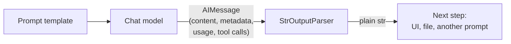

# StrOutputParser: The Complete Guide

> 📚 **Before you start**
>
> - [Why Structured Output Matters](why-structured-output-matters.md), for the parser route.
> - [Chat Models](../03-models/chat-models.md), for `AIMessage`, streaming and chunks.
> - [Prompt Templates](../04-prompts/prompt-templates.md), for templates in a chain.

## Introduction

When you order a parcel, it arrives in a box with tape, a label, an invoice and some bubble wrap. Most of the time you just want the thing inside. Someone has to unpack it.

A chat model's reply is that parcel. It arrives as an `AIMessage` with content, metadata, token counts, an id, maybe tool calls. Very often the next step in your app (showing text to a user, feeding it into another prompt, saving it to a file) just wants the **text**. **Output parsers** are LangChain's unpackers: components that take a model's output and turn it into the form the next step needs. The simplest, and the one you'll use most often, is `StrOutputParser`: message in, plain string out.

This lesson introduces output parsers in general, then covers `StrOutputParser` thoroughly: why it exists when `.content` is right there, how it behaves with LLMs, content blocks and streaming, how it lets you chain several model calls, and a few other small text parsers (lists, numbered lists) plus how to write your own.

> 💡 **Key Insight**
>
> An output parser is a **runnable that converts model output into a useful type**. `StrOutputParser` converts any model output (an `AIMessage`, a chunk, or a string) into a plain `str`, which makes the end of a chain return text and lets one model's answer become the next prompt's input.

---

## Core Explanation

### 1. What an output parser is

Every output parser in `langchain_core.output_parsers` has the same shape:

| Method | Input | Output |
|---|---|---|
| `invoke(output)` | A message (or string) from a model | The parsed value |
| `parse(text)` | The text of a reply | The parsed value |
| `get_format_instructions()` | (nothing) | Text you can put in a prompt telling the model what format to use (for parsers that need one) |
| `stream`, `batch`, `ainvoke`… | As for every runnable | |

Because parsers are runnables, they go at the end of a chain: `prompt | model | parser`.



The parsers in `langchain-core`:

| Parser | Turns the reply into | Covered in |
|---|---|---|
| `StrOutputParser` | `str` | This lesson |
| `CommaSeparatedListOutputParser`, `NumberedListOutputParser`, `MarkdownListOutputParser` | `list[str]` | This lesson |
| `JsonOutputParser`, `SimpleJsonOutputParser` | `dict` / `list` | [Next lesson](jsonoutputparser-and-structuredoutputparser.md) |
| `PydanticOutputParser` | A Pydantic object | [PydanticOutputParser](pydanticoutputparser.md) |
| `XMLOutputParser` | A dict from XML | Rarely needed |
| `JsonOutputToolsParser`, `PydanticToolsParser` | Tool-call arguments | Used inside `with_structured_output` and tool calling |

### 2. `StrOutputParser` on its own

```python
from langchain_core.output_parsers import StrOutputParser
from langchain_core.messages import AIMessage

parser = StrOutputParser()
reply = AIMessage("Your parcel is out for delivery and should reach Andheri by 7 pm.",
                  usage_metadata={"input_tokens": 40, "output_tokens": 15, "total_tokens": 55})
text = parser.invoke(reply)
print(isinstance(text, str), "|", text)
print(parser.invoke("already a string") )
```

Output:

```
True | Your parcel is out for delivery and should reach Andheri by 7 pm.
already a string
```

It took the text out of the message, and a string just passes through unchanged. (If you print `type(text)` you'll see `TextAccessor`: in langchain-core 1.x the text comes back as a small subclass of `str`, so it behaves exactly like a string everywhere.) That second behaviour matters: an LLM-interface model (see [LLMs vs Chat Models](../03-models/llms-vs-chat-models.md)) returns strings, so a chain ending in `StrOutputParser` returns a string whichever kind of model is inside.

### 3. In a chain

```python
from langchain_core.prompts import ChatPromptTemplate
from langchain_core.language_models.fake_chat_models import FakeListChatModel

prompt = ChatPromptTemplate.from_messages([
    ("system", "You write friendly delivery updates in one sentence."),
    ("human", "Order {order_id} is at {status}. Customer area: {area}."),
])
model = FakeListChatModel(responses=["Good news! Your order OD-5521 is out for delivery to Andheri today."])

without_parser = prompt | model
with_parser = prompt | model | StrOutputParser()

values = {"order_id": "OD-5521", "status": "out for delivery", "area": "Andheri"}
print(type(without_parser.invoke(values)).__name__)
print(isinstance(with_parser.invoke(values), str))
```

Output:

```
AIMessage
True
```

### 4. "Why not just use `.content`?"

A fair question. Inside your own Python code, `reply.content` (or `reply.text`) works fine. The parser earns its place in three situations:

1. **Inside a chain**, where there's no line of your code between the model and the next step. You can't write `.content` in the middle of `prompt | model | next_prompt`; you need a runnable there.
2. **When content isn't a plain string.** Modern replies can hold a list of **content blocks** (reasoning, text, tool calls). `.content` then gives you a list; the parser gives you just the text.
3. **When streaming**, where it turns each chunk into a string piece.

Here's case 2. Some models (for example, Claude with extended thinking turned on) return a reasoning block before the text:

```python
blocky = AIMessage(content=[
    {"type": "thinking", "thinking": "The user wants a short update...", "signature": "abc"},
    {"type": "text", "text": "Your order OD-5521 arrives today."},
])
print(type(blocky.content).__name__, "with", len(blocky.content), "blocks")
print(repr(StrOutputParser().invoke(blocky)))
```

Output:

```
list with 2 blocks
'Your order OD-5521 arrives today.'
```

The parser kept only the text block. Code that did `reply.content.upper()` would have crashed on a list.

### 5. Chaining model calls: one answer feeds the next prompt

The most important job of `StrOutputParser` is letting one model call feed another. Say a news app first writes a detailed report on a topic, then turns the report into a five-line summary. The second prompt needs the first answer as a **string variable**:

```python
report_prompt = ChatPromptTemplate.from_messages([("human", "Write a detailed report on {topic}.")])
summary_prompt = ChatPromptTemplate.from_messages([("human", "Summarise in 3 bullet points:\n\n{text}")])

report_model = FakeListChatModel(responses=[
    "UPI processed over 20 billion transactions a month in 2026, driven by small merchant payments, "
    "QR codes in every kirana shop, and new features like credit lines on UPI and UPI Lite for small payments."
])
summary_model = FakeListChatModel(responses=[
    "- UPI handles 20B+ transactions a month\n- Small merchants and QR codes drive growth\n- Credit on UPI and UPI Lite expand use"
])

pipeline = (
    report_prompt | report_model | StrOutputParser()      # topic -> report text
    | (lambda text: {"text": text})                       # wrap it as the next prompt's variable
    | summary_prompt | summary_model | StrOutputParser()   # report text -> summary text
)
print(pipeline.invoke({"topic": "the growth of UPI in India"}))
```

Output:

```
- UPI handles 20B+ transactions a month
- Small merchants and QR codes drive growth
- Credit on UPI and UPI Lite expand use
```

(Figures in the fake reply are illustrative.) The little `lambda` turns the string into the dict the second prompt expects; LangChain wraps plain functions in a chain automatically. [Module 6](../../langchain-complete-guide/course.md#m6) covers this wiring properly (`RunnableLambda`, `RunnablePassthrough` and friends). Without `StrOutputParser`, the second prompt would receive the whole `AIMessage` object and you'd see its `repr`, metadata and all, pasted into your prompt.

### 6. Streaming with a parser

When you stream a chain that ends in `StrOutputParser`, each chunk comes out as a plain string, ready to print or send to a browser:

```python
stream_chain = prompt | FakeListChatModel(responses=["Out for delivery!"]) | StrOutputParser()
pieces = list(stream_chain.stream(values))
print(pieces[:5], "...")
print(isinstance(pieces[0], str), "|", "".join(pieces))
```

Output:

```
['O', 'u', 't', ' ', 'f'] ...
True | Out for delivery!
```

Parsers that can work on partial input (like this one) pass streaming through; you'll see that `JsonOutputParser` can even stream **partial JSON objects**.

### 7. Simple list parsers

Three small parsers turn list-shaped text into Python lists. Each has format instructions you can put in the prompt:

```python
from langchain_core.output_parsers import (CommaSeparatedListOutputParser, NumberedListOutputParser,
                                           MarkdownListOutputParser)

csv_parser = CommaSeparatedListOutputParser()
print(csv_parser.get_format_instructions())
print(csv_parser.invoke(AIMessage("Mumbai, Delhi, Bengaluru, Chennai")))
print(NumberedListOutputParser().invoke(AIMessage("1. Carry ID proof\n2. Reach 30 min early\n3. Keep PNR handy")))
print(MarkdownListOutputParser().invoke(AIMessage("- Paneer tikka\n- Dal makhani\n- Butter naan")))
```

Output:

```
Your response should be a list of comma separated values, eg: `foo, bar, baz` or `foo,bar,baz`
['Mumbai', 'Delhi', 'Bengaluru', 'Chennai']
['Carry ID proof', 'Reach 30 min early', 'Keep PNR handy']
['Paneer tikka', 'Dal makhani', 'Butter naan']
```

Use the format instructions in your prompt so the model writes the list in the shape the parser expects:

```python
cities_prompt = ChatPromptTemplate.from_messages([
    ("human", "Name {n} Indian cities famous for {thing}.\n{format_instructions}"),
]).partial(format_instructions=csv_parser.get_format_instructions())

chain = cities_prompt | FakeListChatModel(responses=["Hyderabad, Lucknow, Kolkata"]) | csv_parser
print(chain.invoke({"n": 3, "thing": "biryani"}))
```

Output:

```
['Hyderabad', 'Lucknow', 'Kolkata']
```

The `.partial(format_instructions=...)` pattern (from [Prompt Templates](../04-prompts/prompt-templates.md)) is how every parser's instructions get into a prompt.

### 8. Writing your own small parser

Need something these don't cover? Any function from text to value can be a parser. The quickest way is a function at the end of the chain; the more reusable way is a class:

```python
from langchain_core.output_parsers import BaseOutputParser

class RupeeAmountParser(BaseOutputParser[int]):
    """Pulls the first rupee amount like '₹1,299' or 'Rs. 450' out of a reply, as an int."""
    def parse(self, text: str) -> int:
        import re
        m = re.search(r"(?:₹|Rs\.?\s?)([\d,]+)", text)
        if not m:
            raise ValueError(f"No rupee amount found in: {text!r}")
        return int(m.group(1).replace(",", ""))

price_chain = FakeListChatModel(responses=["The Rajdhani 3A fare is about ₹2,815 one way."]) | RupeeAmountParser()
print(price_chain.invoke("3A fare Mumbai to Delhi?"))
```

Output:

```
2815
```

Notice that a custom regex parser has all the fragility from [Why Structured Output Matters](why-structured-output-matters.md). For anything beyond trivially simple text, prefer `with_structured_output` or a JSON parser.

---

## Try It Yourself

1. **Chain two calls.** Build a chain that turns a `{dish}` into a recipe (first model) and then the recipe into a shopping list (second model), ending in `MarkdownListOutputParser`. Use fakes, and print the final list.
2. **Blocks.** What does `StrOutputParser().invoke(AIMessage(content=[{"type": "text", "text": "A"}, {"type": "text", "text": "B"}]))` return?
3. **Parser failure.** What happens when `RupeeAmountParser` gets `"The fare isn't listed."`? Catch it and print the message.

<details>
<summary>Show answers</summary>

**1.**

```python
recipe = ChatPromptTemplate.from_messages([("human", "Short recipe for {dish}.")])
shopping = ChatPromptTemplate.from_messages([("human", "Shopping list as a markdown list for:\n{text}")])
chain = (
    recipe | FakeListChatModel(responses=["Soak rajma overnight, cook with onion, tomato, ginger, garlic..."])
    | StrOutputParser() | (lambda t: {"text": t})
    | shopping | FakeListChatModel(responses=["- Rajma\n- Onions\n- Tomatoes\n- Ginger\n- Garlic"])
    | MarkdownListOutputParser()
)
print(chain.invoke({"dish": "rajma chawal"}))
```

Output:

```
['Rajma', 'Onions', 'Tomatoes', 'Ginger', 'Garlic']
```

**2.**

```python
print(repr(StrOutputParser().invoke(AIMessage(content=[{"type": "text", "text": "A"}, {"type": "text", "text": "B"}]))))
```

Output:

```
'AB'
```

The text blocks are joined together.

**3.**

```python
try:
    RupeeAmountParser().invoke(AIMessage("The fare isn't listed."))
except Exception as e:
    print(type(e).__name__, "|", e)
```

Output:

```
ValueError | No rupee amount found in: "The fare isn't listed."
```

A parser that can't parse should fail loudly; silently returning `0` would be a bug.

</details>

---

## Real-World Examples

- **Chat UIs** stream `prompt | model | StrOutputParser()` straight to the browser, one string piece at a time.
- **Content pipelines** (draft → edit → translate) pass text between model calls with `StrOutputParser` at each step.
- **Keyword and tag generation** uses the comma-separated list parser to get a Python list of tags for a blog post or product.
- **Reasoning models**: apps using models that return thinking blocks rely on the parser to show only the final text.

---

## Common Misconceptions

### "StrOutputParser does something clever with the text"

It doesn't change the text at all. It only extracts it from the message (joining text blocks if there are several).

### "I don't need it because I can use `.content`"

In your own code, you can. Inside a chain, and with content blocks or streaming, the parser is the clean way.

### "List parsers make the model produce a list"

Parsers only read what the model wrote. The format instructions in the prompt are what ask the model for the right shape; without them, parsing often fails.

### "Custom regex parsers are as good as structured output"

They inherit every weakness of free-text parsing. Use them for trivially simple formats only.

---

## Interview Relevance

*"What are output parsers in LangChain and why use StrOutputParser?"* A strong answer: output parsers are runnables that turn model output into a usable type, often with `get_format_instructions()` for the prompt; they sit at the end of a chain (`prompt | model | parser`). `StrOutputParser` extracts the text from an `AIMessage` (or passes strings through), joining text blocks and ignoring non-text blocks like reasoning, and streams string chunks. It's essential for chaining model calls, where one answer becomes the next prompt's variable. Mention list parsers, custom parsers via `BaseOutputParser.parse`, and that structured data should use `with_structured_output` or JSON/Pydantic parsers.

---

## Key Takeaways

- **Output parsers are runnables** that convert model output into the type the next step needs.
- **`StrOutputParser` returns plain text**: from messages, chunks or strings, keeping only text blocks.
- **It's the glue for multi-step chains**: one model's text becomes the next prompt's input.
- **Streaming works through it**, yielding string pieces.
- **List parsers and custom parsers** cover simple formats; use structured output for real data.

---

**Up next:** [JsonOutputParser and StructuredOutputParser](jsonoutputparser-and-structuredoutputparser.md)
