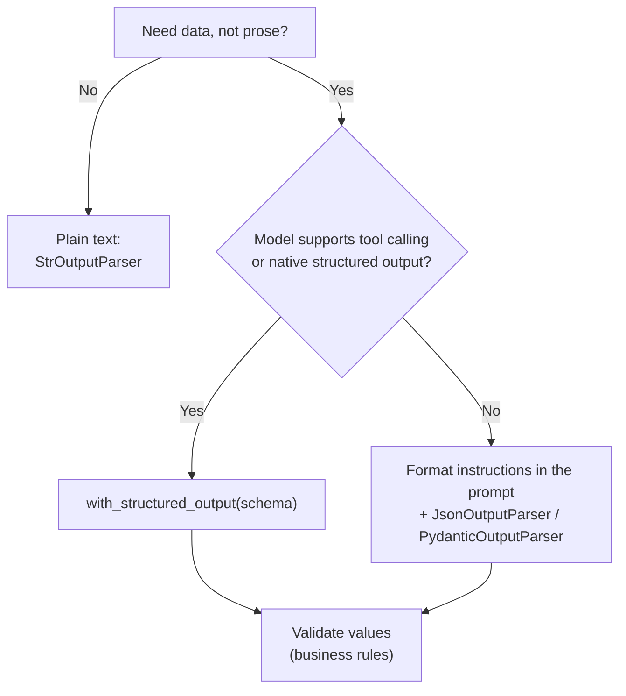

# Why Structured Output Matters: The Complete Guide

> 📚 **Before you start**
>
> - [Structured JSON Output](../../generative-ai-and-llm-foundations/04-prompting-and-structured-output/structured-json-output.md) and [Lab: Reliable JSON Extraction](../../generative-ai-and-llm-foundations/04-prompting-and-structured-output/lab-reliable-json-extraction.md), where you validated and repaired model JSON by hand.
> - [ChatPromptTemplate and Messages](../04-prompts/chatprompttemplate-and-messages.md), for chat prompts.
> - [Pydantic Models](../../apis-and-apps-fastapi-streamlit-and-docker/course.md#m4) in the APIs course; this module re-explains what it uses.

## Introduction

An electronics shop in Nehru Place gets 3,000 online reviews a week. The owner wants a dashboard: average rating per product, which features people complain about, and an alert when anyone mentions "fake" or "duplicate". A chat model can read a review and write a lovely paragraph about it: *"The customer seems mostly happy with the phone, though they mention the battery could be better…"* That paragraph is useless to the dashboard. The dashboard needs **this**:

```json
{"product": "Redmi Note 15", "rating": 4, "sentiment": "positive",
 "complaints": ["battery"], "mentions_counterfeit": false}
```

That's **structured output**: the model returns data in a fixed shape that code can use directly, instead of prose a human must read. It is the bridge between language models and the rest of your software: databases, dashboards, APIs, if-statements.

In the previous course you got JSON from a model the hard way: asking nicely, extracting it from the text, validating it, repairing it. This module shows how LangChain does all of that for you, in two ways. This first lesson explains **why** structure matters, what goes wrong without it, the two routes LangChain offers, and how to choose between them.

> 💡 **Key Insight**
>
> Text is for people; **data is for programs**. Whenever your code (not a human) consumes a model's answer, define a **schema** and make the model fill it. In LangChain that's one method, `with_structured_output(schema)`, when the model supports it, and an **output parser** when it doesn't.

---

## Core Explanation

### 1. Where structured output is needed

Almost every LLM feature that isn't a chat window needs structure:

| Task | Free-text answer | Structured answer your code needs |
|---|---|---|
| **Extraction** | "The invoice is from Sharma Traders for ₹12,400…" | `{"vendor": "Sharma Traders", "amount": 12400, "gst": 18}` |
| **Classification** | "This sounds like a billing problem." | `{"category": "billing", "urgent": true}` |
| **Routing** | "You should probably send this to the refunds team." | `{"route": "refunds"}` |
| **Scoring and grading** | "A decent essay, maybe 7 out of 10." | `{"score": 7, "reasons": [...]}` |
| **Form filling** | "Your name is Priya, born 1998…" | A filled form object |
| **Generating data** | "Here are some sample customers: …" | A list of records |
| **Tool arguments** | "Check the weather in Shimla tomorrow" | `{"city": "Shimla", "date": "2026-10-18"}` |

Notice the last row: when a model calls a tool (Module 7), the arguments it writes **are** structured output. Learning structured output now is half of learning tool calling.

### 2. What goes wrong with free text

Suppose you just ask for a rating and parse it with a regular expression:

```python
import re

replies = [
    "Rating: 4/5. Sentiment: positive.",
    "I'd give it four stars out of five, overall positive.",
    "**Rating**: 4\n**Sentiment**: Positive",
    "Sentiment: mixed. Rating: 3.5/5",
]

def parse_rating(text):
    m = re.search(r"Rating\W*(\d)", text, re.IGNORECASE)
    return int(m.group(1)) if m else None

for r in replies:
    print(f"{parse_rating(r)!s:<5} <- {r!r}")
```

Output:

```
4     <- 'Rating: 4/5. Sentiment: positive.'
None  <- "I'd give it four stars out of five, overall positive."
4     <- '**Rating**: 4\n**Sentiment**: Positive'
3     <- 'Sentiment: mixed. Rating: 3.5/5'
```

Four replies, four formats, two failures: one missed completely and one silently wrong (3.5 became 3). Every new phrasing the model invents breaks your regex a new way. The problems:

- **The format drifts** between calls, models and model versions.
- **Failures are silent**: a wrong number looks like a right one.
- **Types are ambiguous**: "four", "4", "4/5" and "3.5" all mean different things to code.
- **Fields go missing** with no error until something downstream crashes.

### 3. A schema is a contract

The fix is to agree on the shape **before** the model answers. A **schema** says which fields exist, their types, which are required and what values are allowed. In Python you usually write it as a Pydantic model (or a `TypedDict`, covered next lesson):

```python
from typing import Literal
from pydantic import BaseModel, Field

class ReviewSummary(BaseModel):
    """Structured summary of one product review."""
    rating: float = Field(ge=1, le=5, description="Star rating from 1 to 5; halves allowed")
    sentiment: Literal["positive", "negative", "mixed"]
    complaints: list[str] = Field(default_factory=list, description="Short names of features criticised")

print(ReviewSummary(rating=3.5, sentiment="mixed", complaints=["battery"]))
```

Output:

```
rating=3.5 sentiment='mixed' complaints=['battery']
```

The same schema becomes the JSON Schema a model API understands:

```python
import json
schema = ReviewSummary.model_json_schema()
for name, spec in schema["properties"].items():
    print(name, "->", json.dumps(spec))
print("required:", schema["required"])
```

Output:

```
rating -> {"description": "Star rating from 1 to 5; halves allowed", "maximum": 5, "minimum": 1, "title": "Rating", "type": "number"}
sentiment -> {"enum": ["positive", "negative", "mixed"], "title": "Sentiment", "type": "string"}
complaints -> {"description": "Short names of features criticised", "items": {"type": "string"}, "title": "Complaints", "type": "array"}
required: ['rating', 'sentiment']
```

And bad data is rejected loudly, instead of slipping through:

```python
from pydantic import ValidationError

try:
    ReviewSummary(rating=7, sentiment="happy")
except ValidationError as e:
    for err in e.errors():
        print(err["loc"][0], "->", err["msg"])
```

Output:

```
rating -> Input should be less than or equal to 5
sentiment -> Input should be 'positive', 'negative' or 'mixed'
```

### 4. How models are made to follow a schema

You studied the reliability ladder in [Structured JSON Output](../../generative-ai-and-llm-foundations/04-prompting-and-structured-output/structured-json-output.md). In short:

| Technique | How it works | Reliability |
|---|---|---|
| **Ask in the prompt** | "Reply with JSON with fields rating, sentiment…" | Usually works; sometimes adds prose or breaks the format |
| **Ask + parse + validate (+ retry)** | Format instructions in the prompt, then code extracts and validates | Good, with a retry on failure |
| **Tool / function calling** | The schema is given to the API as a tool; the model "calls" it with arguments matching the schema | Very good |
| **Native structured output (constrained decoding)** | The provider forces generated tokens to fit the JSON Schema | Format guaranteed; values still need checking |

LangChain wraps the bottom two rows in **`with_structured_output`** and the middle row in **output parsers**.

### 5. LangChain's two routes

![Two routes to structured data. Native route: a schema goes to with_structured_output, which sends it to the model API as a tool or JSON schema; the constrained reply becomes a validated dict or Pydantic object, and include_raw=True also returns the raw message and any parsing error. Parser route: a schema gives format instructions that go into the prompt; any model replies with text containing JSON; an output parser extracts, parses and validates it into a dict or object, or raises OutputParserException](/img/diagrams/langchain-complete-guide/structured-output-paths.svg)
*Native first, parsers as the fallback, and both end in validated data.*

**Route 1: native structured output.** You hand the schema to the model with `model.with_structured_output(ReviewSummary)` and get back a runnable that returns a `ReviewSummary` object. Under the hood LangChain sends the schema to the provider (as a tool definition or a JSON-schema setting) and parses the reply.

To run this offline we need a fake model that accepts schemas. `FakeMessagesListChatModel` returns scripted messages; we add one method so it accepts tools (a real chat model has this built in). The scripted message is exactly what a real model returns when it fills a schema through tool calling: an `AIMessage` with no text and one **tool call** whose arguments are the data:

```python
from langchain_core.language_models.fake_chat_models import FakeMessagesListChatModel
from langchain_core.messages import AIMessage
from langchain_core.utils.function_calling import convert_to_openai_tool

class ScriptedChatModel(FakeMessagesListChatModel):
    """A scripted chat model that accepts tools/schemas, so structured output runs offline."""
    def bind_tools(self, tools, **kwargs):
        return self.bind(tools=[convert_to_openai_tool(t) for t in tools], **kwargs)

model = ScriptedChatModel(responses=[AIMessage(content="", tool_calls=[{
    "name": "ReviewSummary",
    "args": {"rating": 3.5, "sentiment": "mixed", "complaints": ["battery", "heating"]},
    "id": "call_1",
}])])

summariser = model.with_structured_output(ReviewSummary)
result = summariser.invoke("Good camera but battery drains fast and it heats up while gaming. 3.5 stars.")
print(type(result).__name__)
print(result)
print(result.complaints[0].upper())
```

Output:

```
ReviewSummary
rating=3.5 sentiment='mixed' complaints=['battery', 'heating']
BATTERY
```

You got a typed Python object. `result.rating` is a float, `result.complaints` is a list; your editor even autocompletes the fields.

**Route 2: prompt plus output parser.** For models without tool calling or native structured output (some local models, older APIs), you put **format instructions** in the prompt and use an **output parser** to turn the reply's text into data. The model reply is ordinary text:

```python
from langchain_core.output_parsers import PydanticOutputParser
from langchain_core.language_models.fake_chat_models import FakeListChatModel

parser = PydanticOutputParser(pydantic_object=ReviewSummary)
text_model = FakeListChatModel(responses=[
    'Here you go:\n```json\n{"rating": 3.5, "sentiment": "mixed", "complaints": ["battery"]}\n```'
])
reply = text_model.invoke("...prompt with format instructions...")
print(parser.invoke(reply))
```

Output:

```
rating=3.5 sentiment='mixed' complaints=['battery']
```

The parser found the JSON inside the chatty reply, parsed it and validated it against the schema. Lessons 4 to 6 of this module cover parsers in depth.

### 6. Choosing a route



| | `with_structured_output` | Output parsers |
|---|---|---|
| Works with | Models with tool calling or native structured output (all major hosted models) | Any model that returns text |
| Format reliability | Very high | Good; add retries |
| Prompt changes needed | None (the schema travels separately) | Add format instructions |
| Typical use today | The default | Local/older models, streaming partial JSON, simple text |

Either way, **structure doesn't make values true**. A perfectly shaped `{"rating": 5}` can still be the wrong rating. Check business rules in code (is the product in our catalogue? does the rating match the stars the user clicked?) just as you did in the previous course.

### 7. Structured output in a chain

Because `with_structured_output` returns a runnable, it slots into a chain after a prompt, and the chain's output is the object:

```python
from langchain_core.prompts import ChatPromptTemplate

prompt = ChatPromptTemplate.from_messages([
    ("system", "Summarise the product review. Complaints are short feature names."),
    ("human", "{review}"),
])
model = ScriptedChatModel(responses=[AIMessage(content="", tool_calls=[{
    "name": "ReviewSummary", "args": {"rating": 5, "sentiment": "positive", "complaints": []}, "id": "c2"}])])
chain = prompt | model.with_structured_output(ReviewSummary)

summary = chain.invoke({"review": "Superb display, battery lasts two days. Paisa vasool!"})
print(summary.sentiment, summary.rating, summary.complaints)
```

Output:

```
positive 5.0 []
```

Notice `5` became `5.0`: Pydantic converted the value to the declared `float` type. From here, your code works with clean, typed data: store it, count it, chart it.

---

## Try It Yourself

1. **Break the regex.** Add two more realistic replies to `replies` that `parse_rating` gets wrong, and explain why each fails.
2. **Design a schema.** Write a Pydantic model `TicketTriage` for support emails with `category` (one of billing, delivery, app, other), `urgent` (bool) and `order_id` (optional string). Print its JSON schema's `required` list.
3. **Validation catches it.** Create a `TicketTriage` with `category="refunds"`. What error do you get?

<details>
<summary>Show answers</summary>

**1.**

```python
more = ["Rating - 5 stars!", "Overall I'd rate it 2. Sentiment: negative"]
for r in more:
    print(parse_rating(r), "<-", r)
```

Output:

```
5 <- Rating - 5 stars!
None <- Overall I'd rate it 2. Sentiment: negative
```

The first one happens to work. The second fails because the text says "rate", not "Rating". Each phrasing needs a new rule, which is the whole problem.

**2.**

```python
from typing import Optional

class TicketTriage(BaseModel):
    category: Literal["billing", "delivery", "app", "other"]
    urgent: bool
    order_id: Optional[str] = None

print(TicketTriage.model_json_schema()["required"])
```

Output:

```
['category', 'urgent']
```

`order_id` has a default, so it's optional and not in `required`.

**3.**

```python
try:
    TicketTriage(category="refunds", urgent=True)
except ValidationError as e:
    print(e.errors()[0]["msg"])
```

Output:

```
Input should be 'billing', 'delivery', 'app' or 'other'
```

</details>

---

## Real-World Examples

- **E-commerce review analytics**: every review is turned into rating, sentiment and complaint tags, stored in a database and charted.
- **Invoice and KYC processing**: fields like GSTIN, PAN, amounts and dates are extracted from documents into typed records for accounting systems.
- **Support triage**: incoming emails are classified (category, urgency, order id) and routed automatically.
- **Agents**: every tool call an agent makes is structured output against the tool's argument schema.

---

## Common Misconceptions

### "Asking for JSON in the prompt is enough"

It works most of the time, which is exactly the problem: the failures are rare, random and silent. Use a schema-enforcing route and validate.

### "Structured output means the answer is correct"

It guarantees the **shape**, not the **truth**. The model can still put a wrong number in a perfectly typed field.

### "Structured output is only for extraction"

It's for any time code consumes the answer: classification, routing, grading, data generation, tool arguments and UI rendering.

### "Output parsers are obsolete"

Native structured output is the default for capable models, but parsers are still the right tool for models without it, for streaming partial JSON and for simple text clean-up.

---

## Interview Relevance

*"How do you get reliable structured data from an LLM?"* A strong answer: define a schema (Pydantic, TypedDict or JSON Schema) as the contract; prefer native routes (tool/function calling or provider structured output with constrained decoding), which LangChain wraps as `model.with_structured_output(schema)` returning parsed, validated objects; for models without them, put format instructions in the prompt and use output parsers (`JsonOutputParser`, `PydanticOutputParser`) with retries. Explain why regex over free text fails (format drift, silent errors, type ambiguity), and that structure doesn't guarantee correctness, so validate values against business rules and keep the raw response for debugging.

---

## Key Takeaways

- **Programs need data, not prose**: extraction, classification, routing, grading, data generation and tool arguments all need structure.
- **A schema is the contract**: fields, types, required fields and allowed values, usually a Pydantic model.
- **Route 1, `with_structured_output(schema)`**: the schema goes to the model API; you get validated objects back.
- **Route 2, prompt + output parser**: for models without native support; the parser extracts and validates JSON from text.
- **Shape is not truth**: still validate values against business rules.

---

**Up next:** [Structured Output with TypedDict](structured-output-with-typeddict.md)
