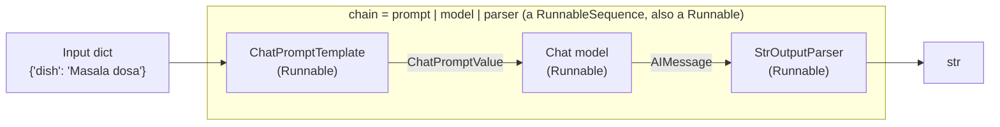

# Chains, LCEL and Runnables: The Complete Guide

> 📚 **Before you start**
>
> - [LangChain Components](../02-langchain-foundations/langchain-components.md), where you first saw `prompt | chat | StrOutputParser()`.
> - [Chat Models](../03-models/chat-models.md), for `invoke`, `stream`, `batch` and async calls.
> - [Prompt Templates](../04-prompts/prompt-templates.md) and [StrOutputParser](../05-structured-output-and-output-parsers/stroutputparser.md), the two ends of most chains.

## Introduction

Think of a dosa counter at a busy Udupi restaurant. One person spreads the batter, the next adds the masala, a third folds and plates. Each station does one job, takes what the previous station hands over, and passes its result on. Nobody needs to know how the other stations work; they only need to agree on what gets handed over.

So far you've built the stations of an LLM app: prompt templates, chat models, output parsers. You've even joined three of them with `|`. This module is about the joining itself. A **chain** is a sequence of steps where each step's output becomes the next step's input, and in current LangChain you build chains with the **LangChain Expression Language (LCEL)**: the `|` operator between **runnables**.

This lesson explains what a runnable is, what `|` actually builds, how data moves through a chain, the methods every chain gets for free (invoke, batch, stream, async, config), how to inspect a chain, and how LCEL replaced the older chain classes. The rest of the module covers the other building blocks (parallel steps, passthroughs, functions, branches), synthetic data, memory and a lab.

> 💡 **Key Insight**
>
> A **Runnable** is anything with the standard methods `invoke`, `batch` and `stream` (plus async twins). Prompts, models, parsers, retrievers, tools and your own functions are all runnables. `a | b` builds a **RunnableSequence**, which is also a runnable, so chains compose like Lego: a chain can be a step in a bigger chain, and every chain gets the full interface for free.

---

## Core Explanation

### 1. What a chain is

A single model call is rarely the whole app. A typical request looks like:

1. Fill a prompt template with the user's input.
2. Send the messages to a chat model.
3. Turn the reply into the type your code needs (text, a dict, an object).

That's a chain of three steps. Bigger apps add more: look something up first, call the model twice, check the result, pick a different path for different inputs.

You could write this as plain Python calls, one after another. LCEL gives you something better: a **declared pipeline** that LangChain understands, so it can stream through it, run it in parallel over many inputs, retry steps, and trace every step in LangSmith without you writing that plumbing.



### 2. The Runnable interface

Every runnable has the same methods. You've used most of them on chat models already:

| Method | What it does |
|---|---|
| `invoke(input)` | Run once, return one output |
| `batch([in1, in2, ...])` | Run on many inputs in parallel, outputs in input order |
| `stream(input)` | Yield the output in pieces as it's produced |
| `ainvoke`, `abatch`, `astream` | Async versions for web servers and concurrent code |
| `astream_events(input)` | Async stream of events from every step inside (start, chunk, end) |
| `with_config(...)` | Attach a run name, tags, metadata or callbacks |
| `with_retry(...)`, `with_fallbacks([...])` | Retry on errors, or switch to a backup |
| `input_schema`, `output_schema` | Pydantic models describing what goes in and comes out |
| `get_graph()` | The chain's structure, drawable as a Mermaid diagram |

The important thing is not the list, it's that **the same list applies to everything**. A prompt template has `batch`. A parser has `stream`. A 12-step chain has `with_retry`. Learn the interface once and you can drive any piece of LangChain.

Let's set up the pieces. As in earlier lessons, a fake chat model stands in for a real one so everything runs offline:

```python
from langchain_core.prompts import ChatPromptTemplate
from langchain_core.output_parsers import StrOutputParser
from langchain_core.language_models.fake_chat_models import FakeListChatModel

prompt = ChatPromptTemplate.from_messages([
    ("system", "You write one-line menu descriptions for a South Indian restaurant."),
    ("human", "Describe: {dish}"),
])
model = FakeListChatModel(responses=["Crisp golden crepe folded around spiced potato, served with sambar and chutney."])
parser = StrOutputParser()

for step in (prompt, model, parser):
    print(f"{type(step).__name__:<20} has invoke/batch/stream:",
          all(hasattr(step, m) for m in ("invoke", "batch", "stream")))
```

Output:

```
ChatPromptTemplate   has invoke/batch/stream: True
FakeListChatModel    has invoke/batch/stream: True
StrOutputParser      has invoke/batch/stream: True
```

### 3. What `|` builds

The pipe operator joins two runnables into a `RunnableSequence`:

```python
chain = prompt | model | parser
print(type(chain).__name__)
print([type(s).__name__ for s in chain.steps])
print(chain.invoke({"dish": "Masala dosa"}))
```

Output:

```
RunnableSequence
['ChatPromptTemplate', 'FakeListChatModel', 'StrOutputParser']
Crisp golden crepe folded around spiced potato, served with sambar and chutney.
```

`a | b | c` is just shorthand. These three lines build equivalent chains:

```python
from langchain_core.runnables import RunnableSequence

chain_a = prompt | model | parser
chain_b = prompt.pipe(model, parser)
chain_c = RunnableSequence(prompt, model, parser)
print([len(c.steps) for c in (chain_a, chain_b, chain_c)])
```

Output:

```
[3, 3, 3]
```

The `|` form is what you'll see everywhere. `RunnableSequence(...)` is useful when you build a list of steps in a loop.

A chain is a runnable, so it can be a step in another chain. Here a second step translates the description into Hindi for the menu's other side:

```python
translate_prompt = ChatPromptTemplate.from_template("Translate into {language}: {text}")
translator = FakeListChatModel(responses=["कुरकुरा सुनहरा डोसा, मसालेदार आलू भरा, सांभर और चटनी के साथ।"])

describe = prompt | model | parser
bilingual = describe | (lambda text: {"text": text, "language": "Hindi"}) | translate_prompt | translator | parser
print(len(bilingual.steps), "steps")
print(bilingual.invoke({"dish": "Masala dosa"}))
```

Output:

```
7 steps
कुरकुरा सुनहरा डोसा, मसालेदार आलू भरा, सांभर और चटनी के साथ।
```

Two things to notice:

- Composing a chain into another chain **flattens** the steps: `bilingual` is one sequence of 7 steps, not a sequence containing a sequence.
- The `lambda` in the middle is a plain function. LCEL wrapped it in a `RunnableLambda` automatically. It's there because `translate_prompt` wants a dict with `text` and `language` keys, while `describe` returns a plain string. Fixing up the shape of data between steps is the most common job of small functions in a chain.

### 4. How data flows between steps

Each step's **output type** must match the next step's **input type**. When a chain fails, it's usually because these don't line up. You can run the steps one at a time to see what's handed over:

```python
value = {"dish": "Masala dosa"}
for step in chain.steps:
    value = step.invoke(value)
    print(f"{type(step).__name__:<20} -> {type(value).__name__}")
```

Output:

```
ChatPromptTemplate   -> ChatPromptValue
FakeListChatModel    -> AIMessage
StrOutputParser      -> TextAccessor
```

| Step | Accepts | Returns |
|---|---|---|
| `ChatPromptTemplate` | dict of variables | `ChatPromptValue` (a list of messages) |
| Chat model | messages, a string or a prompt value | `AIMessage` |
| `StrOutputParser` | message or string | `str` (shown as `TextAccessor`, a `str` subclass) |
| Your function | whatever you write it for | whatever it returns |

A mismatch fails at the step that receives the wrong type, with an error naming that step. For example, piping the parser's string straight into a template that expects a dict:

```python
broken = describe | translate_prompt
try:
    broken.invoke({"dish": "Idli"})
except Exception as e:
    print(type(e).__name__, "-", str(e).splitlines()[0])
```

Output:

```
TypeError - Expected mapping type as input to ChatPromptTemplate. Received <class 'langchain_core.messages.base.TextAccessor'>.
```

That's exactly the error the `lambda` in the bilingual chain prevents. One convenience to know about: a template with exactly **one** variable accepts a bare string and fills that variable with it, so `describe | ChatPromptTemplate.from_template("Translate into Hindi: {text}")` would work without the lambda. Being explicit with a dict is clearer once templates grow.

### 5. Every way to call a chain

Because the chain is a runnable, all the calling styles you learned for models work on the whole pipeline.

**Batch** runs many inputs in parallel and returns outputs in input order:

```python
menu_model = FakeListChatModel(responses=["Soft steamed rice cakes."])
menu_chain = prompt | menu_model | parser
print(menu_chain.batch([{"dish": "Idli"}, {"dish": "Idli"}, {"dish": "Idli"}], config={"max_concurrency": 2}))
```

Output:

```
['Soft steamed rice cakes.', 'Soft steamed rice cakes.', 'Soft steamed rice cakes.']
```

(The fake model gives the same reply to every input; a real model would describe each dish.)

**Stream** yields pieces as soon as the *last* step produces them. Prompts and models pass streams along, and `StrOutputParser` turns each `AIMessageChunk` into a string piece, so the user sees text appear immediately:

```python
pieces = list(chain.stream({"dish": "Masala dosa"}))
print(len(pieces), "pieces, first five:", pieces[:5])
print("joined:", "".join(pieces))
```

Output:

```
79 pieces, first five: ['C', 'r', 'i', 's', 'p']
joined: Crisp golden crepe folded around spiced potato, served with sambar and chutney.
```

**Async** works the same way in a FastAPI handler or any `asyncio` code:

```python
import asyncio

async def main():
    return await chain.ainvoke({"dish": "Masala dosa"})

print(asyncio.run(main()))
```

Output:

```
Crisp golden crepe folded around spiced potato, served with sambar and chutney.
```

**Events** let you watch every step inside the chain, which is how UIs show "thinking..." progress. `astream_events` is async; each event has an `event` type and the `name` of the step:

```python
async def show_events():
    names = []
    async for ev in chain.astream_events({"dish": "Masala dosa"}, version="v2"):
        if ev["event"].endswith("_start"):
            names.append(f'{ev["event"]}:{ev["name"]}')
    return names

for n in asyncio.run(show_events()):
    print(n)
```

Output:

```
on_chain_start:RunnableSequence
on_prompt_start:ChatPromptTemplate
on_chat_model_start:FakeListChatModel
on_parser_start:StrOutputParser
```

The outer `RunnableSequence` starts first, then each step in turn. In the LangGraph course you'll stream graphs the same way.

### 6. Config: names, tags and metadata

Every method accepts a `config` dict. The keys you'll use most:

| Key | Use |
|---|---|
| `run_name` | A readable name for this run in traces |
| `tags` | Labels such as `["menu", "prod"]` to filter traces |
| `metadata` | Key-value facts such as `{"restaurant_id": "BLR-42"}` |
| `callbacks` | Handlers that get notified as steps start and end |
| `max_concurrency` | Cap on parallel work in `batch` |

You can pass config per call, or fix it on the chain with `with_config`. Here a small callback handler records which steps ran and what tags they saw:

```python
from langchain_core.callbacks import BaseCallbackHandler

class StepLogger(BaseCallbackHandler):
    def __init__(self):
        self.seen = []
    def on_chain_start(self, serialized, inputs, *, tags=None, metadata=None, **kwargs):
        self.seen.append((kwargs.get("name"), tuple(tags or ()), (metadata or {}).get("restaurant_id")))

logger = StepLogger()
named = chain.with_config(run_name="menu_writer", tags=["menu"])
named.invoke({"dish": "Masala dosa"}, config={"callbacks": [logger], "metadata": {"restaurant_id": "BLR-42"}})
for row in logger.seen:
    print(row)
```

Output:

```
('menu_writer', ('menu',), 'BLR-42')
('ChatPromptTemplate', ('seq:step:1', 'menu'), 'BLR-42')
('StrOutputParser', ('seq:step:3', 'menu'), 'BLR-42')
```

The whole chain ran under the name `menu_writer`. LangChain also added its own `seq:step:N` tag to each step, recording its position in the sequence. Tags and metadata **flow down** to every step, so in a trace you can find all the steps that served restaurant BLR-42. Chat model calls report through `on_chat_model_start` rather than `on_chain_start`, which is why the model doesn't appear in this list. Module 8 shows the same information in LangSmith.

### 7. Inspecting a chain

A chain knows its own structure and its input and output types:

```python
print(chain.input_schema.model_json_schema()["required"])
print(chain.output_schema.model_json_schema()["type"])
print(chain.get_graph().draw_mermaid())
```

Output:

```
['dish']
string
---
config:
  flowchart:
    curve: linear
---
graph TD;
	PromptInput([PromptInput]):::first
	ChatPromptTemplate(ChatPromptTemplate)
	FakeListChatModel(FakeListChatModel)
	StrOutputParser(StrOutputParser)
	StrOutputParserOutput([StrOutputParserOutput]):::last
	PromptInput --> ChatPromptTemplate;
	ChatPromptTemplate --> FakeListChatModel;
	StrOutputParser --> StrOutputParserOutput;
	FakeListChatModel --> StrOutputParser;
	classDef default fill:#f2f0ff,line-height:1.2
	classDef first fill-opacity:0
	classDef last fill:#bfb6fc
```

The input schema came from the prompt's variables, and the output schema from the parser. Paste the Mermaid text into any Mermaid viewer to see the chain as a diagram; it's handy in code reviews and docs. (There's also `draw_ascii()`, which needs the extra `grandalf` package.)

### 8. Where the old chain classes went

Before LCEL, LangChain shipped ready-made chain classes: `LLMChain` (prompt + model), `SimpleSequentialChain` and `SequentialChain` (several chains in a row), `ConversationChain` (chat with memory) and many task-specific ones. They were hard to customise, didn't stream well, and every one had its own quirks.

In LangChain 1.0 they moved to the `langchain-classic` package. `LLMChain` has been deprecated since version 0.1.17, and the deprecation notice names its replacement directly: a `RunnableSequence` such as `prompt | llm`. You'll still meet the old style in blog posts and older codebases:

```python
# not-run: legacy style; needs `pip install langchain-classic`, shown only for recognition
from langchain_classic.chains import LLMChain

old_chain = LLMChain(llm=model, prompt=prompt)
result = old_chain.invoke({"dish": "Masala dosa"})
print(result["text"])
```

Example output:

```
LangChainDeprecationWarning: The class `LLMChain` was deprecated in LangChain 0.1.17 and will be removed in 2.0.0. Use RunnableSequence, e.g., `prompt | llm` instead.
Crisp golden crepe folded around spiced potato, served with sambar and chutney.
```

The translation is mechanical: `LLMChain(llm=m, prompt=p)` becomes `p | m | StrOutputParser()`, and `SequentialChain` becomes more `|`. The next lesson builds sequential, parallel and conditional chains the LCEL way.

![LCEL in three rows. Parts: a prompt template (dict in, prompt value out), a chat model (messages in, AIMessage out), an output parser (message in, string, dict or object out) and your own function as a RunnableLambda. Compose: a | b | c is a RunnableSequence, a dict of runnables is a RunnableParallel, .assign adds keys while keeping the input, and RunnableBranch picks a path by condition. Get for free: invoke, batch and stream with async twins, retries and fallbacks, config and tracing with tags and metadata, and input and output schemas plus get_graph. A composed chain is itself a Runnable.](/img/diagrams/langchain-complete-guide/lcel-runnables.svg)

---

## Try It Yourself

1. **Read the steps.** Build `review_chain = ChatPromptTemplate.from_template("Rate this review 1-5: {review}") | FakeListChatModel(responses=["4"]) | StrOutputParser()`. Print its number of steps, its required input keys and its output for `{"review": "Good filter coffee"}`.
2. **Fix the shape.** You have `upper = RunnableLambda(lambda s: s.upper())`. Join `describe` and `upper` so the chain returns the description in capitals. Then explain why `describe | translate_prompt` failed but `describe | upper` works.
3. **Tag a batch.** Run `menu_chain.batch` on two dishes with `config={"tags": ["try-it"], "callbacks": [StepLogger()]}`, keeping a reference to the logger, and print how many `on_chain_start` events had the `try-it` tag.

<details>
<summary>Show answers</summary>

**1.**

```python
review_chain = ChatPromptTemplate.from_template("Rate this review 1-5: {review}") | FakeListChatModel(responses=["4"]) | StrOutputParser()
print(len(review_chain.steps), review_chain.input_schema.model_json_schema()["required"],
      review_chain.invoke({"review": "Good filter coffee"}))
```

Output:

```
3 ['review'] 4
```

**2.**

```python
from langchain_core.runnables import RunnableLambda

upper = RunnableLambda(lambda s: s.upper())
print((describe | upper).invoke({"dish": "Masala dosa"}))
```

Output:

```
CRISP GOLDEN CREPE FOLDED AROUND SPICED POTATO, SERVED WITH SAMBAR AND CHUTNEY.
```

`describe` returns a string. `upper` accepts a string, so the types match. `translate_prompt` has two variables, so it needs a dict and rejects a bare string.

**3.**

```python
log = StepLogger()
menu_chain.batch([{"dish": "Idli"}, {"dish": "Vada"}], config={"tags": ["try-it"], "callbacks": [log]})
print(sum("try-it" in tags for _, tags, _ in log.seen), "tagged chain starts")
```

Output:

```
6 tagged chain starts
```

Each of the two runs reports the sequence, the prompt and the parser, and every one carries the tag.

</details>

---

## Real-World Examples

- **Food-delivery apps** run a "describe this dish" chain over thousands of new menu items with `batch` and `max_concurrency`, tagging each run with the restaurant id so a bad description can be traced back.
- **Customer-support tools** stream a chain's answer into the chat widget while a separate `astream_events` consumer shows "looking up your order..." progress from the inner steps.
- **Teams migrating old code** replace `LLMChain` and `SequentialChain` with `|` pipelines, gaining streaming and tracing without changing prompts.
- **Code reviews** include `get_graph().draw_mermaid()` output so reviewers see the pipeline's shape at a glance.

---

## Common Misconceptions

### "A chain is a special LangChain class you have to subclass"

Not any more. A chain is just runnables joined with `|`. The result is a `RunnableSequence`, and you never subclass it.

### "Streaming a chain waits for every step to finish"

Steps that can stream (prompt, model, `StrOutputParser`, JSON parsers) pass pieces along as they arrive. Only a step that can't stream (for example a plain function) collects its input first.

### "LCEL is a new language you need to learn"

It's ordinary Python. `|` is operator overloading (`__or__`) on the `Runnable` class, the same trick you saw with Python's special methods.

### "`LLMChain` is the right way because it's in many tutorials"

It's deprecated and lives in `langchain-classic`. Use `prompt | model | parser`.

---

## Interview Relevance

*"What is LCEL and what's a Runnable?"* A strong answer: a Runnable is LangChain's standard unit of work, with `invoke`, `batch`, `stream`, their async versions, `astream_events`, config, retries, fallbacks and schemas. Prompts, models, parsers, retrievers, tools and functions all implement it. LCEL is the composition syntax: `a | b` builds a `RunnableSequence` that is itself a runnable, functions become `RunnableLambda`s and dicts become `RunnableParallel`s automatically. Benefits: one interface for everything, streaming and parallel batch through the whole pipeline, config (tags, metadata, callbacks) that flows to every step for tracing, and easy composition. Mention that legacy classes like `LLMChain` moved to `langchain-classic` and that for loops, state and agents you move to LangGraph.

---

## Key Takeaways

- **A chain is a pipeline of steps** where each output feeds the next input.
- **Every component is a Runnable** with `invoke`, `batch`, `stream`, async twins, config, retries, fallbacks and schemas.
- **`|` builds a `RunnableSequence`**, which is a runnable too, so chains nest and flatten.
- **Types must line up** between steps; small functions fix the shape of data.
- **Config (run name, tags, metadata, callbacks) flows to every step**, ready for tracing.
- **Old chain classes are legacy**: `LLMChain` and friends live in `langchain-classic`.

---

**Up next:** [Sequential, Parallel and Conditional Chains](sequential-parallel-and-conditional-chains.md)
