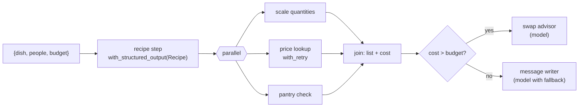

# Lab: A Multi-step LCEL Pipeline

> 📚 **Before you start**
>
> - Every lesson in this module, especially [RunnableSequence, Parallel, Passthrough, Lambda and Branch](runnablesequence-parallel-passthrough-lambda-and-branch.md).
> - [Structured Output with Pydantic and JSON Schema](../05-structured-output-and-output-parsers/structured-output-with-pydantic-and-json-schema.md), for the recipe schema.
> - [Chat Models](../03-models/chat-models.md), for `with_fallbacks`.

## What You'll Build

**Rasoi Planner**: a pipeline that takes a dish, the number of people and a budget, and produces a WhatsApp-ready shopping message. Under the hood it chains every building block from this module:

1. A model extracts the dish's **ingredients as structured data**.
2. Three things happen **in parallel**: scale quantities for the number of people, look up **prices** (from a flaky shop API, so with retries), and check the **pantry**.
3. A **branch**: if the cost is over budget, a model suggests cheaper swaps; otherwise a model writes the shopping message.
4. A **fallback** model takes over if the main one fails.
5. The whole pipeline runs over a week's menu with **`batch`**, tagged for tracing.



> 💡 **Key Insight**
>
> Build a pipeline **one stage at a time, testing each stage on its own**, then join them with `|`. Because every stage is a runnable, each can be invoked alone, and the joined pipeline inherits batch, retries, fallbacks and tracing without extra code.

---

## Step 1: Data and Stand-In Models

Recipes are per 4 people. Prices are per unit (kg, litre or piece), in rupees:

```python
RECIPES = {
    "rajma chawal": [("rajma", 0.25, "kg"), ("rice", 0.4, "kg"), ("onion", 0.3, "kg"), ("tomato", 0.3, "kg"), ("ghee", 0.05, "l")],
    "poha": [("poha", 0.3, "kg"), ("onion", 0.2, "kg"), ("peanuts", 0.1, "kg"), ("lemon", 2, "pc")],
    "paneer butter masala": [("paneer", 0.4, "kg"), ("butter", 0.1, "kg"), ("cream", 0.2, "l"), ("tomato", 0.5, "kg"), ("cashew", 0.05, "kg")],
}
PRICES = {"rajma": 160, "rice": 70, "onion": 40, "tomato": 30, "ghee": 650, "poha": 60, "peanuts": 140,
          "lemon": 5, "paneer": 420, "butter": 560, "cream": 240, "cashew": 1000}
PANTRY = {"rice", "ghee", "peanuts"}
print(len(RECIPES), "recipes,", len(PRICES), "prices,", len(PANTRY), "pantry items")
```

Output:

```
3 recipes, 12 prices, 3 pantry items
```

The recipe model returns a structured `Recipe`, like a real model with `with_structured_output` would. The writer model writes text according to the instruction it receives:

```python
from pydantic import BaseModel, Field
from langchain_core.language_models import BaseChatModel, SimpleChatModel
from langchain_core.messages import AIMessage
from langchain_core.outputs import ChatGeneration, ChatResult
from langchain_core.utils.function_calling import convert_to_openai_tool

class Ingredient(BaseModel):
    name: str
    qty: float = Field(gt=0, description="Quantity for 4 people")
    unit: str

class Recipe(BaseModel):
    """Ingredients for a dish, for 4 people."""
    dish: str
    ingredients: list[Ingredient]

class RecipeModel(BaseChatModel):
    """Offline stand-in: knows three recipes."""
    @property
    def _llm_type(self):
        return "recipe-model"

    def bind_tools(self, tools, **kwargs):
        return self.bind(tools=[convert_to_openai_tool(t) for t in tools], **kwargs)

    def _generate(self, messages, stop=None, run_manager=None, **kwargs):
        dish = messages[-1].content.split("Dish: ")[1].strip().lower()
        args = {"dish": dish, "ingredients": [{"name": n, "qty": q, "unit": u} for n, q, u in RECIPES[dish]]}
        return ChatResult(generations=[ChatGeneration(message=AIMessage(content="", tool_calls=[
            {"name": "Recipe", "args": args, "id": "call_1"}]))])

class WriterModel(SimpleChatModel):
    """Offline stand-in for the writing model."""
    fail: bool = False
    @property
    def _llm_type(self):
        return "writer-model"

    def _call(self, messages, stop=None, run_manager=None, **kwargs):
        if self.fail:
            raise ConnectionError("writer model unavailable")
        text = messages[-1].content
        items = [line[2:] for line in text.splitlines() if line.startswith("- ")]
        if text.startswith("Suggest swaps"):
            dearest = max(items, key=lambda line: int(line.rsplit("₹", 1)[1]))
            return f"Over budget. Biggest cost: {dearest}. Try a cheaper swap for it, or buy a smaller quantity."
        dish = text.split("for ")[1].split(" (")[0]
        return f"🛒 {dish.title()}: please buy " + "; ".join(i.rsplit(" ₹", 1)[0] for i in items) + ". 🙏"

print(RecipeModel().with_structured_output(Recipe).invoke("Dish: Poha").ingredients[0])
```

Output:

```
name='poha' qty=0.3 unit='kg'
```

## Step 2: Stage 1, the Recipe

```python
from langchain_core.prompts import ChatPromptTemplate

recipe_prompt = ChatPromptTemplate.from_messages([
    ("system", "List the ingredients for 4 people for the dish. Use kg, l or pc as units."),
    ("human", "Dish: {dish}"),
])
recipe_step = recipe_prompt | RecipeModel().with_structured_output(Recipe)

r = recipe_step.invoke({"dish": "Rajma Chawal"})
print(r.dish, "->", [i.name for i in r.ingredients])
```

Output:

```
rajma chawal -> ['rajma', 'rice', 'onion', 'tomato', 'ghee']
```

Tested on its own. Next stage.

## Step 3: Stage 2, Three Lookups in Parallel

Each lookup is a small function taking a dict with `recipe` and `people`. The price API is flaky: the first call fails, as real shop APIs sometimes do, so it gets `with_retry`:

```python
from langchain_core.runnables import RunnableLambda, RunnableParallel

def scale(d):
    factor = d["people"] / 4
    return {i.name: (round(i.qty * factor, 2), i.unit) for i in d["recipe"].ingredients}

price_calls = {"n": 0}
def prices(d):
    price_calls["n"] += 1
    if price_calls["n"] == 1:
        raise TimeoutError("shop API timed out")
    return {i.name: PRICES[i.name] for i in d["recipe"].ingredients}

def pantry(d):
    return sorted(i.name for i in d["recipe"].ingredients if i.name in PANTRY)

lookups = RunnableParallel(
    quantities=RunnableLambda(scale),
    unit_prices=RunnableLambda(prices).with_retry(stop_after_attempt=3, wait_exponential_jitter=False),
    have=RunnableLambda(pantry),
)
out = lookups.invoke({"recipe": r, "people": 6})
print(out["quantities"]["rajma"], out["unit_prices"]["rajma"], out["have"])
print("price API calls:", price_calls["n"])
```

Output:

```
(0.38, 'kg') 160 ['ghee', 'rice']
price API calls: 2
```

The first price call timed out, the retry succeeded, and the caller never knew.

## Step 4: Join into a Shopping List

A plain function combines the three results: skip what's in the pantry, compute each line's cost, and total it:

```python
def shopping_list(d):
    lines, total = [], 0
    for name, (qty, unit) in d["quantities"].items():
        if name in d["have"]:
            continue
        cost = round(qty * d["unit_prices"][name])
        total += cost
        lines.append(f"{name} {qty} {unit} ₹{cost}")
    return {"lines": lines, "total": total}

sl = shopping_list(out)
print(sl["lines"], "total ₹", sl["total"])
```

Output:

```
['rajma 0.38 kg ₹61', 'onion 0.45 kg ₹18', 'tomato 0.45 kg ₹14'] total ₹ 93
```

## Step 5: Stage 3, the Branch

Two writer chains, and a routing function that picks one by comparing the total with the budget. The message writer gets a **fallback**: a second model to use if the first one fails:

```python
from langchain_core.output_parsers import StrOutputParser

def as_prompt_vars(d):
    return {"dish": d["dish"], "people": d["people"], "budget": d["budget"],
            "total": d["shop"]["total"], "items": "\n".join("- " + l for l in d["shop"]["lines"])}

writer_prompt = ChatPromptTemplate.from_template(
    "Write a short WhatsApp message to the kirana store for {dish} ({people} people). Items:\n{items}")
swap_prompt = ChatPromptTemplate.from_template(
    "Suggest swaps: the list costs ₹{total} but the budget is ₹{budget}. Items:\n{items}")

primary, backup = WriterModel(fail=True), WriterModel()
message_chain = writer_prompt | primary.with_fallbacks([backup]) | StrOutputParser()
swap_chain = swap_prompt | WriterModel() | StrOutputParser()

def choose(d):
    return swap_chain if d["total"] > d["budget"] else message_chain

finish = RunnableLambda(as_prompt_vars) | RunnableLambda(choose)
print(finish.invoke({"dish": "rajma chawal", "people": 6, "budget": 300, "shop": sl}))
```

Output:

```
🛒 Rajma Chawal: please buy rajma 0.38 kg; onion 0.45 kg; tomato 0.45 kg. 🙏
```

The primary writer is set to fail, so the backup wrote the message. In production the backup would be a different provider's model.

## Step 6: The Full Pipeline

Now join the stages. `RunnablePassthrough.assign` keeps `dish`, `people` and `budget` available all the way down:

```python
from langchain_core.runnables import RunnablePassthrough

rasoi = (
    RunnablePassthrough.assign(recipe=recipe_step)
    | RunnablePassthrough.assign(shop=lookups | RunnableLambda(shopping_list))
    | finish
).with_config(run_name="rasoi_planner")

print(rasoi.invoke({"dish": "Poha", "people": 4, "budget": 200}))
print(rasoi.invoke({"dish": "Paneer Butter Masala", "people": 8, "budget": 500}))
```

Output:

```
🛒 Poha: please buy poha 0.3 kg; onion 0.2 kg; lemon 2.0 pc. 🙏
Over budget. Biggest cost: paneer 0.8 kg ₹336. Try a cheaper swap for it, or buy a smaller quantity.
```

Poha fit the budget, so the message writer ran. The paneer dish for 8 came to more than ₹500, so the swap advisor ran instead and pointed at the most expensive line.

## Step 7: A Week's Menu with `batch`

The pipeline is a runnable, so a week's menu is one `batch` call. Tags and metadata flow to every inner step for tracing:

```python
week = [
    {"dish": "Poha", "people": 4, "budget": 200},
    {"dish": "Rajma Chawal", "people": 4, "budget": 300},
    {"dish": "Paneer Butter Masala", "people": 4, "budget": 300},
    {"dish": "Poha", "people": 6, "budget": 200},
]
results = rasoi.batch(week, config={"max_concurrency": 2, "tags": ["weekly-menu"], "metadata": {"family": "Sharma"}})
for day, (req, msg) in enumerate(zip(week, results), start=1):
    print(f"Day {day} {req['dish']:<21} -> {msg[:60]}")
```

Output:

```
Day 1 Poha                  -> 🛒 Poha: please buy poha 0.3 kg; onion 0.2 kg; lemon 2.0 pc. 
Day 2 Rajma Chawal          -> 🛒 Rajma Chawal: please buy rajma 0.25 kg; onion 0.3 kg; toma
Day 3 Paneer Butter Masala  -> Over budget. Biggest cost: paneer 0.4 kg ₹168. Try a cheaper
Day 4 Poha                  -> 🛒 Poha: please buy poha 0.45 kg; onion 0.3 kg; lemon 3.0 pc.
```

`batch` returned results in menu order even though two ran at a time.

## Step 8: Inspect the Pipeline

```python
print(rasoi.input_schema.model_json_schema().get("title"))
graph = rasoi.get_graph()
print(len(graph.nodes), "nodes,", len(graph.edges), "edges")
```

Output:

```
RunnableSequenceInput
18 nodes, 21 edges
```

Paste `rasoi.get_graph().draw_mermaid()` into a Mermaid viewer to see the whole pipeline, including the parallel lookups.

## Step 9: With Real Models

Only the two model objects change:

```python
# not-run: needs `pip install langchain langchain-anthropic` and ANTHROPIC_API_KEY
from langchain.chat_models import init_chat_model

model = init_chat_model("anthropic:claude-opus-5-5", temperature=0)
recipe_step = recipe_prompt | model.with_structured_output(Recipe)
message_chain = writer_prompt | model.with_fallbacks([backup_model]) | StrOutputParser()  # backup_model: another provider
swap_chain = swap_prompt | model | StrOutputParser()
print(rasoi.invoke({"dish": "Paneer Butter Masala", "people": 8, "budget": 500}))
```

Example output:

```
Your list comes to ₹674 against a ₹500 budget. The biggest costs are paneer (₹336) and butter (₹112). Swap half the paneer for potatoes and peas, use oil instead of butter, and replace cream with milk thickened with a spoon of cashew paste.
```

(You'd rebuild `finish` and `rasoi` after replacing the chains, since they captured the old objects.)

---

## Try It Yourself

1. **Add a fourth lookup.** Add `calories` to the parallel stage: a function returning a rough total using `{"rice": 1300, "rajma": 3300, "paneer": 2650}` kcal per kg (0 for anything else). Print it for rajma chawal for 4 people.
2. **Fail loudly.** Make the price API fail 3 times in a row. What does `rasoi.invoke` do now? Use `batch(..., return_exceptions=True)` to keep the week's batch going.
3. **Pantry-aware message.** Change `shopping_list` so the message also says which items are already at home.

<details>
<summary>Show answers</summary>

**1.**

```python
KCAL = {"rice": 1300, "rajma": 3300, "paneer": 2650}

def calories(d):
    factor = d["people"] / 4
    return round(sum(KCAL.get(i.name, 0) * i.qty * factor for i in d["recipe"].ingredients if i.unit == "kg"))

lookups4 = RunnableParallel(quantities=RunnableLambda(scale), unit_prices=RunnableLambda(prices),
                            have=RunnableLambda(pantry), calories=RunnableLambda(calories))
print(lookups4.invoke({"recipe": recipe_step.invoke({"dish": "rajma chawal"}), "people": 4})["calories"], "kcal")
```

Output:

```
1345 kcal
```

**2.**

```python
def always_down(d):
    raise TimeoutError("shop API down")

broken_lookups = RunnableParallel(quantities=RunnableLambda(scale),
                                  unit_prices=RunnableLambda(always_down).with_retry(stop_after_attempt=3, wait_exponential_jitter=False),
                                  have=RunnableLambda(pantry))
broken = RunnablePassthrough.assign(recipe=recipe_step) | RunnablePassthrough.assign(shop=broken_lookups | RunnableLambda(shopping_list)) | finish
print(broken.batch(week[:2], return_exceptions=True))
```

Output:

```
[TimeoutError('shop API down'), TimeoutError('shop API down')]
```

After three attempts the error propagates. With `return_exceptions=True` each day's slot holds the exception instead of the whole batch failing.

**3.**

```python
def shopping_list_with_home(d):
    out = shopping_list(d)
    if d["have"]:
        out["lines"].append("(already at home: " + ", ".join(d["have"]) + ") ₹0")
    return out

print(shopping_list_with_home(lookups.invoke({"recipe": r, "people": 4}))["lines"][-1])
```

Output:

```
(already at home: ghee, rice) ₹0
```

</details>

---

## What You've Learned

- **Build stage by stage**, test each on its own, then join with `|`.
- **`RunnablePassthrough.assign`** keeps inputs available to later stages.
- **Parallel lookups** with `RunnableParallel`, and **`with_retry`** for flaky APIs.
- **Branching** with a routing function, and **`with_fallbacks`** for model outages.
- **One `batch` call** runs the whole pipeline over many inputs, in order, with tags and metadata for tracing.

---

**Up next:** [Tools and Toolkits](../../langchain-complete-guide/course.md#m7)
