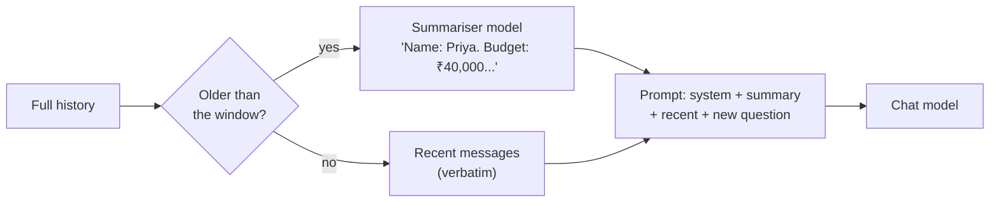

# Memory Management in LangChain

> 📚 **Before you start**
>
> - [MessagesPlaceholder and Chat History](../04-prompts/messagesplaceholder-and-chat-history.md), where you kept history in a list and trimmed it with `trim_messages`.
> - [RunnableSequence, Parallel, Passthrough, Lambda and Branch](runnablesequence-parallel-passthrough-lambda-and-branch.md), for building the memory chains here.
> - [Tokens and Context Windows](../../generative-ai-and-llm-foundations/03-how-llms-work/tokens-and-context-windows.md), for why history costs money.

## Introduction

A good travel agent in Panaji remembers you. You said on Monday that your name is Priya, your budget is ₹40,000 and you hate early flights; on Wednesday you just say "book the second hotel" and they know what you mean. They also don't recite Monday's entire conversation back to themselves before answering. They remember **the important parts**.

Chat models are the opposite of that travel agent: they remember **nothing** between calls. Every call sees only the messages you send. "Memory" in an LLM app is entirely your job: deciding what to keep, what to trim, what to summarise, where to store it, and how to keep different users' conversations apart.

This lesson covers the strategies (full buffer, windowing, summarisation), the plumbing (sessions per user, saving to disk), the legacy memory classes you'll meet in older code and why they were deprecated, and the current recommendation: LangGraph's checkpointers, which you'll use throughout the LangGraph course.

> 💡 **Key Insight**
>
> Memory is a **context budget problem**. Every remembered message is resent and paid for on every turn. Good memory keeps recent turns verbatim, compresses older ones into a summary, stores durable facts separately, and keys everything by a conversation (thread) id. In current LangChain the storage part is handled by LangGraph checkpointers; the strategy part is still your design.

---

## Core Explanation

### 1. The stand-in models

To see memory working (and failing) offline, we need a model whose answer depends on what's in its context. `GoaBot` answers "what's my name?" and "what's my budget?" only if the user (or a system message) stated the fact somewhere in the messages it receives, and otherwise reports how many messages it can see:

```python
import re
from langchain_core.language_models import SimpleChatModel

class GoaBot(SimpleChatModel):
    """Offline stand-in for a travel assistant: can only 'remember' what's in its context."""
    @property
    def _llm_type(self):
        return "goa-bot"

    def _call(self, messages, stop=None, run_manager=None, **kwargs):
        context = " ".join(m.content for m in messages if m.type in ("system", "human"))  # what it was told
        question = messages[-1].content.lower()
        if "my name" in question and "?" in question:
            m = re.search(r"(?:my name is|Name:) (\w+)", context)
            return f"Your name is {m.group(1)}." if m else "Sorry, I don't know your name."
        if "budget" in question and "?" in question:
            m = re.search(r"budget is (₹[\d,]+)|Budget: (₹[\d,]+)", context)
            return f"Your budget is {m.group(1) or m.group(2)}." if m else "Sorry, I don't know your budget."
        return f"Noted. (I can see {len(messages)} messages.)"

bot = GoaBot()
print(bot.invoke("What's my name?").content)
```

Output:

```
Sorry, I don't know your name.
```

### 2. Strategy 1: keep everything (the buffer)

The simplest memory is a list that grows by two messages per turn, inserted into the prompt with `MessagesPlaceholder`:

```python
from langchain_core.prompts import ChatPromptTemplate, MessagesPlaceholder
from langchain_core.messages import HumanMessage, AIMessage

prompt = ChatPromptTemplate.from_messages([
    ("system", "You are a friendly Goa travel assistant."),
    MessagesPlaceholder("history"),
    ("human", "{question}"),
])
chain = prompt | bot

history = []
def chat(question):
    reply = chain.invoke({"history": history, "question": question})
    history.extend([HumanMessage(question), reply])
    return reply.content

for q in ["Hi, my name is Priya.", "My budget is ₹40,000 for 4 nights.", "I prefer North Goa beaches.",
          "No flights before 9 am please.", "What's my name?", "What's my budget?"]:
    print(f"{q:<36} -> {chat(q)}")
```

Output:

```
Hi, my name is Priya.                -> Noted. (I can see 2 messages.)
My budget is ₹40,000 for 4 nights.   -> Noted. (I can see 4 messages.)
I prefer North Goa beaches.          -> Noted. (I can see 6 messages.)
No flights before 9 am please.       -> Noted. (I can see 8 messages.)
What's my name?                      -> Your name is Priya.
What's my budget?                    -> Your budget is ₹40,000.
```

It works perfectly, and the model sees more messages every turn. After 50 turns that's 100 messages resent with every question: slower, more expensive, and eventually over the context window. Buffers are fine for short chats (a support session of 10 turns), not for long ones.

### 3. Strategy 2: a window of recent messages

Keep only the most recent messages that fit a budget. `trim_messages` does it, counting with a real token counter or an approximation. `count_tokens_approximately` estimates tokens from characters, good enough when you don't have the model's tokenizer:

```python
from langchain_core.messages import trim_messages
from langchain_core.messages.utils import count_tokens_approximately

print("whole history:", count_tokens_approximately(history), "tokens (approx)")
window = trim_messages(history, max_tokens=60, token_counter=count_tokens_approximately,
                       strategy="last", start_on="human")
print("window keeps", len(window), "of", len(history), "messages, starting with:", window[0].content)
```

Output:

```
whole history: 136 tokens (approx)
window keeps 4 of 12 messages, starting with: What's my name?
```

Now put the window into the chain and ask again:

```python
def windowed_answer(question, budget=60):
    recent = trim_messages(history, max_tokens=budget, token_counter=count_tokens_approximately,
                           strategy="last", start_on="human")
    return chain.invoke({"history": recent, "question": question}).content

print(windowed_answer("What's my name?"))
```

Output:

```
Sorry, I don't know your name.
```

Cheap and bounded, but the window **forgot Priya's name** because she said it in the first turn. That's the weakness of windowing: important early facts fall off the end.

### 4. Strategy 3: summary plus recent window

The usual fix: compress older messages into a **summary** with a model call, keep recent messages verbatim, and send both. The summary goes in as a system message:



A stand-in summariser that extracts the key facts (a real model would write a short paragraph):

```python
class Summariser(SimpleChatModel):
    """Offline stand-in: pulls name, budget and preferences out of a conversation."""
    @property
    def _llm_type(self):
        return "summariser"

    def _call(self, messages, stop=None, run_manager=None, **kwargs):
        text = messages[-1].content
        facts = []
        if m := re.search(r"my name is (\w+)", text):
            facts.append(f"Name: {m.group(1)}.")
        if m := re.search(r"budget is (₹[\d,]+)", text):
            facts.append(f"Budget: {m.group(1)}.")
        facts += [f"Prefers: {s.strip()}." for s in re.findall(r"I prefer ([^.]+)", text)]
        return " ".join(facts) or "Nothing important yet."

from langchain_core.output_parsers import StrOutputParser

summarise = (
    ChatPromptTemplate.from_template(
        "Summarise the facts about the traveller in this conversation in under 50 words:\n{conversation}")
    | Summariser()
    | StrOutputParser()
)
```

Now the memory step: split the history, summarise the old part, keep the recent part:

```python
from langchain_core.messages import SystemMessage
from langchain_core.runnables import RunnableLambda, RunnablePassthrough

def build_memory(d, keep=4):
    old, recent = d["history"][:-keep], d["history"][-keep:]
    conversation = "\n".join(f"{m.type}: {m.content}" for m in old)
    summary = summarise.invoke({"conversation": conversation}) if old else ""
    memory = [SystemMessage(f"Summary of earlier conversation: {summary}")] if summary else []
    return memory + recent

memory_chain = RunnablePassthrough.assign(history=RunnableLambda(build_memory)) | prompt | bot

for q in ["What's my name?", "What's my budget?"]:
    print(q, "->", memory_chain.invoke({"history": history, "question": q}).content)
print("summary:", summarise.invoke({"conversation": "\n".join(m.content for m in history[:-4])}))
```

Output:

```
What's my name? -> Your name is Priya.
What's my budget? -> Your budget is ₹40,000.
summary: Name: Priya. Budget: ₹40,000. Prefers: North Goa beaches.
```

The model sees a short summary plus the last four messages, and still knows her name and budget. Two practical points:

- **Don't re-summarise every turn.** Production code stores the summary and updates it only when the unsummarised part grows past a threshold (say, every 10 messages). Each summary call costs money and latency.
- **Summaries lose detail.** Exact quotes, numbers and promises can get blurred. Facts that must survive (a booking reference, a confirmed date) belong in a separate store, not only in a summary.

### 5. Sessions: one history per conversation

A real app has many users talking at once. Each conversation needs its own history, keyed by an id. A dict of lists is the simplest version, and `messages_to_dict` / `messages_from_dict` save it as JSON:

```python
import json
from langchain_core.messages import messages_to_dict, messages_from_dict

sessions: dict[str, list] = {}

def chat_in(session_id, question):
    hist = sessions.setdefault(session_id, [])
    reply = chain.invoke({"history": hist, "question": question})
    hist.extend([HumanMessage(question), reply])
    return reply.content

chat_in("priya-goa", "Hi, my name is Priya.")
chat_in("rahul-ooty", "Hi, my name is Rahul.")
print(chat_in("priya-goa", "What's my name?"))
print(chat_in("rahul-ooty", "What's my name?"))

saved = json.dumps({sid: messages_to_dict(h) for sid, h in sessions.items()})
restored = {sid: messages_from_dict(d) for sid, d in json.loads(saved).items()}
print(len(saved), "bytes of JSON;", {sid: len(h) for sid, h in restored.items()})
```

Output:

```
Your name is Priya.
Your name is Rahul.
1721 bytes of JSON; {'priya-goa': 4, 'rahul-ooty': 4}
```

This works, but you're now writing your own persistence layer: what about two requests for the same session at once, saving after every turn, a database instead of a file, deleting old sessions? That's exactly what the next two sections are about.

### 6. Legacy memory classes (recognise, don't use)

Older LangChain had a family of memory classes that plugged into chain classes such as `ConversationChain`: `ConversationBufferMemory`, `ConversationBufferWindowMemory`, `ConversationSummaryMemory`, `ConversationSummaryBufferMemory`, `ConversationTokenBufferMemory`, `VectorStoreRetrieverMemory` and more. They implemented the strategies above, hidden inside the chain.

In LangChain 1.0 they moved to `langchain-classic`, and they're deprecated with removal planned for 2.0. `ConversationBufferMemory`, for example, has been deprecated since 0.3.1, and its notice points to `create_agent` with checkpointing or the `Store` API instead:

```python
# not-run: legacy; needs `pip install langchain-classic`, shown only for recognition
from langchain_classic.memory import ConversationBufferMemory
from langchain_classic.chains import ConversationChain

memory = ConversationBufferMemory()
conversation = ConversationChain(llm=bot, memory=memory)
conversation.invoke({"input": "Hi, my name is Priya."})
```

Example output:

```
LangChainDeprecationWarning: The class `ConversationBufferMemory` was deprecated in LangChain 0.3.1 and will be removed in 2.0.0. ...
```

The bridge between the old and new worlds, `RunnableWithMessageHistory` (in `langchain_core.runnables.history`), wrapped an LCEL chain and loaded and saved a `BaseChatMessageHistory` per session id. It's deprecated too. Running it in the current `langchain-core` prints `RunnableWithMessageHistory is deprecated. Use LangGraph's built-in persistence instead.`, and `InMemoryChatMessageHistory` has been deprecated since `langchain-core` 1.6.4. You'll see both in many tutorials; recognise them and reach for the approach below.

Why the change? The old classes mixed **strategy** (what to keep) with **storage** (where to keep it) inside opaque chain classes, didn't handle concurrency or tool calls well, and each strategy needed its own class. The modern split: storage is a checkpointer; strategy is ordinary code (trim, summarise) you can see and test.

### 7. The current way: LangGraph checkpointers

LangGraph, which you'll learn properly in the [LangGraph course](../../langgraph-complete-guide/course.md), saves the state of a conversation after every step in a **checkpointer**, keyed by a `thread_id`. Memory then just works: call again with the same thread id and the history is there. Here's a tiny preview (one node that calls our model):

```python
from langgraph.graph import StateGraph, MessagesState, START
from langgraph.checkpoint.memory import InMemorySaver

def assistant(state: MessagesState):
    return {"messages": [bot.invoke(state["messages"])]}

builder = StateGraph(MessagesState)
builder.add_node("assistant", assistant)
builder.add_edge(START, "assistant")
app = builder.compile(checkpointer=InMemorySaver())

priya = {"configurable": {"thread_id": "priya-goa"}}
rahul = {"configurable": {"thread_id": "rahul-ooty"}}
app.invoke({"messages": [HumanMessage("Hi, my name is Priya.")]}, priya)
app.invoke({"messages": [HumanMessage("Hi, my name is Rahul.")]}, rahul)

print(app.invoke({"messages": [HumanMessage("What's my name?")]}, priya)["messages"][-1].content)
print(app.invoke({"messages": [HumanMessage("What's my name?")]}, rahul)["messages"][-1].content)
print(len(app.get_state(priya).values["messages"]), "messages stored for Priya's thread")
```

Output:

```
Your name is Priya.
Your name is Rahul.
4 messages stored for Priya's thread
```

Each call sent **only the new message**. The checkpointer added it to the saved history for that thread, and the node saw the whole conversation. Swap `InMemorySaver` for a SQLite or Postgres checkpointer and conversations survive restarts; the LangGraph course covers that, plus trimming and summarising inside a graph.

For agents built with `create_agent` (module 7 previews it), the same idea takes two arguments, and the summary strategy is a ready-made middleware:

```python
# not-run: needs `pip install langchain langchain-anthropic` and ANTHROPIC_API_KEY
from langchain.agents import create_agent
from langchain.agents.middleware import SummarizationMiddleware
from langgraph.checkpoint.memory import InMemorySaver

agent = create_agent(
    model="anthropic:claude-opus-5-5",
    tools=[],
    system_prompt="You are a friendly Goa travel assistant.",
    checkpointer=InMemorySaver(),
    middleware=[SummarizationMiddleware(model="anthropic:claude-opus-5-5",
                                        trigger=("tokens", 4000), keep=("messages", 20))],
)
config = {"configurable": {"thread_id": "priya-goa"}}
agent.invoke({"messages": [{"role": "user", "content": "Hi, my name is Priya."}]}, config)
print(agent.invoke({"messages": [{"role": "user", "content": "What's my name?"}]}, config)["messages"][-1].text)
```

Example output:

```
Your name is Priya! How can I help with your Goa trip?
```

`trigger=("tokens", 4000)` starts summarising when the history passes about 4,000 tokens, and `keep=("messages", 20)` keeps the latest 20 messages verbatim: strategy 3 from this lesson, as configuration.

### 8. Short-term vs long-term memory

Everything above is **short-term memory**: the history of one conversation (one thread). **Long-term memory** is facts that should survive across conversations: Priya's preferred airline, her dietary needs, that she's travelled to Goa three times. That lives in a separate store (LangGraph's `Store`, or your own database), written deliberately and searched when relevant. The LangGraph course covers stores, and the [Context Engineering and Agent Memory](../../context-engineering-and-agent-memory/course.md) course goes deep on memory design.

| Strategy | Keeps | Cost per turn | Risk | Use for |
|---|---|---|---|---|
| Buffer | Everything | Grows every turn | Context overflow | Short sessions |
| Window (`trim_messages`) | Last N tokens | Flat | Forgets early facts | Casual chat |
| Summary + window | Summary + recent | Flat, plus summary calls | Summaries lose detail | Long conversations |
| Long-term store | Chosen facts | Small lookups | Stale or wrong facts | Personalisation across sessions |

---

## Try It Yourself

1. **Find the minimum window.** Using `windowed_answer`, find the smallest `budget` (in steps of 10) at which the bot still knows Priya's budget.
2. **Summary threshold.** Change `build_memory` so it only summarises when there are more than 6 old messages, otherwise it keeps everything. Test it on the first 6 messages of `history` with "What's my name?".
3. **Thread isolation.** Using the LangGraph `app`, start a third thread `"priya-kerala"` and ask "What's my name?". What happens and why?

<details>
<summary>Show answers</summary>

**1.**

```python
for b in range(10, 200, 10):
    if "₹40,000" in windowed_answer("What's my budget?", budget=b):
        print("smallest budget that remembers:", b)
        break
```

Output:

```
smallest budget that remembers: 120
```

At about 120 tokens the window reaches back to the second turn, where Priya stated her budget. The whole history was 136, so windowing saved little here; in a 50-turn chat the saving is large, and so is the risk of forgetting.

**2.**

```python
def build_memory_lazy(d, keep=4, threshold=6):
    if len(d["history"]) - keep <= threshold:
        return d["history"]
    return build_memory(d, keep)

lazy_chain = RunnablePassthrough.assign(history=RunnableLambda(build_memory_lazy)) | prompt | bot
print(lazy_chain.invoke({"history": history[:6], "question": "What's my name?"}).content)
```

Output:

```
Your name is Priya.
```

**3.**

```python
kerala = {"configurable": {"thread_id": "priya-kerala"}}
print(app.invoke({"messages": [HumanMessage("What's my name?")]}, kerala)["messages"][-1].content)
```

Output:

```
Sorry, I don't know your name.
```

A new thread has an empty history. Threads are separate conversations; remembering Priya across them is a job for long-term memory.

</details>

---

## Real-World Examples

- **Customer-support bots** keep the last 20 messages plus a running summary per ticket, and store the order id and customer tier as structured facts outside the history.
- **WhatsApp business assistants** use the phone number (hashed) as the thread id, with a database-backed checkpointer so conversations survive deployments.
- **Tutoring apps** store long-term facts ("weak in trigonometry", "prefers Hindi explanations") in a store, and use a window for each session.
- **Cost control**: teams monitor average tokens per turn; a rising number usually means memory isn't being trimmed.

---

## Common Misconceptions

### "The model remembers earlier calls"

It doesn't. Every call is independent; memory is the history you send.

### "More memory is always better"

Long histories cost more, slow responses, and can distract the model with irrelevant old turns. Keep what helps the next answer.

### "`ConversationBufferMemory` is the standard way to add memory"

It's legacy (in `langchain-classic`, deprecated). Use a list with trimming for simple cases and LangGraph checkpointers for real apps.

### "A summary is as good as the full history"

Summaries drop details. Keep critical facts in structured storage.

---

## Interview Relevance

*"How do you manage conversation memory in LangChain?"* A strong answer: LLMs are stateless, so the app resends history. Strategies: full buffer (simple, grows unbounded), window via `trim_messages` with a token counter (bounded, forgets early facts), summary plus recent window (bounded, keeps key facts, costs summary calls), and long-term stores for cross-session facts. Key by a session/thread id. Mention that the legacy memory classes (`ConversationBufferMemory` and friends) and `RunnableWithMessageHistory` are deprecated, and that the current approach is LangGraph checkpointers with `thread_id` (`InMemorySaver` for dev, SQLite or Postgres for production), or `create_agent` with a checkpointer and `SummarizationMiddleware`.

---

## Key Takeaways

- **Models are stateless**; memory is what you choose to resend.
- **Buffer, window, summary + window**: trade completeness for cost; summary + window is the usual production choice.
- **Key every conversation by an id**, and persist it.
- **Legacy memory classes and `RunnableWithMessageHistory` are deprecated**; recognise them in old code.
- **LangGraph checkpointers** are the current storage layer; strategy (trim, summarise) stays your code or middleware.
- **Long-term facts belong in a store**, not in the chat history.

---

**Up next:** [Lab: Multi-step LCEL pipeline](lab-multi-step-lcel-pipeline.md)
