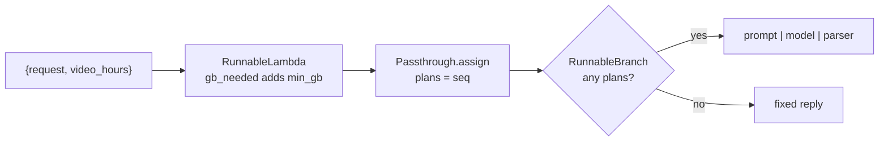

# RunnableSequence, Parallel, Passthrough, Lambda and Branch

> 📚 **Before you start**
>
> - [Why Runnables Exist](why-runnables-exist.md), for the contract and coercion of functions and dicts.
> - [Sequential, Parallel and Conditional Chains](sequential-parallel-and-conditional-chains.md), where you used most of these classes informally.
> - Generators from [Iterators and Generators](../../python-programming/06-functions-and-iterators/iterators-and-generators.md), for `RunnableGenerator`.

## Introduction

A good electrician's toolbox has a handful of tools used every day: pliers, a tester, a screwdriver, insulation tape. Each does one thing, and together they wire a whole house. LCEL is the same: five building blocks (plus a couple of helpers) cover almost every chain you'll write.

You've already used them in passing. This lesson is the reference: each class, what it does, its options, the shorthand LCEL lets you use instead, and the mistakes people make with it. The running example is a **mobile recharge helper** for a telecom shop: it reads a customer's request, looks up plans, and suggests one.

| Block | One-line job | Shorthand |
|---|---|---|
| `RunnableSequence` | Run steps in order | `a \| b` |
| `RunnableParallel` | Run steps side by side on the same input, return a dict | `{"x": a, "y": b}` in a chain |
| `RunnablePassthrough` | Pass the input through unchanged; `.assign()` adds keys | none |
| `RunnableLambda` | Turn a Python function into a runnable | a plain function in a chain |
| `RunnableBranch` | Pick one runnable based on conditions | a function that returns a runnable |

> 💡 **Key Insight**
>
> Think in terms of **data shapes**. A sequence transforms the value. A parallel turns one value into a dict. Passthrough keeps the value and `assign` adds to it. A lambda does any reshaping Python can do. A branch chooses. Almost every LCEL bug is a shape mismatch, so knowing what each block takes and returns is most of the skill.

---

## Core Explanation

### 0. The setup

A plan table and a small stand-in model that recommends a plan from the request it reads:

```python
from langchain_core.language_models import SimpleChatModel
from langchain_core.prompts import ChatPromptTemplate
from langchain_core.output_parsers import StrOutputParser

PLANS = [
    {"price": 199, "days": 28, "data_gb_per_day": 1.5, "ott": None},
    {"price": 299, "days": 28, "data_gb_per_day": 2.0, "ott": None},
    {"price": 449, "days": 28, "data_gb_per_day": 3.0, "ott": "cricket streaming"},
    {"price": 859, "days": 84, "data_gb_per_day": 2.0, "ott": None},
]

class PlanAdvisor(SimpleChatModel):
    """Offline stand-in: picks the cheapest plan listed in the prompt."""
    @property
    def _llm_type(self):
        return "plan-advisor"

    def _call(self, messages, stop=None, run_manager=None, **kwargs):
        text = messages[-1].content
        prices = [int(line.split("₹")[1].split()[0]) for line in text.splitlines() if line.startswith("- ₹")]
        return f"I suggest the ₹{min(prices)} plan." if prices else "Sorry, no plan matches."

prompt = ChatPromptTemplate.from_template("Customer wants: {request}\nMatching plans:\n{plans}\nSuggest one.")
model = PlanAdvisor()
print(model.invoke("Matching plans:\n- ₹299 x\n- ₹199 y").content)
```

Output:

```
I suggest the ₹199 plan.
```

### 1. RunnableSequence: steps in order

`a | b | c` creates a `RunnableSequence`. Its output is the last step's output, and each step receives the previous step's output.

```python
from langchain_core.runnables import RunnableLambda, RunnableSequence

to_lines = RunnableLambda(lambda plans: "\n".join(f"- ₹{p['price']} for {p['days']} days, {p['data_gb_per_day']} GB/day" for p in plans))
seq = RunnableLambda(lambda d: [p for p in PLANS if p["data_gb_per_day"] >= d["min_gb"]]) | to_lines
print(type(seq).__name__, "with", len(seq.steps), "steps")
print(seq.invoke({"min_gb": 2}))
```

Output:

```
RunnableSequence with 2 steps
- ₹299 for 28 days, 2.0 GB/day
- ₹449 for 28 days, 3.0 GB/day
- ₹859 for 84 days, 2.0 GB/day
```

Things to know:

- `seq.steps` lists all steps; `seq.first`, `seq.middle` and `seq.last` split them.
- **Streaming** passes through: if the last step can stream, the sequence streams.
- **Errors** stop the sequence at the failing step; nothing after it runs.
- A sequence needs at least two steps. `RunnableSequence(a)` with one step raises an error, because you'd just use `a`.

### 2. RunnableParallel: one input, several outputs

`RunnableParallel` runs each branch on the **same input** and returns a dict. Three ways to write it, all equivalent:

```python
from langchain_core.runnables import RunnableParallel

count = RunnableLambda(lambda d: len([p for p in PLANS if p["data_gb_per_day"] >= d["min_gb"]]))
cheapest = RunnableLambda(lambda d: min(p["price"] for p in PLANS if p["data_gb_per_day"] >= d["min_gb"]))

p1 = RunnableParallel(count=count, cheapest=cheapest)                 # keyword arguments
p2 = RunnableParallel({"count": count, "cheapest": cheapest})         # a dict
p3 = RunnableLambda(lambda d: d) | {"count": count, "cheapest": cheapest}  # a dict inside a chain

for p in (p1, p2, p3):
    print(p.invoke({"min_gb": 2}))
```

Output:

```
{'count': 3, 'cheapest': 299}
{'count': 3, 'cheapest': 299}
{'count': 3, 'cheapest': 299}
```

The dict-in-a-chain form (`p3`) only works when the dict sits next to a runnable in a `|` expression: a dict on its own has no `invoke`. That's why chains often **start** with a dict after a runnable, or are written as `RunnableParallel(...)` when the dict comes first.

A very common use is **picking keys out of the input** to build the next prompt's variables. `operator.itemgetter` is a neat way to do it:

```python
from operator import itemgetter

prepare = {"request": itemgetter("request"), "plans": seq}
chain = RunnableParallel(prepare) | prompt | model | StrOutputParser()
print(chain.invoke({"request": "2 GB a day, cheapest", "min_gb": 2}))
```

Output:

```
I suggest the ₹299 plan.
```

`itemgetter("request")` is a plain callable, so LCEL wraps it as a lambda. The parallel step built exactly the dict the prompt needed: the request text, and the formatted list of matching plans.

### 3. RunnablePassthrough: keep the input

`RunnablePassthrough()` returns its input unchanged. On its own that sounds useless; in a parallel step it's how you **keep the original input** next to computed values:

```python
from langchain_core.runnables import RunnablePassthrough

keep_and_add = RunnableParallel(original=RunnablePassthrough(), cheapest=cheapest)
print(keep_and_add.invoke({"min_gb": 3}))
```

Output:

```
{'original': {'min_gb': 3}, 'cheapest': 449}
```

When the input is a dict and you just want to **add keys** to it, `RunnablePassthrough.assign(...)` is cleaner. It runs the given runnables (in parallel, on the input) and merges their results into the input dict:

```python
enriched = RunnablePassthrough.assign(count=count, cheapest=cheapest)
print(enriched.invoke({"min_gb": 2, "customer": "Meena"}))
```

Output:

```
{'min_gb': 2, 'customer': 'Meena', 'count': 3, 'cheapest': 299}
```

`assign` is the workhorse of real LCEL pipelines, because it keeps every earlier value available. Every chain also has a `.assign()` method that does the same to its output dict, and `.pick()` to keep only some keys:

```python
summary = enriched.pick(["customer", "cheapest"])
print(summary.invoke({"min_gb": 2, "customer": "Meena"}))
```

Output:

```
{'customer': 'Meena', 'cheapest': 299}
```

| You want | Use |
|---|---|
| Input unchanged | `RunnablePassthrough()` |
| Input dict plus new keys | `RunnablePassthrough.assign(k=runnable)` or `chain.assign(...)` |
| Only some keys | `chain.pick(["a", "b"])` (a single string returns just that value) |
| A new dict built from parts of the input | `{"x": itemgetter("a"), ...}` |

### 4. RunnableLambda: any Python function

`RunnableLambda(fn)` wraps a function that takes **one argument** (the input). Use it for formatting, lookups, API calls, validation, anything that isn't a model call. It gives the function the whole runnable interface:

```python
def gb_needed(d):
    """Estimate daily data from hours of video."""
    return {**d, "min_gb": 3 if d["video_hours"] >= 2 else 2 if d["video_hours"] >= 1 else 1}

estimate = RunnableLambda(gb_needed)
print(estimate.invoke({"video_hours": 1.5}))
print(estimate.batch([{"video_hours": 0.5}, {"video_hours": 3}]))
```

Output:

```
{'video_hours': 1.5, 'min_gb': 2}
[{'video_hours': 0.5, 'min_gb': 1}, {'video_hours': 3, 'min_gb': 3}]
```

Need several arguments? Pass a dict and unpack inside. A few more abilities worth knowing:

**Accessing config.** If the function has a second parameter named `config`, LCEL passes the run's config, so the function can read tags or metadata:

```python
def greet(d, config):
    shop = config.get("metadata", {}).get("shop", "our shop")
    return f"Namaste {d['customer']}, welcome to {shop}!"

print(RunnableLambda(greet).invoke({"customer": "Meena"}, config={"metadata": {"shop": "Sai Mobiles, Pune"}}))
```

Output:

```
Namaste Meena, welcome to Sai Mobiles, Pune!
```

**The `@chain` decorator** turns a function into a named runnable in one line. Inside, you can call other runnables freely, which is handy when the logic is easier to write imperatively:

```python
from langchain_core.runnables import chain

@chain
def recommend(d):
    plans_text = seq.invoke(d)
    reply = (prompt | model).invoke({"request": d["request"], "plans": plans_text})
    return reply.content

print(type(recommend).__name__, recommend.name)
print(recommend.invoke({"request": "heavy video", "min_gb": 3}))
```

Output:

```
RunnableLambda recommend
I suggest the ₹449 plan.
```

**Returning a runnable** makes LCEL run it on the same input. That's the routing pattern from the previous lesson.

**Streaming caveat.** A lambda receives its whole input at once, so it **blocks streaming**: everything before it is collected first. For a step that should process a stream piece by piece, use `RunnableGenerator`, which wraps a generator that takes an iterator of pieces:

```python
from langchain_core.runnables import RunnableGenerator
from langchain_core.language_models.fake_chat_models import FakeListChatModel

def mask_numbers(pieces):
    for piece in pieces:
        yield "".join("#" if ch.isdigit() else ch for ch in piece)

talk = FakeListChatModel(responses=["Call 9876543210 to recharge."])
safe = talk | StrOutputParser() | RunnableGenerator(mask_numbers)
chunks = list(safe.stream("hi"))
print(len(chunks), "chunks:", "".join(chunks))
```

Output:

```
28 chunks: Call ########## to recharge.
```

The masked text still streamed piece by piece. With a `RunnableLambda` there, you'd get one chunk at the end.

### 5. RunnableBranch: choose a path

`RunnableBranch` takes `(condition, runnable)` pairs and a final default runnable. It checks conditions in order and runs the first match:

```python
from langchain_core.runnables import RunnableBranch

reply_by_budget = RunnableBranch(
    (lambda d: d["budget"] < 199, RunnableLambda(lambda d: "Our cheapest plan is ₹199. A ₹10 top-up gives talk time only.")),
    (lambda d: d["budget"] >= 800, RunnableLambda(lambda d: "The ₹859 plan gives 84 days, so you recharge only 4 times a year.")),
    RunnableLambda(lambda d: f"Within ₹{d['budget']}, look at the 28-day plans."),
)
for b in (100, 300, 900):
    print(b, "->", reply_by_budget.invoke({"budget": b}))
```

Output:

```
100 -> Our cheapest plan is ₹199. A ₹10 top-up gives talk time only.
300 -> Within ₹300, look at the 28-day plans.
900 -> The ₹859 plan gives 84 days, so you recharge only 4 times a year.
```

The same thing with a routing function:

```python
def by_budget(d):
    if d["budget"] < 199:
        return "Our cheapest plan is ₹199. A ₹10 top-up gives talk time only."
    if d["budget"] >= 800:
        return "The ₹859 plan gives 84 days, so you recharge only 4 times a year."
    return f"Within ₹{d['budget']}, look at the 28-day plans."

print([RunnableLambda(by_budget).invoke({"budget": b}) == reply_by_budget.invoke({"budget": b}) for b in (100, 300, 900)])
```

Output:

```
[True, True, True]
```

Both work. The LangChain docs suggest the function style for most routing because it's ordinary Python (easy to read, test and debug). `RunnableBranch` is useful when you want each branch to be a visible runnable in traces and graph drawings, and the conditions are themselves simple checks.

### 6. Putting the blocks together

The complete recharge helper uses every block:



```python
helper = (
    RunnableLambda(gb_needed)
    | RunnablePassthrough.assign(plans=seq)
    | RunnableBranch(
        (lambda d: d["plans"] != "", prompt | model | StrOutputParser()),
        RunnableLambda(lambda d: "No plan has that much data. Try a data add-on pack."),
    )
)
print(helper.invoke({"request": "I watch about 2 hours of cricket a day", "video_hours": 2}))
print(helper.invoke({"request": "Light use, WhatsApp only", "video_hours": 0}))
print(helper.get_graph().draw_mermaid().count("-->"), "edges in the drawn graph")
```

Output:

```
I suggest the ₹449 plan.
I suggest the ₹199 plan.
9 edges in the drawn graph
```

Both requests found matching plans, so the first branch ran each time. If a customer needed more data per day than any plan offers, `plans` would be an empty string and the default branch would reply instead of calling the model at all, which saves a model call on requests that can't be served.

### 7. Two more helpers: `bind` and `with_config`

- **`.bind(**kwargs)`** fixes extra arguments passed to a runnable every time it's called. On chat models it's how you pass call options such as `stop` sequences, and `bind_tools` (module 7) is built on it.
- **`.with_config(...)`** fixes config such as `run_name` or `tags`, so a step shows up with a clear name in traces. The config is stored on the wrapper and applied on every call:

```python
named = RunnableLambda(gb_needed).with_config(run_name="estimate_data")
print(named.config)
```

Output:

```
{'run_name': 'estimate_data'}
```

---

## Try It Yourself

1. **Parallel facts.** Build a `RunnableParallel` that, given `{"min_gb": 2}`, returns `count`, `cheapest` and `longest` (the most days among matching plans). Print the result.
2. **Assign and pick.** Starting from `{"customer": "Arjun", "video_hours": 3}`, use `gb_needed`, then `assign` the cheapest matching price, then `pick` only `customer` and `cheapest`.
3. **A streaming filter.** Write a `RunnableGenerator` that replaces the word "recharge" with "top-up" piece by piece. Why is this tricky when pieces are single characters?

<details>
<summary>Show answers</summary>

**1.**

```python
longest = RunnableLambda(lambda d: max(p["days"] for p in PLANS if p["data_gb_per_day"] >= d["min_gb"]))
print(RunnableParallel(count=count, cheapest=cheapest, longest=longest).invoke({"min_gb": 2}))
```

Output:

```
{'count': 3, 'cheapest': 299, 'longest': 84}
```

**2.**

```python
flow = RunnableLambda(gb_needed) | RunnablePassthrough.assign(cheapest=cheapest)
print(flow.pick(["customer", "cheapest"]).invoke({"customer": "Arjun", "video_hours": 3}))
```

Output:

```
{'customer': 'Arjun', 'cheapest': 449}
```

**3.**

```python
def swap_word(pieces):
    buffer = ""
    for piece in pieces:
        buffer += piece
        if " " in buffer:                       # emit complete words only
            done, buffer = buffer.rsplit(" ", 1)
            yield done.replace("recharge", "top-up") + " "
    yield buffer.replace("recharge", "top-up")

flow = talk | StrOutputParser() | RunnableGenerator(swap_word)
talk.i = 0  # restart the fake model's reply list
print("".join(flow.stream("hi")))
```

Output:

```
Call 9876543210 to top-up.
```

A word can be split across pieces ("rech" + "arge"), so the generator must buffer until a word is complete before replacing. Buffering by word keeps most of the streaming benefit.

</details>

---

## Real-World Examples

- **RAG chains** (the next course) start with `{"context": retriever | format_docs, "question": RunnablePassthrough()}`: a parallel step that keeps the question and fetches documents at the same time.
- **Support bots** use `RunnablePassthrough.assign` to add customer profile, order status and policy snippets to the input before one prompt uses them all.
- **Compliance filters** use `RunnableGenerator` to mask phone numbers, Aadhaar numbers or card numbers in streamed answers without losing streaming.
- **Pricing tools** wrap rule engines as `RunnableLambda`s and branch between a model explanation and a fixed reply.

---

## Common Misconceptions

### "`RunnablePassthrough` and `RunnablePassthrough.assign` do the same thing"

The first returns the input unchanged; the second returns the input dict **plus** new keys. `assign` only works on dict inputs.

### "A lambda can take two arguments for the input"

A runnable has one input. Pack several values into a dict. (A second parameter named `config` is special and receives the run config.)

### "`RunnableBranch` evaluates all branches"

It checks conditions in order and runs only the first match (or the default).

### "Putting a function in the middle of a chain is free"

It blocks streaming at that point. Use `RunnableGenerator` for streaming transformations.

---

## Interview Relevance

*"Explain RunnablePassthrough, RunnableParallel and RunnableLambda."* A strong answer: `RunnableParallel` runs several runnables on the same input concurrently and returns a dict (a dict in a chain is coerced to it); `RunnablePassthrough` returns the input unchanged, used inside a parallel to keep the original input, and `.assign()` adds computed keys to a dict input; `RunnableLambda` wraps a one-argument function (optionally taking `config`), gains batch, async and retries, and if it returns a runnable that runnable is invoked; `@chain` is the decorator form. Mention `itemgetter` for picking keys, `.pick()`, `RunnableGenerator` for streaming transforms, and `RunnableBranch` versus a routing function.

---

## Key Takeaways

- **Sequence** transforms in order; **Parallel** fans one input out into a dict.
- **Passthrough** keeps the input; **`.assign`** adds keys; **`.pick`** keeps some.
- **Lambda** makes any function a runnable; `@chain` names it; a `config` parameter receives the run config.
- **Lambdas block streaming**; `RunnableGenerator` streams.
- **Branch** picks the first matching path; a routing function does the same in plain Python.

---

**Up next:** [Synthetic Data Generation](synthetic-data-generation.md)
