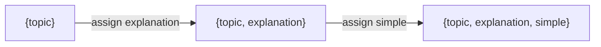
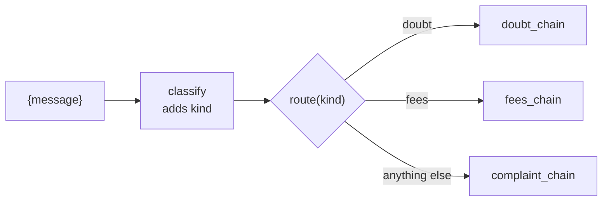

# Sequential, Parallel and Conditional Chains

> 📚 **Before you start**
>
> - [Chains, LCEL and Runnables](chains-lcel-and-runnables.md), for `|`, `RunnableSequence` and data shapes between steps.
> - [StrOutputParser](../05-structured-output-and-output-parsers/stroutputparser.md), for chaining one model's text into the next prompt.
> - [Structured Output with Pydantic and JSON Schema](../05-structured-output-and-output-parsers/structured-output-with-pydantic-and-json-schema.md), used here to classify inputs for routing.

## Introduction

A coaching centre in Kota prepares study material for every new topic. A senior teacher writes the explanation. Then two juniors work **at the same time**: one turns the explanation into revision notes, the other writes a quiz. When students send questions, the front desk **routes** each one: physics doubts to the physics teacher, fee questions to the office, complaints to the manager.

Those are the three shapes almost every LLM workflow is built from:

- **Sequential**: step B needs step A's output (explanation, then notes).
- **Parallel**: independent steps run side by side on the same input (notes and quiz together).
- **Conditional**: the input decides which path runs (doubt, fee or complaint).

This lesson builds each shape in LCEL, then combines them into one pipeline. The next two lessons explain the machinery underneath (why runnables exist, and each `Runnable*` class in detail).

> 💡 **Key Insight**
>
> **Sequential = `|`. Parallel = a dict of runnables. Conditional = a function (or `RunnableBranch`) that picks the next runnable.** Because each shape produces a runnable, you can nest them freely: a parallel step inside a sequence, a sequence inside a branch.

---

## Core Explanation

### 1. A model that follows simple rules

To see different steps produce different text offline, we need a fake model that answers according to what it's asked. This one checks the start of the last message and returns a scripted reply. A real model would write these answers itself:

```python
from langchain_core.language_models import SimpleChatModel

class KotaModel(SimpleChatModel):
    """Offline stand-in: replies depend on how the prompt starts."""
    @property
    def _llm_type(self):
        return "kota-rules"

    def _call(self, messages, stop=None, run_manager=None, **kwargs):
        text = messages[-1].content
        if text.startswith("Explain"):
            return "Newton's second law: force equals mass times acceleration (F = ma). Doubling the force on a cart doubles its acceleration."
        if text.startswith("Simplify"):
            return "Push harder, it speeds up faster. Heavier things need a bigger push. That's F = ma."
        if text.startswith("Notes"):
            return "- F = ma\n- Force in newtons (N)\n- More mass, less acceleration for the same force"
        if text.startswith("Quiz"):
            return "Q1. A 2 kg cart is pushed with 6 N. What is its acceleration? (Answer: 3 m/s²)"
        if text.startswith("Classify"):
            msg = text.split("\n", 1)[1].lower()     # the student's message, after the instructions
            return "fees" if "fee" in msg or "installment" in msg else "complaint" if "not worked" in msg else "doubt"
        if text.startswith("Answer the doubt"):
            return "Acceleration is 3 m/s², because a = F/m = 6/2."
        if text.startswith("Reply about fees"):
            return "The second installment of ₹45,000 is due on 10 November. You can pay at the office or online."
        return "Sorry to hear that. I've raised a ticket with the centre manager."

llm = KotaModel()
print(llm.invoke("Explain Newton's second law").content[:40])
```

Output:

```
Newton's second law: force equals mass t
```

### 2. Sequential chains: one step feeds the next

The teacher explains, then a second call simplifies for a Class 9 student. The output of the first model becomes a variable in the second prompt:

```python
from langchain_core.prompts import ChatPromptTemplate
from langchain_core.output_parsers import StrOutputParser

explain = ChatPromptTemplate.from_template("Explain {topic} for a JEE aspirant in two sentences.") | llm | StrOutputParser()
simplify = ChatPromptTemplate.from_template("Simplify this for a Class 9 student:\n{explanation}") | llm | StrOutputParser()

study = explain | (lambda e: {"explanation": e}) | simplify
print(study.invoke({"topic": "Newton's second law"}))
```

Output:

```
Push harder, it speeds up faster. Heavier things need a bigger push. That's F = ma.
```

This is the LCEL version of the old `SimpleSequentialChain`: one input, one output, steps in a line.

Often a later step needs the **original input as well as** the earlier output (for example, to put the topic in a title). The lambda can't see the original input, because each step only receives what the previous step returned. The fix is to carry the input along. `RunnablePassthrough.assign` keeps the incoming dict and adds a key computed from it:

```python
from langchain_core.runnables import RunnablePassthrough

study_full = (
    RunnablePassthrough.assign(explanation=explain)
    | RunnablePassthrough.assign(simple=simplify)
)
result = study_full.invoke({"topic": "Newton's second law"})
print(list(result))
print("Topic:", result["topic"])
print("Simple:", result["simple"])
```

Output:

```
['topic', 'explanation', 'simple']
Topic: Newton's second law
Simple: Push harder, it speeds up faster. Heavier things need a bigger push. That's F = ma.
```

The dict grows as it moves down the line: `topic`, then `explanation`, then `simple`. Every later step can read every earlier value. This is the LCEL version of the old multi-variable `SequentialChain`, and it's the pattern you'll use most in real pipelines.



### 3. Parallel chains: independent steps side by side

Notes and quiz both need the explanation, but not each other. Run them together by putting runnables in a dict:

```python
from langchain_core.runnables import RunnableParallel

notes = ChatPromptTemplate.from_template("Notes: turn this into 3 bullet points:\n{explanation}") | llm | StrOutputParser()
quiz = ChatPromptTemplate.from_template("Quiz: write one numerical question on:\n{explanation}") | llm | StrOutputParser()

material = RunnableParallel(notes=notes, quiz=quiz)
out = material.invoke({"explanation": "F = ma ..."})
print(out["notes"])
print(out["quiz"])
```

Output:

```
- F = ma
- Force in newtons (N)
- More mass, less acceleration for the same force
Q1. A 2 kg cart is pushed with 6 N. What is its acceleration? (Answer: 3 m/s²)
```

Both branches get **the same input** (the dict with `explanation`), and the result is a dict with one key per branch.

"Parallel" here means really concurrent: LangChain runs the branches on a thread pool (or with `asyncio` in the async methods). With real models, three 2-second calls take about 2 seconds, not 6. We can see that with three steps that each sleep for 0.3 seconds:

```python
import time
from langchain_core.runnables import RunnableLambda

def slow(label):
    def step(x):
        time.sleep(0.3)
        return label
    return RunnableLambda(step)

start = time.perf_counter()
print(RunnableParallel(a=slow("A"), b=slow("B"), c=slow("C")).invoke("go"))
elapsed = time.perf_counter() - start
print("finished in under 0.6 s:", elapsed < 0.6)
```

Output:

```
{'a': 'A', 'b': 'B', 'c': 'C'}
finished in under 0.6 s: True
```

Run one after another, the three would take 0.9 seconds.

Inside a chain you don't even need to write `RunnableParallel`: a plain dict is converted automatically. Here's the full study pack, sequence then parallel:

```python
pack = (
    RunnablePassthrough.assign(explanation=explain)
    | {"topic": lambda d: d["topic"], "notes": notes, "quiz": quiz}
)
result = pack.invoke({"topic": "Newton's second law"})
print(sorted(result))
print(result["quiz"])
```

Output:

```
['notes', 'quiz', 'topic']
Q1. A 2 kg cart is pushed with 6 N. What is its acceleration? (Answer: 3 m/s²)
```

### 4. Conditional chains: let the input pick the path

Student messages need different handling. First, classify; then run the matching chain. The modern way to route is a **function that returns the runnable to use**. When a `RunnableLambda` returns a runnable, LCEL invokes that runnable with the same input:

```python
classify = ChatPromptTemplate.from_template(
    "Classify this student message as doubt, fees or complaint. Reply with one word.\n{message}"
) | llm | StrOutputParser()

doubt_chain = ChatPromptTemplate.from_template("Answer the doubt clearly:\n{message}") | llm | StrOutputParser()
fees_chain = ChatPromptTemplate.from_template("Reply about fees politely:\n{message}") | llm | StrOutputParser()
complaint_chain = ChatPromptTemplate.from_template("Apologise and escalate:\n{message}") | llm | StrOutputParser()

def route(info):
    return {"doubt": doubt_chain, "fees": fees_chain}.get(info["kind"].strip(), complaint_chain)

desk = RunnablePassthrough.assign(kind=classify) | RunnableLambda(route)

for msg in ["A 2 kg cart is pushed with 6 N, what's the acceleration?",
            "When is the second installment due?",
            "The AC in room 4 has not worked for a week."]:
    print(desk.invoke({"message": msg}))
```

Output:

```
Acceleration is 3 m/s², because a = F/m = 6/2.
The second installment of ₹45,000 is due on 10 November. You can pay at the office or online.
Sorry to hear that. I've raised a ticket with the centre manager.
```

The pattern has three parts: **classify** (add a `kind` key), **route** (a function that maps the kind to a chain, with a safe default), **run** (LCEL invokes the chosen chain with the dict that has `message` and `kind`).



LangChain also has a class for this, `RunnableBranch`, which takes `(condition, runnable)` pairs and a default. It's covered with the other building blocks in [RunnableSequence, Parallel, Passthrough, Lambda and Branch](runnablesequence-parallel-passthrough-lambda-and-branch.md); the function style above is what the LangChain docs recommend for most routing, because it's plain Python.

### 5. Classify with structured output, not string matching

`info["kind"].strip()` trusts the model to reply with exactly one of three words. A real model might say "Doubt." or "This is a fees question". As you saw in [Why Structured Output Matters](../05-structured-output-and-output-parsers/why-structured-output-matters.md), the robust fix is a schema with a `Literal`:

```python
# not-run: needs `pip install langchain langchain-anthropic` and ANTHROPIC_API_KEY
from typing import Literal
from pydantic import BaseModel
from langchain.chat_models import init_chat_model

class Kind(BaseModel):
    kind: Literal["doubt", "fees", "complaint"]

model = init_chat_model("anthropic:claude-opus-5-5", temperature=0)
classify = (
    ChatPromptTemplate.from_template("Classify this student message.\n{message}")
    | model.with_structured_output(Kind)
    | (lambda k: k.kind)
)
desk = RunnablePassthrough.assign(kind=classify) | RunnableLambda(route)
print(desk.invoke({"message": "Can I pay the fee in two parts?"}))
```

Example output:

```
Yes, the course fee can be paid in two installments. The second installment of ₹45,000 is due on 10 November.
```

Now `kind` can only ever be one of the three values, and `route` never sees a surprise.

### 6. Putting the shapes together

Real pipelines mix all three. One more example: for a new topic, explain it (sequential), then make notes and a quiz (parallel), then pick a format based on the student's class (conditional):

```python
def format_for(d):
    if d["grade"] >= 11:
        return f"{d['topic']} (JEE)\n{d['notes']}\n{d['quiz']}"
    return f"{d['topic']} (Class {d['grade']})\n{d['notes']}"

full = (
    RunnablePassthrough.assign(explanation=explain)
    | RunnablePassthrough.assign(notes=notes, quiz=quiz)
    | RunnableLambda(format_for)
)
print(full.invoke({"topic": "Newton's second law", "grade": 12}))
print("---")
print(full.invoke({"topic": "Newton's second law", "grade": 9}))
```

Output:

```
Newton's second law (JEE)
- F = ma
- Force in newtons (N)
- More mass, less acceleration for the same force
Q1. A 2 kg cart is pushed with 6 N. What is its acceleration? (Answer: 3 m/s²)
---
Newton's second law (Class 9)
- F = ma
- Force in newtons (N)
- More mass, less acceleration for the same force
```

`RunnablePassthrough.assign(notes=notes, quiz=quiz)` with two keys runs both in parallel and keeps the input, which is often exactly what you want.

### 7. When chains stop being enough

LCEL chains are **directed and acyclic**: data flows forward, each step once. That covers a huge number of apps. It doesn't cover:

- **Loops**: "write, check, and rewrite until the checker is happy".
- **Shared state** that many steps read and update over a long run.
- **Pauses** for a human to approve before continuing.
- **Agents** where the model decides the next step at every turn.

For those, LangChain's sister library LangGraph models the workflow as a graph with state. The [LangGraph course](../../langgraph-complete-guide/course.md) rebuilds sequential, parallel and conditional workflows as graphs and then adds loops. Everything you build here (prompts, models, parsers, chains) plugs straight into LangGraph nodes.

---

## Try It Yourself

1. **Three in a row.** Add a third step to `study`: a prompt starting with `"Quiz"` that takes the simplified text as `{explanation}`. Print the final output.
2. **Parallel with the input kept.** Build a chain that, given `{"topic": ...}`, returns a dict with `topic`, `notes` and `quiz`, where notes and quiz are made from the explanation. (Hint: `assign` the explanation, then `assign` both.) Print the sorted keys.
3. **Route with a default.** Call `desk` with `"Is the library open on Sunday?"`. Which chain answers and why? How would you add a fourth `"general"` route?

<details>
<summary>Show answers</summary>

**1.**

```python
quiz_from = ChatPromptTemplate.from_template("Quiz: one question on:\n{explanation}") | llm | StrOutputParser()
three = explain | (lambda e: {"explanation": e}) | simplify | (lambda s: {"explanation": s}) | quiz_from
print(three.invoke({"topic": "Newton's second law"}))
```

Output:

```
Q1. A 2 kg cart is pushed with 6 N. What is its acceleration? (Answer: 3 m/s²)
```

**2.**

```python
kept = RunnablePassthrough.assign(explanation=explain) | RunnablePassthrough.assign(notes=notes, quiz=quiz)
print(sorted(kept.invoke({"topic": "Newton's second law"})))
```

Output:

```
['explanation', 'notes', 'quiz', 'topic']
```

It also keeps `explanation`; add `| (lambda d: {k: d[k] for k in ("topic", "notes", "quiz")})` to drop it.

**3.**

```python
print(desk.invoke({"message": "Is the library open on Sunday?"}))
```

Output:

```
Acceleration is 3 m/s², because a = F/m = 6/2.
```

The classifier (our rule-based stand-in) labels it a doubt, so `doubt_chain` answers with a physics reply. That's the danger of forcing every message into three buckets. Add `"general"` to the classifier's options (and the `Literal`), write a `general_chain`, and add it to the dict in `route`.

</details>

---

## Real-World Examples

- **EdTech platforms** generate an explanation, then notes, flashcards and quizzes in parallel for each chapter, cutting generation time by the number of parallel branches.
- **Bank support bots** classify messages (balance, card block, complaint, fraud) with structured output and route each to its own chain, with fraud going to a human queue.
- **Content teams** run sequential "draft, then edit for tone, then translate into Hindi and Tamil in parallel" pipelines.
- **E-commerce search** runs query rewriting and spelling correction in parallel before retrieval.

---

## Common Misconceptions

### "Parallel means the branches share results"

Branches all receive the same input and can't see each other's outputs. If B needs A's result, they're sequential.

### "A dict in a chain is just data"

Inside a chain, a dict whose values are runnables (or functions) is turned into a `RunnableParallel`. To pass a literal dict, wrap it in a function.

### "Routing needs a special router class"

A function returning a runnable is enough. `RunnableBranch` exists, but plain functions are easier to read and test.

### "Chains can loop if you call them again"

You can call a chain in a Python loop, but the chain itself has no notion of state or retry-until-done. That's what LangGraph is for.

---

## Interview Relevance

*"How do you build multi-step pipelines in LangChain?"* A strong answer: sequential steps with `|`, using `RunnablePassthrough.assign` to keep earlier values available to later steps; parallel steps with a dict or `RunnableParallel`, which run concurrently and return a dict keyed by branch; conditional steps by classifying (ideally with structured output and a `Literal`) and routing with a function that returns the chosen runnable, or with `RunnableBranch`. Mention a safe default route, that parallel saves latency only for independent steps, and that loops, persistent state and human approval call for LangGraph.

---

## Key Takeaways

- **Sequential**: `a | b`; use `RunnablePassthrough.assign` to carry the input and earlier results forward.
- **Parallel**: a dict of runnables (or `RunnableParallel`) runs branches concurrently on the same input.
- **Conditional**: classify, then a function returns the chain to run; always have a default.
- **Classify with a schema**, not string matching.
- **The shapes nest**, and anything with loops or long-lived state belongs in LangGraph.

---

**Up next:** [Why Runnables Exist](why-runnables-exist.md)
