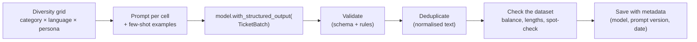

# Synthetic Data Generation with LangChain

> 📚 **Before you start**
>
> - [RunnableSequence, Parallel, Passthrough, Lambda and Branch](runnablesequence-parallel-passthrough-lambda-and-branch.md), for building the pipeline.
> - [Structured Output with Pydantic and JSON Schema](../05-structured-output-and-output-parsers/structured-output-with-pydantic-and-json-schema.md), for schemas with validators.
> - pandas basics from [Data Analysis and Visualisation with Python](../../data-analysis-and-visualisation-with-python/course.md), for checking the dataset.

## Introduction

A fintech startup in Bengaluru is building a classifier that sorts support tickets for its UPI app: failed payments, refunds, KYC problems, card blocks. They have a problem common to every new product: **no data yet**. Real tickets will arrive after launch, but the classifier needs to be tested before launch. And even later, real tickets contain phone numbers, account numbers and names that can't be pasted into a test suite.

**Synthetic data** is data generated to look like the real thing: realistic tickets, written by a model, with known labels. It's one of the most practical uses of LLM chains, and it pulls together everything in this module: a schema for each record, a prompt, a parallel batch, and cleaning steps.

This lesson covers when synthetic data helps (and when it misleads), how to get **variety** instead of 500 copies of the same ticket, how to generate records with structured output, how to clean and check the result, and how to use it responsibly.

> 💡 **Key Insight**
>
> The model is the easy part. Good synthetic data comes from **controlling diversity** (a grid of categories, styles and personas you choose, not the model's habits), **validating every record** against a schema, and **checking the dataset** as a whole (duplicates, label balance, length spread) before anyone trusts it.

---

## Core Explanation

### 1. When synthetic data helps

| Use | Why synthetic data works |
|---|---|
| **Testing a pipeline before launch** | You need inputs of every kind, including rare ones |
| **Evaluation sets** | You know the correct label because you asked for it |
| **Edge cases** | Code-mixed Hinglish, typos, angry customers, very long messages: easy to request |
| **Privacy** | No real customer's data ever enters your test suite |
| **Bootstrapping a classifier** | A starting training set until real labelled data exists |

And when it misleads:

- **It reflects the generator's idea of reality**, not reality. Real customers write things no model would guess. Replace or mix in real (anonymised) data as soon as you have it.
- **Testing a model on data generated by the same model** flatters it: it agrees with its own style. Use a different model or human review for evaluation sets.
- **Low diversity** produces a dataset that looks big but contains a few patterns repeated.

### 2. The pipeline



### 3. The schema

Each record is a ticket with its label. We ask for a batch of tickets per call, which is cheaper than one call per ticket:

```python
from typing import Literal
from pydantic import BaseModel, Field, field_validator

Category = Literal["failed_payment", "refund", "kyc", "card_block"]

class Ticket(BaseModel):
    """One synthetic customer support ticket."""
    category: Category
    language: Literal["english", "hinglish"]
    urgency: Literal["low", "medium", "high"]
    text: str = Field(min_length=20, max_length=400, description="The customer's message")

    @field_validator("text")
    @classmethod
    def no_real_looking_numbers(cls, text):
        digits = sum(ch.isdigit() for ch in text)
        if digits >= 10:
            raise ValueError("looks like it contains a phone or account number")
        return text

class TicketBatch(BaseModel):
    """A batch of synthetic tickets for one category, language and persona."""
    tickets: list[Ticket]

print(sorted(Ticket.model_json_schema()["properties"]))
```

Output:

```
['category', 'language', 'text', 'urgency']
```

The validator is a privacy guard: any ticket with 10 or more digits (a phone number, an account number) is rejected, even if it's fake, because the test data might later be shared.

### 4. Controlling diversity with a grid

Ask a model "write 100 support tickets" and you'll get the same handful of shapes again and again. Instead, **you** decide the variety by building a grid of attributes and generating a few tickets for each cell:

```python
from itertools import product

categories = ["failed_payment", "refund", "kyc", "card_block"]
languages = ["english", "hinglish"]
personas = ["a retired teacher in Lucknow, polite and detailed",
            "a college student in Pune, short and informal",
            "a shopkeeper in Surat, in a hurry"]

grid = [{"category": c, "language": l, "persona": p} for c, l, p in product(categories, languages, personas)]
print(len(grid), "cells, for example:", grid[7])
```

Output:

```
24 cells, for example: {'category': 'refund', 'language': 'english', 'persona': 'a college student in Pune, short and informal'}
```

24 cells × 3 tickets each = 72 tickets, spread evenly over every combination. Adding a dimension (say, "device: Android / iPhone / feature phone") multiplies the variety without touching the prompt logic.

### 5. The prompt, with few-shot examples

Two examples show the style and length you want. The persona and labels come from the grid cell:

```python
from langchain_core.prompts import ChatPromptTemplate

prompt = ChatPromptTemplate.from_messages([
    ("system",
     "You write realistic synthetic support tickets for a UPI payments app in India.\n"
     "Never include real-looking phone, account or card numbers; write 'my number' or 'XXXX' instead.\n"
     "Vary length, tone and details. Examples of the style:\n"
     "- 'Paid 450 to a vegetable vendor, money debited but he says not received. Please check.'\n"
     "- 'Bhai KYC kab tak hoga? 3 din ho gaye, app me pending dikha raha hai.'"),
    ("human",
     "Category: {category}\nLanguage: {language}\nPersona: {persona}\n"
     "Write {n} different tickets from this person."),
])
print(prompt.invoke({**grid[7], "n": 3}).to_messages()[1].content)
```

Output:

```
Category: refund
Language: english
Persona: a college student in Pune, short and informal
Write 3 different tickets from this person.
```

### 6. A stand-in generator

To run offline we need a model that produces a `TicketBatch` tool call from the prompt, like a real model with `with_structured_output` would. This stand-in builds tickets from templates. It also deliberately makes the mistakes real generators make (an exact duplicate, a ticket with a phone number), so the cleaning steps have something to catch:

```python
from langchain_core.language_models import BaseChatModel
from langchain_core.messages import AIMessage
from langchain_core.outputs import ChatGeneration, ChatResult
from langchain_core.utils.function_calling import convert_to_openai_tool

TEMPLATES = {
    ("failed_payment", "english"): ["Paid {amt} at a {shop} but the money was debited and the payment shows failed.",
                                    "My payment of {amt} to a {shop} failed but my bank balance went down. When will it come back?"],
    ("failed_payment", "hinglish"): ["{shop} ko {amt} bheje, paisa kat gaya par payment failed dikha raha hai.",
                                     "Payment fail ho gaya lekin {amt} account se chala gaya. Kab wapas aayega?"],
    ("refund", "english"): ["I cancelled an order from a {shop} two days ago. Where is my refund of {amt}?",
                            "Refund of {amt} from the {shop} is still not in my account after a week."],
    ("refund", "hinglish"): ["{shop} ka refund {amt} abhi tak nahi aaya, 5 din ho gaye.",
                             "Order cancel kiya tha, {amt} refund kab milega?"],
    ("kyc", "english"): ["My KYC has been pending for three days. I uploaded my PAN card twice.",
                         "The app keeps rejecting my Aadhaar photo during KYC. What should I do?"],
    ("kyc", "hinglish"): ["KYC pending hai 3 din se, PAN do baar upload kiya.",
                          "Aadhaar photo upload karte hi error aa raha hai KYC me."],
    ("card_block", "english"): ["I lost my wallet near the {shop}. Please block my linked debit card immediately.",
                                "Please block my card, I think someone used it at a {shop}."],
    ("card_block", "hinglish"): ["Mera card kho gaya {shop} ke paas, turant block karo please.",
                                 "Card block karna hai jaldi, kisi ne {shop} pe use kiya lagta hai."],
}
SHOPS, AMOUNTS = ["kirana store", "chemist", "petrol pump"], ["₹450", "₹1,200", "₹89"]
URGENCY = {"failed_payment": "high", "refund": "medium", "kyc": "low", "card_block": "high"}

def write_tickets(category, language, persona, n):
    seed = sum(map(ord, persona)) % 3                       # deterministic variety per persona
    texts = [TEMPLATES[(category, language)][(seed + i) % 2].format(shop=SHOPS[(seed + i) % 3], amt=AMOUNTS[(seed + i) % 3])
             for i in range(n)]
    if "hurry" in persona and category == "card_block" and language == "english":
        texts[1] = "Block my card now!! Call me back on 9876543210, urgent."   # a privacy problem
    return [{"category": category, "language": language, "urgency": URGENCY[category], "text": t} for t in texts]

class TicketWriter(BaseChatModel):
    """Offline stand-in for a real model generating a TicketBatch."""
    @property
    def _llm_type(self):
        return "ticket-writer"

    def bind_tools(self, tools, **kwargs):
        return self.bind(tools=[convert_to_openai_tool(t) for t in tools], **kwargs)

    def _generate(self, messages, stop=None, run_manager=None, **kwargs):
        fields = dict(line.split(": ", 1) for line in messages[-1].content.splitlines() if ": " in line)
        n = int(messages[-1].content.split("Write ")[1].split()[0])
        args = {"tickets": write_tickets(fields["Category"], fields["Language"], fields["Persona"], n)}
        return ChatResult(generations=[ChatGeneration(message=AIMessage(content="", tool_calls=[
            {"name": "TicketBatch", "args": args, "id": "call_1"}]))])
```

### 7. Generate in parallel

The chain fills the prompt for one grid cell and returns the batch. `include_raw=True` keeps failures as data, and `batch` runs all 24 cells concurrently:

```python
from langchain_core.runnables import RunnablePassthrough

generate = (
    RunnablePassthrough.assign(n=lambda _: 3)
    | prompt
    | TicketWriter().with_structured_output(TicketBatch, include_raw=True)
)
results = generate.batch(grid, config={"max_concurrency": 6})

tickets, rejected = [], []
for cell, out in zip(grid, results):
    if out["parsing_error"] is None:
        tickets += [t.model_dump() | {"persona": cell["persona"]} for t in out["parsed"].tickets]
    else:
        rejected.append((cell["category"], cell["language"], out["parsing_error"].errors()[0]["msg"]))

print(len(tickets), "tickets accepted from", len(grid) - len(rejected), "cells")
for r in rejected:
    print("rejected cell:", r)
```

Output:

```
69 tickets accepted from 23 cells
rejected cell: ('card_block', 'english', 'Value error, looks like it contains a phone or account number')
```

One cell was rejected because one of its tickets contained a phone number. Because the schema validates the **whole batch**, one bad ticket rejects its cell. With a real model you'd simply regenerate that cell (or validate tickets one by one to keep the good ones).

### 8. Clean and check the dataset

Validation catches bad records. Dataset-level checks catch bad **datasets**:

```python
import pandas as pd

df = pd.DataFrame(tickets)
df["norm"] = df["text"].str.lower().str.replace(r"[^a-z0-9 ]", "", regex=True).str.split().str.join(" ")
before = len(df)
df = df.drop_duplicates("norm").drop(columns="norm")
print(f"removed {before - len(df)} duplicates, {len(df)} unique tickets")
print(df.groupby(["category", "language"]).size().unstack().to_string())
```

Output:

```
removed 35 duplicates, 34 unique tickets
language        english  hinglish
category                         
card_block            5         5
failed_payment        5         5
kyc                   2         2
refund                5         5
```

Half the dataset was duplicates. Our template-based stand-in is an extreme case, but real generators repeat themselves too, especially across similar grid cells. Normalising (lower case, no punctuation, single spaces) before comparing catches near-identical copies as well as exact ones.

Look at the table after deduplication: **KYC now has far fewer tickets than the other categories.** Its templates had no shop or amount to vary, so more of its tickets were copies. This is why you check balance *after* cleaning, not before. The fix is to regenerate the thin cells (more tickets, or a "make each ticket about a different problem" instruction) until every category has enough.

Two more quick checks every synthetic dataset deserves:

```python
lengths = df["text"].str.len()
print("length min/median/max:", lengths.min(), int(lengths.median()), lengths.max())
print("distinct opening words:", df["text"].str.split().str[0].nunique(), "of", len(df))
```

Output:

```
length min/median/max: 46 73 98
distinct opening words: 15 of 34
```

The length spread and the variety of opening words are cheap **diversity signals**. Our template-based stand-in scores low on both; a real model with a good grid and a higher temperature does much better. If most tickets start the same way, add a "start differently" instruction or another grid dimension.

The last check is a **human spot-check**: read 20 random tickets. It takes five minutes and catches problems no metric sees (wrong tone, unrealistic scenarios, outdated product details).

### 9. With a real model

```python
# not-run: needs `pip install langchain langchain-anthropic` and ANTHROPIC_API_KEY
from langchain.chat_models import init_chat_model

model = init_chat_model("anthropic:claude-opus-5-5", temperature=1.0)
generate = (
    RunnablePassthrough.assign(n=lambda _: 5)
    | prompt
    | model.with_structured_output(TicketBatch, method="json_schema", include_raw=True)
)
results = generate.batch(grid, config={"max_concurrency": 4})
```

Example output (two tickets from one cell):

```
{'category': 'refund', 'language': 'hinglish', 'urgency': 'medium', 'text': 'Sir maine Zepto order cancel kiya Monday ko, ₹780 ka refund abhi tak nahi aaya. App me bas processing likha hai.'}
{'category': 'refund', 'language': 'hinglish', 'urgency': 'low', 'text': 'Refund status kaise check karu? Koi jaldi nahi hai bas jaanna tha.'}
```

A higher temperature increases variety, which is what you want here, while the schema keeps the structure strict. Save every dataset with its **metadata**: the model, the prompt version, the grid and the date, so you can reproduce or explain it later.

### 10. The older helper

LangChain 0.x shipped a `SyntheticDataGenerator` in the separate `langchain-experimental` package, built on the old `LLMChain` and an OpenAI-specific helper. It isn't part of LangChain 1.x. The pattern in this lesson (schema, grid, prompt, `with_structured_output`, batch, cleaning) does the same job with core pieces and any model, and gives you control over diversity, which the old helper didn't.

---

## Try It Yourself

1. **Another dimension.** Add a `channel` dimension with values `"app chat"` and `"email"` to the grid (it can just be included in the persona text). How many cells and tickets does that give?
2. **Keep the good tickets.** Change the validation so that a bad ticket is dropped but the rest of its cell is kept. (Hint: request the raw `tool_calls[0]["args"]` from `out["raw"]` for rejected cells and validate each ticket with `Ticket.model_validate` in a `try`.)
3. **Balance report.** Print the share of each `urgency` value in `df` as percentages rounded to one decimal place.

<details>
<summary>Show answers</summary>

**1.**

```python
channels = ["app chat", "email"]
grid2 = [{"category": c, "language": l, "persona": f"{p}, writing by {ch}"}
         for c, l, p, ch in product(categories, languages, personas, channels)]
print(len(grid2), "cells,", len(grid2) * 3, "tickets")
```

Output:

```
48 cells, 144 tickets
```

**2.**

```python
from pydantic import ValidationError

kept, dropped = [], 0
for cell, out in zip(grid, results):
    for raw in out["raw"].tool_calls[0]["args"]["tickets"]:
        try:
            kept.append(Ticket.model_validate(raw))
        except ValidationError:
            dropped += 1
print(len(kept), "kept,", dropped, "dropped")
```

Output:

```
71 kept, 1 dropped
```

**3.**

```python
print((df["urgency"].value_counts(normalize=True) * 100).round(1).sort_index().to_string())
```

Output:

```
urgency
high      58.8
low       11.8
medium    29.4
```

The stand-in sets urgency from the category alone, so this mirrors the category balance. In a real dataset you'd want urgency to vary within each category too, which is a good reason to add it to the grid.

</details>

---

## Real-World Examples

- **Fintech and banking teams** generate thousands of synthetic tickets, chats and transaction descriptions to test classifiers and redaction pipelines without exposing customer data.
- **Evaluation sets for RAG and agents**: teams generate question-answer pairs from their own documents (with a different model than the one being tested), then have humans review a sample.
- **Indic-language apps** use synthetic Hinglish, Tamil-English and Bengali-English text to cover code-mixed inputs that public datasets lack.
- **Load and UI testing** uses synthetic customer profiles (fake names, cities, plans) to fill staging databases.

---

## Common Misconceptions

### "Ask for 1,000 examples in one prompt and you're done"

You'll get repetitive data, and long outputs get truncated. Generate small batches over a grid of attributes you control.

### "Synthetic data replaces real data"

It's a bootstrap and a test tool. Real data has surprises a model won't invent; mix it in as soon as you can.

### "If it's fake, privacy doesn't matter"

Generated text can still contain real-looking numbers or even memorised real details. Validate against it, and never seed prompts with real customer records.

### "Evaluating a model on its own synthetic data is fine"

It inflates scores. Use another model for generation, or human-reviewed sets.

---

## Interview Relevance

*"How would you generate synthetic data with an LLM?"* A strong answer: define a Pydantic schema for each record (with validators for rules such as no PII); build a grid of attributes (category, language, persona, length) to control diversity; prompt with few-shot examples and generate small batches per cell using `with_structured_output` and `batch` with `max_concurrency`; use `include_raw=True` to collect failures and regenerate; then clean (normalised deduplication), check balance, length and diversity metrics, and spot-check by hand. Mention higher temperature for variety, saving generation metadata, using a different model for evaluation data, and replacing synthetic with real data over time.

---

## Key Takeaways

- **Synthetic data is great for testing, evaluation, edge cases and privacy**, but reflects the generator's view of the world.
- **Control diversity with a grid** of attributes you choose.
- **Validate every record** with a schema; reject PII-like content.
- **Check the dataset**: duplicates, label balance, length and opening-word variety, plus a human spot-check.
- **Keep metadata** (model, prompt version, date) so datasets are reproducible.

---

**Up next:** [Memory Management](memory-management.md)
