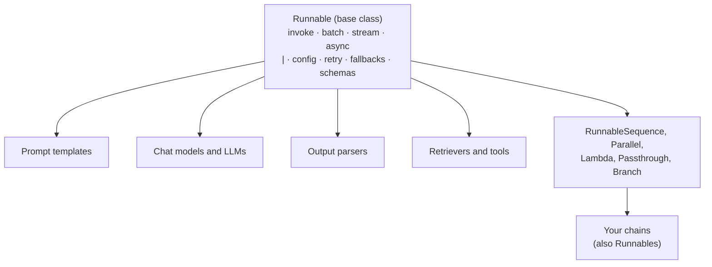

# Why Runnables Exist

> 📚 **Before you start**
>
> - [Chains, LCEL and Runnables](chains-lcel-and-runnables.md) and [Sequential, Parallel and Conditional Chains](sequential-parallel-and-conditional-chains.md).
> - Classes, inheritance and special methods such as `__or__` from [Python Programming](../../python-programming/course.md).
> - Threads and `ThreadPoolExecutor` from [Threads, Processes and Async](../../python-programming/10-concurrency-for-ai-apps/threads-processes-and-async.md).

## Introduction

Before UPI, paying someone in India meant learning a different method for every bank: one app for NEFT, another for IMPS, a different flow for each wallet, each with its own fields and quirks. UPI didn't replace the banks. It gave every bank **one shared interface** (a VPA, a QR code, a PIN), and suddenly any app could pay anyone, and new features like autopay worked for every bank at once.

Runnables are LangChain's UPI moment. Early LangChain had dozens of component types, each called a different way. The `Runnable` interface gave them all the same shape, and that one decision is why `|` works, why every chain can stream and batch, and why tracing sees every step.

This lesson is the "why". You'll see the problem the old design had, build a tiny runnable system from scratch in 40 lines to understand how `|` really works, and then see what LangChain's real `Runnable` adds on top. Knowing this makes LCEL errors much easier to debug.

> 💡 **Key Insight**
>
> A runnable is a **contract**: give me an input, I'll give you an output, through a fixed set of methods. Because every component honours the same contract, LangChain can write composition (`|`), parallelism, streaming, retries and tracing **once**, in the base class, and every component and every chain gets them.

---

## Core Explanation

### 1. The problem: every component spoke a different language

In LangChain's early versions (2022 to 2023), each kind of component had its own calling style. Roughly:

| Component | How you called it (old style) | What came back |
|---|---|---|
| LLM | `llm("text")` or `llm.predict("text")` | a string |
| Chat model | `chat(messages)` or `chat.predict_messages(...)` | a message |
| Prompt template | `prompt.format(**vars)` or `prompt.format_prompt(...)` | a string or prompt value |
| Chain | `chain.run(...)`, `chain(...)`, `chain.apply([...])` | a string or a dict |
| Retriever | `retriever.get_relevant_documents(q)` | a list of documents |
| Parser | `parser.parse(text)` | anything |

Joining two components meant writing glue code for that specific pair. Every chain class (`LLMChain`, `SequentialChain`, `RetrievalQA` and many more) contained its own glue, and each had to separately implement streaming, async and batching, so many didn't. If you wanted to stream the output of a `RetrievalQA` chain, the answer was often "you can't" or "use callbacks".

### 2. The fix: one interface for everything

In 2023 LangChain introduced the `Runnable` interface and LCEL. The idea is simple:

1. Define one abstract method every component must implement: `invoke(input, config) -> output`.
2. Build everything else (`batch`, `stream`, async, `|`, retries, fallbacks, config) **in the base class**, on top of `invoke`.
3. Make every component a subclass.

The old methods were deprecated (you saw `retriever.get_relevant_documents` replaced by `retriever.invoke`, and `LLMChain` replaced by `prompt | model`) and in LangChain 1.0 the old chain classes moved to `langchain-classic`.

### 3. Build a tiny runnable system from scratch

The best way to understand LCEL is to build a small version. This toy has the core ideas: an abstract `invoke`, `batch` built on top of it, and `|` creating a sequence:

```python
from concurrent.futures import ThreadPoolExecutor

class MiniRunnable:
    def invoke(self, x):
        raise NotImplementedError

    def batch(self, xs, max_workers=4):                 # free for every subclass
        with ThreadPoolExecutor(max_workers) as pool:
            return list(pool.map(self.invoke, xs))      # map keeps input order

    def __or__(self, other):                            # a | b
        return MiniSequence(self, coerce(other))

    def __ror__(self, other):                           # function | runnable
        return MiniSequence(coerce(other), self)

class MiniLambda(MiniRunnable):
    def __init__(self, fn):
        self.fn = fn
    def invoke(self, x):
        return self.fn(x)

class MiniParallel(MiniRunnable):
    def __init__(self, branches):
        self.branches = {k: coerce(v) for k, v in branches.items()}
    def invoke(self, x):
        return {k: r.invoke(x) for k, r in self.branches.items()}

class MiniSequence(MiniRunnable):
    def __init__(self, *steps):
        self.steps = []
        for s in steps:                                 # flatten nested sequences
            self.steps += s.steps if isinstance(s, MiniSequence) else [s]
    def invoke(self, x):
        for step in self.steps:
            x = step.invoke(x)
        return x

def coerce(thing):
    if isinstance(thing, MiniRunnable):
        return thing
    if callable(thing):
        return MiniLambda(thing)
    if isinstance(thing, dict):
        return MiniParallel(thing)
    raise TypeError(f"can't make a runnable from {type(thing).__name__}")
```

Now use it like LCEL. A "price with GST" pipeline for a kirana bill:

```python
base_price = MiniLambda(lambda item: {"Atta 5kg": 260, "Toor dal 1kg": 160, "Ghee 1L": 650}[item])
pipeline = base_price | {"price": lambda p: p, "gst": lambda p: round(p * 0.05, 2)} | (lambda d: d["price"] + d["gst"])

print(type(pipeline).__name__, "with", len(pipeline.steps), "steps")
print(pipeline.invoke("Ghee 1L"))
print(pipeline.batch(["Atta 5kg", "Toor dal 1kg", "Ghee 1L"]))
```

Output:

```
MiniSequence with 3 steps
682.5
[273.0, 168.0, 682.5]
```

That's the whole trick:

- **`|` is just `__or__`**, which returns a sequence object. Nothing runs when you build the chain; it runs when you call `invoke`.
- **Plain functions and dicts work** because `coerce` wraps them. The `__ror__` method handles a function on the *left* of `|` (Python tries the left operand's `__or__` first, and a function doesn't have one, so it falls back to the right operand's `__ror__`).
- **`batch` was written once**, in the base class, and works for the lambda, the parallel step and the whole pipeline.

(Real GST on food items varies by item and packaging; 5% is just for the example.)

### 4. The same pipeline in real LCEL

Swap the toy classes for LangChain's and the code barely changes:

```python
from langchain_core.runnables import RunnableLambda

base_price = RunnableLambda(lambda item: {"Atta 5kg": 260, "Toor dal 1kg": 160, "Ghee 1L": 650}[item])
pipeline = base_price | {"price": lambda p: p, "gst": lambda p: round(p * 0.05, 2)} | (lambda d: d["price"] + d["gst"])

print(type(pipeline).__name__, [type(s).__name__ for s in pipeline.steps])
print(pipeline.invoke("Ghee 1L"))
print(pipeline.batch(["Atta 5kg", "Toor dal 1kg", "Ghee 1L"]))
```

Output:

```
RunnableSequence ['RunnableLambda', 'RunnableParallel', 'RunnableLambda']
682.5
[273.0, 168.0, 682.5]
```

Same answers, and now the pipeline also has everything the real base class provides.

### 5. What the real Runnable adds

The real `Runnable` base class implements far more than our toy, all on top of each subclass's `invoke` (and optionally `stream` or async methods for components that can do better):

| Feature | What you get without writing anything |
|---|---|
| `batch` / `abatch` | Thread pool or `asyncio` concurrency, `max_concurrency`, ordered results, `return_exceptions=True` to collect errors instead of failing |
| `stream` / `astream` | Pieces flow through steps that support streaming |
| `ainvoke` | Async version; by default runs the sync code in a thread, and real components override it with true async I/O |
| `astream_events` | Start, stream and end events for every inner step |
| `config` | Run name, tags, metadata and callbacks passed down to every step |
| `with_retry`, `with_fallbacks` | Resilience wrappers |
| `input_schema`, `output_schema` | Types inferred from the steps |
| `get_graph()` | The pipeline's structure for diagrams |
| `as_tool()` | Turn a runnable into a tool an agent can call (module 7) |

Two of these are worth seeing on our GST pipeline. `return_exceptions=True` keeps a batch going when one input fails:

```python
print(pipeline.batch(["Ghee 1L", "Basmati 5kg"], return_exceptions=True))
```

Output:

```
[682.5, KeyError('Basmati 5kg')]
```

"Basmati 5kg" isn't in the price list, so its slot holds the `KeyError` instead of crashing the whole batch.

And `with_retry` re-runs a step that fails with a temporary error. Here a fake stock API fails twice before answering:

```python
calls = {"n": 0}

def flaky_stock(item):
    calls["n"] += 1
    if calls["n"] < 3:
        raise ConnectionError("stock server busy")
    return f"{item}: 12 in stock"

stock = RunnableLambda(flaky_stock).with_retry(stop_after_attempt=3, wait_exponential_jitter=False)
print(stock.invoke("Ghee 1L"), "| attempts:", calls["n"])
```

Output:

```
Ghee 1L: 12 in stock | attempts: 3
```

We didn't write a loop or a `try`. That behaviour came from the base class, because `flaky_stock` was wrapped as a runnable.

### 6. The contract in practice: input and output types

The contract also includes **types**. Each runnable declares what it accepts and returns, and LangChain uses that to build schemas and to coerce inputs. Chat models, for example, accept several input shapes because they share a `LanguageModelInput` type:

```python
from langchain_core.language_models.fake_chat_models import FakeListChatModel
from langchain_core.messages import HumanMessage
from langchain_core.prompts import ChatPromptTemplate

model = FakeListChatModel(responses=["ok"] * 3)
inputs = ["plain string",
          [HumanMessage("a list of messages")],
          ChatPromptTemplate.from_template("a {kind}").invoke({"kind": "prompt value"})]
for x in inputs:
    print(f"{type(x).__name__:<16} ->", type(model.invoke(x)).__name__)
```

Output:

```
str              -> AIMessage
list             -> AIMessage
ChatPromptValue  -> AIMessage
```

This flexibility is why `prompt | model` works: the prompt returns a prompt value, and the model accepts it. When you write your own step, make its input match what the previous step returns, and its output match what the next step accepts.

### 7. When you write your own runnable

You rarely subclass `Runnable` directly. In order of preference:

1. **A plain function** in a chain (auto-wrapped as `RunnableLambda`). Best for small transformations.
2. **`RunnableLambda(fn)`** or the `@chain` decorator when you want to name it, call it on its own, or use its methods like `with_retry`.
3. **`RunnableGenerator`** for a step that should stream (it transforms an iterator of pieces).
4. **Subclassing a specific base** (`BaseChatModel`, `BaseOutputParser`, `BaseRetriever`, `BaseTool`) when you're building a new component of that kind, as you did with the stand-in chat models in earlier labs.

The next lesson covers 1 to 3 in detail, along with the parallel, passthrough and branch classes.



---

## Try It Yourself

1. **Extend the toy.** Add a `MiniRunnable.with_default(value)` method to the toy that returns a runnable which calls `self.invoke` and returns `value` if it raises. Test it on `MiniLambda(lambda x: 1 / x)` with inputs 4 and 0.
2. **Spot the coercion.** In real LCEL, what type does each of these become: `RunnableLambda(str.upper) | (lambda s: s + "!")`, and `RunnableLambda(str.upper) | {"a": str.lower}`? Print the type of the last step in each.
3. **Batch with failures.** Use the real `pipeline` to batch `["Atta 5kg", "Sugar 1kg", "Toor dal 1kg"]` with `return_exceptions=True`, and print only the successful totals.

<details>
<summary>Show answers</summary>

**1.**

```python
class SafeMini(MiniRunnable):
    def __init__(self, inner, value):
        self.inner, self.value = inner, value
    def invoke(self, x):
        try:
            return self.inner.invoke(x)
        except Exception:
            return self.value

MiniRunnable.with_default = lambda self, value: SafeMini(self, value)
safe_inverse = MiniLambda(lambda x: 1 / x).with_default(None)
print(safe_inverse.batch([4, 0]))
```

Output:

```
[0.25, None]
```

This is a tiny version of what `with_fallbacks` does.

**2.**

```python
a = RunnableLambda(str.upper) | (lambda s: s + "!")
b = RunnableLambda(str.upper) | {"a": str.lower}
print(type(a.last).__name__, type(b.last).__name__)
print(a.invoke("chai"), b.invoke("chai"))
```

Output:

```
RunnableLambda RunnableParallel
CHAI! {'a': 'chai'}
```

**3.**

```python
results = pipeline.batch(["Atta 5kg", "Sugar 1kg", "Toor dal 1kg"], return_exceptions=True)
print([r for r in results if not isinstance(r, Exception)])
```

Output:

```
[273.0, 168.0]
```

</details>

---

## Real-World Examples

- **Framework design**: Python's file objects, Java's `Iterable` and UNIX pipes all use the same idea, a small shared contract that lets independent parts compose. UNIX's `cat file | grep x | sort` is LCEL's direct ancestor.
- **Teams standardising AI services** wrap internal APIs (pricing, inventory, KYC checks) as `RunnableLambda`s so they slot into any chain and get retries and tracing for free.
- **Migration projects** moving from `RetrievalQA` and `LLMChain` to LCEL report the biggest wins in streaming and observability, both inherited from the interface.

---

## Common Misconceptions

### "The `|` operator runs the steps"

It only builds a `RunnableSequence` object. Nothing runs until you call `invoke`, `batch` or `stream`.

### "Runnables are a LangChain-only magic feature"

They're ordinary classes with operator overloading. You built a working version in 40 lines.

### "Every runnable streams token by token"

Streaming passes through only if each step supports it. A plain function step waits for its whole input. The next lesson shows `RunnableGenerator` for streaming custom steps.

### "`ainvoke` is always truly asynchronous"

The base class default runs the sync `invoke` in a thread. Components with real async I/O (provider chat models, for example) override it.

---

## Interview Relevance

*"Why did LangChain introduce the Runnable interface?"* A strong answer: early components each had different call methods (`run`, `predict`, `get_relevant_documents`, `parse`), so composing them needed per-pair glue and each chain class reimplemented streaming, async and batching inconsistently. The `Runnable` protocol standardises `invoke` (plus `batch`, `stream`, async, config) across all components; the base class implements composition (`__or__` returning `RunnableSequence`), concurrency, retries, fallbacks, schema inference and callbacks once. Mention coercion of functions and dicts, that `|` is lazy, and that you usually extend via functions or `RunnableLambda` rather than subclassing.

---

## Key Takeaways

- **Before runnables, every component had its own calling style**, and chain classes reimplemented features inconsistently.
- **A runnable is a contract**: `invoke` in, output out, plus a fixed set of methods.
- **`|` is operator overloading** that builds a lazy `RunnableSequence`; functions and dicts are coerced.
- **The base class gives every component** batch, stream, async, events, config, retries, fallbacks, schemas and graphs.
- **Extend with functions first**, and subclass only to build a new kind of component.

---

**Up next:** [RunnableSequence, Parallel, Passthrough, Lambda and Branch](runnablesequence-parallel-passthrough-lambda-and-branch.md)
