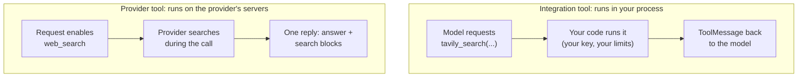

# Built-in Tools

> 📚 **Before you start**
>
> - [Tools and Toolkits](tools-and-toolkits.md), for what a tool is and how to design one.
> - [Setting Up a LangChain Project and API Keys](../02-langchain-foundations/setting-up-a-langchain-project-and-api-keys.md), for installing integration packages and keeping keys in environment variables.

## Introduction

When you set up a new kitchen you don't forge your own knives. You buy a good set and spend your effort on the cooking. LangChain's ecosystem works the same way: for common jobs (web search, Wikipedia, running code, reading files, querying a database) there are **ready-made tools** you can install and hand to a model in a couple of lines.

There are two very different kinds, and mixing them up causes confusion:

- **Integration tools** run **in your Python process**: LangChain wraps a library or API (Tavily search, DuckDuckGo, Wikipedia) as a tool. Your code executes them, exactly like a tool you wrote yourself.
- **Provider (server-side) tools** run **on the model provider's servers**: you switch them on in the request (for example Anthropic's web search or code execution), the provider runs them during the model call, and you get the final answer plus a record of what was done.

This lesson tours both, shows the patterns they share with your own tools, and explains how to choose and use them safely.

> 💡 **Key Insight**
>
> Before writing a tool, check whether one exists. Integration tools are just `BaseTool` objects you install, configure (keys, limits) and inspect like your own. Provider tools aren't LangChain tools at all: they're a setting on the model request, executed by the provider, which saves you code but gives you less control.

---

## Core Explanation

### 1. Integration tools: install, configure, use

Integration tools live in provider packages (`langchain-tavily`) or in `langchain-community`. Each follows the same pattern: install the package, set any API key as an environment variable, create the tool, and use it like any other tool.

**Web search with Tavily** (a search API built for LLM apps; needs a free or paid key):

```python
# not-run: needs `pip install langchain-tavily` and TAVILY_API_KEY
from langchain_tavily import TavilySearch

search = TavilySearch(max_results=3, topic="news")
print(search.name)
result = search.invoke({"query": "monsoon arrival Kerala this year"})
print([r["url"] for r in result["results"]])
```

Example output:

```
tavily_search
['https://www.example-news.in/monsoon-onset-kerala', 'https://mausam.example.gov.in/...', 'https://...']
```

**Web search with DuckDuckGo** (no key needed, but rate-limited and less reliable for heavy use):

```python
# not-run: needs `pip install langchain-community ddgs`
from langchain_community.tools import DuckDuckGoSearchRun

ddg = DuckDuckGoSearchRun()
print(ddg.invoke("current repo rate RBI"))
```

Example output:

```
The Reserve Bank of India's Monetary Policy Committee kept the repo rate unchanged at its latest meeting ...
```

**Wikipedia** (tool plus an API wrapper that holds the settings):

```python
# not-run: needs `pip install langchain-community wikipedia`
from langchain_community.tools import WikipediaQueryRun
from langchain_community.utilities import WikipediaAPIWrapper

wiki = WikipediaQueryRun(api_wrapper=WikipediaAPIWrapper(top_k_results=1, doc_content_chars_max=500))
print(wiki.invoke({"query": "Konkan Railway"}))
```

Example output:

```
Page: Konkan Railway
Summary: The Konkan Railway is a railway line along the west coast of India, running from Roha in Maharashtra to Thokur near Mangaluru ...
```

The **tool + wrapper** split you see with Wikipedia is common in `langchain-community`: the wrapper (`WikipediaAPIWrapper`) talks to the service and holds settings such as how many results and how many characters; the tool (`WikipediaQueryRun`) is the thin `BaseTool` the model sees. `doc_content_chars_max=500` matters: it keeps the result short, which keeps your token bill and the model's attention under control.

Other common integration tools you'll meet:

| Need | Typical tool | Watch out for |
|---|---|---|
| Web search | `TavilySearch`, `DuckDuckGoSearchRun` | Result quality, rate limits, cost per search |
| Encyclopaedia facts | `WikipediaQueryRun` | Long pages: cap the length |
| Files | `FileManagementToolkit` (read, write, list) | Always set `root_dir`; select only the tools you need |
| Databases | `SQLDatabaseToolkit` | Use a read-only database user |
| Shell and Python execution | `ShellTool`, Python REPL tools | Runs arbitrary code on your machine: only in a sandbox |
| HTTP APIs | requests tools | The model can call any URL you allow |

### 2. Inspect before you trust

A built-in tool is a tool like yours, so the same inspection works. Here's a small offline stand-in built the same way as `WikipediaQueryRun` (a wrapper plus a thin tool) so you can see what to check without network access:

```python
from langchain_core.tools import BaseTool
from pydantic import BaseModel, Field

class StationWikiWrapper(BaseModel):
    """Talks to the 'service' and holds settings, like WikipediaAPIWrapper."""
    max_chars: int = 120
    pages: dict = {
        "chhatrapati shivaji maharaj terminus": "Chhatrapati Shivaji Maharaj Terminus is a historic railway station in Mumbai and a UNESCO World Heritage Site, built in 1887 in Victorian Gothic style.",
    }
    def run(self, query: str) -> str:
        page = self.pages.get(query.strip().lower())
        return page[: self.max_chars] if page else "No good Wikipedia Search Result was found"

class StationWikiInput(BaseModel):
    query: str = Field(description="query to look up on Wikipedia")

class StationWikiTool(BaseTool):
    name: str = "station_wiki"
    description: str = "Look up an Indian railway station on Wikipedia. Input should be a station name."
    args_schema: type[BaseModel] = StationWikiInput
    api_wrapper: StationWikiWrapper

    def _run(self, query: str) -> str:
        return self.api_wrapper.run(query)

wiki_tool = StationWikiTool(api_wrapper=StationWikiWrapper(max_chars=80))
print(wiki_tool.name, "|", wiki_tool.description)
print(wiki_tool.args)
print(wiki_tool.invoke({"query": "Chhatrapati Shivaji Maharaj Terminus"}))
```

Output:

```
station_wiki | Look up an Indian railway station on Wikipedia. Input should be a station name.
{'query': {'description': 'query to look up on Wikipedia', 'title': 'Query', 'type': 'string'}}
Chhatrapati Shivaji Maharaj Terminus is a historic railway station in Mumbai and
```

For any built-in tool, check three things before handing it to a model:

1. **`name` and `description`**: do they say clearly when to use it? You can override them (`TavilySearch(name="news_search", description="...")` works because they're ordinary fields).
2. **`args`**: what can the model control? Anything dangerous (a file path, a URL, a SQL string) needs limits.
3. **Result size**: cap it with the wrapper's settings, as `max_chars` does here.

### 3. Turning any runnable into a tool

Sometimes the tool you need is a chain you already built. Every runnable has `as_tool()`, which wraps it as a tool with a name, description and argument schema. It's marked beta, so LangChain prints a warning that we silence here:

```python
import warnings
from typing_extensions import TypedDict
from langchain_core.runnables import RunnableLambda

warnings.filterwarnings("ignore", message="This API is in beta")

class TripArgs(TypedDict):
    city: str
    days: int

planner_chain = RunnableLambda(lambda d: f"{d['days']}-day plan for {d['city']}: day 1 old city walk, day 2 local food trail.")
plan_trip = planner_chain.as_tool(name="plan_trip", description="Make a short sightseeing plan for a city.", args_schema=TripArgs)
print(type(plan_trip).__name__, plan_trip.args)
print(plan_trip.invoke({"city": "Jaipur", "days": 2}))
```

Output:

```
StructuredTool {'city': {'title': 'City', 'type': 'string'}, 'days': {'title': 'Days', 'type': 'integer'}}
2-day plan for Jaipur: day 1 old city walk, day 2 local food trail.
```

This is how a RAG chain or a summariser becomes something a model can decide to call.

### 4. Provider tools: run on the provider's side

Some model providers run tools themselves. With Anthropic's Claude models, for example, you enable **web search** by passing the tool's type definition in `bind_tools`. The model searches, reads results and answers, all inside one API call; your code doesn't execute anything:

```python
# not-run: needs `pip install langchain-anthropic` and ANTHROPIC_API_KEY
from langchain_anthropic import ChatAnthropic

model = ChatAnthropic(model="claude-opus-5-5")
with_search = model.bind_tools([{"type": "web_search_20260209", "name": "web_search"}])
reply = with_search.invoke("What was the opening day collection of the latest big Bollywood release?")
print(reply.text[:200])
print({block["type"] for block in reply.content})
```

Example output:

```
According to trade reports, the film opened to about ₹42 crore net in India on its first day ...
{'text', 'server_tool_use', 'web_search_tool_result'}
```

The reply's content blocks record what happened: a `server_tool_use` block (the search the model ran) and a `web_search_tool_result` block (what it found), followed by text with the answer. Anthropic offers other server tools the same way, such as code execution (`{"type": "code_execution_20250825", "name": "code_execution"}`), and other providers have their own equivalents. The `type` strings carry a date because providers version these tools; check the provider's documentation for the current one.



| | Integration tools | Provider tools |
|---|---|---|
| Who runs it | Your code | The provider |
| Works with | Any tool-calling model | That provider's models only |
| Control (logging, limits, caching) | Full | Settings the provider offers |
| Code you write | The loop that runs tools (or an agent) | None |
| Billing | The tool's API plus model tokens | The provider's per-use fee plus tokens |

### 5. Choosing well

- **Prefer narrow tools.** A "search Indian Railways help pages" tool built on your own documents beats general web search for a railway helpdesk.
- **Count the cost.** Search APIs charge per query, and long results cost tokens. Cap `max_results` and result length.
- **Mind freshness and trust.** Web results can be wrong, outdated or deliberately misleading (a page can contain text written to manipulate the model). Tell users when an answer came from the web.
- **Never give code-execution or shell tools unrestricted access** to a real machine. Use a sandbox, or the provider's hosted code execution, which runs in an isolated container. The [Tools, Agent Skills and Code Execution](../../tools-agent-skills-and-code-execution/course.md) course goes deeper.

---

## Try It Yourself

1. **Override the description.** Create a second `StationWikiTool` named `heritage_station_lookup` whose description says to use it only for heritage railway stations. Print its name and description.
2. **Cap the result.** Using `StationWikiWrapper(max_chars=40)`, how much of the CST page comes back? Why does capping matter more for models than for humans?
3. **A chain as a tool.** Turn `RunnableLambda(lambda d: d["amount"] * 0.18)` into a tool called `gst_amount` with an argument schema `{"amount": float}` and invoke it on 1,500.

<details>
<summary>Show answers</summary>

**1.**

```python
heritage = StationWikiTool(name="heritage_station_lookup",
                           description="Look up a heritage railway station on Wikipedia. Use only for heritage stations.",
                           api_wrapper=StationWikiWrapper())
print(heritage.name, "|", heritage.description)
```

Output:

```
heritage_station_lookup | Look up a heritage railway station on Wikipedia. Use only for heritage stations.
```

**2.**

```python
short = StationWikiTool(api_wrapper=StationWikiWrapper(max_chars=40))
print(short.invoke({"query": "Chhatrapati Shivaji Maharaj Terminus"}))
```

Output:

```
Chhatrapati Shivaji Maharaj Terminus is
```

Every character of a tool result is resent to the model as tokens, on this call and on every later turn that includes the history. A human skims; a model pays for, and attends to, everything.

**3.**

```python
class GstArgs(TypedDict):
    amount: float

gst = RunnableLambda(lambda d: d["amount"] * 0.18).as_tool(name="gst_amount", description="18% GST on an amount in rupees.", args_schema=GstArgs)
print(gst.invoke({"amount": 1500}))
```

Output:

```
270.0
```

</details>

---

## Real-World Examples

- **News and finance assistants** use Tavily or provider web search with `topic="news"` and show source links next to each answer.
- **Customer-support copilots** turn their existing RAG chain into a tool with `as_tool()` so an agent can decide when to search the help centre.
- **Data assistants** use `SQLDatabaseToolkit` with a read-only replica of the production database.
- **Analytics chatbots** enable the provider's sandboxed code execution to compute statistics on uploaded CSVs instead of running Python on their own servers.

---

## Common Misconceptions

### "Web search tools make answers correct"

They make answers *current*. Search results can be wrong or manipulative; show sources and treat results as untrusted.

### "Provider tools appear as tool calls I need to run"

Server-side tools are executed by the provider during the call. You see their record in the content blocks, not tool calls to run.

### "Community tools are safe because they're official"

They do exactly what they say, which can include running shell commands or writing files. Safety comes from limits you set.

### "I need a custom tool for my chain"

`as_tool()` turns any runnable into a tool.

---

## Interview Relevance

*"What built-in tools does LangChain offer and how do you choose?"* A strong answer distinguishes integration tools (Tavily, DuckDuckGo, Wikipedia, file, SQL and shell toolkits in partner packages or `langchain-community`, run in your process as `BaseTool`s, often a thin tool over an API wrapper with settings like result limits) from provider server-side tools (such as Anthropic's web search and code execution, enabled via `bind_tools` with a typed definition and executed by the provider). Mention inspecting name/description/args, overriding descriptions, capping result size, `as_tool()` for turning chains into tools, cost and freshness trade-offs, and sandboxing anything that executes code.

---

## Key Takeaways

- **Two kinds of built-in tools**: integration tools run in your process; provider tools run on the provider's servers.
- **Integration tools are ordinary `BaseTool`s**: install, set keys, configure limits, inspect.
- **The tool + API wrapper pattern** keeps settings (result count, length) in the wrapper.
- **`as_tool()` turns any runnable into a tool.**
- **Provider tools need no execution code** but tie you to that provider and give less control.
- **Limit and sandbox** anything that touches files, databases, shells or the web.

---

**Up next:** [Custom Tools: @tool, StructuredTool and BaseTool](custom-tools-tool-structuredtool-and-basetool.md)
