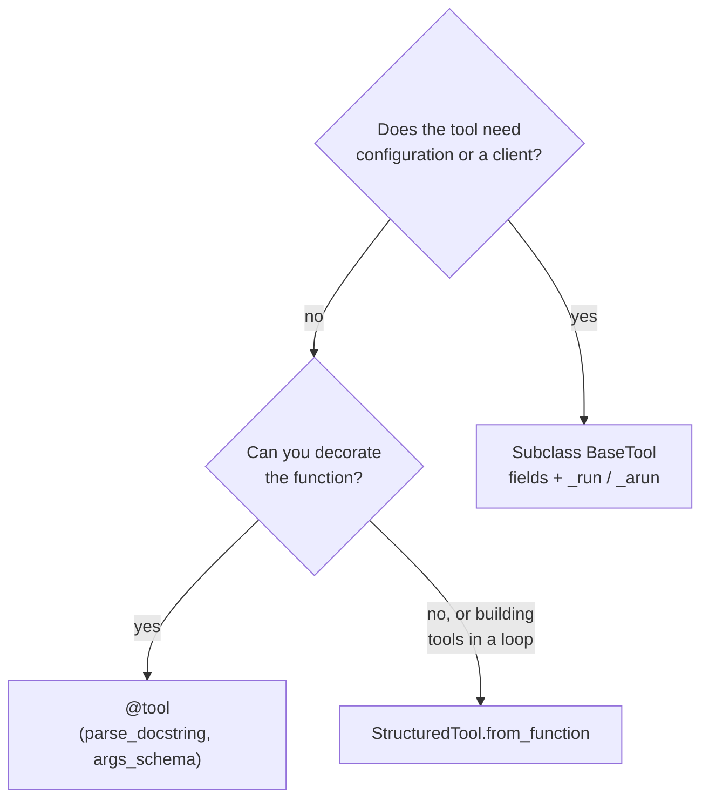

# Custom Tools: @tool, StructuredTool and BaseTool

> 📚 **Before you start**
>
> - [Tools and Toolkits](tools-and-toolkits.md) and [Built-in Tools](built-in-tools.md).
> - [Structured Output with Pydantic and JSON Schema](../05-structured-output-and-output-parsers/structured-output-with-pydantic-and-json-schema.md), for `Field` descriptions and validators, which work the same in tool arguments.
> - `async` functions from [Threads, Processes and Async](../../python-programming/10-concurrency-for-ai-apps/threads-processes-and-async.md).

## Introduction

"Kisan Mitra" is a helpline for farmers in Maharashtra. Callers ask things like "What's the onion price in Lasalgaon mandi today?", "Will it rain in Nashik this week?" and "What would the EMI be on a ₹2 lakh tractor loan?". No ready-made tool knows mandi prices or your bank's loan rules, so you'll write your own.

LangChain gives you three ways to build a custom tool, from least to most code:

| Way | You write | Best for |
|---|---|---|
| `@tool` decorator | A function with type hints and a docstring | Most tools |
| `StructuredTool.from_function` | A function, plus name, description and options as arguments | Tools built from existing functions, or created in a loop |
| `BaseTool` subclass | A class with `_run` (and `_arun`) | Tools with configuration or clients, and reusable tool libraries |

All three produce the same thing: a tool with a name, a description, an argument schema and code. This lesson covers each one, plus the features they share: rich argument schemas, async tools, returning extra data, ending a turn with the tool's answer, and handling errors gracefully.

> 💡 **Key Insight**
>
> Start with `@tool`. Reach for `StructuredTool` when you need to build tools from functions you don't want to decorate, and `BaseTool` when the tool needs state (a client, a config, a cache). Whichever you choose, the schema the model sees comes from the same places: the **name**, the **description** and the **argument schema** (type hints or a Pydantic model).

---

## Core Explanation

### 1. `@tool`: the everyday way

Data for the examples:

```python
MANDI_PRICES = {  # ₹ per quintal, modal price
    ("onion", "lasalgaon"): 1850, ("onion", "pimpalgaon"): 1790,
    ("soybean", "latur"): 4320, ("tur", "latur"): 7150,
}
```

A tool with defaults and a docstring that documents each argument. With `parse_docstring=True`, LangChain reads the Google-style `Args:` section into per-argument descriptions, which the model sees:

```python
from langchain_core.tools import tool

@tool(parse_docstring=True)
def mandi_price(crop: str, mandi: str = "lasalgaon") -> str:
    """Get today's modal price of a crop at a Maharashtra APMC mandi, in rupees per quintal.

    Args:
        crop: Crop name in English, e.g. onion, soybean, tur.
        mandi: Mandi (market) name, e.g. lasalgaon, latur.
    """
    price = MANDI_PRICES.get((crop.lower(), mandi.lower()))
    return f"{crop.title()} at {mandi.title()}: ₹{price}/quintal" if price else f"No price for {crop} at {mandi} today."

print(mandi_price.description)
print(mandi_price.args)
print(mandi_price.invoke({"crop": "Onion"}))
```

Output:

```
Get today's modal price of a crop at a Maharashtra APMC mandi, in rupees per quintal.
{'crop': {'description': 'Crop name in English, e.g. onion, soybean, tur.', 'title': 'Crop', 'type': 'string'}, 'mandi': {'default': 'lasalgaon', 'description': 'Mandi (market) name, e.g. lasalgaon, latur.', 'title': 'Mandi', 'type': 'string'}}
Onion at Lasalgaon: ₹1850/quintal
```

The description is now just the summary line, and each argument carries its own description. Without `parse_docstring=True`, the whole docstring (including the `Args:` block) becomes the description, which also works but is messier.

You can also override the **name**: `@tool("onion_price")` gives the tool a different name from the function. Useful when your function name is awkward for the model or clashes with another tool.

### 2. Rich arguments with a Pydantic schema

Type hints give types; a Pydantic model also gives descriptions, limits and allowed values. Pass it as `args_schema`:

```python
from typing import Literal
from pydantic import BaseModel, Field

class LoanInput(BaseModel):
    principal: float = Field(gt=0, le=5_000_000, description="Loan amount in rupees")
    annual_rate: float = Field(gt=0, lt=30, description="Interest rate per year in percent, e.g. 9.5")
    months: int = Field(ge=6, le=120, description="Loan tenure in months")
    loan_type: Literal["tractor", "crop", "dairy"] = "tractor"

@tool(args_schema=LoanInput)
def loan_emi(principal: float, annual_rate: float, months: int, loan_type: str = "tractor") -> str:
    """Calculate the monthly EMI for a farm loan."""
    r = annual_rate / 12 / 100
    emi = principal * r * (1 + r) ** months / ((1 + r) ** months - 1)
    return f"{loan_type.title()} loan of ₹{principal:,.0f} at {annual_rate}% for {months} months: EMI ₹{emi:,.0f}"

print(loan_emi.invoke({"principal": 200000, "annual_rate": 9.5, "months": 36}))
print(loan_emi.args["loan_type"])
```

Output:

```
Tractor loan of ₹200,000 at 9.5% for 36 months: EMI ₹6,407
{'default': 'tractor', 'enum': ['tractor', 'crop', 'dairy'], 'title': 'Loan Type', 'type': 'string'}
```

The limits are enforced before your code runs. A model asking for a 500-month loan gets a validation error instead of a nonsense EMI:

```python
from pydantic import ValidationError

try:
    loan_emi.invoke({"principal": 200000, "annual_rate": 9.5, "months": 500})
except ValidationError as e:
    print(e.errors()[0]["loc"], e.errors()[0]["msg"])
```

Output:

```
('months',) Input should be less than or equal to 120
```

### 3. `StructuredTool.from_function`: tools without decorating

When the function already exists (in a library you don't want to edit) or you build tools in a loop, `StructuredTool.from_function` takes the function plus the tool's settings as arguments:

```python
from langchain_core.tools import StructuredTool

def rain_forecast(district: str, days: int = 3) -> str:
    forecasts = {"nashik": [5, 22, 40, 12, 0], "latur": [0, 0, 3, 8, 15]}
    mm = forecasts.get(district.lower())
    return f"{district.title()}: expected rain (mm) for the next {days} days: {mm[:days]}" if mm else f"No forecast for {district}."

forecast_tool = StructuredTool.from_function(
    func=rain_forecast,
    name="rain_forecast",
    description="Get the expected daily rainfall in millimetres for a Maharashtra district for the next 1-5 days.",
)
print(forecast_tool.name, forecast_tool.args)
print(forecast_tool.invoke({"district": "Nashik", "days": 4}))
```

Output:

```
rain_forecast {'district': {'title': 'District', 'type': 'string'}, 'days': {'default': 3, 'title': 'Days', 'type': 'integer'}}
Nashik: expected rain (mm) for the next 4 days: [5, 22, 40, 12]
```

Building tools in a loop, one per crop, is a typical use:

```python
def make_price_tool(crop):
    def price(mandi: str) -> str:
        return mandi_price.invoke({"crop": crop, "mandi": mandi})
    return StructuredTool.from_function(func=price, name=f"{crop}_price",
                                        description=f"Get today's {crop} price at a mandi, in rupees per quintal.")

crop_tools = [make_price_tool(c) for c in ("onion", "soybean", "tur")]
print([t.name for t in crop_tools])
print(crop_tools[2].invoke({"mandi": "Latur"}))
```

Output:

```
['onion_price', 'soybean_price', 'tur_price']
Tur at Latur: ₹7150/quintal
```

### 4. `BaseTool`: tools with state

Subclass `BaseTool` when the tool carries configuration or a client: an API base URL, credentials, a cache, a database connection. Fields are declared like Pydantic fields, and the work happens in `_run`:

```python
from langchain_core.tools import BaseTool

class PriceAlertInput(BaseModel):
    crop: str = Field(description="Crop name, e.g. onion")
    target_price: int = Field(gt=0, description="Alert when the price reaches this many rupees per quintal")

class PriceAlertTool(BaseTool):
    name: str = "set_price_alert"
    description: str = "Set an SMS alert for when a crop's price at the farmer's home mandi reaches a target."
    args_schema: type[BaseModel] = PriceAlertInput
    home_mandi: str                      # configuration, not chosen by the model
    max_alerts: int = 3
    alerts: list = []                    # state kept between calls

    def _run(self, crop: str, target_price: int) -> str:
        if len(self.alerts) >= self.max_alerts:
            return f"Alert limit of {self.max_alerts} reached. Delete an alert first."
        self.alerts.append((crop, target_price))
        now = MANDI_PRICES.get((crop.lower(), self.home_mandi), "unknown")
        return f"Alert set: {crop} at {self.home_mandi.title()} reaching ₹{target_price} (now ₹{now})."

alert_tool = PriceAlertTool(home_mandi="lasalgaon", max_alerts=2)
print(alert_tool.args)
for target in (2000, 2200, 2500):
    print(alert_tool.invoke({"crop": "onion", "target_price": target}))
```

Output:

```
{'crop': {'description': 'Crop name, e.g. onion', 'title': 'Crop', 'type': 'string'}, 'target_price': {'description': 'Alert when the price reaches this many rupees per quintal', 'exclusiveMinimum': 0, 'title': 'Target Price', 'type': 'integer'}}
Alert set: onion at Lasalgaon reaching ₹2000 (now ₹1850).
Alert set: onion at Lasalgaon reaching ₹2200 (now ₹1850).
Alert limit of 2 reached. Delete an alert first.
```

Notice what the model can and can't control. It chooses `crop` and `target_price` (they're in the schema). It can't change `home_mandi` or `max_alerts`: those are set when **you** create the tool. This separation of model-controlled arguments from app-controlled configuration is a key safety habit, and the [Injected Tool Arguments](injected-tool-arguments.md) lesson takes it further.

(For async apps, also implement `async def _arun(...)`; otherwise LangChain runs `_run` in a thread when you call `ainvoke`.)

### 5. Async tools

If the tool's work is I/O (an HTTP call, a database query), write it as an `async def`. The decorator detects it:

```python
import asyncio

@tool
async def msp_lookup(crop: str) -> str:
    """Get the government Minimum Support Price (MSP) for a kharif crop, in rupees per quintal."""
    await asyncio.sleep(0.01)   # stands in for an HTTP call
    msp = {"tur": 8000, "soybean": 5328}   # example figures for illustration
    return f"MSP for {crop}: ₹{msp[crop.lower()]}/quintal" if crop.lower() in msp else f"No MSP listed for {crop}."

print(asyncio.run(msp_lookup.ainvoke({"crop": "Tur"})))
try:
    msp_lookup.invoke({"crop": "Tur"})
except NotImplementedError as e:
    print("sync call:", e)
```

Output:

```
MSP for Tur: ₹8000/quintal
sync call: StructuredTool does not support sync invocation.
```

An async-only tool must be called with `ainvoke`. To support both, `StructuredTool.from_function(func=sync_version, coroutine=async_version, ...)` takes one of each.

### 6. Returning extra data: content and artifact

Sometimes a tool produces something big (a full table, a chart, raw API JSON) that your app needs but the model doesn't. With `response_format="content_and_artifact"`, the tool returns a pair: **content** goes to the model, the **artifact** stays on the `ToolMessage` for your code:

```python
@tool(response_format="content_and_artifact")
def price_history(crop: str) -> tuple[str, list]:
    """Get the last 5 days of onion or soybean prices at Lasalgaon, in rupees per quintal."""
    history = {"onion": [1720, 1760, 1800, 1830, 1850], "soybean": [4250, 4280, 4300, 4310, 4320]}[crop.lower()]
    change = history[-1] - history[0]
    return f"{crop.title()} rose ₹{change} over 5 days, now ₹{history[-1]}.", history

msg = price_history.invoke({"name": "price_history", "args": {"crop": "onion"}, "id": "call_1", "type": "tool_call"})
print("to the model:", msg.content)
print("for the app: ", msg.artifact)
```

Output:

```
to the model: Onion rose ₹130 over 5 days, now ₹1850.
for the app:  [1720, 1760, 1800, 1830, 1850]
```

The model reads one short sentence; your UI can draw a chart from the artifact. This keeps token costs down without losing data.

### 7. `return_direct`: the tool's output is the answer

Normally a tool's result goes back to the model, which writes the final reply. With `return_direct=True`, an agent stops after the tool runs and returns the tool's output as the answer. Use it when the tool's output is already exactly what the user should see (a formatted receipt, a confirmation):

```python
@tool(return_direct=True)
def book_soil_test(village: str) -> str:
    """Book a free soil health card test at the nearest Krishi Vigyan Kendra."""
    return f"Soil test booked for {village}. Reference KVK-{len(village) * 137}. Bring 500 g of soil from 6 inches deep."

print(book_soil_test.return_direct)
```

Output:

```
True
```

`return_direct` is a flag that agent loops (such as `create_agent`) read; calling the tool yourself behaves normally.

### 8. Handling errors

Tools fail: the mandi isn't in the data, the API is down, the model passed something odd. If the tool raises an exception, by default it propagates and stops your program or agent. Usually it's better to send the model a **readable error message** so it can correct itself or tell the user.

Raise `ToolException` for expected failures, and set `handle_tool_error`:

```python
from langchain_core.tools import ToolException

def strict_price(crop: str, mandi: str) -> str:
    price = MANDI_PRICES.get((crop.lower(), mandi.lower()))
    if price is None:
        known = sorted({m for c, m in MANDI_PRICES if c == crop.lower()})
        raise ToolException(f"No {crop} price at {mandi}. Mandis with {crop} data: {', '.join(known) or 'none'}.")
    return f"₹{price}/quintal"

strict = StructuredTool.from_function(func=strict_price, name="strict_price",
                                      description="Get a crop price at a mandi.", handle_tool_error=True)
call = {"name": "strict_price", "args": {"crop": "onion", "mandi": "Pune"}, "id": "call_2", "type": "tool_call"}
print(repr(strict.invoke(call)))
```

Output:

```
ToolMessage(content='No onion price at Pune. Mandis with onion data: lasalgaon, pimpalgaon.', name='strict_price', tool_call_id='call_2', status='error')
```

The `ToolMessage` has `status='error'` and a helpful message listing mandis that do have data, so a model can retry with `lasalgaon`. `handle_tool_error` can also be a fixed string or a function that formats the exception.

**Validation errors** (bad arguments) have their own switch, `handle_validation_error`. For `@tool` tools, set it as an attribute after creating the tool:

```python
loan_emi.handle_validation_error = "Invalid loan details: tenure must be 6-120 months and rate below 30%."
bad_call = {"name": "loan_emi", "args": {"principal": 200000, "annual_rate": 9.5, "months": 500}, "id": "call_3", "type": "tool_call"}
print(repr(loan_emi.invoke(bad_call)))
```

Output:

```
ToolMessage(content='Invalid loan details: tenure must be 6-120 months and rate below 30%.', name='loan_emi', tool_call_id='call_3', status='error')
```

Only turn error handling on for errors the model can do something about. Bugs in your code should still crash loudly in testing.



---

## Try It Yourself

1. **A decorated tool.** Write `@tool(parse_docstring=True) def fertiliser_dose(crop: str, acres: float) -> str` that returns "Urea: X kg" using 50 kg per acre for onion and 25 for soybean. Document both arguments and print the tool's `args`.
2. **A Pydantic schema with limits.** Give `fertiliser_dose` an `args_schema` that limits `acres` to between 0.1 and 100. Show what happens for 500 acres, then turn on `handle_validation_error` with a helpful message and pass it as a tool call.
3. **State in a BaseTool.** Write a `CallLogTool(BaseTool)` with a field `calls: list = []` that records the first name of each farmer passed to it and returns how many calls have been logged.

<details>
<summary>Show answers</summary>

**1.**

```python
@tool(parse_docstring=True)
def fertiliser_dose(crop: str, acres: float) -> str:
    """Recommend a urea dose for a crop and field size.

    Args:
        crop: Crop name, onion or soybean.
        acres: Field size in acres.
    """
    per_acre = {"onion": 50, "soybean": 25}.get(crop.lower())
    return f"Urea: {per_acre * acres:.0f} kg" if per_acre else f"No recommendation for {crop}."

print(fertiliser_dose.args)
print(fertiliser_dose.invoke({"crop": "onion", "acres": 2.5}))
```

Output:

```
{'crop': {'description': 'Crop name, onion or soybean.', 'title': 'Crop', 'type': 'string'}, 'acres': {'description': 'Field size in acres.', 'title': 'Acres', 'type': 'number'}}
Urea: 125 kg
```

**2.**

```python
class DoseInput(BaseModel):
    crop: str = Field(description="Crop name, onion or soybean")
    acres: float = Field(ge=0.1, le=100, description="Field size in acres")

dose = StructuredTool.from_function(func=fertiliser_dose.func, name="fertiliser_dose",
                                    description="Recommend a urea dose for a crop and field size.", args_schema=DoseInput)
try:
    dose.invoke({"crop": "onion", "acres": 500})
except ValidationError as e:
    print("error:", e.errors()[0]["msg"])
dose.handle_validation_error = "Field size must be between 0.1 and 100 acres."
print(dose.invoke({"name": "fertiliser_dose", "args": {"crop": "onion", "acres": 500}, "id": "c", "type": "tool_call"}).content)
```

Output:

```
error: Input should be less than or equal to 100
Field size must be between 0.1 and 100 acres.
```

(`fertiliser_dose.func` is the original function the decorator wrapped.)

**3.**

```python
class CallLogInput(BaseModel):
    farmer_name: str = Field(description="The caller's first name")

class CallLogTool(BaseTool):
    name: str = "log_call"
    description: str = "Record that a farmer called the helpline."
    args_schema: type[BaseModel] = CallLogInput
    calls: list = []

    def _run(self, farmer_name: str) -> str:
        self.calls.append(farmer_name)
        return f"Logged {farmer_name}. Calls today: {len(self.calls)}"

log = CallLogTool()
print(log.invoke({"farmer_name": "Sunita"}))
print(log.invoke({"farmer_name": "Ramesh"}))
```

Output:

```
Logged Sunita. Calls today: 1
Logged Ramesh. Calls today: 2
```

</details>

---

## Real-World Examples

- **Agri-tech apps** wrap government mandi price and weather APIs as tools with `Literal` crop names, so models can't ask for crops the API doesn't cover.
- **Banks** use `BaseTool` subclasses that hold an authenticated API client, with the customer's id set by the app and never by the model.
- **Analytics bots** return a one-line summary as content and the full dataframe as an artifact for the UI to chart.
- **Booking flows** mark the final "confirm booking" tool `return_direct=True` so the user sees the exact confirmation text the system produced.

---

## Common Misconceptions

### "The docstring is just for humans"

For a tool, the docstring becomes the description the model reads. It's the most important line you'll write.

### "Validation errors are bugs"

From a model they're normal. Turn them into helpful messages so the model can retry.

### "`return_direct` makes `invoke` return early"

It's a flag for agent loops. Calling the tool yourself works as usual.

### "Fields on a BaseTool are arguments the model fills"

Only the `args_schema` is visible to the model. Other fields are configuration your code sets.

---

## Interview Relevance

*"How do you create custom tools in LangChain?"* A strong answer covers three ways: `@tool` (schema from type hints and docstring, `parse_docstring=True` for per-argument descriptions, a custom name, `args_schema` with Pydantic for limits and enums), `StructuredTool.from_function` (existing functions, sync and async versions, loops), and `BaseTool` subclasses (`_run`/`_arun`, configuration and clients as fields the model can't set). Mention async tools, `response_format="content_and_artifact"` to keep big data out of the prompt, `return_direct`, and error handling with `ToolException` plus `handle_tool_error` and `handle_validation_error`, which return `ToolMessage`s with `status="error"`.

---

## Key Takeaways

- **`@tool`** for most tools; **`StructuredTool.from_function`** for existing functions or loops; **`BaseTool`** for state and configuration.
- **The schema comes from the name, description and arguments**: use `parse_docstring=True` or a Pydantic `args_schema`.
- **Pydantic limits are enforced** before your code runs.
- **Async tools** use `ainvoke`; provide both versions if you need both.
- **`content_and_artifact`** sends a short summary to the model and keeps full data for your app.
- **Handle expected errors** with `ToolException` and `handle_tool_error`/`handle_validation_error`.

---

**Up next:** [Tool Calling with bind_tools](tool-calling-with-bind-tools.md)
