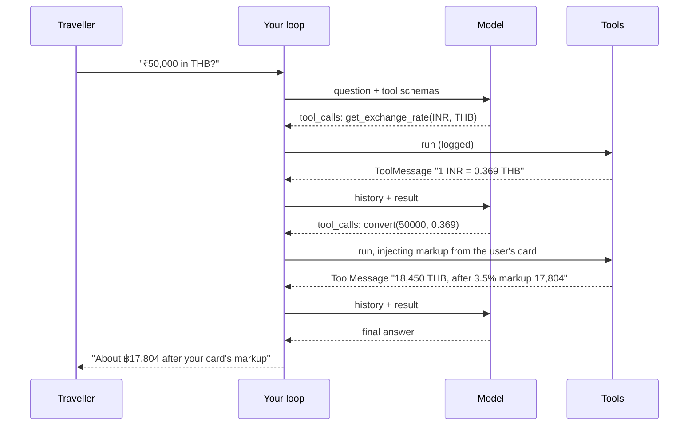

# Lab: Currency Converter with Tool Calling

> 📚 **Before you start**
>
> - Every lesson in this module, especially [Tool Calling with bind_tools](tool-calling-with-bind-tools.md) and [Injected Tool Arguments](injected-tool-arguments.md).
> - [Custom Tools: @tool, StructuredTool and BaseTool](custom-tools-tool-structuredtool-and-basetool.md), for `Literal` arguments and `ToolException`.

## What You'll Build

**Yatra Forex**, a travel-money assistant. A traveller asks "How much is ₹50,000 in Thai baht?" or "Convert 300 USD and 200 EUR to rupees". The model must:

1. Look up exchange rates with a `get_exchange_rate` tool (in parallel when there are several currencies).
2. Use the rates it got back to call a `convert` tool, which applies the **card's forex markup**, a value the model must never control (injected).
3. Answer with the converted amounts.

You'll write the tools, a stand-in model that plays the model's part offline, a production-style loop with injection, logging and error handling, then test it on several questions in one batch.



> 💡 **Key Insight**
>
> Multi-step tool use happens **across rounds**: the model can only use a tool's result after it comes back, so "look up the rate, then convert" takes two rounds of tool calls before the answer. Your loop doesn't need to know the plan; it just keeps running whatever the model asks for, injecting what the model mustn't control, until the model answers.

---

## Step 1: Rates and Tools

Sample rates (rupees per unit, for the lab only, not live):

```python
from typing import Annotated, Literal
from langchain_core.tools import tool, InjectedToolArg, ToolException

INR_PER_UNIT = {"USD": 88.40, "EUR": 102.90, "GBP": 117.60, "AED": 24.07, "SGD": 68.50, "THB": 2.71}
Currency = Literal["INR", "USD", "EUR", "GBP", "AED", "SGD", "THB"]

@tool
def get_exchange_rate(from_currency: Currency, to_currency: Currency) -> str:
    """Get how many units of to_currency one unit of from_currency buys. Use ISO codes like INR, USD, THB."""
    inr = lambda c: 1.0 if c == "INR" else INR_PER_UNIT[c]
    rate = inr(from_currency) / inr(to_currency)
    return f"1 {from_currency} = {rate:.4f} {to_currency}"

@tool
def convert(amount: float, rate: float, to_currency: Currency,
            markup_percent: Annotated[float, InjectedToolArg]) -> str:
    """Convert an amount using a rate from get_exchange_rate, applying the traveller's card markup."""
    if amount <= 0:
        raise ToolException("Amount must be positive.")
    gross = amount * rate
    net = gross * (1 - markup_percent / 100)
    return f"{gross:,.2f} {to_currency} at the market rate; {net:,.2f} {to_currency} after {markup_percent}% card markup"

print(get_exchange_rate.invoke({"from_currency": "INR", "to_currency": "THB"}))
print("model sees convert args:", list(convert.tool_call_schema.model_json_schema()["properties"]))
```

Output:

```
1 INR = 0.3690 THB
model sees convert args: ['amount', 'rate', 'to_currency']
```

Three design decisions:

- **`Literal` currency codes**: the model can't ask for "dollars" or "Baht"; it must use a supported code, and anything else fails validation.
- **Two tools, not one**: rate lookup and conversion are separate, so the model's work is visible in the trace (which rate was used) and each tool stays simple.
- **`markup_percent` is injected**: it depends on the traveller's card, which the app knows. The model sees only `amount`, `rate` and `to_currency`.

An unsupported code is rejected before your function runs:

```python
from pydantic import ValidationError

try:
    get_exchange_rate.invoke({"from_currency": "INR", "to_currency": "JPY"})
except ValidationError as e:
    print(e.errors()[0]["msg"])
```

Output:

```
Input should be 'INR', 'USD', 'EUR', 'GBP', 'AED', 'SGD' or 'THB'
```

## Step 2: A Stand-In Model

The stand-in reads the question and the conversation so far, and decides what to do next in the same three phases a real model would follow: ask for rates, then ask for conversions using those rates, then answer. It's rule-based, but every decision comes from the messages it receives:

```python
import re
from langchain_core.language_models import BaseChatModel
from langchain_core.messages import AIMessage, ToolMessage, HumanMessage
from langchain_core.outputs import ChatGeneration, ChatResult
from langchain_core.utils.function_calling import convert_to_openai_tool

SYMBOLS = {"₹": "INR", "rupees": "INR", "baht": "THB", "dirham": "AED", "pounds": "GBP", "dollars": "USD", "euros": "EUR"}

def parse_question(q):
    """Find (amount, from) pairs and the target currency in a question."""
    text = q.replace(",", "")
    for word, code in SYMBOLS.items():
        text = text.replace(word, f" {code} ")
    pairs = [(float(a), c) for a, c in re.findall(r"(\d+(?:\.\d+)?)\s*(INR|USD|EUR|GBP|AED|SGD|THB)", text)]
    pairs += [(float(a), c) for c, a in re.findall(r"(INR|USD|EUR|GBP|AED|SGD|THB)\s*(\d+(?:\.\d+)?)", text)]
    target = re.findall(r"\b(?:in|to)\s+(?:\w+\s+)?(INR|USD|EUR|GBP|AED|SGD|THB)", text)
    return pairs, target[-1] if target else "INR"

class ForexModel(BaseChatModel):
    """Offline stand-in for a tool-calling model."""
    @property
    def _llm_type(self):
        return "forex-model"

    def bind_tools(self, tools, **kwargs):
        return self.bind(tools=[convert_to_openai_tool(t) for t in tools], **kwargs)

    def _generate(self, messages, stop=None, run_manager=None, **kwargs):
        question = next(m.content for m in messages if isinstance(m, HumanMessage))
        pairs, target = parse_question(question)
        results = [m.content for m in messages if isinstance(m, ToolMessage)]
        rates = [r for r in results if r.startswith("1 ")]
        conversions = [r for r in results if "market rate" in r]
        errors = [m.content for m in messages if isinstance(m, ToolMessage) and m.status == "error"]
        if errors:
            reply = AIMessage(content=f"Sorry, I couldn't complete that: {errors[-1]}")
        elif not pairs:
            reply = AIMessage(content="Please tell me an amount and currency, e.g. '₹10,000 in AED'.")
        elif not rates:                                       # phase 1: look up every rate at once
            calls = [{"name": "get_exchange_rate", "args": {"from_currency": c, "to_currency": target}, "id": f"rate_{i}"}
                     for i, (_, c) in enumerate(pairs)]
            reply = AIMessage(content="", tool_calls=calls)
        elif not conversions:                                 # phase 2: convert using the rates
            calls = []
            for i, ((amount, _), rate_text) in enumerate(zip(pairs, rates)):
                rate = float(rate_text.split(" = ")[1].split()[0])
                calls.append({"name": "convert", "args": {"amount": amount, "rate": rate, "to_currency": target}, "id": f"conv_{i}"})
            reply = AIMessage(content="", tool_calls=calls)
        else:                                                 # phase 3: answer
            lines = [f"{amount:,.0f} {cur} → {conv}" for (amount, cur), conv in zip(pairs, conversions)]
            reply = AIMessage(content="Here you go:\n" + "\n".join(lines))
        return ChatResult(generations=[ChatGeneration(message=reply)])

print(parse_question("How much is ₹50,000 in Thai baht?"))
print(parse_question("Convert 300 USD and 200 EUR to rupees"))
```

Output:

```
([(50000.0, 'INR')], 'THB')
([(300.0, 'USD'), (200.0, 'EUR')], 'INR')
```

A real model does this reasoning itself from the tool descriptions. Swapping it in (Step 7) changes nothing else in the lab.

## Step 3: The Loop, with Injection and Logging

This is the loop from [Tool Calling with bind_tools](tool-calling-with-bind-tools.md), plus three production features: it **injects** the card markup into `convert` calls, it **logs** every call, and it turns tool exceptions into error messages the model can read:

```python
CARDS = {"basic-debit": 3.5, "travel-forex-card": 0.0, "premium-credit": 2.0}
TOOLS = {t.name: t for t in (get_exchange_rate, convert)}
INJECT = {"convert": lambda user: {"markup_percent": CARDS[user["card"]]}}

def run_forex(question, user, model=None, max_rounds=5, log=None):
    bound = (model or ForexModel()).bind_tools(list(TOOLS.values()))
    messages = [HumanMessage(question)]
    for round_no in range(1, max_rounds + 1):
        ai = bound.invoke(messages)
        messages.append(ai)
        if not ai.tool_calls:
            return ai.content
        for call in ai.tool_calls:
            if log is not None:
                log.append((round_no, call["name"], dict(call["args"])))
            tool = TOOLS.get(call["name"])
            if tool is None:
                messages.append(ToolMessage(f"Unknown tool {call['name']}", tool_call_id=call["id"], status="error"))
                continue
            extra = INJECT.get(call["name"], lambda u: {})(user)        # app-controlled values win
            call = {**call, "args": {**call["args"], **extra}}
            try:
                messages.append(tool.invoke(call))
            except (ToolException, ValidationError) as e:
                messages.append(ToolMessage(f"{call['name']} failed: {e}", tool_call_id=call["id"], status="error"))
    return "Stopped after too many tool rounds."

log = []
print(run_forex("How much is ₹50,000 in Thai baht?", {"name": "Ananya", "card": "basic-debit"}, log=log))
for entry in log:
    print("  log:", entry)
```

Output:

```
Here you go:
50,000 INR → 18,450.00 THB at the market rate; 17,804.25 THB after 3.5% card markup
  log: (1, 'get_exchange_rate', {'from_currency': 'INR', 'to_currency': 'THB'})
  log: (2, 'convert', {'amount': 50000.0, 'rate': 0.369, 'to_currency': 'THB'})
```

Two rounds of tool calls, then the answer, and the log shows exactly which rate was used. The markup came from Ananya's card, not from the model.

## Step 4: Several Currencies at Once

When the question involves several amounts, the model asks for all the rates in **one** round (parallel tool calls), then all the conversions in the next:

```python
log = []
print(run_forex("Convert 300 USD and 200 EUR to rupees", {"name": "Vikram", "card": "travel-forex-card"}, log=log))
print("rounds used:", sorted({r for r, _, _ in log}), "| calls:", len(log))
```

Output:

```
Here you go:
300 USD → 26,520.00 INR at the market rate; 26,520.00 INR after 0.0% card markup
200 EUR → 20,580.00 INR at the market rate; 20,580.00 INR after 0.0% card markup
rounds used: [1, 2] | calls: 4
```

Four tool calls in two rounds instead of four rounds. With a real model and real APIs, parallel calls cut waiting time.

## Step 5: Errors the Model Can Handle

A zero amount makes `convert` raise a `ToolException`. The loop turns it into an error `ToolMessage`, and the model explains instead of the program crashing:

```python
log = []
print(run_forex("Convert 0 USD to INR", {"name": "Test", "card": "basic-debit"}, log=log))
print("calls made:", [name for _, name, _ in log])
```

Output:

```
Sorry, I couldn't complete that: convert failed: Amount must be positive.
calls made: ['get_exchange_rate', 'convert']
```

The rate lookup worked, the conversion failed inside the tool, and the error text reached the model as a `ToolMessage` with `status="error"`. The rule lives in the tool, so it holds however the model (or a confused user) phrases the request.

## Step 6: Many Questions in Parallel

`run_forex` is a plain function; wrap it in a `RunnableLambda` and `batch` gives you concurrency, ordered results and `return_exceptions` for free (module 6):

```python
from langchain_core.runnables import RunnableLambda

assistant = RunnableLambda(lambda d: run_forex(d["question"], d["user"]))
questions = [
    {"question": "₹10,000 in AED?", "user": {"name": "Farah", "card": "premium-credit"}},
    {"question": "How much is 150 pounds in rupees?", "user": {"name": "Joseph", "card": "basic-debit"}},
    {"question": "What's the weather in Bangkok?", "user": {"name": "Meera", "card": "basic-debit"}},
]
for q, answer in zip(questions, assistant.batch(questions, config={"max_concurrency": 3})):
    print(f"{q['user']['name']}: {answer}")
```

Output:

```
Farah: Here you go:
10,000 INR → 415.00 AED at the market rate; 406.70 AED after 2.0% card markup
Joseph: Here you go:
150 GBP → 17,640.00 INR at the market rate; 17,022.60 INR after 3.5% card markup
Meera: Please tell me an amount and currency, e.g. '₹10,000 in AED'.
```

Meera's question has no amount, so the model answered directly without any tools, which is what should happen.

## Step 7: With a Real Model

Swap in a real model. A real model also writes a friendlier answer, mentions the markup and suggests a forex card when the markup is high:

```python
# not-run: needs `pip install langchain langchain-anthropic` and ANTHROPIC_API_KEY
from langchain.chat_models import init_chat_model

claude = init_chat_model("anthropic:claude-opus-5-5", temperature=0)
print(run_forex("How much is ₹50,000 in Thai baht?", {"name": "Ananya", "card": "basic-debit"}, model=claude))
```

Example output:

```
₹50,000 is about ฿18,450 at the current market rate. With your debit card's 3.5% forex markup you'd effectively get about ฿17,804. If you travel often, a zero-markup forex card would save you roughly ฿650 on this amount.
```

The same tools work with `create_agent`. Injection then moves from your loop into the tool itself, using `ToolRuntime` and context (from [Injected Tool Arguments](injected-tool-arguments.md)):

```python
# not-run: needs `pip install langchain langchain-anthropic` and ANTHROPIC_API_KEY
from typing_extensions import TypedDict
from langchain.agents import create_agent
from langgraph.prebuilt import ToolRuntime

class Traveller(TypedDict):
    card: str

@tool
def convert_for_traveller(amount: float, rate: float, to_currency: Currency, runtime: ToolRuntime[Traveller]) -> str:
    """Convert an amount using a rate from get_exchange_rate, applying the traveller's card markup."""
    return convert.invoke({"amount": amount, "rate": rate, "to_currency": to_currency,
                           "markup_percent": CARDS[runtime.context["card"]]})

agent = create_agent(model="anthropic:claude-opus-5-5", tools=[get_exchange_rate, convert_for_traveller],
                     system_prompt="You are Yatra Forex, a travel-money assistant for Indian travellers.",
                     context_schema=Traveller)
result = agent.invoke({"messages": [{"role": "user", "content": "₹50,000 in baht?"}]}, context={"card": "basic-debit"})
print(result["messages"][-1].text)
```

---

## Try It Yourself

1. **A new currency.** Add Japanese yen (`JPY`, ₹0.59 per yen) to the rates and the `Literal`, and the word "yen" to `SYMBOLS`. Ask "₹1,00,000 in yen?" with the travel forex card.
2. **Audit trail.** Change `run_forex` so the log also records each tool's result text. Print the full log for "Convert 300 USD to INR".
3. **Cap the spend.** Add an injected `max_amount` (₹2,00,000 for every user) to `convert` that raises a `ToolException` when `amount × rate` exceeds it for conversions **into** INR. Test with "Convert 5000 GBP to rupees".

<details>
<summary>Show answers</summary>

**1.**

```python
INR_PER_UNIT["JPY"] = 0.59
Currency = Literal["INR", "USD", "EUR", "GBP", "AED", "SGD", "THB", "JPY"]
SYMBOLS["yen"] = "JPY"

@tool
def get_exchange_rate(from_currency: Currency, to_currency: Currency) -> str:
    """Get how many units of to_currency one unit of from_currency buys. Use ISO codes like INR, USD, THB."""
    inr = lambda c: 1.0 if c == "INR" else INR_PER_UNIT[c]
    return f"1 {from_currency} = {inr(from_currency) / inr(to_currency):.4f} {to_currency}"

@tool
def convert(amount: float, rate: float, to_currency: Currency, markup_percent: Annotated[float, InjectedToolArg]) -> str:
    """Convert an amount using a rate from get_exchange_rate, applying the traveller's card markup."""
    if amount <= 0:
        raise ToolException("Amount must be positive.")
    gross = amount * rate
    return f"{gross:,.2f} {to_currency} at the market rate; {gross * (1 - markup_percent / 100):,.2f} {to_currency} after {markup_percent}% card markup"

TOOLS = {t.name: t for t in (get_exchange_rate, convert)}

def parse_question(q, _codes="INR|USD|EUR|GBP|AED|SGD|THB|JPY"):
    text = q.replace(",", "")
    for word, code in SYMBOLS.items():
        text = text.replace(word, f" {code} ")
    pairs = [(float(a), c) for a, c in re.findall(rf"(\d+(?:\.\d+)?)\s*({_codes})", text)]
    pairs += [(float(a), c) for c, a in re.findall(rf"({_codes})\s*(\d+(?:\.\d+)?)", text)]
    target = re.findall(rf"\b(?:in|to)\s+(?:\w+\s+)?({_codes})", text)
    return pairs, target[-1] if target else "INR"

print(run_forex("₹1,00,000 in yen?", {"name": "Kiran", "card": "travel-forex-card"}))
```

Output:

```
Here you go:
100,000 INR → 169,490.00 JPY at the market rate; 169,490.00 JPY after 0.0% card markup
```

The tools had to be recreated because a `Literal` type is fixed when the tool's schema is built, and the parser needed the new code too. (The stand-in's `_generate` calls `parse_question` by name, so it picks up the new version.)

**2.**

```python
def run_forex_audited(question, user, max_rounds=5):
    bound = ForexModel().bind_tools(list(TOOLS.values()))
    messages, audit = [HumanMessage(question)], []
    for _ in range(max_rounds):
        ai = bound.invoke(messages)
        messages.append(ai)
        if not ai.tool_calls:
            return ai.content, audit
        for call in ai.tool_calls:
            call = {**call, "args": {**call["args"], **INJECT.get(call["name"], lambda u: {})(user)}}
            result = TOOLS[call["name"]].invoke(call)
            audit.append((call["name"], call["args"], result.content))
            messages.append(result)

answer, audit = run_forex_audited("Convert 300 USD to INR", {"name": "Vikram", "card": "premium-credit"})
for row in audit:
    print(row)
```

Output:

```
('get_exchange_rate', {'from_currency': 'USD', 'to_currency': 'INR'}, '1 USD = 88.4000 INR')
('convert', {'amount': 300.0, 'rate': 88.4, 'to_currency': 'INR', 'markup_percent': 2.0}, '26,520.00 INR at the market rate; 25,989.60 INR after 2.0% card markup')
```

**3.**

```python
@tool
def convert(amount: float, rate: float, to_currency: Currency, markup_percent: Annotated[float, InjectedToolArg],
            max_amount: Annotated[float, InjectedToolArg]) -> str:
    """Convert an amount using a rate from get_exchange_rate, applying the traveller's card markup."""
    if amount <= 0:
        raise ToolException("Amount must be positive.")
    gross = amount * rate
    if to_currency == "INR" and gross > max_amount:
        raise ToolException(f"₹{gross:,.0f} is above the ₹{max_amount:,.0f} limit for one conversion.")
    return f"{gross:,.2f} {to_currency} at the market rate; {gross * (1 - markup_percent / 100):,.2f} {to_currency} after {markup_percent}% card markup"

TOOLS = {t.name: t for t in (get_exchange_rate, convert)}
INJECT["convert"] = lambda user: {"markup_percent": CARDS[user["card"]], "max_amount": 200000}
print(run_forex("Convert 5000 GBP to rupees", {"name": "Rohan", "card": "basic-debit"}))
```

Output:

```
Sorry, I couldn't complete that: convert failed: ₹588,000 is above the ₹200,000 limit for one conversion.
```

</details>

---

## What You've Learned

- **Multi-step tool use happens across rounds**: look up, then use the result, then answer.
- **Parallel tool calls** handle independent lookups in one round.
- **Inject app-controlled values** (card markup, limits) in the loop, never in the model's arguments.
- **Constrain arguments** with `Literal` types and enforce business rules in the tool.
- **Turn tool failures into error `ToolMessage`s** so the model can respond sensibly.
- **Log every call**: the trace explains every answer.
- **`create_agent` with `ToolRuntime`** runs the same tools with the loop built in.

---

**Up next:** [LangSmith Monitoring](../../langchain-complete-guide/course.md#m8)
