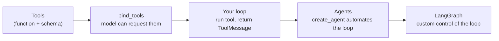

# Tools and Toolkits

> 📚 **Before you start**
>
> - [Why Runnables Exist](../06-chains-and-runnables/why-runnables-exist.md), because a tool is a runnable too.
> - [Structured Output with Pydantic and JSON Schema](../05-structured-output-and-output-parsers/structured-output-with-pydantic-and-json-schema.md), because tool arguments are described with the same JSON Schema.
> - [Data Connectors and API Integrations](../02-langchain-foundations/data-connectors-and-api-integrations.md), where you saw an API exposed "as a tool or as a runnable".

## Introduction

Ask a chat model "What's the status of PNR 4521876390?" and the best it can do is say it doesn't know, or worse, invent an answer. The model has never seen your PNR. It can't open the railway's website, can't do exact arithmetic reliably, and can't book anything. It can only produce text.

**Tools** fix that. A tool is a function your code can run, described to the model so precisely (a name, a purpose, the arguments it takes) that the model can **ask** for it to be called with the right arguments. Your code runs it and hands back the result, and the model uses the result in its answer. Fresh data, exact calculations and real actions all come through tools.

This lesson explains what a tool is in LangChain, how the model "sees" one, what makes a tool easy for a model to use correctly, and what **toolkits** (bundles of related tools) are. The next lessons cover ready-made tools, writing your own in three ways, the calling loop with `bind_tools`, and hiding arguments the model shouldn't control.

> 💡 **Key Insight**
>
> A tool has two halves: **a function** that does the work, and **a schema** (name, description, argument JSON Schema) that tells the model when and how to use it. The model only ever sees the schema and only ever *requests* a call; your code decides whether and how to run it. Good tools are mostly good schemas.

---

## Core Explanation

### 1. What a tool is

In LangChain a tool is an object with:

| Part | Example | Who uses it |
|---|---|---|
| `name` | `"pnr_status"` | The model, to say which tool it wants |
| `description` | `"Get the booking status of an Indian Railways PNR."` | The model, to decide *when* to use it |
| `args` schema | `{"pnr": {"type": "string"}}` | The model, to produce valid arguments |
| The function | your Python code | Your app, to do the work |

The easiest way to make one is the `@tool` decorator on a function with type hints and a docstring:

```python
from langchain_core.tools import tool

BOOKINGS = {"4521876390": {"train": "12951 Mumbai Rajdhani", "status": "CNF", "coach": "B3", "berth": 34},
            "8123004417": {"train": "12627 Karnataka Express", "status": "WL 12", "coach": None, "berth": None}}

@tool
def pnr_status(pnr: str) -> str:
    """Get the booking status of an Indian Railways PNR (a 10-digit number)."""
    b = BOOKINGS.get(pnr)
    if b is None:
        return f"No booking found for PNR {pnr}."
    seat = f", coach {b['coach']} berth {b['berth']}" if b["coach"] else ""
    return f"{b['train']}: {b['status']}{seat}"

print(type(pnr_status).__name__)
print("name:", pnr_status.name)
print("description:", pnr_status.description)
print("args:", pnr_status.args)
```

Output:

```
StructuredTool
name: pnr_status
description: Get the booking status of an Indian Railways PNR (a 10-digit number).
args: {'pnr': {'title': 'Pnr', 'type': 'string'}}
```

The decorator read the function's **name** for the tool name, its **docstring** for the description, and its **type hints** for the argument schema. You wrote a normal function; LangChain built the schema.

### 2. A tool is a runnable

Tools have the full runnable interface. You can call one directly with a dict of arguments, which is how you test it:

```python
print(pnr_status.invoke({"pnr": "4521876390"}))
print(pnr_status.batch([{"pnr": "8123004417"}, {"pnr": "1111111111"}]))
```

Output:

```
12951 Mumbai Rajdhani: CNF, coach B3 berth 34
['12627 Karnataka Express: WL 12', 'No booking found for PNR 1111111111.']
```

And arguments are **validated** against the schema before your function runs. Passing the wrong type (a number where text is expected, or a missing argument) raises a validation error, so your function only ever sees clean inputs:

```python
try:
    pnr_status.invoke({"number": "4521876390"})
except Exception as e:
    print(type(e).__name__, "-", e.errors()[0]["loc"], e.errors()[0]["msg"])
```

Output:

```
ValidationError - ('pnr',) Field required
```

### 3. What the model actually sees

When you give tools to a model (with `bind_tools`, two lessons from now), LangChain converts each one into the JSON format the provider's API expects. You can see the provider-neutral version with `convert_to_openai_tool`, the same function the stand-in models in module 5 used:

```python
import json
from langchain_core.utils.function_calling import convert_to_openai_tool

print(json.dumps(convert_to_openai_tool(pnr_status), indent=2))
```

Output:

```
{
  "type": "function",
  "function": {
    "name": "pnr_status",
    "description": "Get the booking status of an Indian Railways PNR (a 10-digit number).",
    "parameters": {
      "properties": {
        "pnr": {
          "type": "string"
        }
      },
      "required": [
        "pnr"
      ],
      "type": "object"
    }
  }
}
```

That JSON is **all** the model knows about your tool. It never sees your code. If the description is vague or the argument names are confusing, the model will call the tool at the wrong time or with the wrong arguments, however good the function is.

![The tool-calling loop. Define: a Python function with type hints and a docstring becomes a tool schema (name, description, JSON Schema of the arguments) via @tool, StructuredTool or BaseTool, and model.bind_tools sends the schemas with every request. Call: a HumanMessage goes to the model, which decides to answer directly or request tools; the AIMessage carries tool_calls with name, args and id, because the model never runs code; your code runs the tool with tool.invoke(tool_call), validating the arguments first, and returns a ToolMessage with the result and matching tool_call_id back to the model, which may call more tools. Answer: when the model needs no more tools, a final grounded AIMessage. Agents automate this loop.](/img/diagrams/langchain-complete-guide/tool-calling-loop.svg)

### 4. How a model uses a tool: a preview

Here's the loop in miniature, with a hand-written `AIMessage` standing in for the model's request. A tool call is a dict with the tool `name`, the `args` and an `id`:

```python
from langchain_core.messages import AIMessage

request = AIMessage(content="", tool_calls=[{"name": "pnr_status", "args": {"pnr": "4521876390"}, "id": "call_7"}])
call = request.tool_calls[0]
result = pnr_status.invoke(call)          # pass the whole tool call...
print(repr(result))                       # ...and get a ToolMessage back
```

Output:

```
ToolMessage(content='12951 Mumbai Rajdhani: CNF, coach B3 berth 34', name='pnr_status', tool_call_id='call_7')
```

When you invoke a tool with a **tool call** (rather than plain arguments), it returns a `ToolMessage` carrying the result and the same `tool_call_id`, ready to send back to the model so it can write the final answer: "Your Mumbai Rajdhani booking is confirmed: coach B3, berth 34." [Tool Calling with bind_tools](../../langchain-complete-guide/course.md#m7) builds the full loop with a model.

### 5. Designing tools a model can use well

Because the schema is all the model sees, tool design is mostly writing:

| Principle | Weak | Strong |
|---|---|---|
| **Specific name** | `search`, `get_data` | `pnr_status`, `trains_between_stations` |
| **Description says when to use it** | "PNR tool" | "Get the booking status of an Indian Railways PNR (a 10-digit number)." |
| **Clear argument names and types** | `x: str` | `pnr: str`, `travel_date: date` |
| **Constrained values** | `quota: str` | `quota: Literal["GN", "TQ", "LD"]` |
| **Small, focused tools** | one `railway(action, ...)` tool | `pnr_status`, `fare`, `seat_availability` |
| **Short, useful results** | a 5,000-line JSON dump | "CNF, coach B3 berth 34" |
| **Errors as helpful text** | a stack trace | "No booking found for PNR 1111111111." |

Two more rules matter as much:

- **Fewer tools is better.** Models choose well among 5 to 10 tools and worse among 50. Give each request only the tools it needs.
- **Tools act in the real world.** A tool that books tickets or sends money must check permissions and limits in its own code, never trusting that the model asked "correctly". Treat tool arguments as untrusted input, just like form data from a website. (The [Agent Security and Safety](../../agent-security-and-safety/course.md) course covers this in depth.)

### 6. Toolkits: bundles of related tools

A **toolkit** is a group of tools designed to work together, usually sharing a connection or configuration: a database toolkit whose tools list tables, show a schema and run a query against the same database; a file toolkit whose tools read, write and list files inside one folder. In LangChain a toolkit is a `BaseToolkit` subclass with a `get_tools()` method.

You can write your own in a few lines. Here, a railway toolkit shares one bookings source among its tools:

```python
from langchain_core.tools import BaseToolkit, BaseTool

FARES = {("NDLS", "BCT"): {"SL": 755, "3A": 1985, "2A": 2840}}

class RailwayToolkit(BaseToolkit):
    """Tools for a railway helpdesk, sharing one data source."""
    bookings: dict

    def get_tools(self) -> list[BaseTool]:
        bookings = self.bookings

        @tool
        def pnr_status(pnr: str) -> str:
            """Get the booking status of an Indian Railways PNR (a 10-digit number)."""
            b = bookings.get(pnr)
            return f"{b['train']}: {b['status']}" if b else f"No booking found for PNR {pnr}."

        @tool
        def fare(source: str, destination: str, travel_class: str = "SL") -> str:
            """Get the ticket fare in rupees between two station codes (e.g. NDLS, BCT) for a class (SL, 3A, 2A)."""
            f = FARES.get((source.upper(), destination.upper()), {}).get(travel_class.upper())
            return f"₹{f}" if f else "Fare not available for that route or class."

        return [pnr_status, fare]

tools = RailwayToolkit(bookings=BOOKINGS).get_tools()
print([t.name for t in tools])
print(tools[1].invoke({"source": "ndls", "destination": "bct", "travel_class": "3A"}))
```

Output:

```
['pnr_status', 'fare']
₹1985
```

LangChain's integration packages ship many ready-made toolkits. Two common ones from `langchain-community`:

```python
# not-run: needs `pip install langchain-community langchain-anthropic` (and a database file for SQL)
from langchain.chat_models import init_chat_model
from langchain_community.agent_toolkits import FileManagementToolkit, SQLDatabaseToolkit
from langchain_community.utilities import SQLDatabase

files = FileManagementToolkit(root_dir="./workspace", selected_tools=["read_file", "list_directory"])
print([t.name for t in files.get_tools()])

db = SQLDatabase.from_uri("sqlite:///railway.db")
sql = SQLDatabaseToolkit(db=db, llm=init_chat_model("anthropic:claude-opus-5-5"))
print([t.name for t in sql.get_tools()])
```

Example output:

```
['read_file', 'list_directory']
['sql_db_query', 'sql_db_schema', 'sql_db_list_tables', 'sql_db_query_checker']
```

Notice `selected_tools` and `root_dir`: a good toolkit lets you **limit** what it can do. Giving a model a write-file or run-SQL tool on production data without limits is how accidents happen.

Tools also come from **MCP servers**: the Model Context Protocol is a standard way for apps to offer tools to any AI client, and LangChain can load an MCP server's tools as ordinary LangChain tools. The [Model Context Protocol (MCP)](../../model-context-protocol-mcp/course.md) course covers it.

### 7. Where tools fit



This module covers the first three boxes: tools, `bind_tools` and running the loop yourself. Agents built with `create_agent` (which runs the loop for you) get a preview at the end of the tool-calling lesson, and the [LangGraph course](../../langgraph-complete-guide/course.md) builds agents step by step.

---

## Try It Yourself

1. **Inspect a tool.** Write a `@tool` called `platform_number(train_number: str, station: str) -> str` that returns `"Platform 4"` for any input. Print its name, description and `args`.
2. **Improve a description.** This tool has a weak schema: `@tool def lookup(q: str) -> str: """Lookup."""`. Rewrite it for looking up a station code from a city name (for example "Pune" gives "PUNE", "Mumbai" gives "CSMT"), with a better name, description and argument name. Test it.
3. **Tool call to message.** Create an `AIMessage` with a tool call to your `fare` tool from the toolkit (`NDLS` to `BCT`, class `2A`, id `"call_9"`), invoke the tool with it, and print the `ToolMessage`'s `content` and `tool_call_id`.

<details>
<summary>Show answers</summary>

**1.**

```python
@tool
def platform_number(train_number: str, station: str) -> str:
    """Get the expected platform number for a train at a station."""
    return "Platform 4"

print(platform_number.name, "|", platform_number.description, "|", list(platform_number.args))
```

Output:

```
platform_number | Get the expected platform number for a train at a station. | ['train_number', 'station']
```

**2.**

```python
CODES = {"pune": "PUNE", "mumbai": "CSMT", "delhi": "NDLS", "chennai": "MAS"}

@tool
def station_code(city: str) -> str:
    """Get the main Indian Railways station code for a city name, e.g. 'Pune' -> 'PUNE'."""
    return CODES.get(city.strip().lower(), f"No station code known for {city}.")

print(station_code.invoke({"city": "Mumbai"}), station_code.invoke({"city": "Shimla"}))
```

Output:

```
CSMT No station code known for Shimla.
```

**3.**

```python
fare_tool = tools[1]
msg = AIMessage(content="", tool_calls=[{"name": "fare", "args": {"source": "NDLS", "destination": "BCT", "travel_class": "2A"}, "id": "call_9"}])
out = fare_tool.invoke(msg.tool_calls[0])
print(out.content, out.tool_call_id)
```

Output:

```
₹2840 call_9
```

</details>

---

## Real-World Examples

- **Travel apps** give models tools for PNR status, fares, seat availability and booking, with the booking tool requiring a separate user confirmation.
- **Banking assistants** expose read-only tools (balance, last 5 transactions) to the model and keep money-moving actions behind a human or OTP step.
- **Data teams** use SQL toolkits with read-only database users, so a model can answer "how many orders from Jaipur last week?" without being able to change data.
- **Internal copilots** load tools from MCP servers (ticketing, documentation search) so the same tools work in several AI clients.

---

## Common Misconceptions

### "The model runs the tool"

The model only produces a request (name, arguments, id). Your code runs the tool, which is why you can validate, log, limit or refuse it.

### "A tool needs a special class"

A normal function with type hints and a docstring plus `@tool` is enough for most tools.

### "More tools make a model more capable"

Past a handful, models pick the wrong tool more often. Give each task the tools it needs.

### "Validation of arguments is the model's job"

LangChain validates arguments against the schema, and your function should still check business rules (limits, permissions).

---

## Interview Relevance

*"What is a tool in LangChain and how does a model use it?"* A strong answer: a tool pairs a function with a schema (name, description, JSON Schema arguments), usually built by `@tool` from type hints and the docstring; it's a runnable, so it can be invoked and batched, and invoking it with a tool call returns a `ToolMessage`. Models see only the schema; with `bind_tools` they emit `tool_calls`, your code runs the tool and returns results. Mention design (specific names, descriptions that say when to use the tool, constrained args, concise results, errors as text), keeping the tool count small, treating arguments as untrusted, toolkits as groups of tools sharing config (`BaseToolkit.get_tools()`), and MCP as another tool source.

---

## Key Takeaways

- **A tool = function + schema**; `@tool` builds the schema from type hints and the docstring.
- **Tools are runnables**: `invoke` with args returns the result; with a tool call it returns a `ToolMessage`.
- **The model sees only the schema** and only requests calls; your code runs them.
- **Design matters**: specific names, "when to use" descriptions, constrained args, short results, few tools.
- **Toolkits bundle related tools** with shared configuration; limit what they can do.

---

**Up next:** [Built-in Tools](built-in-tools.md)
