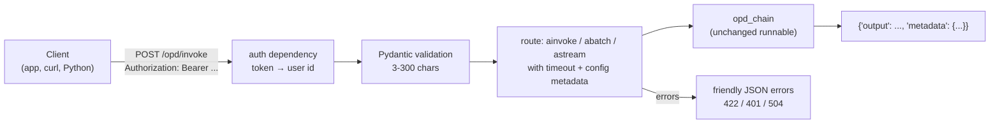

# Lab: Deploy a Chain as an API (LangServe and Its Modern Replacement)

> 📚 **Before you start**
>
> - [LangServe Deployment](langserve-deployment.md), for the endpoints and why LangServe is deprecated.
> - [LangSmith Monitoring](langsmith-monitoring.md), for run names, tags and metadata.
> - [APIs and FastAPI Fundamentals](../../apis-and-apps-fastapi-streamlit-and-docker/course.md#m2), for routes and Pydantic request models.

## What You'll Build

You'll deploy **OPD Mitra**, the hospital helpdesk chain, as a web API twice:

1. **The LangServe way** (legacy): `add_routes` in a few lines, shown so you can recognise and maintain it.
2. **The modern way**: your own FastAPI app that offers the same contract LangServe did (`/invoke`, `/batch`, `/stream`, `/input_schema`, `/output_schema`) plus what LangServe left to you: authentication with the user id taken from the token, input limits, timeouts, friendly errors, trace metadata and a health check. You'll test every endpoint with FastAPI's `TestClient`, then build a tiny client that makes the remote API usable as a runnable, the job `RemoteRunnable` used to do.



> 💡 **Key Insight**
>
> An API for a chain is a thin, well-tested **adapter**: validate the request, attach who the user is (from the token, not the body), call the runnable with a timeout and trace config, and translate the result or error into HTTP. Keep the chain itself free of HTTP concerns, so the same chain runs in tests, notebooks and production.

---

## Step 1: The Chain

The chain answers from a timetable lookup. The stand-in model streams its answer word by word, as real models do, so the streaming endpoint has something to stream:

```python
from langchain_core.language_models import BaseChatModel
from langchain_core.messages import AIMessage, AIMessageChunk
from langchain_core.outputs import ChatGeneration, ChatGenerationChunk, ChatResult
from langchain_core.prompts import ChatPromptTemplate
from langchain_core.output_parsers import StrOutputParser
from langchain_core.runnables import RunnableLambda, RunnablePassthrough

TIMETABLE = {"cardiology": "Mon-Sat 9:00-13:00, Dr. Rao", "dermatology": "Tue/Thu/Sat 10:00-14:00, Dr. Fatima",
             "orthopaedics": "Mon/Wed/Fri 11:00-15:00, Dr. Iyer"}

def lookup(d):
    dept = next((k for k in TIMETABLE if k in d["question"].lower()), None)
    return f"{dept}: {TIMETABLE[dept]}" if dept else "none"

class OpdModel(BaseChatModel):
    """Offline stand-in: answers from the timetable entry in the system message, streaming word by word."""
    @property
    def _llm_type(self):
        return "opd-model"

    def _answer(self, messages):
        entry = messages[0].content.split("Timetable entry: ")[1]
        if entry == "none":
            return "Sorry, I couldn't find that department. Please call the help desk at extension 100."
        dept, times = entry.split(": ", 1)
        return f"{dept.title()} OPD: {times}."

    def _generate(self, messages, stop=None, run_manager=None, **kwargs):
        return ChatResult(generations=[ChatGeneration(message=AIMessage(self._answer(messages)))])

    def _stream(self, messages, stop=None, run_manager=None, **kwargs):
        words = self._answer(messages).split(" ")
        for i, w in enumerate(words):
            yield ChatGenerationChunk(message=AIMessageChunk(content=w + (" " if i < len(words) - 1 else "")))

prompt = ChatPromptTemplate.from_messages([
    ("system", "You are OPD Mitra. Answer only from the timetable. Timetable entry: {entry}"),
    ("human", "{question}"),
])
opd_chain = (RunnablePassthrough.assign(entry=RunnableLambda(lookup)) | prompt | OpdModel() | StrOutputParser()
             ).with_config(run_name="opd_chain")

print(opd_chain.invoke({"question": "When is cardiology OPD?"}))
print(list(opd_chain.stream({"question": "Dermatology days?"}))[:4])
```

Output:

```
Cardiology OPD: Mon-Sat 9:00-13:00, Dr. Rao.
['Dermatology ', 'OPD: ', 'Tue/Thu/Sat ', '10:00-14:00, ']
```

The chain knows nothing about HTTP. Tested on its own, it's ready to serve.

## Step 2: The LangServe Way (Legacy)

For reference, this is the whole LangServe server:

```python
# not-run: legacy; needs `pip install "langserve[all]" uvicorn`
from fastapi import FastAPI
from langserve import add_routes

app = FastAPI(title="OPD Mitra (LangServe)")
add_routes(app, opd_chain, path="/opd")
# run with: uvicorn server:app --port 8000, then open http://localhost:8000/opd/playground/
```

Three lines gave you `/opd/invoke`, `/opd/batch`, `/opd/stream`, `/opd/stream_log`, `/opd/astream_events`, schema endpoints and a playground. What it did **not** give you: authentication, per-user identity, input limits, timeouts or a health check. Those are exactly what you'll add in the modern version, while keeping LangServe's request and response shapes (`{"input": ...}` in, `{"output": ...}` out) so existing clients would keep working.

## Step 3: Request and Response Models

```python
from pydantic import BaseModel, Field

class OpdInput(BaseModel):
    question: str = Field(min_length=3, max_length=300, description="The patient's question")

class InvokeRequest(BaseModel):
    input: OpdInput

class BatchRequest(BaseModel):
    inputs: list[OpdInput] = Field(min_length=1, max_length=20)

class InvokeResponse(BaseModel):
    output: str
    metadata: dict

class BatchResponse(BaseModel):
    output: list[str]
    metadata: dict

print(InvokeRequest.model_json_schema()["$defs"]["OpdInput"]["properties"]["question"])
```

Output:

```
{'description': "The patient's question", 'maxLength': 300, 'minLength': 3, 'title': 'Question', 'type': 'string'}
```

The `max_length` limits protect your token budget; `BatchRequest` caps a batch at 20 questions so one request can't run up a huge bill.

## Step 4: Authentication and Trace Config

Clients send `Authorization: Bearer <token>`. A FastAPI **dependency** turns the token into a user, or rejects the request. Here a dict stands in for your real token check (a database or an identity provider):

```python
from fastapi import Depends, Header, HTTPException

TOKENS = {"tok-reception-01": {"user_id": "staff-17", "role": "reception"},
          "tok-app-9f3": {"user_id": "patient-app", "role": "app"}}

def current_user(authorization: str = Header(default="")) -> dict:
    token = authorization.removeprefix("Bearer ").strip()
    user = TOKENS.get(token)
    if user is None:
        raise HTTPException(status_code=401, detail="Missing or invalid token")
    return user

def run_config(user: dict, endpoint: str) -> dict:
    """Trace config built on the server: who and what, never taken from the request body."""
    return {"run_name": f"opd_api_{endpoint}", "tags": ["opd-api", "v1"],
            "metadata": {"user_id": user["user_id"], "role": user["role"]}}

print(run_config(current_user("Bearer tok-app-9f3"), "invoke"))
```

Output:

```
{'run_name': 'opd_api_invoke', 'tags': ['opd-api', 'v1'], 'metadata': {'user_id': 'patient-app', 'role': 'app'}}
```

This is LangServe's `per_req_config_modifier` idea, done explicitly: the identity in traces (and anything the chain uses to decide what a user may see) comes from the verified token.

## Step 5: The App

Now the routes. Each one calls the chain's async method with a timeout, and turns a timeout into a 504 error instead of a hanging request:

```python
import asyncio, json
from fastapi import FastAPI
from fastapi.responses import StreamingResponse

TIMEOUT_S = 20
app = FastAPI(title="OPD Mitra API", version="1.0")

@app.get("/health")
def health():
    return {"status": "ok"}

@app.post("/opd/invoke", response_model=InvokeResponse)
async def opd_invoke(body: InvokeRequest, user: dict = Depends(current_user)):
    try:
        out = await asyncio.wait_for(opd_chain.ainvoke(body.input.model_dump(), config=run_config(user, "invoke")), TIMEOUT_S)
    except asyncio.TimeoutError:
        raise HTTPException(status_code=504, detail="The assistant took too long. Please try again.")
    return InvokeResponse(output=out, metadata={"user_id": user["user_id"]})

@app.post("/opd/batch", response_model=BatchResponse)
async def opd_batch(body: BatchRequest, user: dict = Depends(current_user)):
    inputs = [i.model_dump() for i in body.inputs]
    config = {**run_config(user, "batch"), "max_concurrency": 5}
    outs = await asyncio.wait_for(opd_chain.abatch(inputs, config=config), TIMEOUT_S)
    return BatchResponse(output=outs, metadata={"count": len(outs)})

@app.post("/opd/stream")
async def opd_stream(body: InvokeRequest, user: dict = Depends(current_user)):
    async def events():
        async for chunk in opd_chain.astream(body.input.model_dump(), config=run_config(user, "stream")):
            yield f"event: data\ndata: {json.dumps(chunk)}\n\n"
        yield "event: end\n\n"
    return StreamingResponse(events(), media_type="text/event-stream")

@app.get("/opd/input_schema")
def opd_input_schema():
    return OpdInput.model_json_schema()

@app.get("/opd/output_schema")
def opd_output_schema():
    return opd_chain.output_schema.model_json_schema()

print(sorted(r.path for r in app.routes if r.path.startswith("/opd") or r.path == "/health"))
```

Output:

```
['/health', '/opd/batch', '/opd/input_schema', '/opd/invoke', '/opd/output_schema', '/opd/stream']
```

The streaming route uses **server-sent events** (SSE), the same format LangServe used: each chunk is an `event: data` line followed by a `data:` line with JSON, and an `end` event closes the stream. Browsers read SSE with `EventSource` or `fetch`, and Python with `httpx`.

## Step 6: Test Every Endpoint

`TestClient` sends real HTTP requests to the app in-process, so you can test without running a server:

```python
from fastapi.testclient import TestClient

client = TestClient(app)
auth = {"Authorization": "Bearer tok-reception-01"}

r = client.post("/opd/invoke", json={"input": {"question": "When is cardiology OPD?"}}, headers=auth)
print("invoke:", r.status_code, r.json())

r = client.post("/opd/batch", json={"inputs": [{"question": "Orthopaedics timings?"}, {"question": "Is there an ENT OPD?"}]}, headers=auth)
print("batch: ", r.status_code, r.json()["output"])

with client.stream("POST", "/opd/stream", json={"input": {"question": "Dermatology days?"}}, headers=auth) as resp:
    data = [json.loads(line[len("data: "):]) for line in resp.iter_lines() if line.startswith("data: ")]
print("stream:", resp.status_code, len(data), "chunks ->", "".join(data))

print("schema:", client.get("/opd/input_schema").json()["required"], client.get("/opd/output_schema").json())
```

Output:

```
invoke: 200 {'output': 'Cardiology OPD: Mon-Sat 9:00-13:00, Dr. Rao.', 'metadata': {'user_id': 'staff-17'}}
batch:  200 ['Orthopaedics OPD: Mon/Wed/Fri 11:00-15:00, Dr. Iyer.', "Sorry, I couldn't find that department. Please call the help desk at extension 100."]
stream: 200 7 chunks -> Dermatology OPD: Tue/Thu/Sat 10:00-14:00, Dr. Fatima.
schema: ['question'] {'title': 'StrOutputParserOutput', 'type': 'string'}
```

And the failure cases, which matter as much as the happy path:

```python
cases = {
    "no token": client.post("/opd/invoke", json={"input": {"question": "Cardiology?"}}),
    "bad token": client.post("/opd/invoke", json={"input": {"question": "Cardiology?"}}, headers={"Authorization": "Bearer nope"}),
    "too short": client.post("/opd/invoke", json={"input": {"question": "?"}}, headers=auth),
    "wrong shape": client.post("/opd/invoke", json={"question": "Cardiology?"}, headers=auth),
    "batch too big": client.post("/opd/batch", json={"inputs": [{"question": "Cardiology?"}] * 21}, headers=auth),
}
for name, resp in cases.items():
    detail = resp.json()["detail"]
    print(f"{name:<14} {resp.status_code}  {detail if isinstance(detail, str) else detail[0]['msg']}")
```

Output:

```
no token       401  Missing or invalid token
bad token      401  Missing or invalid token
too short      422  String should have at least 3 characters
wrong shape    422  Field required
batch too big  422  List should have at most 20 items after validation, not 21
```

Every bad request is rejected **before** the chain runs, so it costs no tokens. "wrong shape" is the LangServe envelope at work: the question must be inside `"input"`.

## Step 7: Timeouts

A slow model shouldn't hang the client. Swap in a deliberately slow chain for one test and shorten the timeout. (The routes look up the module-level `opd_chain` and `TIMEOUT_S` each time they run, so reassigning them is enough.)

```python
async def slow(d):
    await asyncio.sleep(0.5)
    return "too late"

saved_chain, saved_timeout = opd_chain, TIMEOUT_S
opd_chain, TIMEOUT_S = RunnableLambda(slow), 0.1
r = client.post("/opd/invoke", json={"input": {"question": "Cardiology?"}}, headers=auth)
print(r.status_code, r.json())
opd_chain, TIMEOUT_S = saved_chain, saved_timeout
```

Output:

```
504 {'detail': 'The assistant took too long. Please try again.'}
```

In production, also set the model's own `timeout` and `max_retries` (from [Chat Models](../03-models/chat-models.md)) below the API timeout, so a retry can still finish in time.

## Step 8: A Client That Behaves Like a Runnable

LangServe's `RemoteRunnable` made the remote chain feel local. The same idea in a few lines: a `RunnableLambda` that posts to the API. Because it's a runnable, it gets `batch`, `with_retry` and composition for free:

```python
def remote_opd(http, token):
    def call(question_dict):
        r = http.post("/opd/invoke", json={"input": question_dict}, headers={"Authorization": f"Bearer {token}"})
        r.raise_for_status()
        return r.json()["output"]
    return RunnableLambda(call).with_config(run_name="remote_opd")

remote = remote_opd(client, "tok-app-9f3")          # with a real server: httpx.Client(base_url="https://...")
print(remote.invoke({"question": "Cardiology OPD timings?"}))

shout = remote | (lambda text: text.upper())
print(shout.invoke({"question": "Orthopaedics?"}))
```

Output:

```
Cardiology OPD: Mon-Sat 9:00-13:00, Dr. Rao.
ORTHOPAEDICS OPD: MON/WED/FRI 11:00-15:00, DR. IYER.
```

`TestClient` is an `httpx` client underneath, so swapping in `httpx.Client(base_url="https://opd.example-hospital.in")` makes this work against a real deployment unchanged.

## Step 9: Run It for Real

Save Steps 1, 3, 4 and 5 as `server.py` (with the real model swapped in) and start it with uvicorn:

```bash
pip install fastapi uvicorn langchain langchain-anthropic
export ANTHROPIC_API_KEY=...                 # from your secrets manager in production
export LANGSMITH_TRACING=true LANGSMITH_API_KEY=... LANGSMITH_PROJECT=opd-mitra-prod
uvicorn server:app --host 0.0.0.0 --port 8000 --workers 2
```

Then from another terminal:

```bash
curl -s -X POST http://localhost:8000/opd/invoke \
  -H "Authorization: Bearer tok-reception-01" -H "Content-Type: application/json" \
  -d '{"input": {"question": "When is cardiology OPD?"}}'
curl -N -X POST http://localhost:8000/opd/stream \
  -H "Authorization: Bearer tok-reception-01" -H "Content-Type: application/json" \
  -d '{"input": {"question": "Dermatology days?"}}'
```

And a minimal container for deployment:

```dockerfile
FROM python:3.12-slim
WORKDIR /app
COPY requirements.txt .
RUN pip install --no-cache-dir -r requirements.txt
COPY server.py .
CMD ["uvicorn", "server:app", "--host", "0.0.0.0", "--port", "8000"]
```

Every request now shows up in LangSmith as `opd_api_invoke`, `opd_api_batch` or `opd_api_stream`, tagged `opd-api` and `v1`, with the user id in metadata, so you can find any patient-facing answer from a complaint.

If this assistant grows into an agent with conversations, approvals and long-running tasks, move it to the Agent Server, covered in the LangGraph course's [Deploying and Running LangGraph Apps](../../langgraph-complete-guide/10-deployment-and-observability/deploying-and-running-langgraph-apps.md).

---

## Try It Yourself

1. **Role-based access.** Allow `/opd/batch` only for the `reception` role. Return 403 for others, and test with both tokens.
2. **Version the API.** Add the chain's version to every response's `metadata` (`"chain_version": "2026-10-01"`) and test it.
3. **Count streamed chunks.** Write a test that asserts the `/opd/stream` endpoint's chunks, joined, equal the `/opd/invoke` output for the same question.

<details>
<summary>Show answers</summary>

**1.**

```python
def reception_only(user: dict = Depends(current_user)) -> dict:
    if user["role"] != "reception":
        raise HTTPException(status_code=403, detail="Batch is for reception staff only")
    return user

@app.post("/opd/v2/batch", response_model=BatchResponse)
async def opd_batch_v2(body: BatchRequest, user: dict = Depends(reception_only)):
    outs = await opd_chain.abatch([i.model_dump() for i in body.inputs], config=run_config(user, "batch"))
    return BatchResponse(output=outs, metadata={"count": len(outs)})

body = {"inputs": [{"question": "Cardiology?"}]}
print(client.post("/opd/v2/batch", json=body, headers=auth).status_code,
      client.post("/opd/v2/batch", json=body, headers={"Authorization": "Bearer tok-app-9f3"}).status_code)
```

Output:

```
200 403
```

**2.**

```python
CHAIN_VERSION = "2026-10-01"

@app.post("/opd/v2/invoke", response_model=InvokeResponse)
async def opd_invoke_v2(body: InvokeRequest, user: dict = Depends(current_user)):
    out = await opd_chain.ainvoke(body.input.model_dump(), config=run_config(user, "invoke"))
    return InvokeResponse(output=out, metadata={"user_id": user["user_id"], "chain_version": CHAIN_VERSION})

print(client.post("/opd/v2/invoke", json={"input": {"question": "Cardiology?"}}, headers=auth).json()["metadata"])
```

Output:

```
{'user_id': 'staff-17', 'chain_version': '2026-10-01'}
```

**3.**

```python
q = {"input": {"question": "Orthopaedics timings?"}}
whole = client.post("/opd/invoke", json=q, headers=auth).json()["output"]
with client.stream("POST", "/opd/stream", json=q, headers=auth) as resp:
    pieces = [json.loads(l[6:]) for l in resp.iter_lines() if l.startswith("data: ")]
assert "".join(pieces) == whole
print("stream matches invoke:", len(pieces), "chunks")
```

Output:

```
stream matches invoke: 7 chunks
```

</details>

---

## What You've Learned

- **LangServe's `add_routes`** generated a full API in three lines; it's deprecated, but its contract is a good template.
- **A modern chain API** is a FastAPI adapter: Pydantic request models with limits, an auth dependency, `ainvoke`/`abatch`/`astream` with timeouts, SSE streaming and schema endpoints.
- **Identity comes from the token**, and goes into trace metadata on the server side.
- **`TestClient`** tests every endpoint, including failure cases, without a running server.
- **A client wrapped as a runnable** composes like `RemoteRunnable` did.
- **uvicorn and Docker** run it for real; agents graduate to the Agent Server.

---

**Up next:** You've finished the LangChain Complete Guide. Continue with [Retrieval-Augmented Generation (RAG)](../../retrieval-augmented-generation-rag/course.md), where these chains get retrieval, and then the [LangGraph Complete Guide](../../langgraph-complete-guide/course.md).
