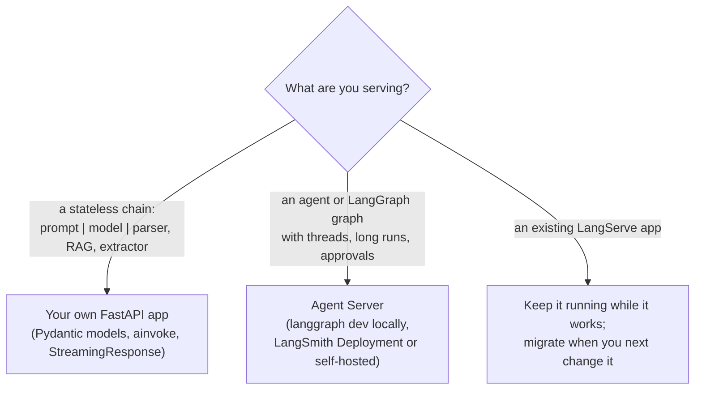

# LangServe Deployment (and What Replaced It)

> 📚 **Before you start**
>
> - [APIs and FastAPI Fundamentals](../../apis-and-apps-fastapi-streamlit-and-docker/course.md#m2), for routes, request bodies and running a FastAPI app.
> - [Chains, LCEL and Runnables](../06-chains-and-runnables/chains-lcel-and-runnables.md), for `invoke`, `batch`, `stream`, `input_schema` and config.
> - [LangSmith Monitoring](langsmith-monitoring.md), because a deployed chain should be traced.

## Introduction

Your chain works in a notebook. Now the hospital's mobile app, a WhatsApp integration and the reception desk's web page all need to use it. They aren't written in Python and they don't run on your laptop. They need an **HTTP API**: send a JSON request, get a JSON (or streamed) response.

**LangServe** was LangChain's answer: one function, `add_routes`, that turns any runnable into a set of FastAPI endpoints mirroring the runnable interface (`/invoke`, `/batch`, `/stream` and more), with a browser playground and a Python client that makes the remote chain look local. It was popular, it's in many tutorials and courses, and you'll meet it in existing codebases.

It's also **deprecated**. Since 18 November 2024 its README has recommended LangChain's agent server platform for new projects (then called LangGraph Platform, renamed LangSmith Deployment in late 2025), and the project accepts bug fixes but no new features. So this lesson does two things: it explains LangServe properly, because its design is a clean picture of what serving a runnable involves, and it shows the current options: **your own FastAPI app** (the next lab builds one) and the **Agent Server**.

> 💡 **Key Insight**
>
> Serving a runnable means mapping its interface to HTTP: `invoke` → `POST /invoke`, `batch` → `POST /batch`, `stream` → a streamed response, schemas → `GET` endpoints for input and output types. LangServe did this mapping automatically. Today you write the mapping in FastAPI yourself (a few dozen lines) or let the Agent Server do it for graphs and agents. The runnable itself never changes.

---

## Core Explanation

### 1. LangServe in one file

A LangServe server is a FastAPI app plus `add_routes` calls, one per runnable:

```python
# not-run: legacy; needs `pip install "langserve[all]" langchain-anthropic uvicorn` and ANTHROPIC_API_KEY
from fastapi import FastAPI
from langchain_core.prompts import ChatPromptTemplate
from langchain_core.output_parsers import StrOutputParser
from langchain_anthropic import ChatAnthropic
from langserve import add_routes

app = FastAPI(title="OPD Mitra API", version="1.0")

prompt = ChatPromptTemplate.from_template("Answer this hospital OPD question briefly: {question}")
opd_chain = prompt | ChatAnthropic(model="claude-opus-5-5") | StrOutputParser()

add_routes(app, opd_chain, path="/opd")

if __name__ == "__main__":
    import uvicorn
    uvicorn.run(app, host="0.0.0.0", port=8000)
```

Run the file, and the chain is a web service. `add_routes(app, runnable, path=...)` read the chain's input and output schemas (from the prompt's variables and the parser's output type) and generated validated endpoints for it.

### 2. The endpoints `add_routes` creates

For `path="/opd"`:

| Endpoint | Maps to | Body or response |
|---|---|---|
| `POST /opd/invoke` | `invoke` | `{"input": {...}, "config": {...}}` → `{"output": ..., "metadata": {...}}` |
| `POST /opd/batch` | `batch` | `{"inputs": [...]}` → `{"output": [...]}` |
| `POST /opd/stream` | `stream` | Server-sent events, one per output chunk |
| `POST /opd/stream_log` | `astream_log` | Streamed intermediate steps |
| `POST /opd/astream_events` | `astream_events` | Streamed events from every inner step |
| `GET /opd/input_schema` | `input_schema` | JSON Schema of the input |
| `GET /opd/output_schema` | `output_schema` | JSON Schema of the output |
| `GET /opd/config_schema` | `config_schema` | JSON Schema of configurable fields |
| `GET /opd/playground/` | | A web page for trying the chain with streaming output |

Any client can call it:

```bash
curl -X POST http://localhost:8000/opd/invoke \
  -H "Content-Type: application/json" \
  -d '{"input": {"question": "When does cardiology OPD open?"}}'
```

Example output:

```
{"output":"Cardiology OPD opens at 9 am, Monday to Saturday.","metadata":{"run_id":"...","feedback_tokens":[]}}
```

Note the **envelope**: inputs go under `"input"` and the result comes back under `"output"`. A FastAPI app gets interactive docs at `/docs` too.

### 3. The Python client: `RemoteRunnable`

LangServe's client makes the remote chain behave like a local runnable, so it can even be a step in another chain:

```python
# not-run: legacy; needs `pip install "langserve[client]"` and the server above running
from langserve import RemoteRunnable

opd = RemoteRunnable("http://localhost:8000/opd/")
print(opd.invoke({"question": "Is there a Sunday OPD?"}))
for chunk in opd.stream({"question": "Dermatology timings?"}):
    print(chunk, end="", flush=True)
```

Example output:

```
There is no regular OPD on Sunday; the emergency department is open 24 hours.
Dermatology OPD runs Tuesday, Thursday and Saturday from 10 am to 2 pm.
```

### 4. Configuration, auth and feedback

- **Config from the client.** Clients can pass `config` (tags, metadata, and configurable fields such as a model choice) in the request body. Which keys are accepted is controlled per route.
- **Auth.** Standard FastAPI dependencies protect the routes (`add_routes(app, chain, dependencies=[Depends(verify_token)])`). For per-user logic, such as "only search this user's documents", `add_routes` takes a `per_req_config_modifier` function that receives the raw request and can put the user's id into the config. That's the HTTP version of the injected arguments from [Injected Tool Arguments](../07-tools-and-tool-calling/injected-tool-arguments.md): the user id comes from the verified token, never from the request body.
- **Feedback.** With LangSmith tracing on, `enable_feedback_endpoint=True` lets clients send thumbs up/down against the run id returned in the response metadata.
- **CORS.** Browser apps on another domain need FastAPI's `CORSMiddleware`, as with any FastAPI app.

### 5. Why LangServe was deprecated

LangServe was designed for **stateless runnables**: one request in, one response out. As LLM apps became agents, they needed things a thin runnable-to-HTTP layer doesn't give:

- **Persistence**: conversations (threads) and checkpoints that survive restarts.
- **Long-running and background runs**: an agent that works for ten minutes shouldn't hold an HTTP request open.
- **Human-in-the-loop**: pause a run, wait for approval, resume.
- **Concurrency control**: what happens when a user sends a second message while the first is still running ("double texting").
- **Scheduled runs**, task queues and horizontal scaling.

Its README also notes that it's meant for simple runnables and points LangGraph users elsewhere. So LangChain built a dedicated server for agent workloads and recommended it instead.

Can you still use LangServe? The last release (0.3.3, October 2025) installs alongside `langchain-core` 1.x, and for a simple chain it works. But it gets no new features, so new projects should pick one of the current options.

### 6. Current option A: your own FastAPI app

For chains (stateless prompt → model → parser pipelines), the simplest modern approach is a small FastAPI app that does LangServe's mapping by hand. It's ordinary FastAPI code with Pydantic models for requests and responses, so you control the API shape, auth, errors and versioning. Here's the core, runnable offline with a fake model and FastAPI's `TestClient`:

```python
from fastapi import FastAPI
from fastapi.testclient import TestClient
from pydantic import BaseModel
from langchain_core.prompts import ChatPromptTemplate
from langchain_core.output_parsers import StrOutputParser
from langchain_core.language_models.fake_chat_models import FakeListChatModel

opd_chain = (ChatPromptTemplate.from_template("Answer this hospital OPD question briefly: {question}")
             | FakeListChatModel(responses=["Cardiology OPD opens at 9 am, Monday to Saturday."])
             | StrOutputParser())

class OpdQuestion(BaseModel):
    question: str

class OpdAnswer(BaseModel):
    answer: str

app = FastAPI(title="OPD Mitra API")

@app.post("/opd/invoke", response_model=OpdAnswer)
async def invoke(body: OpdQuestion) -> OpdAnswer:
    answer = await opd_chain.ainvoke({"question": body.question}, config={"run_name": "opd_api"})
    return OpdAnswer(answer=answer)

client = TestClient(app)
r = client.post("/opd/invoke", json={"question": "When does cardiology OPD open?"})
print(r.status_code, r.json())
print(client.post("/opd/invoke", json={"q": "missing field"}).status_code)
```

Output:

```
200 {'answer': 'Cardiology OPD opens at 9 am, Monday to Saturday.'}
422
```

`TestClient` calls the app in-process, exactly as an HTTP client would, so you can test the API without starting a server. The request body is validated by Pydantic (a missing `question` gets a 422 error), and `ainvoke` keeps the server responsive under load. The [lab](lab-deploy-a-chain-with-langserve.md) extends this to `/batch`, `/stream` and schema endpoints, matching what LangServe generated, plus error handling and auth.

Where this fits best: chains, RAG pipelines, extractors and classifiers; teams that already run FastAPI services; anyone who needs a custom API contract.

### 7. Current option B: the Agent Server and LangSmith Deployment

For LangGraph graphs and agents (including those from `create_agent`), LangChain's **Agent Server** exposes them over HTTP with persistence, threads, background runs, streaming, human-in-the-loop, cron jobs and double-texting control built in. You don't write endpoints; you describe the project in a `langgraph.json` file and run it locally with the `langgraph` CLI (`langgraph dev`), or deploy it to **LangSmith Deployment** (formerly LangGraph Platform) as a cloud, hybrid or self-hosted service. Clients use the LangGraph SDK.

That's covered properly, with code, in the LangGraph course's [Deploying and Running LangGraph Apps](../../langgraph-complete-guide/10-deployment-and-observability/deploying-and-running-langgraph-apps.md) lesson, after you've learned graphs.

### 8. Choosing



| | LangServe (legacy) | Your own FastAPI | Agent Server |
|---|---|---|---|
| Status | Deprecated, bug fixes only | Your code | Actively developed |
| Endpoints | Generated by `add_routes` | You write them | Generated from `langgraph.json` |
| Best for | Existing simple-chain services | Chains, custom APIs | Agents and graphs |
| Persistence, threads | No | You add it | Built in |
| Background runs, human-in-the-loop | No | You build it | Built in |
| Hosting | Anywhere FastAPI runs | Anywhere FastAPI runs | Docker anywhere, or LangSmith Deployment |

Whatever you choose, the production basics are the same: keys from environment variables or a secrets manager, authentication, timeouts and retries on model calls, rate limits per user, tracing (LangSmith or an alternative), a health-check endpoint, and a Docker image ([Docker and Cloud Deployment](../../apis-and-apps-fastapi-streamlit-and-docker/course.md#m9) covers that).


---

## Try It Yourself

1. **Read the contract.** Using the endpoint table, write the JSON body you'd send to LangServe's `/opd/batch` to ask two questions, and the shape of the response.
2. **Add a health check.** Add `GET /health` returning `{"status": "ok"}` to the FastAPI `app` above, and test it with `TestClient`.
3. **Add input limits.** Change `OpdQuestion` so `question` must be 3 to 300 characters. Test a 1-character question. What status code comes back, and why is the limit useful for an LLM API?

<details>
<summary>Show answers</summary>

**1.** Body: `{"inputs": [{"question": "Cardiology timings?"}, {"question": "Is there a Sunday OPD?"}]}`. Response: `{"output": ["...", "..."], "metadata": {...}}`, with outputs in the same order as the inputs.

**2.**

```python
@app.get("/health")
def health():
    return {"status": "ok"}

print(client.get("/health").json())
```

Output:

```
{'status': 'ok'}
```

**3.**

```python
from pydantic import Field

class LimitedQuestion(BaseModel):
    question: str = Field(min_length=3, max_length=300)

@app.post("/opd/v2/invoke", response_model=OpdAnswer)
async def invoke_v2(body: LimitedQuestion) -> OpdAnswer:
    return OpdAnswer(answer=await opd_chain.ainvoke({"question": body.question}))

print(client.post("/opd/v2/invoke", json={"question": "?"}).status_code)
```

Output:

```
422
```

422, a validation error, before the chain runs. Limits stop empty requests and stop someone pasting a whole book into your API, which would cost you tokens (and money) on every call.

</details>

---

## Real-World Examples

- **Many 2024-era LangChain services** still run on LangServe behind an API gateway; teams migrate them to plain FastAPI when they next change the chain.
- **Product teams** serve RAG chains from FastAPI with `/invoke` and `/stream` endpoints, Pydantic request models and LangSmith tracing, deployed as Docker containers.
- **Agent products** (research assistants, coding agents, support agents with approvals) run on the Agent Server for threads, background runs and human-in-the-loop.
- **Internal tools** call chains from other Python services over HTTP, sometimes with LangServe's `RemoteRunnable` in older code, or plain `httpx` today.

---

## Common Misconceptions

### "LangServe is the official way to deploy LangChain"

It was. It's deprecated; use FastAPI for chains or the Agent Server for agents and graphs.

### "Deploying means changing the chain"

The runnable stays the same. Deployment adds an HTTP layer, configuration, auth and tracing around it.

### "A FastAPI wrapper is too much work"

The core is a Pydantic model and an `async` route calling `ainvoke`. The lab builds a full LangServe-style API in under 100 lines.

### "The Agent Server is only for LangSmith's cloud"

It runs locally (`langgraph dev`), in your own Docker infrastructure, or on LangSmith Deployment.

---

## Interview Relevance

*"How would you deploy a LangChain chain as an API?"* A strong answer: historically LangServe's `add_routes(app, runnable, path=...)` generated FastAPI endpoints (`/invoke`, `/batch`, `/stream`, `/stream_log`, `/astream_events`, schema endpoints and a `/playground/`) with `RemoteRunnable` as the client; it's deprecated since November 2024 (bug fixes only) because it doesn't handle persistence, long-running or background runs, or human-in-the-loop. Today: for stateless chains, a FastAPI app with Pydantic request/response models, `ainvoke` and `StreamingResponse`; for agents and graphs, the Agent Server (`langgraph.json`, `langgraph dev`, LangSmith Deployment or self-hosted). In all cases: secrets in the environment, auth with the user id from the token, input limits, timeouts, rate limits, tracing and Docker.

---

## Key Takeaways

- **Serving = mapping the runnable interface to HTTP**; LangServe did it automatically with `add_routes`.
- **LangServe endpoints**: `/invoke`, `/batch`, `/stream`, `/stream_log`, `/astream_events`, schema endpoints, `/playground/`; **`RemoteRunnable`** is the client.
- **LangServe is deprecated** (since 18 November 2024): recognise and maintain it, don't start with it.
- **Chains → your own FastAPI app**; **agents and graphs → the Agent Server**.
- **The runnable doesn't change**; auth, limits, tracing and Docker go around it.

---

**Up next:** [Lab: Deploy a chain with LangServe](lab-deploy-a-chain-with-langserve.md)
