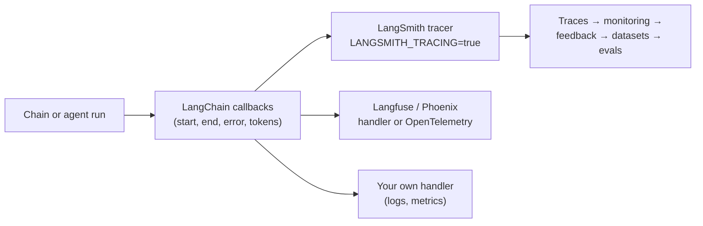

# LangSmith Monitoring

> 📚 **Before you start**
>
> - [Chains, LCEL and Runnables](../06-chains-and-runnables/chains-lcel-and-runnables.md), especially config (run name, tags, metadata, callbacks).
> - [Setting Up a LangChain Project and API Keys](../02-langchain-foundations/setting-up-a-langchain-project-and-api-keys.md), for environment variables and `.env` files.
> - [Tool Calling with bind_tools](../07-tools-and-tool-calling/tool-calling-with-bind-tools.md), for the multi-step runs you'll want to trace.

## Introduction

A hospital in Hyderabad launches "OPD Mitra", a chatbot that answers questions about outpatient timings, doctors and reports. On day three a patient complains that the bot said the cardiology OPD opens at 8 am; it opens at 9. Was it the prompt? The retrieved timetable? The model? A parser bug? Without a record of what happened inside that one request, you're guessing.

LLM apps fail in ways ordinary logs don't capture: the same input can give different outputs, a "wrong" answer raises no exception, and the cause can sit three steps back in a chain. **Observability** for LLM apps means recording every step of every run (inputs, outputs, prompts, tool calls, latency, tokens, errors) in a form you can search and replay. **LangSmith** is LangChain's platform for this, and it works with LangChain with almost no code.

This lesson covers turning tracing on, what a trace contains (and how to see the same structure offline), making traces findable with names, tags and metadata, tracing non-LangChain code, controlling what's recorded, monitoring cost and quality in production, feedback, datasets and evaluations, prompt versioning, and the alternatives.

> 💡 **Key Insight**
>
> A trace is the **run tree** of one request: the chain at the root, each step as a child, each model and tool call as a leaf, all with inputs, outputs, timings and tokens. LangChain already produces this tree through its callback system for every runnable; LangSmith is a destination for it. Set two environment variables and every chain you've built in this course is traced.

---

## Core Explanation

### 1. Turning tracing on

Create an account at LangSmith, make an API key, and set:

```bash
export LANGSMITH_TRACING=true
export LANGSMITH_API_KEY="<your-langsmith-api-key>"
export LANGSMITH_PROJECT="opd-mitra-dev"     # optional; otherwise traces go to "default"
# export LANGSMITH_ENDPOINT="https://eu.api.smith.langchain.com"   # only for EU-region accounts
```

That's all. Every `invoke`, `batch` and `stream` of every chain, model, retriever and tool is now sent to LangSmith in a background thread, so your app doesn't wait for it. Put the variables in your `.env` file like your model keys (never in code), and install the `langsmith` package, which comes with `langchain`.

Older tutorials use `LANGCHAIN_TRACING_V2`, `LANGCHAIN_API_KEY` and `LANGCHAIN_PROJECT`. Current versions still accept them, but the `LANGSMITH_` names are the ones to use.

### 2. What a trace contains

Under the hood, LangChain reports every step to **callback handlers**: "chain started", "model started", "model finished", "tool errored", and so on. LangSmith's tracer is one such handler. We can attach our own small handler to see exactly the tree LangSmith would receive, offline. First the chain, an OPD question answerer with a timetable lookup step:

```python
from langchain_core.prompts import ChatPromptTemplate
from langchain_core.output_parsers import StrOutputParser
from langchain_core.runnables import RunnableLambda, RunnablePassthrough
from langchain_core.language_models.fake_chat_models import GenericFakeChatModel
from langchain_core.messages import AIMessage

TIMETABLE = {"cardiology": "Mon-Sat 9:00-13:00, Dr. Rao", "dermatology": "Tue/Thu/Sat 10:00-14:00, Dr. Fatima"}

def lookup(d):
    dept = next((k for k in TIMETABLE if k in d["question"].lower()), None)
    return TIMETABLE.get(dept, "not found")

prompt = ChatPromptTemplate.from_messages([
    ("system", "Answer using only this timetable entry: {entry}"),
    ("human", "{question}"),
])
model = GenericFakeChatModel(messages=iter([
    AIMessage("Cardiology OPD runs Monday to Saturday, 9 am to 1 pm, with Dr. Rao.",
              usage_metadata={"input_tokens": 41, "output_tokens": 18, "total_tokens": 59}),
]))
opd_chain = RunnablePassthrough.assign(entry=RunnableLambda(lookup).with_config(run_name="timetable_lookup")) | prompt | model | StrOutputParser()
```

Now a handler that prints the run tree, with timing and token counts, as the chain runs:

```python
from langchain_core.callbacks import BaseCallbackHandler

class RunTreePrinter(BaseCallbackHandler):
    """Prints the tree of runs a tracer such as LangSmith records."""
    def __init__(self):
        self.depth = {}

    def _start(self, kind, name, run_id, parent_run_id, tags=None, metadata=None):
        d = self.depth.get(parent_run_id, -1) + 1
        self.depth[run_id] = d
        extra = {k: v for k, v in (metadata or {}).items() if k in ("patient_id", "channel")}
        print(f"{'  ' * d}{kind:<6}{name:<28}{extra}")

    def on_chain_start(self, serialized, inputs, *, run_id, parent_run_id=None, tags=None, metadata=None, **kw):
        self._start("chain", kw.get("name"), run_id, parent_run_id, tags, metadata)

    def on_chat_model_start(self, serialized, messages, *, run_id, parent_run_id=None, tags=None, metadata=None, **kw):
        self._start("llm", kw.get("name") or serialized.get("name"), run_id, parent_run_id, tags, metadata)

    def on_llm_end(self, response, *, run_id, **kw):
        usage = response.generations[0][0].message.usage_metadata
        print(f"{'  ' * self.depth[run_id]}      -> tokens in {usage['input_tokens']}, out {usage['output_tokens']}")

answer = opd_chain.invoke(
    {"question": "When is the cardiology OPD?"},
    config={"run_name": "opd_answer", "tags": ["opd", "v1"],
            "metadata": {"patient_id": "P-20931", "channel": "whatsapp"},
            "callbacks": [RunTreePrinter()]},
)
print(answer)
```

Output:

```
chain opd_answer                  {'patient_id': 'P-20931', 'channel': 'whatsapp'}
  chain RunnableAssign<entry>       {'patient_id': 'P-20931', 'channel': 'whatsapp'}
    chain RunnableParallel<entry>     {'patient_id': 'P-20931', 'channel': 'whatsapp'}
      chain timetable_lookup            {'patient_id': 'P-20931', 'channel': 'whatsapp'}
  chain ChatPromptTemplate          {'patient_id': 'P-20931', 'channel': 'whatsapp'}
  llm   GenericFakeChatModel        {'patient_id': 'P-20931', 'channel': 'whatsapp'}
        -> tokens in 41, out 18
  chain StrOutputParser             {'patient_id': 'P-20931', 'channel': 'whatsapp'}
Cardiology OPD runs Monday to Saturday, 9 am to 1 pm, with Dr. Rao.
```

The root run carries the name we gave it, `opd_answer`. `RunnablePassthrough.assign` shows up as two layers (`RunnableAssign` wrapping a `RunnableParallel`), with our renamed `timetable_lookup` step inside. Then come the prompt, the model (with its token counts) and the parser. That nesting is what you see in LangSmith's trace view, with a panel for each run showing its inputs, outputs, timing, tokens and cost. For the wrong-time complaint you'd open the trace, click `timetable_lookup` to see what entry was fetched, then `ChatPromptTemplate` to see the exact messages the model got, then the model run to see what it answered. In two minutes you know whether the data, the prompt or the model was wrong.

Notice that `patient_id` and `channel` reached **every** run: metadata set at the top flows down, which is what makes traces searchable.

### 3. Making traces easy to find

A busy app produces thousands of traces a day. Name and label them so you can filter:

| Setting | How | Use it for |
|---|---|---|
| Run name | `config={"run_name": "opd_answer"}` or `.with_config(run_name=...)` on a step | Readable names instead of `RunnableSequence` |
| Tags | `config={"tags": ["opd", "v1"]}` | Versions, features, A/B variants |
| Metadata | `config={"metadata": {"patient_id": ..., "channel": ...}}` | Ids to search by (user, session, tenant) |
| Thread grouping | metadata key `session_id`, `thread_id` or `conversation_id` | See a whole conversation as one thread |
| Project | `LANGSMITH_PROJECT` or `tracing_context(project_name=...)` | Separate dev, staging and prod |

Never put secrets or unnecessary personal data in metadata. Use internal ids (`P-20931`), not names or phone numbers.

### 4. Tracing code that isn't LangChain

LangChain components are traced automatically. For your own functions, or direct SDK calls, use the `@traceable` decorator from the `langsmith` package, and those functions appear in the same tree:

```python
# not-run: needs `pip install langsmith` plus LANGSMITH_TRACING and LANGSMITH_API_KEY
from langsmith import traceable

@traceable(run_type="tool", name="his_lookup")
def fetch_from_hospital_system(department: str) -> dict:
    ...  # call the hospital information system's API

@traceable(name="opd_pipeline")
def answer(question: str) -> str:
    entry = fetch_from_hospital_system("cardiology")   # child run
    return opd_chain.invoke({"question": question})     # LangChain runs nest under it too
```

`run_type` tells LangSmith how to display the run (`"llm"`, `"chain"`, `"tool"`, `"retriever"` and so on). For direct provider SDK calls, `langsmith.wrappers` has wrappers such as `wrap_anthropic` and `wrap_openai` that trace every call made through the wrapped client.

### 5. Controlling what's recorded

```python
# not-run: needs `pip install langsmith` plus LANGSMITH_API_KEY
import langsmith as ls

with ls.tracing_context(enabled=False):          # skip tracing for this block
    opd_chain.invoke({"question": "Test question"})

with ls.tracing_context(enabled=True, project_name="opd-mitra-evals"):   # trace to another project
    opd_chain.invoke({"question": "When is dermatology OPD?"})
```

More controls, all environment variables:

- **`LANGSMITH_HIDE_INPUTS=true` / `LANGSMITH_HIDE_OUTPUTS=true`** keep inputs or outputs out of traces (structure, timings and errors are still recorded). Important for health and financial data.
- **`LANGSMITH_TRACING_SAMPLING_RATE=0.1`** traces only 10% of runs, for high-traffic production.

In short-lived scripts (a batch job, a serverless function), make sure traces are sent before the process exits. LangChain provides `wait_for_all_tracers()` in `langchain_core.tracers.langchain` for this.

### 6. Monitoring in production

Individual traces answer "what happened in this request?". **Monitoring** answers "how is the app doing overall?". LangSmith builds dashboards from your traces for each project:

| Metric | Why it matters |
|---|---|
| Request volume and error rate | Outages, provider errors, parser failures |
| Latency (median and p99) | Slow tools or models; streaming helps perceived speed |
| Tokens and cost per run | Prompt or memory growth shows up as rising cost |
| Feedback scores | Real users' thumbs up/down over time |
| Breakdowns by tag or metadata | Compare `v1` against `v2`, WhatsApp against web |

You can set **alerts** on these (for example, error rate above 5% for 10 minutes) and **automation rules** that act on matching traces: send every thumbs-down trace to an annotation queue for a human to review, or add it to a dataset.

You can collect the same numbers locally with a callback handler, which is useful for tests. A tiny monitor that counts runs, errors and tokens:

```python
class Monitor(BaseCallbackHandler):
    def __init__(self):
        self.runs = self.errors = self.tokens = 0
    def on_llm_end(self, response, **kw):
        self.runs += 1
        self.tokens += response.generations[0][0].message.usage_metadata["total_tokens"]
    def on_chain_error(self, error, **kw):
        self.errors += 1

mon = Monitor()
replies = [AIMessage(f"Reply {i}", usage_metadata={"input_tokens": 40, "output_tokens": 10, "total_tokens": 50}) for i in range(3)]
monitored = prompt | GenericFakeChatModel(messages=iter(replies)) | StrOutputParser()
for q in ["When is cardiology?", "Dermatology days?", "Is there a Sunday OPD?"]:
    monitored.invoke({"question": q, "entry": "..."}, config={"callbacks": [mon]})
print(f"runs={mon.runs} errors={mon.errors} tokens={mon.tokens} avg={mon.tokens / mon.runs:.0f}")
```

Output:

```
runs=3 errors=0 tokens=150 avg=50
```

### 7. Feedback, datasets and evaluation

**Feedback** attaches a score to a run: a user's thumbs up, a doctor's correction, an automatic check. With the run's id (available from the traced run), the client records it:

```python
# not-run: needs `pip install langsmith` and LANGSMITH_API_KEY; run_id comes from the traced run
from langsmith import Client

client = Client()
client.create_feedback(run_id=run_id, key="patient_thumbs", score=0, comment="Wrong OPD time")
```

**Datasets and evaluation** turn "it seems better" into numbers. Collect examples (inputs and expected outputs, often taken from real traces, especially failures), and after every change to the prompt, model or code, run the chain on all of them and score the results. The evaluator is a plain function. Here's the idea offline, with an evaluator written the way LangSmith expects (`inputs`, `outputs`, `reference_outputs`):

```python
dataset = [
    {"inputs": {"question": "When is the cardiology OPD?"}, "outputs": {"must_mention": "9"}},
    {"inputs": {"question": "Which days is dermatology?"}, "outputs": {"must_mention": "Thu"}},
    {"inputs": {"question": "Is there a neurology OPD?"}, "outputs": {"must_mention": "not"}},
]

def mentions_key_fact(inputs: dict, outputs: dict, reference_outputs: dict) -> bool:
    return reference_outputs["must_mention"].lower() in outputs["answer"].lower()

def target(inputs: dict) -> dict:
    entry = lookup(inputs)                                  # the real lookup step
    reply = f"Timetable says: {entry}." if entry != "not found" else "Sorry, that department is not in the OPD timetable."
    return {"answer": reply}                                # stand-in for the chain's answer

scores = [mentions_key_fact(ex["inputs"], target(ex["inputs"]), ex["outputs"]) for ex in dataset]
print(scores, f"accuracy {sum(scores) / len(scores):.0%}")
```

Output:

```
[True, True, True] accuracy 100%
```

With LangSmith, the dataset lives in the platform and each run of the evaluation is stored as an **experiment** you can compare side by side with earlier ones:

```python
# not-run: needs `pip install langsmith` and LANGSMITH_API_KEY
from langsmith import Client

client = Client()
ds = client.create_dataset(dataset_name="opd-mitra-regression", description="OPD questions with key facts")
client.create_examples(dataset_id=ds.id, examples=dataset)

results = client.evaluate(
    target,
    data="opd-mitra-regression",
    evaluators=[mentions_key_fact],
    experiment_prefix="prompt-v2",
    max_concurrency=4,
)
```

Code checks like this one are cheap and exact. For answers that need judgement ("is this polite and medically safe?"), evaluators can call an LLM as a judge. Evaluation has a full course of its own: [Agent Evals, Observability and Reliability](../../agent-evals-observability-and-reliability/course.md).

### 8. Prompt versioning

LangSmith also stores **prompts** with version history, so non-developers can edit them in a playground and your app pulls a specific version:

```python
# not-run: needs `pip install langsmith` and LANGSMITH_API_KEY
from langsmith import Client

client = Client()
client.push_prompt("opd-mitra-system", object=prompt)          # creates a new version
latest = client.pull_prompt("opd-mitra-system")                # a ChatPromptTemplate
pinned = client.pull_prompt("opd-mitra-system:12344e88")       # a specific commit
```

Pin a version (or a tag) in production so a prompt edit can't change live behaviour until you choose to. The old `langchain.hub` module that did this in LangChain 0.x lives in `langchain-classic`; the `langsmith` client is the current way.

### 9. The alternatives

LangSmith is the most integrated option for LangChain, but it's a commercial product with a free tier, and there are others:

| Tool | How it connects | Notes |
|---|---|---|
| **LangSmith** | Environment variables, automatic | Tracing, monitoring, datasets, evals, prompts; cloud or self-hosted on enterprise plans |
| **Langfuse** | A LangChain callback handler, or OpenTelemetry | Open source, self-hostable |
| **Arize Phoenix** | OpenTelemetry instrumentation | Open source, strong on evaluation |
| **Your own stack** | A custom callback handler (like `Monitor` above) or OpenTelemetry | Full control, more work |

All of them build on the same callback events you printed in section 2. Choose based on hosting needs (patient data may have to stay in India or on your own servers), cost, and what your team already uses.



---

## Try It Yourself

1. **Trace a branch.** Build a chain with a `RunnableBranch` that answers "emergency" questions with a fixed message ("Call 108 or come to Casualty") and others with `opd_chain`'s lookup. Attach `RunTreePrinter` and run one of each. Which runs appear for each?
2. **Count errors.** Make a chain whose lookup raises `KeyError` for unknown departments. Run three questions (one unknown) with the `Monitor` handler, catching the exception, and print the error count.
3. **A second evaluator.** Write `is_short(inputs, outputs, reference_outputs)` that returns `True` if the answer has fewer than 25 words, and compute both scores for the dataset.

<details>
<summary>Show answers</summary>

**1.**

```python
from langchain_core.runnables import RunnableBranch

lookup_only = RunnablePassthrough.assign(entry=RunnableLambda(lookup).with_config(run_name="timetable_lookup")) | (lambda d: d["entry"])
triage = RunnableBranch(
    (lambda d: "emergency" in d["question"].lower(), RunnableLambda(lambda d: "Call 108 or come to Casualty.")),
    lookup_only,
).with_config(run_name="triage")

for q in ["Emergency! Chest pain", "When is dermatology?"]:
    print(triage.invoke({"question": q}, config={"callbacks": [RunTreePrinter()]}))
```

Output:

```
chain triage                      {}
  chain RunnableLambda              {}
  chain RunnableLambda              {}
Call 108 or come to Casualty.
chain triage                      {}
  chain RunnableLambda              {}
  chain RunnableSequence            {}
    chain RunnableAssign<entry>       {}
      chain RunnableParallel<entry>     {}
        chain timetable_lookup            {}
    chain RunnableLambda              {}
Tue/Thu/Sat 10:00-14:00, Dr. Fatima
```

Each run shows the branch at the root. The conditions are checked as small runs of their own, and only the chosen path appears below them.

**2.**

```python
def strict_lookup(d):
    dept = next((k for k in TIMETABLE if k in d["question"].lower()), None)
    return TIMETABLE[dept]                               # KeyError when dept is None

strict = RunnablePassthrough.assign(entry=RunnableLambda(strict_lookup))
mon2 = Monitor()
for q in ["cardiology timing?", "neurology timing?", "dermatology timing?"]:
    try:
        strict.invoke({"question": q}, config={"callbacks": [mon2]})
    except KeyError:
        pass
print("errors counted:", mon2.errors)
```

Output:

```
errors counted: 3
```

The error is reported by every chain run it passes through on the way up (the lookup, the `assign` step and the outer sequence), so one failed request produces several `on_chain_error` events. Real monitors count errors at the **root** run only (`parent_run_id is None`) to count requests.

**3.**

```python
def is_short(inputs: dict, outputs: dict, reference_outputs: dict) -> bool:
    return len(outputs["answer"].split()) < 25

for ex in dataset:
    out = target(ex["inputs"])
    print(mentions_key_fact(ex["inputs"], out, ex["outputs"]), is_short(ex["inputs"], out, ex["outputs"]))
```

Output:

```
True True
True True
True True
```

</details>

---

## Real-World Examples

- **Healthcare chatbots** trace with `LANGSMITH_HIDE_INPUTS` turned on, keep patient ids (not names) in metadata, and route thumbs-down traces to a doctor's review queue.
- **E-commerce support teams** tag traces with the prompt version and compare refund-question accuracy between `v1` and `v2` on a regression dataset before switching.
- **Fintech apps** alert when token cost per conversation rises, which usually means memory isn't being trimmed.
- **Teams with existing observability stacks** send LangChain traces to Langfuse or Phoenix through OpenTelemetry and keep one dashboard for the whole system.

---

## Common Misconceptions

### "Tracing needs code in every step"

For LangChain components, two environment variables are enough. Only non-LangChain code needs `@traceable`.

### "Tracing slows every request"

Traces are sent in a background thread. In short-lived scripts, wait for tracers before exit so nothing is lost.

### "Logs are enough"

Logs show that something happened. Traces show the exact prompt, retrieved data and model output for each step of one request, which is what LLM debugging needs.

### "Evaluation is only for researchers"

A dataset of 30 real questions with simple code checks catches most regressions before users do.

---

## Interview Relevance

*"How do you monitor and debug a LangChain app in production?"* A strong answer: enable LangSmith tracing with `LANGSMITH_TRACING` and `LANGSMITH_API_KEY` (optionally `LANGSMITH_PROJECT`); every runnable's callbacks become a trace tree with inputs, outputs, latency, tokens and errors. Make traces findable with run names, tags and metadata (user or session ids, versions); trace non-LangChain code with `@traceable`; control recording with `tracing_context`, hiding inputs/outputs and sampling. Use dashboards and alerts for error rate, latency and cost; collect feedback; build datasets from real traces and run evaluations (`client.evaluate` with evaluator functions) after every change; version prompts with `push_prompt`/`pull_prompt`. Mention alternatives (Langfuse, Phoenix, OpenTelemetry) built on the same callback system, and privacy rules for sensitive data.

---

## Key Takeaways

- **Two environment variables turn on tracing** for every LangChain component.
- **A trace is the run tree** of one request, built from LangChain's callback events.
- **Run names, tags and metadata** make traces searchable; metadata flows to every step.
- **`@traceable`** covers your own code; **`tracing_context`**, hiding and sampling control what's sent.
- **Monitor** errors, latency, cost and feedback; **evaluate** on datasets after every change.
- **Version prompts** and pin them in production.
- **Alternatives** plug into the same callback system.

![From chain to production. Clients (web and mobile apps, Python services, developers) call an HTTP layer: LangServe's add_routes (legacy), your own FastAPI routes, or the Agent Server. It runs your runnable, the same code as in development, surrounded by environment-variable keys, auth, rate limits, timeouts, a checkpointer database and Docker. With LANGSMITH_TRACING, every run produces traces of each step's inputs, outputs, latency, tokens and errors, which feed monitoring (dashboards, alerts, feedback, cost) and datasets and evaluations (replaying real cases after every change, with prompt versions).](/img/diagrams/langchain-complete-guide/chain-to-production.svg)

---

**Up next:** [LangServe Deployment](langserve-deployment.md)
