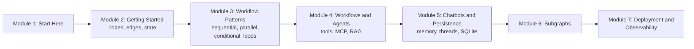

# How This Course Works

## Introduction

In [Agentic AI Fundamentals](../../agentic-ai-fundamentals/course.md) you built agents by hand: a loop, a tool registry, a shared state dictionary, approval callbacks and step limits. That code works, but as soon as you want an agent to **pause for a human and resume tomorrow**, **survive a server restart**, **stream its progress to a web page**, or **run three steps in parallel**, the hand-written loop starts to creak.

**LangGraph** is a framework for exactly those problems. You describe your agent or workflow as a **graph**: boxes (nodes) that do work, arrows (edges) that say what runs next, and a **state** object that flows through. LangGraph runs the graph for you and adds persistence, streaming, human-in-the-loop and debugging tools on top.

This short article tells you what you'll learn, how the course is organised, what to install, and how the code examples work.

> 💡 **Key Insight**
>
> LangGraph doesn't replace what you learned; it **formalises** it. Your hand-written loop becomes edges, your `state` dictionary becomes a typed state schema, your `if` statements that picked the next step become conditional edges. If you understood the scratch agent, you already understand most of LangGraph.

---

## What You Will Learn

By the end of this course you will be able to:

- **Explain why LangGraph exists** and when to use it instead of a simple LangChain chain.
- **Build graphs** from nodes, edges and state, and understand exactly how LangGraph executes them step by step.
- **Implement the core workflow patterns**: sequential, parallel, conditional (routing) and iterative (looping).
- **Build agents** with tools using `ToolNode` and `tools_condition`, plug in MCP tools, and add retrieval (RAG).
- **Build a chatbot with memory** that saves conversations, resumes after crashes, and stores data in SQLite, with a Streamlit UI.
- **Compose graphs from subgraphs**, deploy them, and trace them with LangSmith.

### The course at a glance



After this course, [LangGraph State and Memory](../course.md) goes deeper into state reducers and memory, and [Human-in-the-Loop with LangGraph](../course.md) covers interrupts, breakpoints and time travel.

---

## What You Need Before Starting

- **Python** comfortable enough to read classes, type hints and dictionaries. [Advanced Python Programming](../../python-programming/course.md) covers type hints and classes.
- **The agent loop and tool calling**, from [Agentic AI Fundamentals](../../agentic-ai-fundamentals/course.md). This course assumes you know what a tool call and a tool result are.
- **LangChain basics**: chat models, messages and prompt templates, from the [LangChain Complete Guide](../../langchain-complete-guide/course.md). You need these from module 4 onward; modules 2 and 3 use plain Python.

### Installing LangGraph

```bash
python -m venv .venv
source .venv/bin/activate          # on Windows: .venv\Scripts\activate
pip install langgraph
```

Check it worked:

```bash
python -c "import langgraph, importlib.metadata as m; print(m.version('langgraph'))"
```

The examples on this site were tested with **LangGraph 1.2**. LangGraph changes quickly; if an import fails on a newer version, check the official docs for the new name.

### Do I need an API key?

**Not for modules 2 and 3.** A LangGraph node is just a Python function, so the early lessons use ordinary functions (and sometimes a pretend model) as nodes. Every example runs offline, for free, with the exact output shown. From module 4, lessons that call a real LLM say so at the top, and those code blocks are marked as not run on this site because they need a key.

---

## How Every Lesson Is Built

The lessons follow the same template as the rest of the platform: **Before you start** links, an **Introduction**, a **Key Insight**, the **Core Explanation** with diagrams and runnable code, **Try It Yourself** exercises with hidden answers, **Real-World Examples**, **Common Misconceptions**, **Interview Relevance** and **Key Takeaways**. **Labs** are guided builds from an empty file to something that works.

A tip specific to this course: LangGraph can draw any graph you build as a diagram. Whenever a lesson shows a graph picture, try generating it yourself with `app.get_graph().draw_mermaid()` and pasting the result into a Mermaid viewer. Seeing the shape of your graph is the fastest way to catch a wiring mistake.

---

## Common Misconceptions

### "LangGraph is only for agents"

Many LangGraph apps are **workflows** with fixed steps, parallel branches and simple routing. Agents are just one kind of graph.

### "LangGraph replaces LangChain"

They work together. LangChain provides models, prompts, tools and retrievers; LangGraph orchestrates them. You can also use LangGraph with no LangChain at all.

### "Graphs are harder than writing a loop"

For a three-line script, yes. For anything that needs pausing, resuming, streaming or parallelism, a graph is far less code than doing it by hand.

---

## Key Takeaways

- LangGraph models apps as **graphs**: **nodes** do work, **edges** decide what's next, **state** carries data.
- It adds **persistence, streaming, human-in-the-loop and debugging** to the loops you wrote by hand.
- Modules 2 and 3 need **no API key**; nodes are plain Python functions.
- Install with `pip install langgraph`; examples use LangGraph 1.2.

---

**Up next:** [LangChain vs LangGraph: Why LangGraph Exists](../02-getting-started/langchain-vs-langgraph-why-langgraph-exists.md)
