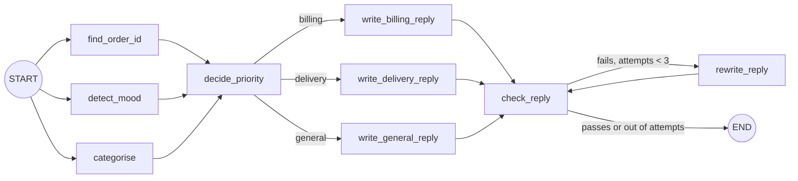

# Lab: Your First Graph

> 📚 **Before you start**
>
> - [Graphs, Nodes, Edges and State](graphs-nodes-edges-and-state.md)
> - [The LangGraph Execution Model](the-langgraph-execution-model.md)
> - [Simple Graphs and Node Connections](simple-graphs-and-node-connections.md)

## What You'll Build

A **support ticket triage** graph for an online shop. Given a customer message, it will:

1. **Analyse** the ticket in parallel: find an order id, judge the customer's mood, and pick a category.
2. **Route** it to the right reply writer (billing, delivery or general).
3. **Check** the reply against simple rules, and **rewrite** it if it fails (up to two times).
4. Return a clean result with just the fields the caller needs.

It uses every idea from this module: state with reducers, fan-out and fan-in, conditional edges, a loop with a stopping rule, input and output schemas, and streaming. The "intelligence" inside nodes is simple keyword rules so the lab runs offline; in module 5 you'll swap them for model calls without changing the graph.



> 💡 **Key Insight**
>
> Build graphs **state first, then nodes, then wiring, then run**, testing each node as a plain function before you connect it. When something goes wrong in the full graph, you'll already know each piece works on its own.

Run the blocks in order in one file or notebook (`pip install langgraph` first).

---

## Step 1: Design the State

Write down every piece of data the graph needs, who writes it, and whether parallel nodes write it:

| Field | Written by | Parallel writers? |
|---|---|---|
| `message` | caller | no |
| `notes` | `find_order_id`, `detect_mood`, `categorise` | **yes**, so it needs a reducer |
| `order_id`, `mood`, `category` | the three analysers | no (one each) |
| `priority` | `decide_priority` | no |
| `reply`, `attempts`, `problems` | writers, checker, rewriter | no |

```python
import operator
import re
from typing import Annotated, TypedDict
from langgraph.graph import StateGraph, START, END

class TicketState(TypedDict):
    message: str
    order_id: str
    mood: str
    category: str
    notes: Annotated[list, operator.add]     # three analysers append here in parallel
    priority: str
    reply: str
    attempts: int
    problems: list

class TicketInput(TypedDict):
    message: str

class TicketOutput(TypedDict):
    category: str
    priority: str
    reply: str
    notes: list
```

The input and output schemas mean callers send only `message` and get back only four fields.

---

## Step 2: The Analyser Nodes

Three independent nodes that will run in parallel. Each writes its own field plus a note:

```python
def find_order_id(state: TicketState):
    match = re.search(r"\b(ORD-\d{4})\b", state["message"].upper())
    order_id = match.group(1) if match else ""
    return {"order_id": order_id, "notes": [f"order_id={order_id or 'none'}"]}

def detect_mood(state: TicketState):
    angry_words = ["angry", "worst", "unacceptable", "refund now", "terrible"]
    mood = "upset" if any(w in state["message"].lower() for w in angry_words) else "calm"
    return {"mood": mood, "notes": [f"mood={mood}"]}

def categorise(state: TicketState):
    text = state["message"].lower()
    if any(w in text for w in ["charged", "refund", "payment", "invoice"]):
        category = "billing"
    elif any(w in text for w in ["delivery", "shipped", "late", "courier", "arrive"]):
        category = "delivery"
    else:
        category = "general"
    return {"category": category, "notes": [f"category={category}"]}

# test each node on its own before wiring anything
sample = {"message": "I was charged twice for ORD-4417. This is unacceptable!"}
print(find_order_id(sample))
print(detect_mood(sample))
print(categorise(sample))
```

Output:

```
{'order_id': 'ORD-4417', 'notes': ['order_id=ORD-4417']}
{'mood': 'upset', 'notes': ['mood=upset']}
{'category': 'billing', 'notes': ['category=billing']}
```

---

## Step 3: Priority and the Reply Writers

`decide_priority` is the fan-in node: it runs after all three analysers and can see all their results.

```python
def decide_priority(state: TicketState):
    high = state["mood"] == "upset" or state["category"] == "billing"
    return {"priority": "high" if high else "normal", "attempts": 0}

def write_billing_reply(state: TicketState):
    return {"reply": "We're sorry about the billing problem. Our payments team will "
                     "review your charge within 24 hours."}

def write_delivery_reply(state: TicketState):
    return {"reply": f"Thanks for your patience. We're checking with the courier "
                     f"about order {state['order_id']} and will update you today."}

def write_general_reply(state: TicketState):
    return {"reply": "Thanks for reaching out! A member of our team will reply shortly."}

print(decide_priority({"mood": "calm", "category": "delivery"}))
```

Output:

```
{'priority': 'normal', 'attempts': 0}
```

Notice that `write_billing_reply` forgets to mention the order id. That's deliberate: the checker will catch it.

---

## Step 4: The Checker, the Rewriter and the Routers

The checker applies rules; the rewriter fixes what the checker found. Two **routing functions** decide where to go next.

```python
def check_reply(state: TicketState):
    problems = []
    if state["order_id"] and state["order_id"] not in state["reply"]:
        problems.append(f"mention order {state['order_id']}")
    if state["mood"] == "upset" and "sorry" not in state["reply"].lower():
        problems.append("apologise to an upset customer")
    return {"problems": problems}

def rewrite_reply(state: TicketState):
    reply = state["reply"]
    for problem in state["problems"]:
        if problem.startswith("mention order"):
            reply += f" (Reference: {state['order_id']}.)"
        if problem.startswith("apologise"):
            reply = "We're sorry for the trouble. " + reply
    return {"reply": reply, "attempts": state["attempts"] + 1}

def route_by_category(state: TicketState):
    return state["category"]

def route_after_check(state: TicketState):
    if state["problems"] and state["attempts"] < 2:
        return "rewrite"
    return "done"
```

Routers only **read** the state and return a label. All changes happen in nodes.

---

## Step 5: Wire the Graph

```python
builder = StateGraph(TicketState, input_schema=TicketInput, output_schema=TicketOutput)

for node in [find_order_id, detect_mood, categorise, decide_priority,
             write_billing_reply, write_delivery_reply, write_general_reply,
             check_reply, rewrite_reply]:
    builder.add_node(node)

# fan-out from START, fan-in to decide_priority
for analyser in ["find_order_id", "detect_mood", "categorise"]:
    builder.add_edge(START, analyser)
    builder.add_edge(analyser, "decide_priority")

# branch by category
builder.add_conditional_edges("decide_priority", route_by_category, {
    "billing": "write_billing_reply",
    "delivery": "write_delivery_reply",
    "general": "write_general_reply",
})
for writer in ["write_billing_reply", "write_delivery_reply", "write_general_reply"]:
    builder.add_edge(writer, "check_reply")

# loop: check → rewrite → check, until it passes or attempts run out
builder.add_conditional_edges("check_reply", route_after_check,
                              {"rewrite": "rewrite_reply", "done": END})
builder.add_edge("rewrite_reply", "check_reply")

triage = builder.compile()
print(len(triage.get_graph().nodes), "nodes,", len(triage.get_graph().edges), "edges")
```

Output:

```
11 nodes, 15 edges
```

(11 nodes = your 9 plus `__start__` and `__end__`.)

---

## Step 6: Run It

```python
tickets = [
    "I was charged twice for ORD-4417. This is unacceptable!",
    "My parcel ORD-2093 hasn't arrived yet, the courier says it shipped Monday.",
    "Do you sell gift cards?",
]
for t in tickets:
    result = triage.invoke({"message": t})
    print(result["category"], "|", result["priority"], "|", sorted(result["notes"]))
    print("  ", result["reply"])
```

Output:

```
billing | high | ['category=billing', 'mood=upset', 'order_id=ORD-4417']
   We're sorry about the billing problem. Our payments team will review your charge within 24 hours. (Reference: ORD-4417.)
delivery | normal | ['category=delivery', 'mood=calm', 'order_id=ORD-2093']
   Thanks for your patience. We're checking with the courier about order ORD-2093 and will update you today.
general | normal | ['category=general', 'mood=calm', 'order_id=none']
   Thanks for reaching out! A member of our team will reply shortly.
```

The billing reply failed the first check (no order id), was rewritten once, and then passed. The other two passed first time.

---

## Step 7: Watch It Run

Stream the updates for the first ticket to see the super-steps, including the loop:

```python
for chunk in triage.stream({"message": tickets[0]}, stream_mode="updates"):
    for node, update in chunk.items():
        shown = {k: v for k, v in update.items() if k != "notes"}
        print(f"{node:<22} {shown}")
```

Output:

```
categorise             {'category': 'billing'}
detect_mood            {'mood': 'upset'}
find_order_id          {'order_id': 'ORD-4417'}
decide_priority        {'priority': 'high', 'attempts': 0}
write_billing_reply    {'reply': "We're sorry about the billing problem. Our payments team will review your charge within 24 hours."}
check_reply            {'problems': ['mention order ORD-4417']}
rewrite_reply          {'reply': "We're sorry about the billing problem. Our payments team will review your charge within 24 hours. (Reference: ORD-4417.)", 'attempts': 1}
check_reply            {'problems': []}
```

Read it top to bottom: three analysers (one super-step), the fan-in, the branch to the billing writer, a failed check, one rewrite, and a passing check.

---

## Try It Yourself

1. **New category.** Add a `returns` category (keywords: "return", "exchange", "size") with its own writer. Which three places in the code must change?
2. **Stricter checker.** Add a rule: replies to `high` priority tickets must say "within 24 hours". Which tickets now need rewrites?
3. **Out of attempts.** Make `rewrite_reply` do nothing useful (return only the incremented `attempts`). What does the stream show, and why does the graph still finish?
4. **Draw it.** Print `triage.get_graph().draw_mermaid()` and paste it into a Mermaid viewer. Compare it with the diagram at the top.

<details>
<summary>Show answers</summary>

**1.** (a) `categorise` needs the new keywords and category; (b) a new `write_returns_reply` node added to the builder; (c) the `route_by_category` path map needs `"returns": "write_returns_reply"` and an edge from the new writer to `check_reply`.

**2.** The billing ticket's reply already says "within 24 hours", so only a high-priority ticket in another category would need a rewrite (for example an upset delivery ticket). A rewrite rule would append the promise.

**3.** The loop runs `check_reply → rewrite_reply` until `attempts` reaches 2, then `route_after_check` returns `"done"` and the graph ends with the problems unfixed. The attempt counter is your stopping rule; the recursion limit never comes into play.

**4.** The generated diagram has the same nodes; conditional edges appear as dotted lines labelled with the path-map keys.

</details>

---

## What You've Learned

- **Designing state** by listing every field, who writes it and whether writes happen in parallel.
- **Testing nodes as functions** before wiring.
- **Fan-out/fan-in** with a reducer, **branching** with a path map, and a **loop** with an attempt counter.
- **Input/output schemas** for a clean interface.
- **Streaming updates** to see exactly what ran.

---

**Up next:** [Sequential Workflows and Prompt Chaining](../03-workflow-patterns-in-langgraph/sequential-workflows-and-prompt-chaining.md)
