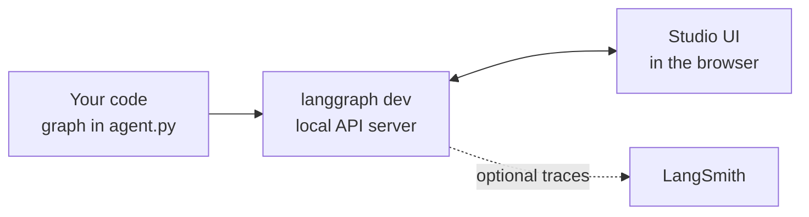

# LangGraph Studio: The Complete Guide

> 📚 **Before you start**
>
> - [Simple Graphs and Node Connections](simple-graphs-and-node-connections.md), so you have graphs worth looking at.
> - [Configuration and Environment Variables](../../apis-and-apps-fastapi-streamlit-and-docker/course.md#m5), for `.env` files and API keys.

## Introduction

Reading `print` output is fine for a three-node graph. For an agent that loops through tools, branches between sub-agents and pauses for approval, you want to **see** it: which node is running, what the state looks like right now, which branch was taken and why.

**LangGraph Studio** is a visual debugger for LangGraph apps. It draws your graph, lets you run it with any input, highlights each node as it executes, shows the state after every step, and lets you pause, edit the state, and re-run from any earlier point. It's the LangGraph equivalent of stepping through code in a debugger.

This lesson explains what Studio does, how to set up a project so Studio can load it, and a workflow for debugging with it.

> 💡 **Key Insight**
>
> Studio runs **your real graph** on a local development server and gives you a visual window into its **state at every step**. Because LangGraph saves a checkpoint after each super-step, Studio can rewind to any of them, let you change the state, and continue: the fastest way to answer "what if this node had returned something else?"

---

## Core Explanation

### 1. What Studio gives you

| Feature | What it lets you do |
|---|---|
| **Graph view** | See nodes and edges drawn automatically, including conditional branches |
| **Run panel** | Start a run with any input and watch nodes light up as they execute |
| **State inspector** | See the full state after every step |
| **Threads** | Keep separate conversations or runs side by side |
| **Interrupts** | Pause before or after chosen nodes, like breakpoints |
| **Edit and fork** | Change the state at a step and continue from there, creating a new branch of history |
| **Hot reload** | Edit your code and Studio picks up the change |
| **Chat mode** | For graphs whose state has `messages`, interact with it as a chat |



### 2. Setting up a project for Studio

Studio needs your graph in a file plus a small configuration file, `langgraph.json`, that tells the development server where to find it. A minimal project looks like this:

```
my-graph/
├── agent.py          # defines and compiles the graph
├── requirements.txt  # langgraph and anything your nodes import
├── .env              # API keys (never commit this)
└── langgraph.json    # tells the server where the graph is
```

`agent.py` must expose the **compiled graph** as a module-level variable:

```python
# not-run: agent.py, loaded by the LangGraph dev server
from typing import TypedDict
from langgraph.graph import StateGraph, START, END

class TextState(TypedDict):
    text: str

def clean(state):
    return {"text": state["text"].strip()}

def title(state):
    return {"text": state["text"].title()}

builder = StateGraph(TextState)
builder.add_sequence([clean, title])
builder.add_edge(START, "clean")
builder.add_edge("title", END)

graph = builder.compile()     # Studio loads this variable
```

`langgraph.json` points at it (the part after the colon is the variable name):

```json
{
  "dependencies": ["."],
  "graphs": {
    "text_cleaner": "./agent.py:graph"
  },
  "env": ".env"
}
```

You can list several graphs under `"graphs"`; each gets its own entry in Studio.

### 3. Starting the development server

Install the LangGraph CLI with the in-memory server extra, then start it from the project folder:

```bash
pip install -U "langgraph-cli[inmem]"
langgraph dev
```

The command starts a local API server (by default on `http://127.0.0.1:2024`), and prints a link that opens Studio in your browser connected to that server. Studio's web UI is served through LangSmith, so you'll be asked to sign in with a (free) LangSmith account the first time. Your graph and data still run on your machine.

If you prefer not to use the browser UI, the same local server also exposes an HTTP API and API docs, which you'll use when deploying in [Deploying and Running LangGraph Apps](../10-deployment-and-observability/deploying-and-running-langgraph-apps.md).

> **Tip:** if Studio can't find your graph, check three things: the path in `langgraph.json` is relative to that file, the variable name after the colon matches your code, and your dependencies are listed so the server can import them.

### 4. A debugging workflow

Here's a practical routine when a graph misbehaves:

1. **Reproduce.** Paste the failing input into the run panel and run it.
2. **Follow the path.** Watch which nodes light up. Did the conditional edge take the branch you expected?
3. **Inspect state at each step.** Click a step to see the state after it. Find the first step where a value looks wrong.
4. **Edit and re-run.** Change that value in the state and continue from that step. If everything downstream now works, you've found the culprit node.
5. **Fix the code.** Edit the node; hot reload picks it up. Run the original input again.
6. **Add interrupts** before risky nodes (like a tool that sends email) so you can check the state before it runs.

This workflow relies on **checkpoints**, which the dev server adds for you. You'll learn how checkpoints work, and how to use them in your own apps, in [Persistence and Checkpointers](../06-chatbots-and-persistence/persistence-and-checkpointers.md), and the full set of time-travel tools in [Human-in-the-Loop and Debugging](../course.md#m8), later in this course.

### 5. Studio without an LLM

Studio works for any LangGraph graph, including the plain-Python graphs from this module. It's a good idea to open your first graphs in Studio even though they're simple: seeing the super-steps and state changes visually builds intuition you'll need for agents.

### 6. Alternatives when you can't use Studio

- **`draw_mermaid()`** for the structure: `print(graph.get_graph().draw_mermaid())`.
- **`stream(..., stream_mode="values")`** to print the full state after every step.
- **`stream_mode="debug"`** for task-level detail.
- **LangSmith tracing** (no Studio needed) to record runs from scripts and servers. → [LangSmith Observability for LangGraph](../10-deployment-and-observability/langsmith-observability-for-langgraph.md)

```python
from typing import TypedDict
from langgraph.graph import StateGraph, START, END

class TextState(TypedDict):
    text: str

builder = StateGraph(TextState)
builder.add_sequence([lambda s: {"text": s["text"].strip()}])
builder.add_edge(START, "<lambda>")
builder.add_edge("<lambda>", END)
for snapshot in builder.compile().stream({"text": "  hi  "}, stream_mode="values"):
    print(snapshot)
```

Output:

```
{'text': '  hi  '}
{'text': 'hi'}
```

(Notice the node name `<lambda>`: a lambda has no useful name, which is a good reason to use named functions for nodes.)

---

## Try It Yourself

1. **Set up a project.** Create the `my-graph` folder above, run `langgraph dev`, and open your graph in Studio. Run it with `{"text": "  hello studio  "}`.
2. **Branch in Studio.** Add a conditional edge after `clean` that skips `title` when the text is already title-case. Run two inputs in Studio and compare the paths.
3. **Troubleshoot.** Your `langgraph.json` says `"./agent.py:app"` but your code ends with `graph = builder.compile()`. What happens, and what's the fix?

<details>
<summary>Show answers</summary>

**1.** You should see `__start__ → clean → title → __end__` light up, and the final state `{"text": "Hello Studio"}`.

**2.** Use a router like `lambda s: "skip" if s["text"] == s["text"].title() else "title"` with the path map `{"skip": END, "title": "title"}`. Studio shows one input taking the short path and the other going through `title`.

**3.** The server can't find a variable named `app` in `agent.py`, so the graph fails to load. Change the config to `"./agent.py:graph"` or rename the variable.

</details>

---

## Real-World Examples

- **Agent developers** use Studio to see why an agent called the wrong tool: they step to the model node, inspect the messages it saw, and edit the prompt or state to test a fix.
- **Teams reviewing workflows** use the graph view as living documentation of how the app works.
- **QA** re-runs saved threads after code changes to check the same inputs still take the right path.

---

## Common Misconceptions

### "Studio is required to use LangGraph"

It's an optional development tool. Everything works from plain Python.

### "Studio sends my graph to the cloud"

The graph runs on your local dev server. The browser UI connects to it; traces go to LangSmith only if you enable tracing.

### "Studio is only for LLM agents"

Any LangGraph graph can be visualised and stepped through.

---

## Interview Relevance

*"How do you debug a LangGraph agent?"* Mention: visualising the graph (Studio or `draw_mermaid`), inspecting **state per step** (Studio, `stream_mode="values"`), **checkpoints** to rewind and **fork** with edited state, **interrupts** as breakpoints, and **LangSmith traces** for production runs.

---

## Key Takeaways

- **LangGraph Studio** visualises your graph, runs it, and shows the **state after every step**.
- Set up with `agent.py` (compiled graph variable) + **`langgraph.json`** (`"graphs": {"name": "./agent.py:graph"}`), then run **`langgraph dev`**.
- Debug by following the path, **inspecting state**, **editing and forking** from a step, and adding **interrupts**.
- Without Studio: `draw_mermaid()`, `stream_mode="values"`/`"debug"`, and LangSmith traces.

---

**Up next:** [Lab: Your first graph](lab-your-first-graph.md)
