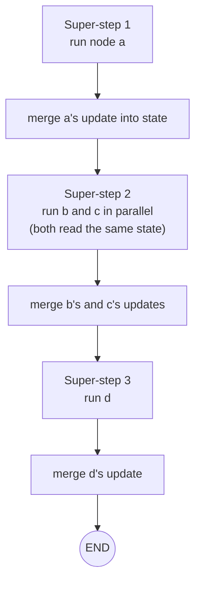

# The LangGraph Execution Model: The Complete Guide

> 📚 **Before you start**
>
> - [Graphs, Nodes, Edges and State](graphs-nodes-edges-and-state.md), for the building blocks.
> - [Concurrency for AI Apps](../../python-programming/course.md#m10) in Python Programming, helpful but optional, for the idea of things running "at the same time".

## Introduction

You can build simple graphs knowing only "nodes return updates, edges say what's next". But the first time you add two branches that run in parallel, or a loop, you'll hit questions like: *Why did I get an error saying a key "can receive only one value per step"? Why did my list get overwritten instead of appended to? Why did my loop stop with a "recursion limit" error?*

All three are answered by understanding **how LangGraph actually executes a graph**. It's a simple model with three ideas: **super-steps**, **reducers** and **limits**. Once you know them, LangGraph's behaviour becomes completely predictable.

> 💡 **Key Insight**
>
> LangGraph runs in **super-steps**. In each super-step, every node that's ready runs (in parallel if there are several), each returns its updates, and only **then** are all the updates merged into the state using each field's **reducer**. The next super-step starts from that merged state.

---

## Core Explanation

### 1. Super-steps

LangGraph's runtime is inspired by Google's **Pregel** system for processing huge graphs. Execution proceeds in rounds called **super-steps**:



1. Start with the input as the state.
2. Find every node that's been **triggered** (by an edge from a node that just ran).
3. Run all of them. They all see the **same** state snapshot, the one from the end of the previous super-step.
4. Collect their updates and **merge** them into the state.
5. Repeat until no nodes are triggered (everything has reached `END`).

Two consequences matter in practice:

- Nodes in the same super-step **can't see each other's updates**. They only see the result next super-step.
- If two nodes in the same super-step update the **same key**, LangGraph needs a rule for combining them. That rule is a **reducer**.

### 2. Seeing parallel super-steps

Here's a diamond-shaped graph: `a` fans out to `b` and `c`, which both lead to `d`. Each node adds its name to a `log` list:

```python
from typing import TypedDict
from langgraph.graph import StateGraph, START, END

class PlainState(TypedDict):
    log: list

def logger(name):
    def node(state):
        return {"log": [name]}
    return node

def diamond(state_schema):
    g = StateGraph(state_schema)
    for name in "abcd":
        g.add_node(name, logger(name))
    g.add_edge(START, "a")
    g.add_edge("a", "b")
    g.add_edge("a", "c")
    g.add_edge("b", "d")
    g.add_edge("c", "d")
    g.add_edge("d", END)
    return g.compile()

try:
    diamond(PlainState).invoke({"log": []})
except Exception as e:
    print(type(e).__name__ + ":", str(e).splitlines()[0])
```

Output:

```
InvalidUpdateError: At key 'log': Can receive only one value per step. Use an Annotated key to handle multiple values.
```

`b` and `c` ran in the same super-step and both returned a `log`. Without a reducer, LangGraph's default rule is **"overwrite"**, and it refuses to guess which of two overwrites should win. So it raises an error instead of silently losing data.

### 3. Reducers: how updates are merged

A **reducer** is a function `(current_value, update) -> new_value` attached to a state field with `Annotated`. The classic one is `operator.add`, which for lists means **append**:

```python
import operator
from typing import Annotated

class LogState(TypedDict):
    log: Annotated[list, operator.add]     # reducer: concatenate lists

app = diamond(LogState)
print(app.invoke({"log": []}))
```

Output:

```
{'log': ['a', 'b', 'c', 'd']}
```

Now each node's `["name"]` is **added** to the list. The default (no reducer) is to **replace** the value.

| Field definition | Behaviour on update | Typical use |
|---|---|---|
| `count: int` | Replace (only one writer per super-step allowed) | Most fields |
| `log: Annotated[list, operator.add]` | Append lists | Logs, collected results from parallel branches |
| `total: Annotated[int, operator.add]` | Add numbers | Running totals, counters |
| `messages: Annotated[list, add_messages]` | Append messages, update by id | Chat history (module 6) |
| `Annotated[dict, my_merge]` | Your own function | Custom merges |

A custom reducer is just a function. Here's one that keeps the highest score seen:

```python
def keep_max(current, update):
    return max(current, update)

class ScoreState(TypedDict):
    best: Annotated[int, keep_max]

g = StateGraph(ScoreState)
g.add_node("grader_1", lambda s: {"best": 6})
g.add_node("grader_2", lambda s: {"best": 9})
g.add_node("grader_3", lambda s: {"best": 7})
for name in ["grader_1", "grader_2", "grader_3"]:
    g.add_edge(START, name)        # all three start in the same super-step
    g.add_edge(name, END)
print(g.compile().invoke({"best": 0}))
```

Output:

```
{'best': 9}
```

<<<<<<< HEAD:courses/langgraph-fundamentals/02-getting-started/the-langgraph-execution-model.md
Reducers are covered in depth in [State Reducers](../../langgraph-state-and-memory/03-advanced-state/state-reducers.md).
=======
Reducers are covered in depth in [State Reducers](../course.md#m4).
>>>>>>> origin/main:courses/langgraph-complete-guide/02-getting-started/the-langgraph-execution-model.md

### 4. Watching the execution: `stream`

`invoke` waits and returns the final state. `stream` yields as the graph runs, and its `stream_mode` controls what you see:

- **`"updates"`** (default): each node's returned update, as `{node_name: update}`.
- **`"values"`**: the **full state** after each super-step.
- Others include `"messages"` (LLM tokens, used for chat UIs in module 6) and `"debug"` (everything).

```python
print("updates:")
for chunk in app.stream({"log": []}, stream_mode="updates"):
    print(" ", chunk)

print("values:")
for chunk in app.stream({"log": []}, stream_mode="values"):
    print(" ", chunk)
```

Output:

```
updates:
  {'a': {'log': ['a']}}
  {'b': {'log': ['b']}}
  {'c': {'log': ['c']}}
  {'d': {'log': ['d']}}
values:
  {'log': []}
  {'log': ['a']}
  {'log': ['a', 'b', 'c']}
  {'log': ['a', 'b', 'c', 'd']}
```

The `values` stream shows the super-steps clearly: after step 2 the state jumps from `['a']` to `['a', 'b', 'c']` in one go, because `b` and `c` ran in the same super-step and were merged together.

You can also see the step number of every task with the `debug` mode:

```python
for event in app.stream({"log": []}, stream_mode="debug"):
    if event["type"] == "task":
        print("super-step", event["step"], "runs", event["payload"]["name"])
```

Output:

```
super-step 1 runs a
super-step 2 runs b
super-step 2 runs c
super-step 3 runs d
```

### 5. Loops and the recursion limit

Edges can point backwards, which creates loops. Every super-step counts against a **recursion limit** (25 by default), a safety net exactly like `max_steps` in your [scratch agent](../../agentic-ai-fundamentals/03-the-agent-loop/lab-agent-loop-with-a-pretend-model.md):

```python
class CounterState(TypedDict):
    n: int

g = StateGraph(CounterState)
g.add_node("inc", lambda s: {"n": s["n"] + 1})
g.add_edge(START, "inc")
g.add_conditional_edges("inc", lambda s: "inc")      # bug: always loops back
looping = g.compile()

try:
    looping.invoke({"n": 0}, {"recursion_limit": 5})
except Exception as e:
    print(type(e).__name__ + ":", str(e).splitlines()[0])
```

Output:

```
GraphRecursionError: Recursion limit of 5 reached without hitting a stop condition. You can increase the limit by setting the `recursion_limit` config key.
```

- Your **own** stopping condition (like "score ≥ 7 or tries ≥ 3") should end loops normally.
- The **recursion limit** catches bugs. Raise it with `config={"recursion_limit": 100}` for legitimately long runs, but don't use it as your stopping logic.

### 6. The `config` argument

The second argument to `invoke` and `stream` is the **config**, a dictionary of run settings that aren't part of the state:

- `recursion_limit`: maximum super-steps.
- `configurable`: custom values, most importantly `thread_id` for persistence (module 6).
- `tags` and `metadata`: labels for tracing in LangSmith.

```python
# not-run: shown for reference
app.invoke({"log": []}, config={"recursion_limit": 50, "tags": ["demo"],
                                "configurable": {"thread_id": "user-42"}})
```

### 7. Putting it together

When you design a graph, ask:

1. **Which nodes can run in the same super-step?** Any fields they both write need a reducer.
2. **Should this field replace or accumulate?** Replace is the default; accumulate needs a reducer.
3. **Can this graph loop?** Make sure your own condition ends the loop, and know that the recursion limit is the backstop.
4. **What do I need to observe?** Use `stream` with `updates` for progress, `values` for full snapshots.

---

## Try It Yourself

1. **Predict the values stream.** For a straight graph `START → x → y → END` where both append to an `operator.add` log, write down every `values` chunk before running it.
2. **A counter reducer.** Make a state with `visits: Annotated[int, operator.add]` and three parallel nodes that each return `{"visits": 1}`. What's the final value starting from 0?
3. **Fix the loop.** Change the looping graph's router so it stops when `n` reaches 3. What does `invoke({"n": 0})` return?

<details>
<summary>Show answers</summary>

**1.** `{'log': []}`, `{'log': ['x']}`, `{'log': ['x', 'y']}`. That is the input, then one chunk per super-step.

**2.**

```python
class VisitState(TypedDict):
    visits: Annotated[int, operator.add]

g = StateGraph(VisitState)
for name in ["p", "q", "r"]:
    g.add_node(name, lambda s: {"visits": 1})
    g.add_edge(START, name)
    g.add_edge(name, END)
print(g.compile().invoke({"visits": 0}))
```

Output:

```
{'visits': 3}
```

**3.**

```python
g = StateGraph(CounterState)
g.add_node("inc", lambda s: {"n": s["n"] + 1})
g.add_edge(START, "inc")
g.add_conditional_edges("inc", lambda s: "inc" if s["n"] < 3 else END)
print(g.compile().invoke({"n": 0}))
```

Output:

```
{'n': 3}
```

</details>

---

## Real-World Examples

- **Parallel graders** (clarity, depth, grammar) run in one super-step and append their scores to a list with `operator.add`; a final node averages them.
- **Agents** loop between a model node and a tools node; the model's decision to stop ends the loop, and the recursion limit protects against runaway tool calls.
- **Chat apps** stream `messages` to show tokens as they arrive and `updates` to show which step is running.

---

## Common Misconceptions

### "Parallel nodes see each other's results"

They all see the same snapshot from the previous super-step. Results combine only after the step.

### "Lists append by default"

The default is **replace**. Appending requires a reducer such as `operator.add`.

### "The recursion limit is how you stop loops"

It's a safety net. Your routing logic should end loops on purpose.

---

## Interview Relevance

*"How does LangGraph execute a graph?"* Answer: in **super-steps** (Pregel-style message passing). All triggered nodes run with the same state snapshot, potentially in parallel; their updates are merged with per-key **reducers** (default: overwrite; `Annotated[..., reducer]` for custom merges like `operator.add` or `add_messages`). Execution continues until no node is triggered or the **recursion limit** is hit. Mention `stream` modes for observing execution.

A common follow-up: *"What's `InvalidUpdateError: Can receive only one value per step`?"* Two nodes in the same super-step wrote the same key without a reducer; add one or restructure the graph.

---

## Key Takeaways

- LangGraph runs in **super-steps**: run all ready nodes on the same snapshot, then **merge** their updates.
- Merging uses **reducers**: default **replace**; `Annotated[list, operator.add]` to **append**; custom functions for anything else.
- Two parallel writers to a field without a reducer cause **`InvalidUpdateError`**.
- `stream` shows execution: **`updates`** per node, **`values`** full state per super-step, **`debug`** for detail.
- Loops end by your logic; the **recursion limit** (default 25) is the safety net.

---

**Up next:** [Simple Graphs and Node Connections](simple-graphs-and-node-connections.md)
