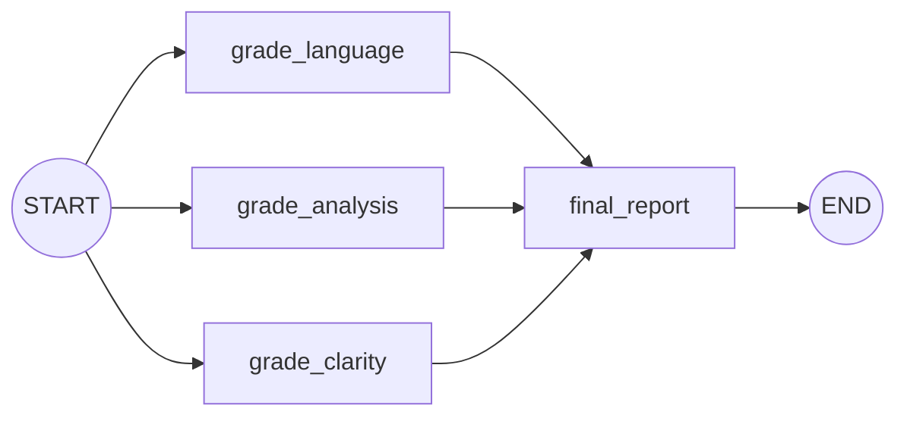

# Lab: Essay Evaluator with Parallel Graders

> 📚 **Before you start**
>
> - [Parallel Workflows](parallel-workflows.md), for fan-out, fan-in and reducers.
> - [Conditional Workflows](conditional-workflows.md), for structured output and safe defaults.
> - [Pydantic Models](../../apis-and-apps-fastapi-streamlit-and-docker/course.md#m4), used to validate each grader's answer.

## What You'll Build

An **essay evaluator** for students preparing for written exams. Given an essay and its topic, it will:

1. Send the essay to **three graders in parallel**: one for language, one for depth of analysis, one for clarity of thought. Each returns a score out of 10 and one piece of feedback.
2. **Validate** every grader's answer against a schema, falling back safely if a grader returns rubbish.
3. **Combine** the results: the average score, a band ("strong", "good", "needs work"), and a summary of the feedback.



> 💡 **Key Insight**
>
> Parallel graders are faster than one grader doing everything, and **more consistent**: each prompt focuses on one dimension with its own rubric. The trick is the state: each grader **appends** its result to a shared list through a reducer, and the fan-in node sees all three.

The graders use `FakeListChatModel` so the lab runs offline; Step 7 shows the one-line change to a real model. Run the blocks in order (`pip install langgraph langchain-core`).

---

## Step 1: The Grade Schema

Each grader must return the same shape. A Pydantic model makes that shape explicit and checks it:

```python
from pydantic import BaseModel, Field, ValidationError

class Grade(BaseModel):
    dimension: str
    score: int = Field(ge=0, le=10)
    feedback: str

print(Grade.model_validate_json('{"dimension": "language", "score": 7, "feedback": "Varied vocabulary."}'))
try:
    Grade.model_validate_json('{"dimension": "language", "score": 14, "feedback": "Great!"}')
except ValidationError as e:
    print("rejected:", e.errors()[0]["msg"])
```

Output:

```
dimension='language' score=7 feedback='Varied vocabulary.'
rejected: Input should be less than or equal to 10
```

A score of 14 out of 10 is exactly the kind of mistake a model makes now and then. The schema catches it.

---

## Step 2: The State

```python
import operator
from typing import Annotated, TypedDict
from langgraph.graph import StateGraph, START, END

class EssayState(TypedDict):
    topic: str
    essay: str
    grades: Annotated[list, operator.add]   # three graders append in parallel
    average: float
    band: str
    report: str
```

Without the `operator.add` reducer, three graders writing `grades` in the same super-step would raise `InvalidUpdateError`.

---

## Step 3: The Grader Models

Each grader gets its own (pretend) model and its own rubric. The fake models return JSON just as a real model would when asked for it:

```python
from langchain_core.language_models.fake_chat_models import FakeListChatModel

RUBRICS = {
    "language": "Grammar, vocabulary and sentence variety.",
    "analysis": "Depth of argument, use of examples and evidence, counter-arguments.",
    "clarity": "Logical structure, a clear thesis, and a conclusion that follows.",
}

grader_models = {
    "language": FakeListChatModel(responses=[
        '{"dimension": "language", "score": 8, "feedback": "Fluent and varied; a few long sentences could be split."}']),
    "analysis": FakeListChatModel(responses=[
        '{"dimension": "analysis", "score": 6, "feedback": "Good examples, but the costs of renewables are not discussed."}']),
    "clarity": FakeListChatModel(responses=[
        '{"dimension": "clarity", "score": 7, "feedback": "Clear thesis; the conclusion repeats rather than concludes."}']),
}
```

---

## Step 4: One Grader Function, Three Nodes

The three graders differ only in their dimension, so write **one function that makes grader nodes**:

```python
def make_grader(dimension: str):
    def grade(state: EssayState):
        prompt = (
            f"You are an exam grader. Grade ONLY on {dimension}: {RUBRICS[dimension]}\n"
            f"Topic: {state['topic']}\n\nEssay:\n{state['essay']}\n\n"
            'Reply with JSON: {"dimension": ..., "score": 0-10, "feedback": one sentence}'
        )
        raw = grader_models[dimension].invoke(prompt).content
        try:
            grade = Grade.model_validate_json(raw)
        except ValidationError:
            grade = Grade(dimension=dimension, score=0, feedback="Grader output was invalid; please re-check manually.")
        return {"grades": [grade.model_dump()]}
    grade.__name__ = f"grade_{dimension}"     # becomes the node name
    return grade

# test one grader on its own
print(make_grader("analysis")({"topic": "t", "essay": "e"}))
```

Output:

```
{'grades': [{'dimension': 'analysis', 'score': 6, 'feedback': 'Good examples, but the costs of renewables are not discussed.'}]}
```

That test used up the analysis model's only response, so we'll rebuild the models before the full run. Notice the **safe default**: an invalid answer becomes a score of 0 with a note asking for a human check, instead of crashing the whole evaluation.

---

## Step 5: The Fan-In Report

```python
def final_report(state: EssayState):
    grades = sorted(state["grades"], key=lambda g: g["dimension"])
    average = round(sum(g["score"] for g in grades) / len(grades), 1)
    band = "strong" if average >= 8 else "good" if average >= 6 else "needs work"
    lines = [f"- {g['dimension'].title()} ({g['score']}/10): {g['feedback']}" for g in grades]
    report = f"Overall {average}/10 ({band})\n" + "\n".join(lines)
    return {"average": average, "band": band, "report": report}
```

Sorting by dimension matters: parallel nodes can finish in any order, and you want the report to look the same every time.

---

## Step 6: Wire and Run

```python
builder = StateGraph(EssayState)
for dimension in RUBRICS:
    builder.add_node(make_grader(dimension))
    builder.add_edge(START, f"grade_{dimension}")
    builder.add_edge(f"grade_{dimension}", "final_report")
builder.add_node(final_report)
builder.add_edge("final_report", END)
evaluator = builder.compile()

grader_models["analysis"] = FakeListChatModel(responses=[
    '{"dimension": "analysis", "score": 6, "feedback": "Good examples, but the costs of renewables are not discussed."}'])

essay = """India's energy future must be renewable. Solar parks in Rajasthan and wind farms
in Tamil Nadu already supply cheap power, and rooftop solar lets households earn from their roofs..."""
result = evaluator.invoke({"topic": "Renewable energy and India's future", "essay": essay})
print(result["report"])
```

Output:

```
Overall 7.0/10 (good)
- Analysis (6/10): Good examples, but the costs of renewables are not discussed.
- Clarity (7/10): Clear thesis; the conclusion repeats rather than concludes.
- Language (8/10): Fluent and varied; a few long sentences could be split.
```

Check that the graders really ran together, in one super-step:

```python
grader_models.update({d: FakeListChatModel(responses=[f'{{"dimension": "{d}", "score": 5, "feedback": "ok"}}'])
                      for d in RUBRICS})
steps = {}
for chunk in evaluator.stream({"topic": "t", "essay": "e"}, stream_mode="debug"):
    if chunk["type"] == "task":
        steps.setdefault(chunk["step"], []).append(chunk["payload"]["name"])
for step, names in steps.items():
    print("step", step, sorted(names))
```

Output:

```
step 1 ['grade_analysis', 'grade_clarity', 'grade_language']
step 2 ['final_report']
```

All three graders are in step 1; the report waits for all of them in step 2.

---

## Step 7: Using a Real Model

With a real model, use **structured output** instead of asking for JSON in the prompt; the model returns a validated `Grade` object directly:

```python
# not-run: needs langchain-anthropic and an API key
from langchain_anthropic import ChatAnthropic

structured_grader = ChatAnthropic(model="claude-opus-5-5").with_structured_output(Grade)

def make_grader(dimension: str):
    def grade(state: EssayState):
        result = structured_grader.invoke(
            f"Grade ONLY on {dimension}: {RUBRICS[dimension]}\n"
            f"Topic: {state['topic']}\n\nEssay:\n{state['essay']}")
        return {"grades": [result.model_dump()]}
    grade.__name__ = f"grade_{dimension}"
    return grade
```

The graph wiring doesn't change at all.

---

## Try It Yourself

1. **A fourth grader.** Add a `structure` dimension (introduction, body, conclusion). What do you change? Does the wiring loop need editing?
2. **Broken grader.** Make the clarity model return `"I think it's a 7"`. What does the report show, and what's the new average?
3. **Weighted average.** Analysis matters twice as much as the others. Change `final_report` to use weights `{"analysis": 2, "language": 1, "clarity": 1}`. What's the new overall score for the essay above?

<details>
<summary>Show answers</summary>

**1.** Add a `"structure"` entry to `RUBRICS` and a model to `grader_models`. The wiring loop runs over `RUBRICS`, so it picks up the new grader automatically.

**2.**

```python
grader_models.update({
    "language": FakeListChatModel(responses=['{"dimension": "language", "score": 8, "feedback": "Fluent."}']),
    "analysis": FakeListChatModel(responses=['{"dimension": "analysis", "score": 6, "feedback": "Needs costs."}']),
    "clarity": FakeListChatModel(responses=["I think it's a 7"]),
})
print(evaluator.invoke({"topic": "t", "essay": "e"})["report"])
```

Output:

```
Overall 4.7/10 (needs work)
- Analysis (6/10): Needs costs.
- Clarity (0/10): Grader output was invalid; please re-check manually.
- Language (8/10): Fluent.
```

The safe default kept the run alive, but a 0 drags the average down. A better design excludes invalid grades from the average and flags the report for review.

**3.**

```python
WEIGHTS = {"analysis": 2, "language": 1, "clarity": 1}
scores = {"analysis": 6, "language": 8, "clarity": 7}
weighted = sum(scores[d] * w for d, w in WEIGHTS.items()) / sum(WEIGHTS.values())
print(round(weighted, 2))
```

Output:

```
6.75
```

</details>

---

## What You've Learned

- **Parallel graders** with fan-out from `START` and fan-in to a report node.
- A **reducer** (`operator.add`) so parallel nodes can share a list.
- **Validating LLM output** with Pydantic and falling back safely.
- A **node factory** (`make_grader`) to build similar nodes without copy-paste.
- Sorting fan-in results so output is **deterministic**.

---

**Up next:** [Lab: Post generator with an evaluator loop](lab-post-generator-with-an-evaluator-loop.md)
