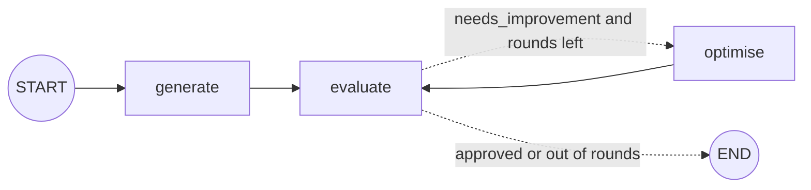

# Lab: Post Generator with an Evaluator Loop

> 📚 **Before you start**
>
> - [Iterative (Looping) Workflows](iterative-looping-workflows.md), for loops and stopping rules.
> - [Lab: Essay evaluator with parallel graders](lab-essay-evaluator-with-parallel-graders.md), for validating LLM output with Pydantic.

## What You'll Build

A **social media post generator** that critiques and rewrites its own work. Given a topic, it will:

1. **Generate** a short, funny post.
2. **Evaluate** it with a separate "judge" model that returns a structured verdict (`approved` or `needs_improvement`) and specific feedback.
3. **Optimise**: rewrite the post using that feedback, then evaluate again.
4. Stop when the judge approves **or** after a maximum number of rounds, and keep the full history of drafts and feedback.

This is the **evaluator-optimizer** pattern: one model creates, another critiques, and a loop connects them.



> 💡 **Key Insight**
>
> Use **different prompts (and often different models) for the writer and the judge**. A model asked to grade its own work in the same breath tends to approve it. A separate judge with a strict rubric and a fixed set of verdicts gives the loop something real to push against.

Run the blocks in order (`pip install langgraph langchain-core`).

---

## Step 1: State and Verdict Schema

```python
import operator
from typing import Annotated, Literal, TypedDict
from pydantic import BaseModel, ValidationError
from langgraph.graph import StateGraph, START, END

class Verdict(BaseModel):
    verdict: Literal["approved", "needs_improvement"]
    feedback: str

class PostState(TypedDict):
    topic: str
    post: str
    verdict: str
    feedback: str
    round: int
    max_rounds: int
    post_history: Annotated[list, operator.add]
    feedback_history: Annotated[list, operator.add]
```

`round` counts evaluations; `max_rounds` is the cap, supplied per run. The two history lists use `operator.add` so each round **appends** instead of overwriting.

---

## Step 2: Three Models, Three Jobs

```python
from langchain_core.language_models.fake_chat_models import FakeListChatModel

def fresh_models():
    writer = FakeListChatModel(responses=[
        "Monsoon is here. It is raining. Roads are wet. Stay safe everyone.",
    ])
    judge = FakeListChatModel(responses=[
        '{"verdict": "needs_improvement", "feedback": "Reads like a weather report. Add a relatable Indian detail and end on a punchline."}',
        '{"verdict": "needs_improvement", "feedback": "Funnier, but 38 words is long. Keep it under 30."}',
        '{"verdict": "approved", "feedback": "Relatable, short, and the auto-driver line lands."}',
    ])
    optimiser = FakeListChatModel(responses=[
        "Monsoon in India means three things: chai tastes better, every pothole becomes a lake, "
        "and your umbrella breaks the exact moment the bus splashes you. Also the auto driver who "
        "suddenly 'doesn't go that side'. Every. Single. Time.",
        "Monsoon checklist: chai ✅ umbrella ✅ wet socks ✅ auto driver saying 'not going that side' ✅",
    ])
    return writer, judge, optimiser

writer, judge, optimiser = fresh_models()
```

With a real model you'd use, for example, a creative temperature for the writer and a low temperature with structured output for the judge.

---

## Step 3: The Nodes

```python
def generate(state: PostState):
    post = writer.invoke(f"Write a short, original, funny post about {state['topic']}. "
                         "Under 30 words. No hashtags.").content
    return {"post": post, "post_history": [post]}

def evaluate(state: PostState):
    raw = judge.invoke(
        "You are a strict social media editor. Approve only if the post is funny, original, "
        f"under 30 words and relatable.\n\nPost: {state['post']}\n\n"
        'Reply with JSON: {"verdict": "approved" or "needs_improvement", "feedback": "..."}'
    ).content
    try:
        result = Verdict.model_validate_json(raw)
    except ValidationError:
        result = Verdict(verdict="needs_improvement", feedback="Judge reply was invalid; try a tighter, funnier version.")
    return {"verdict": result.verdict, "feedback": result.feedback,
            "feedback_history": [result.feedback], "round": state["round"] + 1}

def optimise(state: PostState):
    post = optimiser.invoke(
        f"Improve this post about {state['topic']} using the editor's feedback.\n"
        f"Post: {state['post']}\nFeedback: {state['feedback']}").content
    return {"post": post, "post_history": [post]}

def route_after_evaluate(state: PostState) -> Literal["optimise", "__end__"]:
    if state["verdict"] == "approved" or state["round"] >= state["max_rounds"]:
        return END
    return "optimise"
```

Notice how a broken judge reply defaults to `needs_improvement`, the cautious choice: the worst case is one extra rewrite, never an unchecked post.

---

## Step 4: Wire It

```python
builder = StateGraph(PostState)
builder.add_node(generate)
builder.add_node(evaluate)
builder.add_node(optimise)
builder.add_edge(START, "generate")
builder.add_edge("generate", "evaluate")
builder.add_conditional_edges("evaluate", route_after_evaluate)
builder.add_edge("optimise", "evaluate")
post_maker = builder.compile()
```

---

## Step 5: Run It and Read the History

```python
result = post_maker.invoke({"topic": "the Indian monsoon", "round": 0, "max_rounds": 5})

print("verdict:", result["verdict"], "after", result["round"], "rounds\n")
for i, (post, fb) in enumerate(zip(result["post_history"], result["feedback_history"]), 1):
    print(f"Round {i} ({len(post.split())} words): {post[:55]}...")
    print(f"  judge: {fb}")
print("\nFINAL:", result["post"])
```

Output:

```
verdict: approved after 3 rounds

Round 1 (12 words): Monsoon is here. It is raining. Roads are wet. Stay saf...
  judge: Reads like a weather report. Add a relatable Indian detail and end on a punchline.
Round 2 (38 words): Monsoon in India means three things: chai tastes better...
  judge: Funnier, but 38 words is long. Keep it under 30.
Round 3 (17 words): Monsoon checklist: chai ✅ umbrella ✅ wet socks ✅ auto d...
  judge: Relatable, short, and the auto-driver line lands.

FINAL: Monsoon checklist: chai ✅ umbrella ✅ wet socks ✅ auto driver saying 'not going that side' ✅
```

The history shows the loop working: each rewrite responds to the specific feedback before it.

---

## Step 6: Hitting the Cap

What if the judge never approves? Set `max_rounds` to 2:

```python
writer, judge, optimiser = fresh_models()
capped = post_maker.invoke({"topic": "the Indian monsoon", "round": 0, "max_rounds": 2})
print(capped["verdict"], capped["round"], len(capped["post_history"]))
```

Output:

```
needs_improvement 2 2
```

The run stops cleanly after two evaluations with the best effort so far, and the `verdict` tells the caller it wasn't approved, so the app can show it to a human instead of posting it.

---

## Step 7: With Real Models

```python
# not-run: needs langchain-anthropic and an API key
from langchain_anthropic import ChatAnthropic

writer = ChatAnthropic(model="claude-opus-5-5", temperature=1.0)
optimiser = writer
judge_structured = ChatAnthropic(model="claude-opus-5-5", temperature=0).with_structured_output(Verdict)

def evaluate(state: PostState):
    result = judge_structured.invoke(f"Strict editor. Judge this post: {state['post']}")
    return {"verdict": result.verdict, "feedback": result.feedback,
            "feedback_history": [result.feedback], "round": state["round"] + 1}
```

Because the graph only depends on the node functions, swapping models changes nothing in the wiring.

---

## Try It Yourself

1. **Combine with code checks.** Add a `check_length` node between `generate`/`optimise` and `evaluate` that skips the judge (and sends straight back to `optimise`) when the post has 30 or more words. Why does this save money?
2. **Stream progress.** Use `stream_mode="updates"` to print just the node names as the loop runs with fresh models. What sequence do you see?
3. **Reflect.** Why is `round` incremented in `evaluate`, not in `optimise`?

<details>
<summary>Show answers</summary>

**1.** A code check is free and instant; the judge is an LLM call. Rejecting obviously long posts in code means you only pay the judge for posts that could plausibly pass.

**2.**

```python
writer, judge, optimiser = fresh_models()
for chunk in post_maker.stream({"topic": "monsoon", "round": 0, "max_rounds": 5}, stream_mode="updates"):
    print(next(iter(chunk)), end=" ")
print()
```

Output:

```
generate evaluate optimise evaluate optimise evaluate 
```

**3.** Rounds count **judgements**. Incrementing in `evaluate` means the counter and the verdict are updated together, so the router always compares an up-to-date count, and the very first post (from `generate`) also counts as a round.

</details>

---

## What You've Learned

- The **evaluator-optimizer** loop: generate, judge, rewrite, repeat.
- A **structured verdict** (`Literal` field) the router can trust, with a cautious fallback.
- **Two stopping rules**: approval or a per-run `max_rounds` cap.
- **History lists with reducers** to audit how the output improved.
- Separating **writer and judge** prompts and models.

---

**Up next:** [The LangGraph State System](../course.md#m4)
