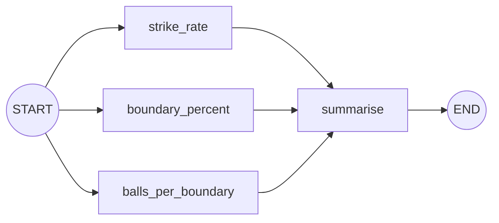
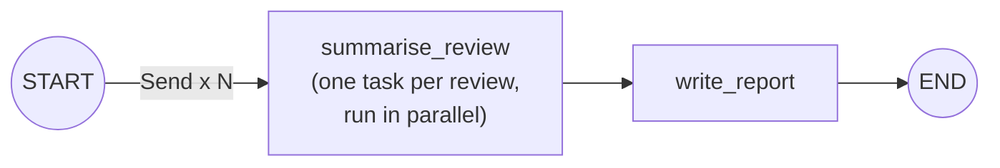

# Parallel Workflows: The Complete Guide

> 📚 **Before you start**
>
> - [The LangGraph Execution Model](../02-getting-started/the-langgraph-execution-model.md), for super-steps and reducers.
> - [Simple Graphs and Node Connections](../02-getting-started/simple-graphs-and-node-connections.md), for fan-out and fan-in.
> - [Sequential Workflows and Prompt Chaining](sequential-workflows-and-prompt-chaining.md), for LLM nodes with a fake model.

## Introduction

A cricket analyst reviewing a batter's innings doesn't calculate the strike rate, then the boundary percentage, then the balls per boundary one after another and wait in between. Those calculations don't depend on each other, so they can all happen at once, and the analyst writes a summary when all three are ready.

The same is true of many LLM tasks. Grading an essay on language, analysis and clarity; checking a contract for legal, financial and privacy risks; summarising twenty customer reviews: the parts are **independent**. Running them **in parallel** cuts the waiting time to roughly the time of the slowest part instead of the sum of all of them.

LangGraph supports two kinds of parallelism: **static** (a fixed set of branches you draw in advance) and **dynamic** (as many branches as the data needs, decided at run time, using `Send`). This lesson covers both, plus how to merge results safely.

> 💡 **Key Insight**
>
> Parallel branches all read the **same state snapshot** and their updates are merged **after** the super-step. So every field that two branches write must have a **reducer**, and the step that combines results must not depend on the order they arrive in.

---

## Core Explanation

### 1. When to parallelise

Parallelise when sub-tasks are **independent**: none needs another's output. Typical cases:

- **Multiple perspectives** on the same input: several graders, reviewers or checkers.
- **The same task on many items**: summarise each document, classify each review (map-reduce).
- **Several lookups**: fetch weather, news and calendar at once.

Don't parallelise steps where one needs the other's result; that's a [sequential chain](sequential-workflows-and-prompt-chaining.md).

### 2. Static parallelism: a fixed set of branches

Here's the batting analysis. Three nodes compute independent statistics from the same input, then a summary node combines them:

```python
from typing import TypedDict
from langgraph.graph import StateGraph, START, END

class BattingState(TypedDict):
    runs: int
    balls: int
    fours: int
    sixes: int
    strike_rate: float
    boundary_percent: float
    balls_per_boundary: float
    summary: str

def strike_rate(state: BattingState):
    return {"strike_rate": round(state["runs"] / state["balls"] * 100, 2)}

def boundary_percent(state: BattingState):
    boundary_runs = state["fours"] * 4 + state["sixes"] * 6
    return {"boundary_percent": round(boundary_runs / state["runs"] * 100, 2)}

def balls_per_boundary(state: BattingState):
    return {"balls_per_boundary": round(state["balls"] / (state["fours"] + state["sixes"]), 2)}

def summarise(state: BattingState):
    return {"summary": (f"Strike rate {state['strike_rate']}, "
                        f"{state['boundary_percent']}% of runs in boundaries, "
                        f"a boundary every {state['balls_per_boundary']} balls")}

g = StateGraph(BattingState)
for fn in [strike_rate, boundary_percent, balls_per_boundary, summarise]:
    g.add_node(fn)
for name in ["strike_rate", "boundary_percent", "balls_per_boundary"]:
    g.add_edge(START, name)
    g.add_edge(name, "summarise")
g.add_edge("summarise", END)
batting = g.compile()

print(batting.invoke({"runs": 100, "balls": 64, "fours": 10, "sixes": 4})["summary"])
```

Output:

```
Strike rate 156.25, 64.0% of runs in boundaries, a boundary every 4.57 balls
```



No reducer is needed here because each branch writes a **different** field. The fan-in node `summarise` waits for all three.

### 3. Parallel LLM calls with a shared results field

When parallel branches produce the **same kind** of result (for example, feedback from several graders), it's natural to collect them in one list. That needs a reducer:

```python
import operator
from typing import Annotated
from langchain_core.language_models.fake_chat_models import FakeListChatModel

class ReviewState(TypedDict):
    text: str
    feedback: Annotated[list, operator.add]
    verdict: str

# one fake model per reviewer, so each returns its own canned answer
grammar_llm = FakeListChatModel(responses=["grammar: 2 small errors"])
tone_llm = FakeListChatModel(responses=["tone: friendly and clear"])
facts_llm = FakeListChatModel(responses=["facts: one claim needs a source"])

def make_reviewer(name, model, instruction):
    def review(state: ReviewState):
        answer = model.invoke(f"{instruction}\n\nText:\n{state['text']}").content
        return {"feedback": [answer]}
    review.__name__ = name
    return review

reviewers = [
    make_reviewer("review_grammar", grammar_llm, "List grammar errors."),
    make_reviewer("review_tone", tone_llm, "Describe the tone."),
    make_reviewer("review_facts", facts_llm, "Flag unsupported claims."),
]

def decide(state: ReviewState):
    needs_work = any("error" in f or "needs" in f for f in state["feedback"])
    return {"verdict": "revise" if needs_work else "publish"}

g = StateGraph(ReviewState)
g.add_node(decide)
for r in reviewers:
    g.add_node(r)
    g.add_edge(START, r.__name__)
    g.add_edge(r.__name__, "decide")
g.add_edge("decide", END)
review_app = g.compile()

result = review_app.invoke({"text": "Solar panels pays for themself in 2 years.", "feedback": []})
print(sorted(result["feedback"]))
print(result["verdict"])
```

Output:

```
['facts: one claim needs a source', 'grammar: 2 small errors', 'tone: friendly and clear']
revise
```

With a real model, these three calls happen concurrently, so the whole review takes about as long as the slowest reviewer.

### 4. Dynamic parallelism with `Send` (map-reduce)

Static branches are drawn in advance. But what if you need one branch **per item**, and the number of items is only known at run time, like summarising however many reviews a product has?

LangGraph's `Send` solves this. A routing function returns a **list of `Send` objects**, each naming a node and the **input to give it**. LangGraph runs that node once per `Send`, in parallel:

```python
from langgraph.types import Send

class ProductState(TypedDict):
    reviews: list
    summaries: Annotated[list, operator.add]
    report: str

class OneReview(TypedDict):          # the input each parallel task receives
    review: str

def fan_out(state: ProductState):
    return [Send("summarise_review", {"review": r}) for r in state["reviews"]]

def summarise_review(state: OneReview):
    words = state["review"].split()
    mood = "positive" if any(w in state["review"].lower() for w in ["great", "love", "good"]) else "negative"
    return {"summaries": [f"{mood}: {' '.join(words[:4])}..."]}

def write_report(state: ProductState):
    positives = sum(s.startswith("positive") for s in state["summaries"])
    return {"report": f"{positives}/{len(state['summaries'])} reviews positive"}

g = StateGraph(ProductState)
g.add_node(summarise_review)
g.add_node(write_report)
g.add_conditional_edges(START, fan_out, ["summarise_review"])   # map
g.add_edge("summarise_review", "write_report")                   # reduce
g.add_edge("write_report", END)
reviews_app = g.compile()

out = reviews_app.invoke({"reviews": [
    "Great battery life, lasts two days easily",
    "Camera is poor in low light",
    "Love the display, very bright outdoors",
    "Charger stopped working after a week",
    "Good value for the price",
]})
print(out["report"])
print(len(out["summaries"]), "summaries")
```

Output:

```
3/5 reviews positive
5 summaries
```



Key points about `Send`:

- The routing function (here `fan_out`) is attached with `add_conditional_edges`, and the third argument lists the possible target nodes.
- Each `Send` carries its **own input**, which doesn't have to match the main state's schema (here, `OneReview`).
- The mapped node's outputs flow back into the **main state**, so the field they write (`summaries`) needs a reducer.
- The number of tasks can differ every run: five reviews, five tasks; five hundred reviews, five hundred tasks.

### 5. Merging results safely

Since parallel results can arrive in any order:

- **Make the reduce step order-independent**: count, sort, or aggregate rather than relying on position.
- **Tag results** with where they came from (`"grammar: ..."`, or a dict with a `source` key) so the merge step knows which is which.
- **Handle failures**: if one branch fails, the whole super-step raises an error. For flaky external calls, catch errors inside the node and return a result like `{"feedback": ["tone: unavailable"]}` so the others still count.

### 6. Costs and limits

Parallel calls finish faster but **cost the same** as sequential ones (often more, if you add extra perspectives). Model providers also have **rate limits**, so fanning out to hundreds of LLM calls at once can trigger errors. For large fan-outs, limit concurrency with the `max_concurrency` config option:

```python
# not-run: limit how many tasks run at once
reviews_app.invoke({"reviews": many_reviews}, config={"max_concurrency": 10})
```

---

## Try It Yourself

1. **Add a statistic.** Add `dot_ball_percent` to the batting graph (add a `dots: int` input). Where do you add edges?
2. **Reducer needed?** In the reviewer graph, what happens if you remove `operator.add` from `feedback`? Why?
3. **Map with metadata.** Change the `Send` example so each task also receives its position (`{"review": r, "index": i}`) and each summary starts with `#index`. Does `write_report` need to change?

<details>
<summary>Show answers</summary>

**1.** Add `dots: int` and `dot_ball_percent: float` to the state, a node returning `{"dot_ball_percent": round(state["dots"] / state["balls"] * 100, 2)}`, and edges `START → dot_ball_percent → summarise` (plus using it in the summary text).

**2.** LangGraph raises `InvalidUpdateError`, because three nodes in the same super-step write `feedback` and the default "replace" rule can't merge them.

**3.**

```python
class IndexedReview(TypedDict):
    review: str
    index: int

def fan_out(state: ProductState):
    return [Send("summarise_review", {"review": r, "index": i}) for i, r in enumerate(state["reviews"], 1)]

def summarise_review(state: IndexedReview):
    mood = "positive" if any(w in state["review"].lower() for w in ["great", "love", "good"]) else "negative"
    return {"summaries": [f"#{state['index']} {mood}"]}

def write_report(state: ProductState):
    positives = sum("positive" in s for s in state["summaries"])
    return {"report": f"{positives}/{len(state['summaries'])} reviews positive"}

g = StateGraph(ProductState)
g.add_node(summarise_review)
g.add_node(write_report)
g.add_conditional_edges(START, fan_out, ["summarise_review"])
g.add_edge("summarise_review", "write_report")
g.add_edge("write_report", END)
out = g.compile().invoke({"reviews": ["Great phone", "Bad speaker"]})
print(sorted(out["summaries"]), out["report"])
```

Output:

```
['#1 positive', '#2 negative'] 1/2 reviews positive
```

`write_report` changed from `startswith("positive")` to `"positive" in s`, because summaries now start with the index. That's the kind of coupling to watch for when you change a mapped node's output.

</details>

---

## Real-World Examples

- **Essay and code review tools** run several specialised graders in parallel, then combine scores.
- **Research assistants** search several sources at once and merge the findings.
- **Document pipelines** use map-reduce to summarise each chunk of a long document, then summarise the summaries.

---

## Common Misconceptions

### "Parallel means cheaper"

It means faster. The number of model calls (and cost) is the same or higher.

### "Results come back in the order of the edges"

Don't rely on any order. Sort, tag or aggregate in the merge step.

### "`Send` is only for LLM calls"

It works for any node: API calls, calculations, sub-graphs.

---

## Interview Relevance

*"How do you run steps in parallel in LangGraph?"* Static fan-out (multiple edges from one node; fan-in to a node that waits for all) and dynamic fan-out with **`Send`** from a conditional edge (map-reduce over a variable number of items). Mention **reducers** for fields written by parallel branches, order-independent merging, error handling inside branches, and **rate limits / `max_concurrency`** for large fan-outs.

---

## Key Takeaways

- Parallelise **independent** sub-tasks; total time ≈ the slowest branch.
- **Static parallelism**: draw the branches; fan in to a node that waits for all.
- **Dynamic parallelism**: return a list of **`Send(node, input)`** from a conditional edge for **map-reduce**.
- Fields written by several branches need a **reducer**; merge results **order-independently**.
- Watch **cost, rate limits and failures**; use `max_concurrency` for big fan-outs.

---

**Up next:** [Conditional Workflows](conditional-workflows.md)
