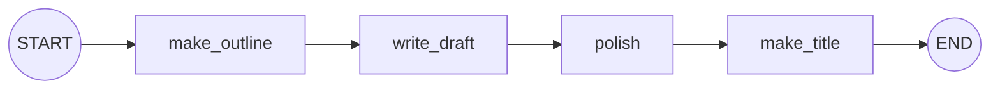

# Sequential Workflows and Prompt Chaining: The Complete Guide

> 📚 **Before you start**
>
> - [Lab: Your first graph](../02-getting-started/lab-your-first-graph.md), for building and running graphs.
> - [Prompt Templates](../../langchain-complete-guide/course.md#m4) and [Chat Models](../../langchain-complete-guide/course.md#m3) from the LangChain Complete Guide.
> - [Workflows vs Agents](../../agentic-ai-fundamentals/03-the-agent-loop/workflows-vs-agents.md), for where workflows fit.

## Introduction

Ask a model in one go to *"write a well-researched, well-structured 800-word blog post about solar panels for Indian homes, in a friendly tone, with a catchy title"*, and you'll get something passable. Ask it to do the same job in **steps** (first an outline, then a draft from the outline, then a polish pass, then a title) and the result is usually noticeably better, easier to check, and easier to fix when one step goes wrong.

That technique is called **prompt chaining**: break a task into a fixed sequence of smaller LLM calls, where each call's output feeds the next. In LangGraph it's the simplest workflow pattern: a straight line of nodes, each with one focused prompt, sharing a state that holds every intermediate result.

> 💡 **Key Insight**
>
> Each step in a chain should have **one job and one prompt**. Small, focused prompts are easier for the model to follow, and the intermediate results in the state give you **checkpoints you can inspect, test and improve** one at a time.

---

## Core Explanation

### 1. Why chain prompts?

| One big prompt | A chain of small prompts |
|---|---|
| The model juggles every requirement at once | Each call focuses on one thing |
| Hard to tell which requirement it ignored | You can see exactly which step went wrong |
| One failure ruins everything | Fix or retry just the weak step |
| One model for everything | Use a cheap model for easy steps, a strong one for hard ones |
| Cheaper and faster (one call) | More calls, more latency |

Use chaining when a task has **natural stages** (plan → write → refine, extract → transform → format) and quality matters more than the extra calls.

### 2. The state for a chain

A chain's state holds the input and **every intermediate output**:

```python
from typing import TypedDict
from langgraph.graph import StateGraph, START, END

class BlogState(TypedDict):
    topic: str
    outline: str
    draft: str
    final: str
    title: str
```

Keeping intermediate results (rather than overwriting one `text` field) means you can inspect the outline after a run, show it to a user, or rerun from the draft step.

### 3. A pretend model with the real interface

To run offline, we'll use LangChain's `FakeListChatModel`, a real chat model class that returns pre-written responses in order. It has exactly the same interface as a real model (`.invoke(...)` returns a message with `.content`), so the nodes you write here work unchanged with a real model.

```python
from langchain_core.language_models.fake_chat_models import FakeListChatModel

llm = FakeListChatModel(responses=[
    "1. Why solar suits Indian homes\n2. Costs and subsidies\n3. Choosing an installer",
    "Solar panels suit Indian homes because of strong sunshine... (draft covering costs, "
    "subsidies and installers)",
    "Thinking of going solar? India's sunshine makes it a smart choice... (polished, friendly)",
    "Sunshine to Savings: A Friendly Guide to Home Solar in India",
])
print(llm.invoke("test").content.splitlines()[0])
```

Output:

```
1. Why solar suits Indian homes
```

(That first test call used up response 1, so we'll recreate the model before running the chain.)

### 4. One node per prompt

Each node builds its prompt from the state, calls the model, and stores the result. LangChain's `ChatPromptTemplate` keeps prompts tidy:

```python
from langchain_core.prompts import ChatPromptTemplate

outline_prompt = ChatPromptTemplate.from_messages([
    ("system", "You plan blog posts. Reply with a numbered outline of exactly 3 sections."),
    ("human", "Topic: {topic}"),
])
draft_prompt = ChatPromptTemplate.from_messages([
    ("system", "You write clear blog drafts that follow the outline exactly."),
    ("human", "Topic: {topic}\nOutline:\n{outline}\n\nWrite the draft."),
])
polish_prompt = ChatPromptTemplate.from_messages([
    ("system", "You edit for a friendly, simple tone. Keep every fact. Indian English."),
    ("human", "{draft}"),
])
title_prompt = ChatPromptTemplate.from_messages([
    ("system", "You write catchy blog titles under 70 characters. Reply with the title only."),
    ("human", "{final}"),
])

def make_outline(state: BlogState):
    return {"outline": llm.invoke(outline_prompt.invoke(state)).content}

def write_draft(state: BlogState):
    return {"draft": llm.invoke(draft_prompt.invoke(state)).content}

def polish(state: BlogState):
    return {"final": llm.invoke(polish_prompt.invoke(state)).content}

def make_title(state: BlogState):
    return {"title": llm.invoke(title_prompt.invoke(state)).content}
```

`outline_prompt.invoke(state)` fills `{topic}` from the state (extra keys are ignored), producing the messages the model receives. Each prompt sees only what its step needs.

### 5. Wiring the chain

```python
builder = StateGraph(BlogState)
builder.add_sequence([make_outline, write_draft, polish, make_title])
builder.add_edge(START, "make_outline")
builder.add_edge("make_title", END)
blog_chain = builder.compile()

llm = FakeListChatModel(responses=[      # fresh model so responses start from the first
    "1. Why solar suits Indian homes\n2. Costs and subsidies\n3. Choosing an installer",
    "Solar panels suit Indian homes because of strong sunshine... (draft covering costs, "
    "subsidies and installers)",
    "Thinking of going solar? India's sunshine makes it a smart choice... (polished, friendly)",
    "Sunshine to Savings: A Friendly Guide to Home Solar in India",
])

result = blog_chain.invoke({"topic": "Solar panels for Indian homes"})
print("TITLE:", result["title"])
print("OUTLINE:", result["outline"].replace("\n", " | "))
print("FINAL:", result["final"][:60] + "...")
```

Output:

```
TITLE: Sunshine to Savings: A Friendly Guide to Home Solar in India
OUTLINE: 1. Why solar suits Indian homes | 2. Costs and subsidies | 3. Choosing an installer
FINAL: Thinking of going solar? India's sunshine makes it a smart c...
```

The nodes look up `llm` when they run, which is why replacing it before `invoke` works. In a real app you'd create the model once at the top of the file.



### 6. Using a real model

Swap the fake for a real chat model; nothing else changes:

```python
# not-run: needs `pip install langchain-anthropic` and ANTHROPIC_API_KEY
from langchain_anthropic import ChatAnthropic

llm = ChatAnthropic(model="claude-opus-5-5")
result = blog_chain.invoke({"topic": "Solar panels for Indian homes"})
print(result["title"])
```

Because each step is a separate call, you can also use **different models per step**, for example a small fast model for the title and a stronger one for the draft.

### 7. Adding a programmatic check (a "gate")

Chains get more reliable when you **check intermediate outputs in code**. For example, make sure the outline really has three sections before spending a call on the draft. The simplest gate is a node that validates and records problems; in the next lessons you'll route on such checks ([Conditional Workflows](conditional-workflows.md)) and loop to fix them ([Iterative Workflows](iterative-looping-workflows.md)).

```python
def count_sections(outline: str) -> int:
    return sum(1 for line in outline.splitlines() if line.strip()[:2].rstrip(".").isdigit())

print(count_sections(result["outline"]))
print(count_sections("Intro and a few thoughts"))
```

Output:

```
3
0
```

### 8. Streaming progress

Long chains feel slow. Stream the updates so a UI can show "Outlining... Drafting... Polishing...":

```python
llm = FakeListChatModel(responses=["1. A\n2. B\n3. C", "draft", "final", "A Title"])
for chunk in blog_chain.stream({"topic": "Chai"}, stream_mode="updates"):
    node = next(iter(chunk))
    print(f"finished {node}")
```

Output:

```
finished make_outline
finished write_draft
finished polish
finished make_title
```

---

## Try It Yourself

1. **Add a step.** Add a `meta_description` node after `make_title` that writes a 150-character summary. Update the state and the sequence. How many responses does the fake model now need?
2. **Different models.** Rewrite the nodes so `make_title` uses a separate `title_llm`. Why might you do this in production?
3. **Design a chain.** Write the node names (no code) for a chain that turns a customer complaint email into a support ticket: what are the stages?

<details>
<summary>Show answers</summary>

**1.**

```python
class BlogState(TypedDict):
    topic: str
    outline: str
    draft: str
    final: str
    title: str
    meta: str

def meta_description(state: BlogState):
    return {"meta": llm.invoke(f"Summarise in 150 characters: {state['final']}").content}

builder = StateGraph(BlogState)
builder.add_sequence([make_outline, write_draft, polish, make_title, meta_description])
builder.add_edge(START, "make_outline")
builder.add_edge("meta_description", END)
llm = FakeListChatModel(responses=["1. A\n2. B\n3. C", "draft", "final", "Title", "A short summary."])
print(builder.compile().invoke({"topic": "Chai"})["meta"])
```

Output:

```
A short summary.
```

Five responses, one per LLM node.

**2.** Define `title_llm = ...` and use it inside `make_title`. In production, a cheaper, faster model is often good enough for short tasks like titles, saving cost and latency.

**3.** For example: `extract_details` (customer, order id, issue) → `classify_issue` (category, urgency) → `summarise` (two-line summary) → `format_ticket` (fields for the ticketing system).

</details>

---

## Real-World Examples

- **Content teams** chain outline → draft → edit → SEO metadata.
- **Document processing** chains extract → normalise → validate → format into a database row.
- **Code generation tools** chain plan → write code → write tests → write documentation.

---

## Common Misconceptions

### "Chaining is always better than one prompt"

For simple tasks one prompt is cheaper and good enough. Chain when the stages are real and quality matters.

### "Each step needs the whole state"

Give each prompt only what it needs; less irrelevant text usually means better focus.

### "A chain doesn't need LangGraph"

A plain LangChain pipeline can run a simple chain. LangGraph pays off when you add gates, branches, retries, streaming of each step, or persistence.

---

## Interview Relevance

*"What is prompt chaining and when would you use it?"* Breaking a task into a fixed sequence of focused LLM calls where each output feeds the next; use it for tasks with natural stages, to improve reliability and debuggability at the cost of more calls. Mention **programmatic gates** between steps and choosing **different models per step**.

---

## Key Takeaways

- **Prompt chaining** = a fixed sequence of focused LLM calls; in LangGraph, a straight line of nodes.
- Keep **every intermediate result** in the state so you can inspect and rerun steps.
- One **job and prompt per node**; use `ChatPromptTemplate` to fill prompts from the state.
- Add **code checks (gates)** between steps; stream progress to users.
- Swap the **fake model** for a real one without changing the graph.

---

**Up next:** [Parallel Workflows](parallel-workflows.md)
