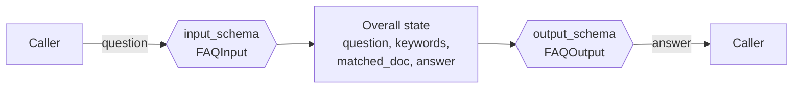
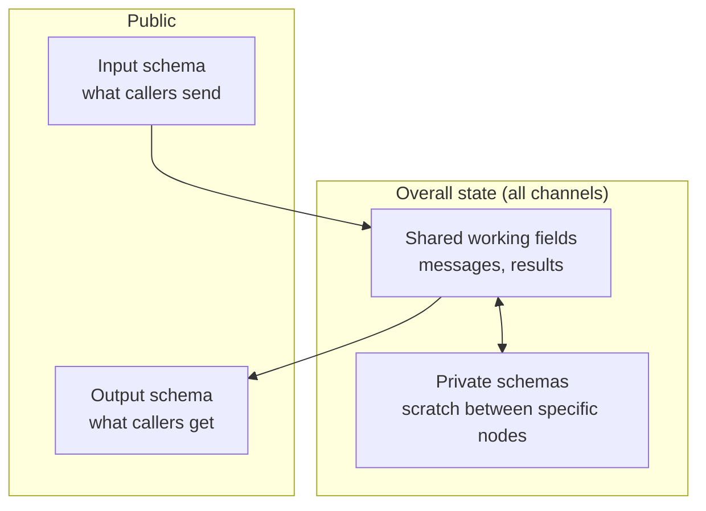

# Multiple Schemas: The Complete Guide

> 📚 **Before you start**
>
> - [State Schemas and Data Flow](state-schemas-and-data-flow.md), especially section 5 on narrower node inputs.
> - [State Reducers](state-reducers.md), because reducers keep working across schemas.
> - [Shared vs Different State in Subgraphs](../09-subgraphs/shared-vs-different-state-in-subgraphs.md), where you first met `input_schema` and `output_schema` on a subgraph.

## Introduction

When you order a masala dosa at a restaurant, the menu is the **input** (you say "one masala dosa, extra chutney"), and the plate that arrives is the **output**. Behind the kitchen door there's a lot more going on: the batter's fermentation time, which tawa is free, the chef's notes about a customer who wanted it crisp. You don't fill in those fields, and you don't get them back on your plate. The restaurant's interface is small on purpose.

So far, every graph you've built has had a single schema, which means the "menu" and the "plate" are the entire kitchen: callers can pass in any internal field, and the result dictionary contains every scratch value your nodes wrote. That's fine in a notebook. It's a problem when a graph becomes an API, a subgraph used by another team, or a deployed agent whose responses go straight to a front end.

LangGraph lets one graph have **several schemas**: an **input schema** (what callers may send), an **output schema** (what they get back), the **overall state** (the full set of channels), and **private schemas** used only between particular nodes. This lesson shows each one, what it does and doesn't hide, and how to design a clean graph interface.

> 💡 **Key Insight**
>
> Multiple schemas control **what crosses the boundary** of the graph and **what each node sees**. Internally there is still **one set of channels**: the union of every schema's keys, all saved in checkpoints. "Private" means "not part of the interface", not "secret". Think of the schemas as the doors of the kitchen, not as locked cupboards inside it.

---

## Core Explanation

### 1. The problem with one schema

A small question-answering graph for a bank's FAQ, written the usual way:

```python
from typing import TypedDict
from langgraph.graph import StateGraph, START, END

class FAQState(TypedDict):
    question: str
    keywords: list
    matched_doc: str
    answer: str

DOCS = {
    "upi": "UPI payments are free for customers. The daily limit is usually ₹1 lakh per bank account.",
    "fd": "Fixed deposits from 7 days to 10 years. Senior citizens get an extra 0.5% interest.",
    "card": "To block a debit card, use the app, net banking, or call the 24x7 helpline.",
}

def extract(state: FAQState):
    return {"keywords": [w.strip("?.,").lower() for w in state["question"].split()]}

def retrieve(state: FAQState):
    key = next((k for k in DOCS if k in state["keywords"]), "card")
    return {"matched_doc": DOCS[key]}

def respond(state: FAQState):
    return {"answer": state["matched_doc"]}

b = StateGraph(FAQState)
b.add_sequence([extract, retrieve, respond])
b.add_edge(START, "extract")
faq_v1 = b.compile()

print(faq_v1.invoke({"question": "Is UPI free?"}))
```

Output:

```
{'question': 'Is UPI free?', 'keywords': ['is', 'upi', 'free'], 'matched_doc': 'UPI payments are free for customers. The daily limit is usually ₹1 lakh per bank account.', 'answer': 'UPI payments are free for customers. The daily limit is usually ₹1 lakh per bank account.'}
```

The caller asked one question and got back the internal keyword list and the retrieved document. Worse, a caller could **pass** `matched_doc` in the input and influence the graph in ways you never intended. Every internal field has become part of the public contract.

### 2. Input and output schemas

Give the `StateGraph` two extra schemas. The first argument is still the **overall state**; `input_schema` and `output_schema` describe the boundary:

```python
class FAQInput(TypedDict):
    question: str

class FAQOutput(TypedDict):
    answer: str

b = StateGraph(FAQState, input_schema=FAQInput, output_schema=FAQOutput)
b.add_sequence([extract, retrieve, respond])
b.add_edge(START, "extract")
faq = b.compile()

print(faq.invoke({"question": "Is UPI free?"}))
print(faq.invoke({"question": "Is UPI free?", "matched_doc": "Everything is free!"}))
```

Output:

```
{'answer': 'UPI payments are free for customers. The daily limit is usually ₹1 lakh per bank account.'}
{'answer': 'UPI payments are free for customers. The daily limit is usually ₹1 lakh per bank account.'}
```

- The output contains only `answer`.
- The sneaky `matched_doc` in the second call was **filtered out** at the door: only keys in the input schema are written from the input.



The schemas are also published as JSON Schema, which is what deployment tools and Studio use to build input forms and API docs:

```python
print(faq.get_input_jsonschema())
print(faq.get_output_jsonschema()["properties"])
```

Output:

```
{'properties': {'question': {'title': 'Question', 'type': 'string'}}, 'required': ['question'], 'title': 'FAQInput', 'type': 'object'}
{'answer': {'title': 'Answer', 'type': 'string'}}
```

### 3. Private state between nodes

Input and output schemas hide fields from **callers**. Sometimes you also want fields that only **some nodes** use, without adding them to the overall state class. A node can declare a different schema in its type hints: the type of its first parameter is what it **reads**, and LangGraph registers every key of every schema it finds as a channel.

```python
class Overall(TypedDict):
    question: str
    answer: str

class Scratch(TypedDict):          # used only between two nodes
    keywords: list
    matched_doc: str

def extract_p(state: Overall) -> Scratch:
    return {"keywords": [w.strip("?.,").lower() for w in state["question"].split()]}

def retrieve_p(state: Scratch) -> Scratch:
    print("retrieve sees:", sorted(state))
    key = next((k for k in DOCS if k in state["keywords"]), "card")
    return {"matched_doc": DOCS[key]}

def respond_p(state: Scratch) -> Overall:
    print("respond sees:", sorted(state))
    return {"answer": state["matched_doc"]}

b = StateGraph(Overall, input_schema=FAQInput, output_schema=FAQOutput)
b.add_sequence([extract_p, retrieve_p, respond_p])
b.add_edge(START, "extract_p")
faq_private = b.compile()

print(faq_private.invoke({"question": "What about FD for senior citizens?"}))
print("channels:", [c for c in faq_private.channels if not c.startswith(("__", "branch:"))])
```

Output:

```
retrieve sees: ['keywords']
respond sees: ['keywords', 'matched_doc']
{'answer': 'Fixed deposits from 7 days to 10 years. Senior citizens get an extra 0.5% interest.'}
channels: ['question', 'answer', 'keywords', 'matched_doc']
```

`keywords` and `matched_doc` aren't in `Overall`, yet they work: LangGraph found the `Scratch` schema on the nodes' type hints and created channels for its keys. `retrieve_p` and `respond_p` read only the `Scratch` view; the `-> Scratch` return hints are documentation (nodes may write any registered key).

The rule to remember: **a key must appear in some schema LangGraph can see** (the overall state, the input or output schema, or a node's parameter type hint). A node writing a key that no schema mentions is silently dropped, exactly like the typo case from the first module.

### 4. "Private" is not "secret"

All those keys are ordinary channels, so they're stored in checkpoints and show up in some streams:

```python
from langgraph.checkpoint.memory import InMemorySaver

b = StateGraph(Overall, input_schema=FAQInput, output_schema=FAQOutput)
b.add_sequence([extract_p, retrieve_p, respond_p])
b.add_edge(START, "extract_p")
saved = b.compile(checkpointer=InMemorySaver())
cfg = {"configurable": {"thread_id": "faq-1"}}

result = saved.invoke({"question": "How to block my card?"}, cfg)
print("returned:", result)
print("checkpoint has:", sorted(saved.get_state(cfg).values))
```

Output:

```
retrieve sees: ['keywords']
respond sees: ['keywords', 'matched_doc']
returned: {'answer': 'To block a debit card, use the app, net banking, or call the 24x7 helpline.'}
checkpoint has: ['answer', 'keywords', 'matched_doc', 'question']
```

The caller got only the answer, but the checkpoint holds everything. That's what you want for debugging and resuming, but it means:

- **Don't** put secrets (API keys, raw card numbers, OTPs) in state, private or not. Pass them through runtime context or keep them out of the graph.
- `stream_mode="values"` emits the full state after each step, so a server that forwards raw value streams to a browser will leak private keys. Forward `updates` from chosen nodes, or the final output, instead.

| Where | Sees private keys? |
|---|---|
| `invoke` return value | No, only the output schema |
| `stream_mode="updates"` | Yes, each node's update as returned |
| `stream_mode="values"` | Yes, the full state |
| `get_state` / checkpoints | Yes, everything |

### 5. Combining schemas with messages

The pattern you'll use most often: callers send a question and get an answer, while the graph keeps a full message history internally (for a model, tools, retries). The overall state subclasses `MessagesState`; the interface stays tiny:

```python
from langchain_core.language_models.fake_chat_models import FakeListChatModel
from langchain_core.messages import HumanMessage, SystemMessage
from langgraph.graph import MessagesState

llm = FakeListChatModel(responses=["UPI is free for customers, with a typical limit of ₹1 lakh a day."])

class AskIn(TypedDict):
    question: str

class AskOut(TypedDict):
    answer: str

class AskState(MessagesState):
    question: str
    answer: str

def to_messages(state: AskIn):
    return {"messages": [HumanMessage(state["question"])]}

def call_model(state: AskState):
    reply = llm.invoke([SystemMessage("Answer in one sentence.")] + state["messages"])
    return {"messages": [reply]}

def to_answer(state: AskState):
    return {"answer": state["messages"][-1].content}

b = StateGraph(AskState, input_schema=AskIn, output_schema=AskOut)
b.add_sequence([to_messages, call_model, to_answer])
b.add_edge(START, "to_messages")
ask = b.compile()

print(ask.invoke({"question": "Is UPI free?"}))
```

Output:

```
{'answer': 'UPI is free for customers, with a typical limit of ₹1 lakh a day.'}
```

Callers never need to know LangChain message classes exist. You could swap the internals for a tool-calling agent (you will, in the lab) without changing a single caller.

### 6. Output schema keys must be written

The output schema filters the final state; it doesn't invent values. If no node writes an output key, it's simply missing from the result:

```python
class FAQOutputWithSource(TypedDict):
    answer: str
    source: str            # nobody writes this

b = StateGraph(FAQState, input_schema=FAQInput, output_schema=FAQOutputWithSource)
b.add_sequence([extract, retrieve, respond])
b.add_edge(START, "extract")
print(b.compile().invoke({"question": "Is UPI free?"}))
```

Output:

```
{'answer': 'UPI payments are free for customers. The daily limit is usually ₹1 lakh per bank account.'}
```

When you change an output schema, check that some node actually writes each key, and add a test that invokes the graph and checks the result's keys.

### 7. Designing the interface



| Question | Guideline |
|---|---|
| What goes in the input schema? | Only what a caller must or may decide: the question, a document id, options |
| What goes in the output schema? | Only what a caller needs: the answer, a status, citations |
| What stays internal? | Messages, tool results, drafts, counters, retry flags |
| When to use a private schema? | Scratch data used by two or three adjacent nodes, to keep the overall class readable |
| Pydantic or TypedDict for the input? | Pydantic if the input comes from users or other services, and make the first node read that model so it's actually validated |

---

## Try It Yourself

1. **Add citations.** Extend `faq` so the output also includes `source` (the DOCS key that matched). Which nodes and schemas change?
2. **Prove the filter.** Show that passing `{"question": ..., "keywords": ["fd"]}` to `faq` doesn't affect the answer for "Is UPI free?".
3. **Pydantic input.** Make the input schema a Pydantic model that rejects questions shorter than 5 characters. Show the error for `"hi"`.

<details>
<summary>Show answers</summary>

**1.** `retrieve` writes `source`, the overall state and the output schema gain it:

```python
class FAQState2(FAQState):
    source: str

class FAQOutput2(TypedDict):
    answer: str
    source: str

def retrieve2(state: FAQState2):
    key = next((k for k in DOCS if k in state["keywords"]), "card")
    return {"matched_doc": DOCS[key], "source": key}

b = StateGraph(FAQState2, input_schema=FAQInput, output_schema=FAQOutput2)
b.add_node(extract)
b.add_node("retrieve", retrieve2)
b.add_node(respond)
b.add_edge(START, "extract")
b.add_edge("extract", "retrieve")
b.add_edge("retrieve", "respond")
print(b.compile().invoke({"question": "Senior citizen FD rates?"}))
```

Output:

```
{'answer': 'Fixed deposits from 7 days to 10 years. Senior citizens get an extra 0.5% interest.', 'source': 'fd'}
```

**2.**

```python
print(faq.invoke({"question": "Is UPI free?", "keywords": ["fd"]}))
```

Output:

```
{'answer': 'UPI payments are free for customers. The daily limit is usually ₹1 lakh per bank account.'}
```

`keywords` isn't in the input schema, so it's dropped at the door, and `extract` computes the real keywords anyway.

**3.**

```python
from pydantic import BaseModel, Field

class StrictIn(BaseModel):
    question: str = Field(min_length=5)

b = StateGraph(FAQState, input_schema=StrictIn, output_schema=FAQOutput)
b.add_sequence([extract, retrieve, respond])
b.add_edge(START, "extract")
print("graph schema only:", b.compile().invoke({"question": "hi"}))

def extract_checked(state: StrictIn):          # the first node READS the Pydantic model
    return {"keywords": [w.strip("?.,").lower() for w in state.question.split()]}

b = StateGraph(FAQState, input_schema=StrictIn, output_schema=FAQOutput)
b.add_node("extract", extract_checked)
b.add_node(retrieve)
b.add_node(respond)
b.add_edge(START, "extract")
b.add_edge("extract", "retrieve")
b.add_edge("retrieve", "respond")
strict = b.compile()
print(strict.invoke({"question": "Is UPI free?"}))
try:
    strict.invoke({"question": "hi"})
except Exception as e:
    print(type(e).__name__, "|", str(e).splitlines()[2].strip())
```

Output:

```
graph schema only: {'answer': 'To block a debit card, use the app, net banking, or call the 24x7 helpline.'}
{'answer': 'UPI payments are free for customers. The daily limit is usually ₹1 lakh per bank account.'}
ValidationError | String should have at least 5 characters [type=string_too_short, input_value='hi', input_type=str]
```

A surprise worth remembering: putting a Pydantic model in `input_schema` alone **didn't** reject `"hi"`. The graph-level input schema decides which keys get in; validation happens when a node **reads** the state as that Pydantic model (the same rule as in [State Schemas and Data Flow](state-schemas-and-data-flow.md)). So make the first node's parameter the Pydantic input model, as `extract_checked` does.

</details>

---

## Real-World Examples

- **Deployed agents** (LangSmith Deployment, your own FastAPI server) publish the input and output JSON Schemas as their API contract, so front-end teams never depend on internal fields.
- **Reusable subgraphs** such as a "verify KYC document" graph expose `document_id` in and `verdict` out, while their message history and OCR text stay internal.
- **Compliance-sensitive apps** use output schemas to make sure internal reasoning, retrieved customer records or tool outputs never reach the client by accident.

---

## Common Misconceptions

### "Private state isn't saved"

It's an ordinary channel: saved in checkpoints and visible in `values` and `updates` streams. It's only hidden from the input and the `invoke` result.

### "Keys outside the input schema cause an error"

They're silently ignored. To reject bad input, have the first node read the state as a Pydantic model (exercise 3).

### "The output schema creates keys"

It only filters. Keys nobody wrote are missing from the result.

### "Nodes can only write keys of their declared return type"

The return hint documents intent; a node may write any channel the graph knows about.

---

## Interview Relevance

*"How do you hide internal state from a LangGraph graph's callers?"* Use `StateGraph(Overall, input_schema=In, output_schema=Out)`; keep scratch data in private schemas declared on node type hints. Explain that all keys are still channels saved in checkpoints, so private isn't secret, and that `values` streams expose everything.

*"Why separate input and output schemas?"* A stable, minimal contract for APIs and subgraphs, input filtering (callers can't inject internal fields), clean JSON Schemas for tools and UIs, and freedom to change internals without breaking callers.

---

## Key Takeaways

- **`input_schema`** filters what callers can write; **`output_schema`** filters what `invoke` returns.
- **Private schemas** on node type hints add channels used only between specific nodes.
- All schemas form **one set of channels**; private keys are **saved and streamed**, so never store secrets there.
- Output keys must be **written by some node**; the schema only filters.
- Design a **small public interface** and keep messages, drafts and tool results internal.

---

**Up next:** [Lab: A multi-schema agent](lab-a-multi-schema-agent.md)
