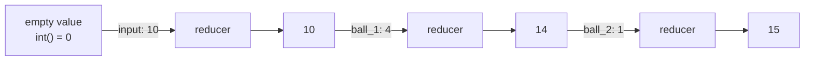

# State Reducers: The Complete Guide

> 📚 **Before you start**
>
> - [The LangGraph State System](the-langgraph-state-system.md), for channels and the one-writer-per-step rule.
> - [State Schemas and Data Flow](state-schemas-and-data-flow.md), where a nested dictionary lost its data.
> - [ChatPromptTemplate and Messages](../../langchain-complete-guide/course.md#m4) in the LangChain Complete Guide, for message objects such as `HumanMessage` and `AIMessage`.
> - [Parallel Workflows](../03-workflow-patterns-in-langgraph/parallel-workflows.md), since reducers matter most when branches run together.

## Introduction

At the end of a cricket match, the scorer doesn't let each fielder rewrite the scorecard. Each ball produces a small fact ("4 runs", "wicket", "wide"), and the scorer **folds** it into the card by a fixed rule: runs are added to the total, wickets are counted, the over number moves on, and the bowler's figures are updated. Two things happening on the same ball (a run *and* a run-out) are both applied, by their own rules.

A **reducer** is that scorer's rule for one field of your state. Without one, a field is simply replaced by the latest value, and two writers in one step are an error. With one, every update is folded into the current value by a function you choose. You've used `operator.add` and `add_messages` already; this lesson explains exactly when reducers run, how `add_messages` handles ids and deletions, how to write your own reducers for real problems (merging settings, de-duplicating, sliding windows, resetting), how to bypass a reducer, and the traps that catch nearly everyone once.

> 💡 **Key Insight**
>
> A reducer is a function `(current, update) -> new`. LangGraph calls it for **every** write to that field: the **graph input**, each **node update**, each **`update_state`** call and each **`Command(update=...)`**. If you remember "the reducer sees every write, including the input", you'll avoid the most common reducer bug: data that appears twice.

---

## Core Explanation

### 1. Watching a reducer work

Let's give a field a reducer that prints every call:

```python
import operator
from typing import Annotated, TypedDict
from langgraph.graph import StateGraph, START, END

def noisy_add(current, update):
    print(f"  reducer({current!r}, {update!r})")
    return current + update

class Score(TypedDict):
    runs: Annotated[int, noisy_add]
    balls: list

def ball_1(state: Score):
    return {"runs": 4}

def ball_2(state: Score):
    return {"runs": 1}

b = StateGraph(Score)
b.add_sequence([ball_1, ball_2])
b.add_edge(START, "ball_1")
innings = b.compile()

print("with runs in the input:")
print(innings.invoke({"runs": 10, "balls": []}))
print("without runs in the input:")
print(innings.invoke({"balls": []}))
```

Output:

```
with runs in the input:
  reducer(0, 10)
  reducer(10, 4)
  reducer(14, 1)
{'runs': 15, 'balls': []}
without runs in the input:
  reducer(0, 4)
  reducer(4, 1)
{'runs': 5, 'balls': []}
```

Three facts are visible here:

- The **input** went through the reducer too (`reducer(0, 10)`).
- Before the first write, the reducer's `current` is the **empty value of the annotated type**: `int()` is `0`, `list()` is `[]`, `dict()` is `{}`. That's why `Annotated[int, operator.add]` "just works" as a counter.
- Each node's update was folded in turn: `10 + 4`, then `14 + 1`.



### 2. The built-in workhorse: `operator.add`

`operator.add` is Python's `+` as a function, so its meaning depends on the type:

| Annotation | `current + update` means | Typical use |
|---|---|---|
| `Annotated[list, operator.add]` | Concatenate lists | Logs, results from parallel branches |
| `Annotated[int, operator.add]` | Add numbers | Counters, token totals, costs |
| `Annotated[float, operator.add]` | Add numbers | Running ₹ totals |
| `Annotated[str, operator.add]` | Concatenate strings | Rarely what you want |

The list version has one sharp edge: the update must be a **list**. Python refuses to add a bare string to a list, so a node that forgets the brackets fails:

```python
class Log(TypedDict):
    log: Annotated[list, operator.add]

def wrong(state: Log):
    return {"log": "toss won"}          # should be ["toss won"]

b = StateGraph(Log)
b.add_node(wrong)
b.add_edge(START, "wrong")
try:
    b.compile().invoke({"log": []})
except TypeError as e:
    print("TypeError:", e)
```

Output:

```
TypeError: can only concatenate list (not "str") to list
```

### 3. `add_messages` in depth

For conversations, `operator.add` isn't enough: you also need to **edit** and **delete** messages. `add_messages` is the reducer behind `MessagesState`, and it follows these rules:

| Update contains | Effect |
|---|---|
| A message with a **new id** (or no id) | Appended; a message without an id gets a fresh UUID |
| A message whose id **already exists** | Replaces that message in place (same position) |
| `RemoveMessage(id=...)` | Deletes that message; an unknown id raises `ValueError` |
| `RemoveMessage(id=REMOVE_ALL_MESSAGES)` | Deletes **everything before it** in the update; later messages in the same update are kept |
| Tuples or dicts like `("user", "hi")` | Converted to message objects first |

You can call it directly, like any function, which is the easiest way to learn it:

```python
from langchain_core.messages import AIMessage, HumanMessage, RemoveMessage
from langgraph.graph.message import add_messages, REMOVE_ALL_MESSAGES

chat = [HumanMessage("Score?", id="h1"), AIMessage("India 245/3", id="a1")]

chat = add_messages(chat, [AIMessage("India 245/4 (Kohli out)", id="a1")])   # replace by id
print([m.content for m in chat])

chat = add_messages(chat, [("user", "Who's batting now?")])                  # append, id assigned
print([m.content for m in chat], "| new id assigned:", chat[-1].id is not None)

chat = add_messages(chat, [RemoveMessage(id="h1")])                          # delete one
print([m.content for m in chat])

chat = add_messages(chat, [RemoveMessage(id=REMOVE_ALL_MESSAGES), HumanMessage("New chat", id="h9")])
print([m.content for m in chat])

try:
    add_messages(chat, [RemoveMessage(id="does-not-exist")])
except ValueError as e:
    print("ValueError:", e)
```

Output:

```
['Score?', 'India 245/4 (Kohli out)']
['Score?', 'India 245/4 (Kohli out)', "Who's batting now?"] | new id assigned: True
['India 245/4 (Kohli out)', "Who's batting now?"]
['New chat']
ValueError: Attempting to delete a message with an ID that doesn't exist ('does-not-exist')
```

The `REMOVE_ALL_MESSAGES` pattern ("wipe, then write a fresh list") is how you **replace** a whole conversation, for example with a trimmed or summarised version. You'll use it in the [Memory](../course.md#m7) module.

### 4. Custom reducer: merging dictionaries

In the last lesson, updating `prefs` with `{"berth": "lower"}` wiped the meal and language settings, because a plain key is replaced whole. A merging reducer fixes it:

```python
def merge_dicts(current: dict, update: dict) -> dict:
    """Shallow merge: keys in the update win, other keys are kept."""
    return {**current, **update}

class Passenger(TypedDict):
    prefs: Annotated[dict, merge_dicts]

def set_berth(state: Passenger):
    return {"prefs": {"berth": "lower"}}

def set_meal(state: Passenger):
    return {"prefs": {"meal": "jain"}}

b = StateGraph(Passenger)
b.add_node(set_berth)
b.add_node(set_meal)
b.add_edge(START, "set_berth")          # both run in the same super-step
b.add_edge(START, "set_meal")
print(b.compile().invoke({"prefs": {"berth": "any", "meal": "veg", "language": "hi"}}))
```

Output:

```
{'prefs': {'berth': 'lower', 'meal': 'jain', 'language': 'hi'}}
```

Two parallel nodes updated different settings in the same step, and nothing was lost. A reducer turns "one writer per step" into "many writers, merged by a rule".

### 5. More reducers worth knowing

Reducers are ordinary functions, so they can encode any merge rule. Four that come up again and again:

```python
def unique(current: list, update: list) -> list:
    """Append only items not already present, keeping first-seen order."""
    return current + [x for x in update if x not in current]

def last_n(n: int):
    """Keep only the most recent n items."""
    def reducer(current: list, update: list) -> list:
        return (current + update)[-n:]
    return reducer

def resettable(current: list, update):
    """Append lists; an update of None clears the list."""
    return [] if update is None else current + update

def keep_max(current: float, update: float) -> float:
    return max(current, update)

print(unique(["Rohit", "Gill"], ["Gill", "Kohli"]))
print(last_n(3)([1, 2, 3], [4, 5]))
print(resettable(["a", "b"], None), resettable(["a"], ["b"]))
print(keep_max(87.5, 92.0))
```

Output:

```
['Rohit', 'Gill', 'Kohli']
[3, 4, 5]
[] ['a', 'b']
92.0
```

Here are two of them inside a graph: a scorer that keeps only the last three balls for a "recent form" display while tracking distinct batters:

```python
class Over(TypedDict):
    recent: Annotated[list, last_n(3)]
    batters: Annotated[list, unique]

def make_ball(runs, batter):
    def ball(state: Over):
        return {"recent": [runs], "batters": [batter]}
    return ball

b = StateGraph(Over)
deliveries = [(1, "Rohit"), (4, "Gill"), (0, "Gill"), (6, "Gill"), (1, "Rohit")]
names = []
for i, (runs, batter) in enumerate(deliveries, start=1):
    b.add_node(f"ball_{i}", make_ball(runs, batter))
    names.append(f"ball_{i}")
b.add_edge(START, names[0])
for a, c in zip(names, names[1:]):
    b.add_edge(a, c)
print(b.compile().invoke({"recent": [], "batters": []}))
```

Output:

```
{'recent': [0, 6, 1], 'batters': ['Rohit', 'Gill']}
```

### 6. Reducers and parallel branches: order isn't promised

When several nodes write the same field in one super-step, the reducer is called once per update. LangGraph applies them in a consistent order for a given graph, but that order is an implementation detail, not something the API promises. A reducer whose result depends on order will give a result that looks arbitrary:

```python
def take_latest(current, update):
    return update

class Who(TypedDict):
    winner: Annotated[str, take_latest]

b = StateGraph(Who)
for name in ["zaheer", "ashwin", "bumrah"]:
    b.add_node(name, lambda state, n=name: {"winner": n})
    b.add_edge(START, name)
print(b.compile().invoke({"winner": ""}))
```

Output:

```
{'winner': 'zaheer'}
```

Not alphabetical, not the order a human would guess, and nothing you should build on. Prefer reducers that are **order-independent** (adding numbers, merging disjoint keys, collecting into a list you sort later, taking a max). If order truly matters, put the writers in **sequence** instead of in parallel, or include a sort key in each update.

### 7. Bypassing a reducer with `Overwrite`

Occasionally a node needs to **replace** a reduced field outright, for example to reset a log at the start of a new round. Wrapping the value in `Overwrite` skips the reducer for that one write:

```python
from langgraph.types import Overwrite

class Round(TypedDict):
    log: Annotated[list, operator.add]

def play(state: Round):
    return {"log": ["played"]}

def new_round(state: Round):
    return {"log": Overwrite(["round 2 started"])}

b = StateGraph(Round)
b.add_sequence([play, new_round])
b.add_edge(START, "play")
print(b.compile().invoke({"log": ["round 1 started"]}))
```

Output:

```
{'log': ['round 2 started']}
```

Only one `Overwrite` per field per super-step is allowed (two would be ambiguous). For `messages`, the equivalent idiom is the `RemoveMessage(id=REMOVE_ALL_MESSAGES)` pattern from section 3.

### 8. The classic trap: data that appears twice

Because the reducer sees the **input** too, re-sending existing data duplicates it. With a checkpointer this bites hard: the saved list is the `current` value, and your input is added to it:

```python
from langgraph.checkpoint.memory import InMemorySaver

class Basket(TypedDict):
    items: Annotated[list, operator.add]

def note(state: Basket):
    return {}

b = StateGraph(Basket)
b.add_node(note)
b.add_edge(START, "note")
shop = b.compile(checkpointer=InMemorySaver())
cfg = {"configurable": {"thread_id": "basket-1"}}

shop.invoke({"items": ["atta"]}, cfg)
print(shop.invoke({"items": ["atta", "dal"]}, cfg)["items"])     # resends atta
```

Output:

```
['atta', 'atta', 'dal']
```

The rule: **send only what's new** to a field with an appending reducer. (`add_messages` is more forgiving for *message objects* with ids, since a repeated id replaces instead of appending, but new dictionaries or tuples get new ids and duplicate just the same.) The same trap appears when a subgraph (a graph used as a node inside another graph) returns a list that the parent appends to; see [Shared vs Different State in Subgraphs](../09-subgraphs/shared-vs-different-state-in-subgraphs.md).

### 9. Choosing a merge rule

| You want | Use |
|---|---|
| One owner, latest value wins | No reducer |
| Collect results from parallel branches | `Annotated[list, operator.add]` |
| Count or total | `Annotated[int, operator.add]` |
| A conversation you can edit and prune | `add_messages` (or `MessagesState`) |
| Settings updated piece by piece | A dict-merge reducer |
| No duplicates | A `unique` reducer |
| Bounded history | A `last_n` reducer |
| Occasionally start over | `Overwrite(...)` or a reset sentinel |

---

## Try It Yourself

1. **Token budget counter.** Give a state `tokens: Annotated[int, operator.add]` and three nodes that report 120, 340 and 95 tokens. What's the final total if the input also passes `tokens: 1000`?
2. **Deep merge.** Write `deep_merge` so `{"seat": {"coach": "B2"}}` merged into `{"seat": {"coach": "B1", "berth": 34}, "meal": "veg"}` gives `{"seat": {"coach": "B2", "berth": 34}, "meal": "veg"}`.
3. **Edit an AI message.** Using `add_messages`, replace the AI message in `[Human("2+2?", id="q"), AI("5", id="a")]` with the correct answer, then delete the question. Print the contents.

<details>
<summary>Show answers</summary>

**1.** The input goes through the reducer too, so it's 1000 + 120 + 340 + 95.

```python
class Usage(TypedDict):
    tokens: Annotated[int, operator.add]

b = StateGraph(Usage)
calls = [("plan", 120), ("search", 340), ("answer", 95)]
for name, used in calls:
    b.add_node(name, lambda state, used=used: {"tokens": used})
b.add_edge(START, "plan")
b.add_edge("plan", "search")
b.add_edge("search", "answer")
print(b.compile().invoke({"tokens": 1000}))
```

Output:

```
{'tokens': 1555}
```

**2.**

```python
def deep_merge(current: dict, update: dict) -> dict:
    out = dict(current)
    for key, value in update.items():
        if isinstance(value, dict) and isinstance(out.get(key), dict):
            out[key] = deep_merge(out[key], value)
        else:
            out[key] = value
    return out

print(deep_merge({"seat": {"coach": "B1", "berth": 34}, "meal": "veg"}, {"seat": {"coach": "B2"}}))
```

Output:

```
{'seat': {'coach': 'B2', 'berth': 34}, 'meal': 'veg'}
```

Use it as `Annotated[dict, deep_merge]`.

**3.**

```python
chat = [HumanMessage("2+2?", id="q"), AIMessage("5", id="a")]
chat = add_messages(chat, [AIMessage("4", id="a")])
chat = add_messages(chat, [RemoveMessage(id="q")])
print([(type(m).__name__, m.content) for m in chat])
```

Output:

```
[('AIMessage', '4')]
```

</details>

---

## Real-World Examples

- **Research agents** fan out searches in parallel and collect results with `operator.add`, then sort and de-duplicate in a later node.
- **Cost tracking**: an `Annotated[float, operator.add]` field adds up each model call's cost so the graph can stop when a ₹ budget is reached.
- **Settings and profiles** in onboarding flows use a dict-merge reducer so separate questions fill in separate keys.
- **Chat apps** use `add_messages` ids for "edit message" and `RemoveMessage` for "delete message" buttons.

---

## Common Misconceptions

### "Reducers only apply to node outputs"

They apply to every write: the input, node updates, `Command(update=...)` and `update_state`.

### "The first update is stored as-is"

It's folded into the empty value of the annotated type (`0`, `[]`, `{}`), so the reducer runs even for the first write.

### "`add_messages` always appends"

It appends new ids, replaces existing ids and deletes on `RemoveMessage`. That's what makes editing and pruning conversations possible.

### "Parallel updates are applied in the order the nodes were added"

The order is an implementation detail. Write order-independent reducers or run order-sensitive writers in sequence.

---

## Interview Relevance

*"What is a reducer in LangGraph and why do you need one?"* A `(current, update) -> new` function attached with `Annotated`. Without it a key is replaced and only one node may write it per super-step; with it, many writers are merged. Give examples: `operator.add` for parallel results, `add_messages` for chat history with id-based edits and `RemoveMessage`, and a custom dict merge.

*"Why do I see duplicated messages or list items?"* The reducer also processes the input; re-sending existing items with a checkpointer (or returning them from a subgraph) appends them again. Send only new items, or use ids with `add_messages`.

---

## Key Takeaways

- A **reducer** folds every write into the field, starting from the type's **empty value**.
- It runs for the **input, node updates, `Command` updates and `update_state`**.
- **`add_messages`** appends new ids, replaces existing ids, deletes with **`RemoveMessage`**, and clears with **`REMOVE_ALL_MESSAGES`**.
- **Custom reducers** (merge, unique, last-N, reset) are plain functions; keep them **order-independent**.
- Use **`Overwrite`** to bypass a reducer once, and **send only new items** to appending fields.

---

**Up next:** [Multiple Schemas](multiple-schemas.md)
