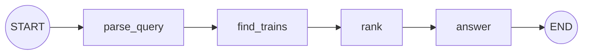

# State Schemas and Data Flow: The Complete Guide

> 📚 **Before you start**
>
> - [The LangGraph State System](the-langgraph-state-system.md), for snapshots, updates and merging.
> - [Graphs, Nodes, Edges and State](../02-getting-started/graphs-nodes-edges-and-state.md), where you first saw `TypedDict` and Pydantic schemas.
> - [Routers](../05-workflows-and-agents/routers.md), helpful for section 6, which combines routing and updates.

## Introduction

An IRCTC reservation form has a shape. Some fields are required (train number, date, passenger name), some have sensible defaults (berth preference: "no preference"), and some are checked the moment you type them (age must be a number, a PNR is exactly ten digits). Behind the form, different counters use different parts of it: the fare calculator needs class and distance, the chart-preparation system needs names and berths, and nobody needs your payment details except the payment step.

A LangGraph **state schema** is that form, and **data flow** is the question of which node reads and writes which field. Get the schema right and nodes are short, bugs show up early, and a new team member can understand the graph by reading one class. Get it wrong and you get `KeyError`s, silent type mix-ups and nodes that quietly depend on fields they shouldn't touch.

In this lesson you'll compare the three schema types LangGraph accepts (`TypedDict`, dataclass, Pydantic), learn exactly when validation happens and when it doesn't, give individual nodes a narrower view of the state, combine updates with routing using `Command`, and pick up the design rules that keep state easy to work with.

> 💡 **Key Insight**
>
> The schema decides **how a node reads** the state (dictionary keys or attributes), **what defaults** fill missing fields, and **when values are checked**. But whatever schema you choose, nodes still **return a dictionary of updates**, and the graph still **returns a dictionary**. The schema shapes the view into the state; it doesn't change how updates flow.

---

## Core Explanation

### 1. One state, three schema types

Here's a ticket booking state written three ways.

```python
from dataclasses import dataclass, field
from typing import TypedDict
from pydantic import BaseModel, Field
from langgraph.graph import StateGraph, START, END

class TicketTD(TypedDict):
    pnr: str
    seats: int
    notes: list

@dataclass
class TicketDC:
    pnr: str
    seats: int = 1
    notes: list = field(default_factory=list)

class TicketPD(BaseModel):
    pnr: str
    seats: int = Field(default=1, ge=1, le=6)
    notes: list = []

def run_one(schema, read):
    def confirm(state):
        print(f"  node got a {type(state).__name__}; seats = {read(state, 'seats')}")
        return {"notes": read(state, "notes") + ["confirmed"]}
    b = StateGraph(schema)
    b.add_node("confirm", confirm)
    b.add_edge(START, "confirm")
    b.add_edge("confirm", END)
    return b.compile()

as_key = lambda s, k: s[k]
as_attr = lambda s, k: getattr(s, k)

print("TypedDict:")
print(" ", run_one(TicketTD, as_key).invoke({"pnr": "4521873690", "seats": 2, "notes": []}))
print("dataclass:")
print(" ", run_one(TicketDC, as_attr).invoke({"pnr": "4521873690"}))
print("Pydantic:")
print(" ", run_one(TicketPD, as_attr).invoke({"pnr": "4521873690", "seats": "2"}))
```

Output:

```
TypedDict:
  node got a dict; seats = 2
  {'pnr': '4521873690', 'seats': 2, 'notes': ['confirmed']}
dataclass:
  node got a TicketDC; seats = 1
  {'pnr': '4521873690', 'notes': ['confirmed']}
Pydantic:
  node got a TicketPD; seats = 2
  {'pnr': '4521873690', 'seats': '2', 'notes': ['confirmed']}
```

Several details are worth slowing down for:

- **Reading** differs: `TypedDict` nodes get a dictionary (`state["seats"]`), dataclass and Pydantic nodes get an object (`state.seats`).
- **Defaults** work only for dataclass and Pydantic. The dataclass node saw `seats = 1` even though we didn't pass it.
- **Coercion**: Pydantic turned the string `"2"` into the integer `2`.
- **Output is always a dictionary**, and it contains the keys that were **written** (by the input or a node). Defaults that nobody wrote, like the dataclass's `seats`, are filled in for nodes to read but don't appear in the result.

| | `TypedDict` | dataclass | Pydantic `BaseModel` |
|---|---|---|---|
| Node reads | `state["key"]` | `state.key` | `state.key` |
| Default values | No (use `.get`) | Yes | Yes |
| Validates types | No | No | Yes, with coercion |
| Custom checks | No | No | `Field(ge=...)`, `@field_validator` |
| Speed | Fastest | Fast | Slower (validation on every node input) |
| Typical use | Most graphs, especially chat graphs | When defaults matter | Inputs from untrusted sources |

### 2. Required and optional fields

With a dataclass, a field without a default is **required**. If the input doesn't provide it, LangGraph can't build the object for the first node and the run fails immediately:

```python
try:
    run_one(TicketDC, as_attr).invoke({"seats": 2})
except TypeError as e:
    print("TypeError:", e)
```

Output:

```
TypeError: TicketDC.__init__() missing 1 required positional argument: 'pnr'
```

With a `TypedDict`, nothing is checked, so the convention is to mark optional keys with `NotRequired` (or a whole class with `total=False`). It's documentation for humans and type checkers; LangGraph won't complain either way:

```python
from typing import NotRequired

class Enquiry(TypedDict):
    train_no: str                     # always provided by the caller
    quota: NotRequired[str]           # may be missing; read with .get

def fare(state: Enquiry):
    quota = state.get("quota", "general")
    return {"quota": quota}

b = StateGraph(Enquiry)
b.add_node(fare)
b.add_edge(START, "fare")
print(b.compile().invoke({"train_no": "12951"}))
```

Output:

```
{'train_no': '12951', 'quota': 'general'}
```

### 3. When Pydantic validates, and when it doesn't

Pydantic validation is the reason to choose it, so it's important to know its exact reach. LangGraph validates by **building the Pydantic object whenever a node needs the state as input**. Two consequences follow.

The **input is checked before any node runs**, including your own validators:

```python
from pydantic import field_validator

class Booking(BaseModel):
    pnr: str
    seats: int = Field(default=1, ge=1, le=6)

    @field_validator("pnr")
    @classmethod
    def ten_digits(cls, v: str) -> str:
        if len(v) != 10 or not v.isdigit():
            raise ValueError("PNR must be 10 digits")
        return v

def add_seat(state: Booking):
    return {"seats": state.seats + 1}

def overbook(state: Booking):
    return {"seats": 99}

b = StateGraph(Booking)
b.add_node(add_seat)
b.add_node(overbook)
b.add_edge(START, "add_seat")
b.add_edge("add_seat", "overbook")
b.add_edge("overbook", END)
booking = b.compile()

try:
    booking.invoke({"pnr": "12"})
except Exception as e:
    print(type(e).__name__, "|", str(e).splitlines()[2].strip())
```

Output:

```
ValidationError | Value error, PNR must be 10 digits [type=value_error, input_value='12', input_type=str]
```

But a **node's update is not checked when it's returned**. It's checked only when the next node builds its input. So a bad value written by the **last** node sails straight into the output:

```python
print(booking.invoke({"pnr": "4521873690"}))
```

Output:

```
{'pnr': '4521873690', 'seats': 99}
```

`seats` should be at most 6, yet the result says 99, because no node ran after `overbook`. If the same value were written earlier, the next node's input would fail validation. The practical rules:

- Use Pydantic to **guard the front door** (inputs from users, APIs or other teams).
- For important invariants, **check in the node that writes the value**, or add a small final "validate" node.
- Remember the cost: Pydantic builds and validates an object for every node call. For chat graphs with long message lists, `TypedDict` is the usual choice.

### 4. Mapping the data flow

Before writing nodes, it pays to list **which node reads and writes which field**. Here's a small train-enquiry workflow:



| Field | Written by | Read by |
|---|---|---|
| `query` | input | `parse_query` |
| `origin`, `destination`, `date` | `parse_query` | `find_trains` |
| `trains` | `find_trains` | `rank` |
| `best` | `rank` | `answer` |
| `answer` | `answer` | the caller |

A table like this shows three things at a glance: every field has exactly one writer (no parallel clash), every field is written before it's read (no `KeyError`), and only `query` and `answer` matter to the caller (a hint that the next module's **input and output schemas** would tidy the interface).

```python
class TrainEnquiry(TypedDict):
    query: str
    origin: str
    destination: str
    date: str
    trains: list
    best: dict
    answer: str

TIMETABLE = [
    {"no": "12951", "name": "Mumbai Rajdhani", "from": "MMCT", "to": "NDLS", "hours": 15.9},
    {"no": "12953", "name": "August Kranti Rajdhani", "from": "MMCT", "to": "NDLS", "hours": 17.3},
    {"no": "12909", "name": "Garib Rath", "from": "BDTS", "to": "NZM", "hours": 17.6},
]

def parse_query(state: TrainEnquiry):
    # A real app would ask an LLM for structured output; we keep it rule-based.
    return {"origin": "MMCT", "destination": "NDLS", "date": "2026-10-20"}

def find_trains(state: TrainEnquiry):
    found = [t for t in TIMETABLE if t["from"] == state["origin"] and t["to"] == state["destination"]]
    return {"trains": found}

def rank(state: TrainEnquiry):
    return {"best": min(state["trains"], key=lambda t: t["hours"])}

def answer(state: TrainEnquiry):
    t = state["best"]
    return {"answer": f"Take {t['no']} {t['name']} on {state['date']} ({t['hours']} h)."}

b = StateGraph(TrainEnquiry)
b.add_sequence([parse_query, find_trains, rank, answer])
b.add_edge(START, "parse_query")
enquiry = b.compile()

for update in enquiry.stream({"query": "fastest Mumbai to Delhi train on 20 Oct"}, stream_mode="updates"):
    node, change = next(iter(update.items()))
    print(f"{node:12} wrote {sorted(change)}")
```

Output:

```
parse_query  wrote ['date', 'destination', 'origin']
find_trains  wrote ['trains']
rank         wrote ['best']
answer       wrote ['answer']
```

The update stream is the table, generated from the running code. It's a quick way to check a design against reality.

### 5. Giving a node a narrower view

By default every node receives the **whole** state. You can hand a node only the keys it needs by giving it an **input schema**, either with a type hint on its first parameter or with `add_node(..., input_schema=...)`:

```python
class RankInput(TypedDict):
    trains: list

def rank_narrow(state: RankInput):
    print("rank sees only:", sorted(state))
    return {"best": min(state["trains"], key=lambda t: t["hours"])}

b = StateGraph(TrainEnquiry)
b.add_node(parse_query)
b.add_node(find_trains)
b.add_node("rank", rank_narrow, input_schema=RankInput)
b.add_node(answer)
b.add_edge(START, "parse_query")
b.add_edge("parse_query", "find_trains")
b.add_edge("find_trains", "rank")
b.add_edge("rank", "answer")
print(b.compile().invoke({"query": "Mumbai to Delhi"})["answer"])
```

Output:

```
rank sees only: ['trains']
Take 12951 Mumbai Rajdhani on 2026-10-20 (15.9 h).
```

The node can still **write** any key of the graph's state (`best` here). Narrow inputs make a node easier to test (you only need to build a tiny dictionary) and stop it from quietly depending on fields it shouldn't. The next module takes this idea further with private state and graph-level input and output schemas: [Multiple Schemas](multiple-schemas.md).

### 6. Updating and routing together with `Command`

Sometimes a node decides both **what to write** and **where to go next**. Instead of returning an update and adding a separate routing function, it can return a `Command` that carries both:

```python
from typing import Literal
from langgraph.types import Command

class Refund(TypedDict):
    amount: float
    decision: str

def check_refund(state: Refund) -> Command[Literal["auto_approve", "send_to_agent"]]:
    if state["amount"] <= 500:
        return Command(update={"decision": "auto"}, goto="auto_approve")
    return Command(update={"decision": "manual review"}, goto="send_to_agent")

def auto_approve(state: Refund):
    return {"decision": state["decision"] + " -> approved"}

def send_to_agent(state: Refund):
    return {"decision": state["decision"] + " -> queued for agent"}

b = StateGraph(Refund)
b.add_node(check_refund)
b.add_node(auto_approve)
b.add_node(send_to_agent)
b.add_edge(START, "check_refund")
refunds = b.compile()

for amount in [349.0, 2499.0]:
    print(amount, "->", refunds.invoke({"amount": amount})["decision"])
```

Output:

```
349.0 -> auto -> approved
2499.0 -> manual review -> queued for agent
```

The return type hint `Command[Literal[...]]` matters: it's how LangGraph learns the possible destinations, so it can draw the graph and check the wiring. Notice there are no edges out of `check_refund`; the `Command` provides them. `Command(update=...)` goes through the same reducers as a normal update.

### 7. Design rules for good state

**Keep it flat and specific.** Separate fields merge independently; one big nested dictionary doesn't. A plain key is **replaced** as a whole, so updating one part of a nested dictionary wipes the rest:

```python
class Profile(TypedDict):
    prefs: dict

def set_berth(state: Profile):
    return {"prefs": {"berth": "lower"}}       # intends to change one setting

b = StateGraph(Profile)
b.add_node(set_berth)
b.add_edge(START, "set_berth")
print(b.compile().invoke({"prefs": {"berth": "any", "meal": "veg", "language": "hi"}}))
```

Output:

```
{'prefs': {'berth': 'lower'}}
```

The meal and language preferences are gone. Either make them separate fields, return the merged dictionary (`{**state["prefs"], "berth": "lower"}`), or give the field a merging reducer, which is the first custom reducer in [State Reducers](state-reducers.md).

A few more rules:

| Rule | Why |
|---|---|
| Store **data, not objects** (ids, strings, numbers, small dicts, messages) | State is serialised into every checkpoint; clients and connections can't be |
| Keep **large blobs out** (PDFs, images, whole web pages) | They're copied into every checkpoint; store a path or id instead |
| Give each field **one owner** unless it has a reducer | Avoids `InvalidUpdateError` and "who changed this?" bugs |
| Name fields for **what they mean**, not which node wrote them | `best_train`, not `node3_output` |
| Put run-wide constants in **runtime context** | Keeps state small and stops nodes from changing them |

---

## Try It Yourself

1. **Defaults with a dataclass.** Write a dataclass state for a chai order with `size: str = "cutting"` and `sugar: bool = True`, and a node that writes `price` (₹15 for cutting, ₹25 for full, +₹0 for sugar). Invoke with `{}` plus only the fields you need, and show which keys appear in the output.
2. **Catch it early.** Add a final `validate` node to the `Booking` graph that raises `ValueError` if `seats > 6`. Show that `overbook`'s value is now caught.
3. **Command with a loop.** Write a node `guess` with state `{"target": int, "tries": int}` that returns `Command(update={"tries": tries + 1}, goto="guess")` until `tries` reaches `target`, then goes to `END`.

<details>
<summary>Show answers</summary>

**1.**

```python
@dataclass
class Chai:
    size: str = "cutting"
    sugar: bool = True
    price: int = 0

def price_chai(state: Chai):
    return {"price": 15 if state.size == "cutting" else 25}

b = StateGraph(Chai)
b.add_node(price_chai)
b.add_edge(START, "price_chai")
chai = b.compile()
print(chai.invoke({}))
print(chai.invoke({"size": "full"}))
```

Output:

```
{'price': 15}
{'size': 'full', 'price': 25}
```

Only written keys come back: `price` always (the node wrote it), `size` only when we passed it.

**2.**

```python
def validate(state: Booking):
    if state.seats > 6:
        raise ValueError(f"seats={state.seats} is more than 6")
    return {}

b = StateGraph(Booking)
b.add_sequence([add_seat, overbook, validate])
b.add_edge(START, "add_seat")
try:
    b.compile().invoke({"pnr": "4521873690"})
except Exception as e:
    print(type(e).__name__, "|", str(e).splitlines()[0])
```

Output:

```
ValidationError | 1 validation error for Booking
```

The error comes from Pydantic, not from our `ValueError`: the moment `validate` needs its input, LangGraph builds a `Booking` with `seats=99`, and the `le=6` rule rejects it. Any node after the bad write would have caught it; `validate` simply guarantees there is one.

**3.**

```python
class Guess(TypedDict):
    target: int
    tries: int

def guess(state: Guess) -> Command[Literal["guess", "__end__"]]:
    if state["tries"] >= state["target"]:
        return Command(goto=END)
    return Command(update={"tries": state["tries"] + 1}, goto="guess")

b = StateGraph(Guess)
b.add_node(guess)
b.add_edge(START, "guess")
print(b.compile().invoke({"target": 3, "tries": 0}))
```

Output:

```
{'target': 3, 'tries': 3}
```

</details>

---

## Real-World Examples

- **Fintech onboarding agents** use a Pydantic input schema so a malformed PAN or IFSC code is rejected before any model call is paid for.
- **Chat assistants** almost always use `TypedDict` (usually `MessagesState` plus a few keys), because they are fast and messages are already structured objects.
- **Large teams** keep a data-flow table (field, writer, readers) in the graph's README, and review it whenever someone adds a node.

---

## Common Misconceptions

### "Pydantic validates every update"

It validates when a node's input is built, so the graph's input and every value a later node reads are checked. A value written by the last node, or one that is never read again, isn't.

### "Nodes with a dataclass schema should return a dataclass"

Nodes always return a dictionary of updates (or a `Command`), whatever the schema.

### "Defaults appear in the output"

Only written keys do. Defaults fill in values for nodes to read.

### "A narrower input schema limits what a node can write"

It limits what the node **sees**. It can still write any key of the graph's state.

---

## Interview Relevance

*"TypedDict, dataclass or Pydantic for LangGraph state?"* `TypedDict` for speed and simplicity (most chat graphs), dataclass when you want defaults, Pydantic for validated inputs and custom checks, with the caveat that validation runs when node inputs are built, not on every returned update. Mention the cost of Pydantic on large message lists.

*"How do you design a graph's state?"* Map each field's writer and readers, keep fields flat with one owner (or a reducer), store data rather than objects or blobs, keep run constants in runtime context, and narrow node inputs where it helps testing.

---

## Key Takeaways

- **Three schema types**: `TypedDict` (dict access, no checks), dataclass (defaults), Pydantic (defaults, validation, coercion).
- Nodes always **return dicts**, and graphs always **return dicts** of the keys that were written.
- **Pydantic validates node inputs**, not returned updates; guard important invariants explicitly.
- Give nodes a **narrower view** with a type hint or `add_node(..., input_schema=...)`.
- **`Command(update=..., goto=...)`** combines writing and routing; plain keys are **replaced whole**, so keep state flat.

---

**Up next:** [State Reducers](state-reducers.md)
