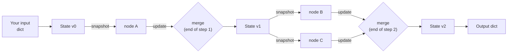
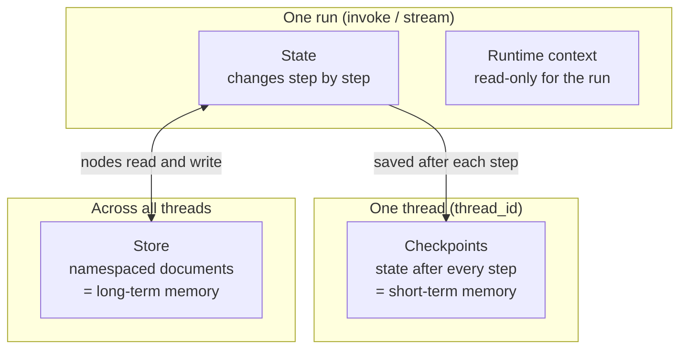

# The LangGraph State System: The Complete Guide

> 📚 **Before you start**
>
> - [Graphs, Nodes, Edges and State](../02-getting-started/graphs-nodes-edges-and-state.md), where you first defined a state schema.
> - [The LangGraph Execution Model](../02-getting-started/the-langgraph-execution-model.md), for super-steps and the first look at reducers.
> - [Building Agents](../05-workflows-and-agents/building-agents.md) and [Agents with Memory](../05-workflows-and-agents/agents-with-memory.md), from the Workflows and Agents module this course builds on.

## Introduction

Picture the order board at a busy railway-station canteen. The cashier writes "table 6: 2 thalis, 1 lassi". The cook reads the board, makes the thalis and ticks them off. The drinks counter reads the same board, makes the lassi and ticks it off. Nobody shouts instructions to anyone else; everybody reads the board and writes their small change on it. And there are rules: only the cashier writes new orders, two people never erase each other's ticks, and at closing time the board is either wiped or photographed for tomorrow.

A LangGraph **state** is that board. You've been using it since your first graph, mostly by instinct. In this lesson you'll learn the actual rules: how your input becomes the state, what a node really receives, what happens to the dictionary it returns, why two parallel nodes can clash, how each field is stored as a **channel**, and how the state differs from the other data a node can see (the **config** and the **runtime context**).

By the end you'll be able to predict exactly what the state looks like at every step of any graph, which is the skill every later lesson in this course builds on.

> 💡 **Key Insight**
>
> Nodes never change the state directly. Each node receives a **read-only snapshot** and returns an **update**, a small dictionary of "here's what I want to change". LangGraph collects the updates from every node in a super-step and **merges them all at once**, field by field, using each field's rule (replace by default, or a reducer). Once you think "snapshot in, update out, merge between steps", most state puzzles solve themselves.

---

## Core Explanation

### 1. The state's life cycle in one picture



Four rules describe everything in this picture:

| Rule | Meaning |
|---|---|
| **Input is an update too** | Your `invoke` input is applied to an empty state exactly like a node's update. |
| **Nodes read a snapshot** | Every node in a super-step sees the state as it was at the **start** of that step. |
| **Nodes return partial updates** | Only the keys you return change. Returning `{}` or `None` changes nothing. |
| **Merging happens between steps** | All updates of a step are applied together, key by key, using each key's merge rule. |

Let's watch each rule in action with a canteen order.

### 2. Input becomes the starting state

```python
import operator
from typing import Annotated, TypedDict
from langgraph.graph import StateGraph, START, END

class Order(TypedDict):
    table: int
    items: list
    status: str

def take_order(state: Order):
    print("take_order sees:", state)
    return {"status": "taken"}

builder = StateGraph(Order)
builder.add_node(take_order)
builder.add_edge(START, "take_order")
builder.add_edge("take_order", END)
canteen = builder.compile()

print(canteen.invoke({"table": 6, "items": ["thali", "thali", "lassi"]}))
```

Output:

```
take_order sees: {'table': 6, 'items': ['thali', 'thali', 'lassi']}
{'table': 6, 'items': ['thali', 'thali', 'lassi'], 'status': 'taken'}
```

Notice what *isn't* there: we never passed `status`, so `take_order` saw a state with **no `status` key at all**. A `TypedDict` schema describes which keys are allowed, not which keys exist. Reading a key that hasn't been written yet raises a `KeyError`:

```python
def careless(state: Order):
    return {"status": state["status"] + " and checked"}

b = StateGraph(Order)
b.add_node(careless)
b.add_edge(START, "careless")
try:
    b.compile().invoke({"table": 2, "items": []})
except KeyError as e:
    print("KeyError:", e)
```

Output:

```
KeyError: 'status'
```

Two habits avoid this: pass every field the graph reads in the input, or read optional fields with `state.get("status", "new")`. The next lesson shows a third option: schema types (dataclasses and Pydantic models) that support **default values**.

### 3. Nodes return updates, not the whole state

A node's return value is an **update**: only the keys it contains are changed. Everything else is left as it was.

```python
def cook(state: Order):
    return {"status": "cooked"}          # items and table untouched

def serve(state: Order):
    return None                          # no change at all is fine too

b = StateGraph(Order)
b.add_sequence([take_order, cook, serve])
b.add_edge(START, "take_order")
flow = b.compile()

for update in flow.stream({"table": 6, "items": ["thali"]}, stream_mode="updates"):
    print(update)
```

Output:

```
take_order sees: {'table': 6, 'items': ['thali']}
{'take_order': {'status': 'taken'}}
{'cook': {'status': 'cooked'}}
{'serve': None}
```

`stream_mode="updates"` prints exactly what each node returned, which makes it the best tool for seeing "who changed what". `serve` returned `None`, and LangGraph recorded that as "no update". A node that returns `{}` shows up the same way.

### 4. Mutating the snapshot is not an update

Because a node receives a Python dictionary, it's tempting to change it in place: `state["items"].append(...)`. Don't. In-place changes bypass the merge rules, never appear in the update stream, and may leak into places you don't expect. Here's what happens:

```python
def sneaky_waiter(state: Order):
    state["items"].append("extra papad")    # mutates a list inside the snapshot
    state["status"] = "upsold"              # reassigns a key in the snapshot
    return {}

def bill(state: Order):
    print("bill sees:", state)
    return {}

b = StateGraph(Order)
b.add_sequence([sneaky_waiter, bill])
b.add_edge(START, "sneaky_waiter")
leaky = b.compile()

my_input = {"table": 3, "items": ["dosa"], "status": "new"}
for update in leaky.stream(my_input, stream_mode="updates"):
    print(update)
print("caller's input afterwards:", my_input)
```

Output:

```
{'sneaky_waiter': None}
bill sees: {'table': 3, 'items': ['dosa', 'extra papad'], 'status': 'new'}
{'bill': None}
caller's input afterwards: {'table': 3, 'items': ['dosa', 'extra papad'], 'status': 'new'}
```

Look closely:

- Reassigning `state["status"]` had **no effect**: `bill` still saw `"new"`. The node got its own dictionary, and changing a key of that dictionary changes nothing in the graph.
- Appending to `state["items"]` **did** leak, because the list object is shared: the graph's state, the snapshot and even the caller's `my_input` all point at the same list. The update stream shows `None` (an empty update) for `sneaky_waiter`, so nothing records that the change happened, and a checkpointer may or may not capture it depending on timing.

That inconsistency is exactly why the rule is absolute: **treat the snapshot as read-only, and return every change**. If you need a modified list, build a new one: `{"items": state["items"] + ["extra papad"]}`.

### 5. Merging: one rule per key

When a super-step ends, LangGraph applies the updates key by key. Each key has a **merge rule**:

- **No reducer** (a plain annotation like `status: str`): the new value **replaces** the old one, and at most **one** node may write that key in a single super-step.
- **With a reducer** (`Annotated[list, operator.add]`): the reducer combines the old value with each update, so many nodes can write in the same step.

Two parallel stations writing the same plain key is ambiguous (which value should win?), so LangGraph refuses:

```python
class Kitchen(TypedDict):
    status: str
    ready: Annotated[list, operator.add]

def tandoor(state: Kitchen):
    return {"status": "naan ready", "ready": ["naan"]}

def curry_station(state: Kitchen):
    return {"status": "dal ready", "ready": ["dal makhani"]}

def build(state_cls):
    b = StateGraph(state_cls)
    b.add_node(tandoor)
    b.add_node(curry_station)
    b.add_edge(START, "tandoor")          # both run in super-step 1
    b.add_edge(START, "curry_station")
    return b.compile()

try:
    build(Kitchen).invoke({"status": "new", "ready": []})
except Exception as e:
    print(type(e).__name__, "-", str(e).splitlines()[0])
```

Output:

```
InvalidUpdateError - At key 'status': Can receive only one value per step. Use an Annotated key to handle multiple values.
```

`ready` was fine: it has the `operator.add` reducer, so both lists were going to be added together. `status` caused the error. The fix depends on what you mean: give `status` a reducer (for example, keep a list of statuses), or let only one node own it.

```python
class FixedKitchen(TypedDict):
    status: Annotated[list, operator.add]     # every station appends its status
    ready: Annotated[list, operator.add]

def tandoor(state: FixedKitchen):
    return {"status": ["naan ready"], "ready": ["naan"]}

def curry_station(state: FixedKitchen):
    return {"status": ["dal ready"], "ready": ["dal makhani"]}

result = build(FixedKitchen).invoke({"status": [], "ready": []})
print(sorted(result["status"]), sorted(result["ready"]))
```

Output:

```
['dal ready', 'naan ready'] ['dal makhani', 'naan']
```

(We sort because parallel nodes in the same step have no guaranteed order.) Reducers have a whole lesson of their own: [State Reducers](state-reducers.md).

### 6. Under the hood: every key is a channel

When you compile, LangGraph turns each state key into a **channel**: a small container that knows how to accept updates. You can see them on the compiled graph:

```python
kitchen_app = build(FixedKitchen)
print({k: type(v).__name__ for k, v in kitchen_app.channels.items() if not k.startswith(("__", "branch:"))})
print({k: type(v).__name__ for k, v in canteen.channels.items() if not k.startswith(("__", "branch:"))})
```

Output:

```
{'status': 'BinaryOperatorAggregate', 'ready': 'BinaryOperatorAggregate'}
{'table': 'LastValue', 'items': 'LastValue', 'status': 'LastValue'}
```

| Channel type | Created for | Behaviour |
|---|---|---|
| `LastValue` | A plain key (`status: str`) | Stores the latest value; errors on two writes in one step |
| `BinaryOperatorAggregate` | `Annotated[type, reducer]` | Folds each update in with the reducer |
| `EphemeralValue`, `Topic` and others | LangGraph's internal bookkeeping (`__start__`, `branch:to:...`) | Used to trigger nodes; you never write them |

You'll rarely touch channels directly, but the picture is useful: the "state" is really a set of independent channels, one per key, and merging is each channel applying its own rule. That's also why a typo'd key (`"Status"` instead of `"status"`) is silently dropped: there's no channel to receive it.

### 7. State, config and runtime context: three different things

A node can receive more than the state. It's important to put each kind of data in the right place:

| | **State** | **Config** | **Runtime context** |
|---|---|---|---|
| What it holds | Data the graph works on and changes | Run settings: `thread_id`, tags, callbacks, recursion limit | Read-only facts about this run: user id, tenant, model name, DB handle |
| Changes during the run? | Yes, through updates | No | No |
| Saved in checkpoints? | Yes | The `thread_id` is the key, not the content | No |
| How a node gets it | First parameter | `config: RunnableConfig` parameter | `runtime: Runtime[YourContext]` parameter |

The **runtime context** is the newest of the three. You declare its type with `context_schema` and pass a value with `context=` on each call. It's the right home for things like "which user is this?", which every node may need but no node should change:

```python
from dataclasses import dataclass
from langgraph.runtime import Runtime

@dataclass
class CanteenContext:
    branch: str
    gst_percent: float = 5.0

class Bill(TypedDict):
    subtotal: float
    total: float

def add_tax(state: Bill, runtime: Runtime[CanteenContext]):
    rate = runtime.context.gst_percent
    return {"total": round(state["subtotal"] * (1 + rate / 100), 2)}

b = StateGraph(Bill, context_schema=CanteenContext)
b.add_node(add_tax)
b.add_edge(START, "add_tax")
biller = b.compile()

print(biller.invoke({"subtotal": 240.0}, context=CanteenContext(branch="Pune station")))
print(biller.invoke({"subtotal": 240.0}, context=CanteenContext(branch="Airport", gst_percent=18.0)))
```

Output:

```
{'subtotal': 240.0, 'total': 252.0}
{'subtotal': 240.0, 'total': 283.2}
```

The GST rate didn't become part of the state, so it isn't saved in checkpoints, can't be changed by a node by mistake, and doesn't show up in the graph's output. The `runtime` object also carries the long-term memory **store** (`runtime.store`), which you'll use in [Long-Term Memory with Stores](../07-memory/long-term-memory-with-stores.md), and a **stream writer** for custom progress events.

### 8. Where state lives after the run

Without a checkpointer, the state exists only while `invoke` runs; the returned dictionary is all that's left. With a checkpointer, LangGraph saves the state after every super-step under the thread's id, and `get_state` reads the latest copy back:

```python
from langgraph.checkpoint.memory import InMemorySaver

b_flow = StateGraph(Order)
b_flow.add_sequence([take_order, cook])
b_flow.add_edge(START, "take_order")
saved_flow = b_flow.compile(checkpointer=InMemorySaver())

cfg = {"configurable": {"thread_id": "table-6"}}
saved_flow.invoke({"table": 6, "items": ["thali"]}, cfg)
snap = saved_flow.get_state(cfg)
print(snap.values, "| next:", snap.next)
```

Output:

```
take_order sees: {'table': 6, 'items': ['thali']}
{'table': 6, 'items': ['thali'], 'status': 'cooked'} | next: ()
```

That gives the full map of where an app's data can live:



Module 4 of this course is about the two memory boxes: keeping the checkpointed conversation small, and putting durable facts in the store.

---

## Try It Yourself

1. **Predict the snapshot.** A graph has `A → (B and C in parallel) → D`. The state has `log: Annotated[list, operator.add]` and `last: str`. A, B, C and D each return `{"log": [name]}`, and only D also returns `{"last": "D"}`. What does C see in `log`? What's the final state? Check with code.
2. **Fix the mutation.** Rewrite `sneaky_waiter` so the extra papad is added properly and shows up in the update stream.
3. **Context or state?** For a hotel-booking agent, decide where each belongs: the user's loyalty tier, the list of hotels found so far, the LLM model name, the current check-in date the user is negotiating.

<details>
<summary>Show answers</summary>

**1.** C runs in step 2 with B, so both see the snapshot after A: `['A']`.

```python
class Trace(TypedDict):
    log: Annotated[list, operator.add]
    last: str

def make(name):
    def node(state: Trace):
        if name == "C":
            print("C sees", state["log"])
        update = {"log": [name]}
        if name == "D":
            update["last"] = "D"
        return update
    return node

b = StateGraph(Trace)
for name in "ABCD":
    b.add_node(name, make(name))
b.add_edge(START, "A")
b.add_edge("A", "B")
b.add_edge("A", "C")
b.add_edge(["B", "C"], "D")
out = b.compile().invoke({"log": []})
print(out["log"][0], sorted(out["log"][1:3]), out["log"][3], out["last"])
```

Output:

```
C sees ['A']
A ['B', 'C'] D D
```

**2.**

```python
def honest_waiter(state: Order):
    return {"items": state["items"] + ["extra papad"], "status": "upsold"}

b = StateGraph(Order)
b.add_sequence([honest_waiter, bill])
b.add_edge(START, "honest_waiter")
my_input = {"table": 3, "items": ["dosa"], "status": "new"}
for update in b.compile().stream(my_input, stream_mode="updates"):
    print(update)
print("caller's input afterwards:", my_input)
```

Output:

```
{'honest_waiter': {'items': ['dosa', 'extra papad'], 'status': 'upsold'}}
bill sees: {'table': 3, 'items': ['dosa', 'extra papad'], 'status': 'upsold'}
{'bill': None}
caller's input afterwards: {'table': 3, 'items': ['dosa'], 'status': 'new'}
```

The change is now visible in the stream, `bill` sees it, and the caller's input is untouched because we built a new list.

**3.** Loyalty tier and model name are **runtime context** (facts about the run that nodes read but never change). Hotels found so far and the check-in date being negotiated are **state** (they change as the agent works, and you'd want them in checkpoints so the conversation can resume). If the loyalty tier should be *remembered* across chats, it also belongs in the **store**, loaded into context or state at the start of each run.

</details>

---

## Real-World Examples

- **Food-delivery order pipelines** model an order as state (`items`, `status`, `rider`) and let parallel nodes (payment check, restaurant confirmation) write separate keys, so they never clash.
- **Multi-tenant SaaS agents** pass the tenant id and permissions as runtime context, so a node can't accidentally switch tenants by writing to state.
- **Debugging in Studio** is reading the update of each node next to the state after each step: exactly the "snapshot in, update out" model.

---

## Common Misconceptions

### "A node changes the state"

A node returns an update; LangGraph changes the state when the super-step ends, using each key's merge rule.

### "The schema guarantees every key exists"

A `TypedDict` only lists allowed keys. Keys you haven't written are missing, and reading them raises `KeyError`.

### "In-place edits are a harmless shortcut"

They skip the merge rules and the update stream, may leak into the caller's data, and may or may not be saved. Always return the change.

### "Everything a node needs should go in the state"

Read-only facts about a run (user, tenant, model, settings) belong in the runtime context. Keeping them out of state keeps checkpoints small and stops nodes from changing them.

---

## Interview Relevance

*"How does state flow through a LangGraph graph?"* Input is applied as the first update; each node receives a snapshot from the start of its super-step and returns a partial update; at the end of the step, updates are merged per key, replacing by default or using a reducer. Mention channels, the one-writer-per-step rule for plain keys (`InvalidUpdateError`) and that parallel nodes don't see each other's updates within a step.

*"Where would you put a user id?"* In the runtime context (`context_schema`, `Runtime`), not the state, unless it changes during the run. Thread ids go in the config; long-term facts go in a store.

---

## Key Takeaways

- **Snapshot in, update out**: nodes read a read-only view and return only what changes.
- **Merging happens between super-steps**, key by key: replace by default, reducer if annotated.
- **Plain keys allow one writer per step**; parallel writers need a reducer.
- Each key is a **channel** (`LastValue` or `BinaryOperatorAggregate`), which is why unknown keys are dropped.
- Keep **run settings in config**, **read-only facts in runtime context**, and **changing data in state**.

---

**Up next:** [State Schemas and Data Flow](state-schemas-and-data-flow.md)
