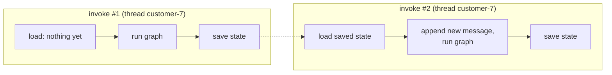

# Agents with Memory: The Complete Guide

> 📚 **Before you start**
>
> - [Building Agents](building-agents.md), for the agent loop you'll give a memory to.
> - [The LangGraph Execution Model](../02-getting-started/the-langgraph-execution-model.md), for the `config` argument.
> - [Memory Management](../../langchain-complete-guide/course.md#m6) in the LangChain Complete Guide, helpful but optional, for how chat history was handled before LangGraph.

## Introduction

Imagine ordering at a chai stall where the person behind the counter forgets everything the moment you stop talking. "Two cutting chai, please." *Done.* "Make one of them without sugar." *One of what?*

That's the agent from the last lesson. Each `invoke` starts from scratch: the state is created from your input, the graph runs, and the state is thrown away. Ask "how much for 3 kg of basmati?" and then "add 5% GST to that", and the second call has no idea what "that" is.

In this lesson you'll fix it with a **checkpointer**, LangGraph's built-in way of saving the state after every step and loading it again on the next call. You'll learn what a **thread** is, how to keep conversations separate, a common mistake that duplicates history, and how to stop memory from growing forever.

> 💡 **Key Insight**
>
> Memory in LangGraph isn't a separate feature bolted onto the agent; it's **saved state**. Compile with a checkpointer, pass a `thread_id`, and every run on that thread starts from where the last one finished. Because `messages` uses the `add_messages` reducer, your new message is simply appended to the saved conversation.

---

## Core Explanation

### 1. The agent, and a way to see what the model receives

We'll reuse the grocery agent's shape. To *show* memory working, the assistant node records how many messages the model was given on each call.

```python
from langchain_core.language_models.fake_chat_models import GenericFakeChatModel
from langchain_core.messages import AIMessage, HumanMessage
from langchain_core.tools import tool
from langgraph.graph import StateGraph, MessagesState, START, END
from langgraph.prebuilt import ToolNode, tools_condition

PRICES = {"basmati rice": 120.0, "mustard oil": 185.0}

@tool
def get_price(item: str) -> float:
    """Price in rupees for one kg or one litre of a grocery item."""
    return PRICES[item.lower()]

@tool
def add_gst(amount: float, rate_percent: float) -> float:
    """Add GST at rate_percent to an amount in rupees, rounded to 2 decimals."""
    return round(amount * (1 + rate_percent / 100), 2)

tools = [get_price, add_gst]

class ToolFake(GenericFakeChatModel):
    """A scripted chat model that accepts bind_tools, for offline examples."""
    def bind_tools(self, tools, **kwargs):
        return self

def call(name, call_id, **args):
    return {"name": name, "args": args, "id": call_id}

def two_turn_script():
    return ToolFake(messages=iter([
        # turn 1: "How much is 1 kg of basmati rice?"
        AIMessage("", tool_calls=[call("get_price", "c1", item="basmati rice")]),
        AIMessage("1 kg of basmati rice is ₹120."),
        # turn 2: "Add 5% GST to that."
        AIMessage("", tool_calls=[call("add_gst", "c2", amount=120.0, rate_percent=5)]),
        AIMessage("With 5% GST, that's ₹126."),
    ]))

llm_with_tools = two_turn_script()
model_saw = []

def assistant(state: MessagesState):
    model_saw.append(len(state["messages"]))
    return {"messages": [llm_with_tools.invoke(state["messages"])]}

builder = StateGraph(MessagesState)
builder.add_node(assistant)
builder.add_node("tools", ToolNode(tools))
builder.add_edge(START, "assistant")
builder.add_conditional_edges("assistant", tools_condition)
builder.add_edge("tools", "assistant")
```

### 2. Without memory: every call starts fresh

```python
forgetful = builder.compile()

forgetful.invoke({"messages": [("user", "How much is 1 kg of basmati rice?")]})
turn_2 = forgetful.invoke({"messages": [("user", "Add 5% GST to that.")]})

print("messages the model saw on each call:", model_saw)
print("turn 2 state holds", len(turn_2["messages"]), "messages")
```

Output:

```
messages the model saw on each call: [1, 3, 1, 3]
turn 2 state holds 4 messages
```

On the first call of turn 2, the model received **one** message: "Add 5% GST to that." The question about rice, the price lookup and the answer were all gone. Our scripted model happens to know the amount was ₹120 because we wrote the script; a real model would have to guess or ask "add GST to what?".

### 3. Adding a checkpointer

A **checkpointer** saves the graph's state after every super-step. The simplest one, `InMemorySaver`, keeps those saves in a Python dictionary. You pass it to `compile`, and then identify the conversation with a **`thread_id`** in the config:

```python
from langgraph.checkpoint.memory import InMemorySaver

memory = InMemorySaver()
agent = builder.compile(checkpointer=memory)

llm_with_tools = two_turn_script()
model_saw.clear()
config = {"configurable": {"thread_id": "customer-7"}}

agent.invoke({"messages": [("user", "How much is 1 kg of basmati rice?")]}, config)
result = agent.invoke({"messages": [("user", "Add 5% GST to that.")]}, config)

print("messages the model saw on each call:", model_saw)
for m in result["messages"]:
    label = type(m).__name__.replace("Message", "")
    detail = m.content or f"calls {[c['name'] for c in m.tool_calls]}"
    print(f"{label:5} {detail}")
```

Output:

```
messages the model saw on each call: [1, 3, 5, 7]
Human How much is 1 kg of basmati rice?
AI    calls ['get_price']
Tool  120.0
AI    1 kg of basmati rice is ₹120.
Human Add 5% GST to that.
AI    calls ['add_gst']
Tool  126.0
AI    With 5% GST, that's ₹126.
```

On turn 2 the model received **5** messages, then 7: the earlier question, the price lookup and the answer, plus the new question. So "that" clearly meant ₹120. The saved conversation now holds both turns, eight messages in all.



### 4. Threads keep conversations apart

A **thread** is one conversation's saved history, named by its `thread_id`. Different ids, different memories. This is how one deployed agent serves thousands of users without mixing them up:

```python
llm_with_tools = ToolFake(messages=iter([AIMessage("Sure, which item would you like GST added to?")]))
model_saw.clear()

other = {"configurable": {"thread_id": "customer-8"}}
reply = agent.invoke({"messages": [("user", "Add 5% GST to that.")]}, other)
print("model saw", model_saw, "->", reply["messages"][-1].content)
```

Output:

```
model saw [1] -> Sure, which item would you like GST added to?
```

Customer 8 has never spoken before, so their thread starts empty, and customer 7's conversation is untouched. In a web app, you'd typically use a user id, a session id or a chat id as the `thread_id`.

### 5. Looking inside the saved state

The compiled graph can read any thread's latest saved state with `get_state`:

```python
snapshot = agent.get_state(config)
print(len(snapshot.values["messages"]), "messages saved for customer-7")
print("next node to run:", snapshot.next)
print("checkpoints saved:", len(list(agent.get_state_history(config))))
```

Output:

```
8 messages saved for customer-7
next node to run: ()
checkpoints saved: 10
```

`next` is empty because the last run finished. Ten checkpoints were saved across the two turns: each turn saved one when the new input arrived and one after each of its four super-steps. You'll explore snapshots, history and what you can do with them in [Persistence and Checkpointers](../06-chatbots-and-persistence/persistence-and-checkpointers.md).

### 6. A classic mistake: re-sending the whole history

People coming from plain LangChain, or from a chat UI, often keep their own history as a list of `{"role": ..., "content": ...}` dictionaries and send all of it on every call. With a checkpointer, that **duplicates** the conversation. The saved messages are already in the thread, and each dictionary is turned into a brand-new message object with a brand-new id, so `add_messages` appends it again:

```python
llm_with_tools = ToolFake(messages=iter([AIMessage("Hello!"), AIMessage("Hello again!")]))
dup_config = {"configurable": {"thread_id": "dup-demo"}}

ui_history = [{"role": "user", "content": "Hi"}]
reply = agent.invoke({"messages": ui_history}, dup_config)["messages"][-1]
ui_history.append({"role": "assistant", "content": reply.content})
ui_history.append({"role": "user", "content": "Hi again"})

out = agent.invoke({"messages": ui_history}, dup_config)      # re-sends everything
print([m.content for m in out["messages"]])
```

Output:

```
['Hi', 'Hello!', 'Hi', 'Hello!', 'Hi again', 'Hello again!']
```

The rule is simple: **with a checkpointer, send only the new message.** The thread already holds the rest. (Re-sending the *same message objects* happens not to duplicate, because they keep the ids they were given the first time, but relying on that is fragile.)

### 7. Memory that grows forever

Every turn adds messages, and every model call sends all of them. After a long chat that means slower, more expensive calls, and eventually hitting the model's context window. The fix is to send the model a **trimmed view** while keeping the full history saved. LangChain's `trim_messages` keeps the most recent messages within a budget:

```python
from langchain_core.messages import trim_messages

def trimmed_assistant(state: MessagesState):
    recent = trim_messages(state["messages"], max_tokens=4, token_counter=len,
                           strategy="last", start_on="human")
    model_saw.append([m.content or "(tool call)" for m in recent])
    return {"messages": [llm_with_tools.invoke(recent)]}

b = StateGraph(MessagesState)
b.add_node("assistant", trimmed_assistant)
b.add_node("tools", ToolNode(tools))
b.add_edge(START, "assistant")
b.add_conditional_edges("assistant", tools_condition)
b.add_edge("tools", "assistant")
trimmed_agent = b.compile(checkpointer=InMemorySaver())

llm_with_tools = ToolFake(messages=iter([AIMessage("Namaste!"), AIMessage("₹120 per kg."), AIMessage("Yes, in stock.")]))
model_saw.clear()
cfg = {"configurable": {"thread_id": "long-chat"}}
for text in ["Hi", "Basmati price?", "Is it in stock?"]:
    trimmed_agent.invoke({"messages": [("user", text)]}, cfg)
print(model_saw[-1])
print(len(trimmed_agent.get_state(cfg).values["messages"]), "messages still saved")
```

Output:

```
['Basmati price?', '₹120 per kg.', 'Is it in stock?']
6 messages still saved
```

`token_counter=len` counts each message as one "token" so the example is easy to follow; in a real app you'd pass the model (or a tokenizer function) to count actual tokens. `start_on="human"` makes the trimmed view begin at a user message, so it never starts with an orphaned tool result. Trimming, summarising and long-term memory get a full treatment later in this course, in the [Memory](../course.md#m7) module.

### 8. Short-term vs long-term memory

| | Short-term memory | Long-term memory |
|---|---|---|
| Scope | One thread (one conversation) | Across threads (the same user, many chats) |
| LangGraph feature | **Checkpointer** + `thread_id` | **Store** (`InMemoryStore`, Postgres store...) |
| Example | "Add GST to *that*" | "Remember I'm vegetarian" in every future chat |
<<<<<<< HEAD:courses/langgraph-fundamentals/04-workflows-and-agents/agents-with-memory.md
| Covered in | This lesson and module 5 | [Long-Term Memory with Stores](../07-memory/long-term-memory-with-stores.md) |
=======
| Covered in | This lesson and module 6 | [Long-Term Memory with Stores](../course.md#m7) |
>>>>>>> origin/main:courses/langgraph-complete-guide/05-workflows-and-agents/agents-with-memory.md

This course focuses on the first. The checkpointer is also what gives you fault tolerance, resuming and human-in-the-loop, so it's worth understanding well.

---

## Try It Yourself

1. **Three turns.** Using `agent` (with `InMemorySaver`), run three turns on a new thread with a model scripted to reply "One", "Two", "Three". How many messages are saved at the end?
2. **Separate memories.** Run one turn on thread `"a"` and two turns on thread `"b"`. Print the saved message count for each thread.
3. **Why `start_on="human"`?** Trim `[Human, AI(tool call), Tool, AI, Human]` to the last 4 messages with and without `start_on="human"`. What's wrong with the version without it?

<details>
<summary>Show answers</summary>

**1.** Three human and three AI messages:

```python
llm_with_tools = ToolFake(messages=iter([AIMessage("One"), AIMessage("Two"), AIMessage("Three")]))
c = {"configurable": {"thread_id": "three-turns"}}
for text in ["1?", "2?", "3?"]:
    agent.invoke({"messages": [("user", text)]}, c)
print(len(agent.get_state(c).values["messages"]))
```

Output:

```
6
```

**2.**

```python
llm_with_tools = ToolFake(messages=iter([AIMessage("A1"), AIMessage("B1"), AIMessage("B2")]))
agent.invoke({"messages": [("user", "hi")]}, {"configurable": {"thread_id": "a"}})
for text in ["hi", "again"]:
    agent.invoke({"messages": [("user", text)]}, {"configurable": {"thread_id": "b"}})
for t in ["a", "b"]:
    print(t, len(agent.get_state({"configurable": {"thread_id": t}}).values["messages"]))
```

Output:

```
a 2
b 4
```

**3.**

```python
from langchain_core.messages import ToolMessage

msgs = [HumanMessage("price?"), AIMessage("", tool_calls=[call("get_price", "x1", item="basmati rice")]),
        ToolMessage("120.0", tool_call_id="x1"), AIMessage("₹120."), HumanMessage("thanks")]
for start in [None, "human"]:
    kept = trim_messages(msgs, max_tokens=4, token_counter=len, strategy="last", start_on=start)
    print(start, [type(m).__name__ for m in kept])
```

Output:

```
None ['AIMessage', 'ToolMessage', 'AIMessage', 'HumanMessage']
human ['HumanMessage']
```

Without it, the view starts with an AI tool call that has no user question before it, which many model APIs reject or misread. With it, the trimmer drops the incomplete turn. A real budget would be larger, so more whole turns would fit.

</details>

---

## Real-World Examples

- **Banking and telecom chatbots** use the customer's session id as the `thread_id`, so follow-ups like "and the one before that?" work.
- **Slack or WhatsApp bots** use the chat or thread id from the platform as the `thread_id`, giving each group conversation its own memory.
- **Long-running assistants** keep the full history saved for audit but send the model a trimmed or summarised view to control cost.

---

## Common Misconceptions

### "The model remembers previous calls"

Models are stateless. Memory is the application re-sending the conversation; the checkpointer just makes that automatic.

### "I should send the whole history on each turn"

Not with a checkpointer. Send only the new message, or you'll duplicate the conversation.

### "`InMemorySaver` is fine for production"

It lives in your Python process and disappears on restart. Use SQLite for local apps and Postgres (or a managed deployment) in production; see [Persistent Storage with SQLite](../06-chatbots-and-persistence/persistent-storage-with-sqlite.md).

### "Trimming deletes the history"

Trimming inside the node only changes what the **model sees** on that call. The saved state still holds everything.

---

## Interview Relevance

*"How do you add memory to a LangGraph agent?"* Compile with a **checkpointer** (`InMemorySaver` for development, SQLite/Postgres for real use), pass `{"configurable": {"thread_id": ...}}` on every call, and send only new messages; `add_messages` appends them to the saved history. Mention `get_state` for inspection.

*"How do you handle long conversations?"* Trim (`trim_messages`) or summarise what the model sees, keep tool-call pairs intact, and use a store for facts that should outlive one thread.

---

## Key Takeaways

- Without a checkpointer, **every `invoke` starts from scratch**.
- **`compile(checkpointer=InMemorySaver())`** plus a **`thread_id`** gives the agent memory of earlier turns.
- A **thread** is one saved conversation; different `thread_id`s never share memory.
- With a checkpointer, send **only the new message**; re-sending history duplicates it.
- **Trim** what the model sees to control cost; the full history stays saved.

---

**Up next:** [Tools in LangGraph: ToolNode and tools_condition](tools-in-langgraph-toolnode-and-tools-condition.md)
