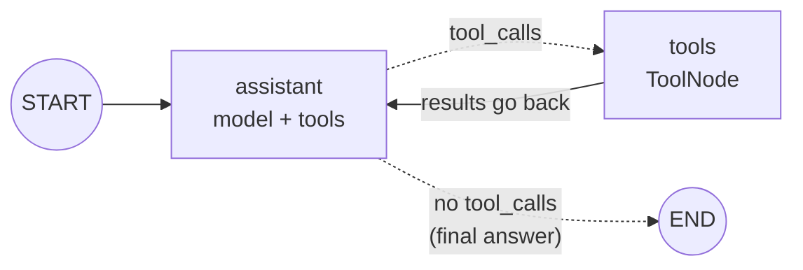

# Building Agents: The Complete Guide

> 📚 **Before you start**
>
> - [Routers](routers.md), for `ToolNode` and `tools_condition`.
> - [ReAct](../../agentic-ai-fundamentals/05-reasoning-patterns/react.md) and [The Agent Loop: Decide, Act, Observe](../../agentic-ai-fundamentals/03-the-agent-loop/the-agent-loop-decide-act-observe.md), for the loop you're about to rebuild as a graph.
> - [Iterative (Looping) Workflows](../03-workflow-patterns-in-langgraph/iterative-looping-workflows.md), for loops and the recursion limit.

## Introduction

Ask a good kirana shopkeeper "How much for 3 kg of basmati and 2 litres of mustard oil, with GST?" and watch what happens. He checks the rice price, checks the oil price, multiplies each by the quantity, adds them up, adds the tax, and only *then* tells you the total. He didn't know in advance how many steps it would take; each answer told him what to do next.

That's an **agent**: a model that keeps choosing actions, reading the results, and choosing again until it can answer. In [Routers](routers.md) the graph stopped right after the first tool ran. In this lesson you'll add **one edge**, from the tools node back to the model, and the router becomes a full agent loop. You'll then watch the loop run step by step, handle parallel tool calls, cap runaway loops gracefully, and see the prebuilt shortcut LangChain offers.

> 💡 **Key Insight**
>
> An agent in LangGraph is a router with the arrow bent back: **`tools → assistant`**. The model now sees every tool result and decides again. The loop ends when the model replies **without** tool calls, which `tools_condition` turns into `END`. Nothing else about the graph changes.

---

## Core Explanation

### 1. One edge turns a router into an agent



This is the **ReAct** loop (reason, act, observe) from [Agentic AI Fundamentals](../../agentic-ai-fundamentals/05-reasoning-patterns/react.md), drawn as a graph:

| Scratch agent (Agentic AI Fundamentals) | LangGraph agent |
|---|---|
| `while` loop over rounds | the `tools → assistant` edge |
| `if stop_reason != "tool_use": return` | `tools_condition` returning `END` |
| run each `tool_use` block, collect `tool_result`s | `ToolNode` |
| `self.messages` list | `MessagesState` |
| `max_rounds` | `recursion_limit` (and your own cap, section 6) |

### 2. The tools and the scripted model

Three small tools for the shop. Real tools would call a database or an API; these use a dictionary so the numbers are easy to check.

```python
from langchain_core.language_models.fake_chat_models import GenericFakeChatModel
from langchain_core.messages import AIMessage, SystemMessage
from langchain_core.tools import tool
from langgraph.graph import StateGraph, MessagesState, START, END
from langgraph.prebuilt import ToolNode, tools_condition

PRICES = {"basmati rice": 120.0, "mustard oil": 185.0, "toor dal": 160.0}   # ₹ per kg or litre

@tool
def get_price(item: str) -> float:
    """Price in rupees for one kg or one litre of a grocery item."""
    return PRICES[item.lower()]

@tool
def multiply(a: float, b: float) -> float:
    """Multiply a by b."""
    return a * b

@tool
def add_gst(amount: float, rate_percent: float) -> float:
    """Add GST at rate_percent to an amount in rupees, rounded to 2 decimals."""
    return round(amount * (1 + rate_percent / 100), 2)

tools = [get_price, multiply, add_gst]

class ToolFake(GenericFakeChatModel):
    """A scripted chat model that accepts bind_tools, for offline examples."""
    def bind_tools(self, tools, **kwargs):
        return self

def call(name, call_id, **args):
    return {"name": name, "args": args, "id": call_id}
```

The script below is what a capable model would do for "3 kg of basmati rice with 5% GST": look up the price, multiply, add tax, answer. Each reply is one turn of the loop.

```python
def basmati_script():
    return ToolFake(messages=iter([
        AIMessage("", tool_calls=[call("get_price", "c1", item="basmati rice")]),
        AIMessage("", tool_calls=[call("multiply", "c2", a=120.0, b=3)]),
        AIMessage("", tool_calls=[call("add_gst", "c3", amount=360.0, rate_percent=5)]),
        AIMessage("3 kg of basmati rice costs ₹360, or ₹378 including 5% GST."),
    ]))
```

### 3. Building the agent

```python
SYSTEM = SystemMessage("You are a grocery billing assistant. Always use tools for prices and arithmetic.")
llm_with_tools = basmati_script().bind_tools(tools)

def assistant(state: MessagesState):
    return {"messages": [llm_with_tools.invoke([SYSTEM] + state["messages"])]}

builder = StateGraph(MessagesState)
builder.add_node(assistant)
builder.add_node("tools", ToolNode(tools))
builder.add_edge(START, "assistant")
builder.add_conditional_edges("assistant", tools_condition)
builder.add_edge("tools", "assistant")          # the one edge that makes it an agent
agent = builder.compile()
```

Compare it with the router: the only difference is `add_edge("tools", "assistant")` instead of `add_edge("tools", END)`.

### 4. Running it and reading the transcript

```python
result = agent.invoke({"messages": [("user", "How much for 3 kg of basmati rice with 5% GST?")]})
for m in result["messages"]:
    m.pretty_print()
```

Output:

```
================================ Human Message =================================

How much for 3 kg of basmati rice with 5% GST?
================================== Ai Message ==================================
Tool Calls:
  get_price (c1)
 Call ID: c1
  Args:
    item: basmati rice
================================= Tool Message =================================
Name: get_price

120.0
================================== Ai Message ==================================
Tool Calls:
  multiply (c2)
 Call ID: c2
  Args:
    a: 120.0
    b: 3
================================= Tool Message =================================
Name: multiply

360.0
================================== Ai Message ==================================
Tool Calls:
  add_gst (c3)
 Call ID: c3
  Args:
    amount: 360.0
    rate_percent: 5
================================= Tool Message =================================
Name: add_gst

378.0
================================== Ai Message ==================================

3 kg of basmati rice costs ₹360, or ₹378 including 5% GST.
```

Read it as a conversation between the model and your tools: ask, get an answer, ask the next thing, and finally write a reply for the human. Unlike the router, the run ends with the model's **own words**, not a raw tool output. And every number came from your code, not the model's mental arithmetic.

### 5. Watching the loop step by step

`stream_mode="updates"` shows each node as it finishes. A small helper summarises what each step produced:

```python
def describe(update):
    node, data = next(iter(update.items()))
    msg = data["messages"][-1]
    if node == "tools":
        return f"tools      -> {[m.content for m in data['messages']]}"
    if msg.tool_calls:
        return f"assistant  -> calls {[c['name'] for c in msg.tool_calls]}"
    return f"assistant  -> answers: {msg.content}"

llm_with_tools = basmati_script()
for update in agent.stream({"messages": [("user", "3 kg basmati with 5% GST?")]}, stream_mode="updates"):
    print(describe(update))
```

Output:

```
assistant  -> calls ['get_price']
tools      -> ['120.0']
assistant  -> calls ['multiply']
tools      -> ['360.0']
assistant  -> calls ['add_gst']
tools      -> ['378.0']
assistant  -> answers: 3 kg of basmati rice costs ₹360, or ₹378 including 5% GST.
```

Seven super-steps: the model ran four times and the tools three times. Keep that ratio in mind for section 6.

### 6. Parallel tool calls

A good model doesn't look up prices one at a time when it needs two. It asks for **both in one reply**, and `ToolNode` runs them together:

```python
llm_with_tools = ToolFake(messages=iter([
    AIMessage("", tool_calls=[call("get_price", "p1", item="basmati rice"),
                              call("get_price", "p2", item="mustard oil")]),
    AIMessage("", tool_calls=[call("multiply", "m1", a=120.0, b=3),
                              call("multiply", "m2", a=185.0, b=2)]),
    AIMessage("Rice ₹360 + oil ₹370 = ₹730 before tax."),
]))
for update in agent.stream({"messages": [("user", "3 kg basmati and 2 L mustard oil?")]}, stream_mode="updates"):
    print(describe(update))
```

Output:

```
assistant  -> calls ['get_price', 'get_price']
tools      -> ['120.0', '185.0']
assistant  -> calls ['multiply', 'multiply']
tools      -> ['360.0', '370.0']
assistant  -> answers: Rice ₹360 + oil ₹370 = ₹730 before tax.
```

Two rounds instead of four. Each `ToolMessage` carries the `tool_call_id` of its request, so the model can tell which `360.0` belongs to the rice. You didn't write any code for this; it's the same graph.

### 7. Stopping: the model, the recursion limit, and your own cap

The loop normally ends when the model stops asking for tools. But models can get stuck, for example calling the same search again and again. Here's a "model" that never stops:

```python
import itertools

def stuck_model():
    return ToolFake(messages=(AIMessage("", tool_calls=[call("get_price", f"loop{i}", item="toor dal")])
                              for i in itertools.count()))

llm_with_tools = stuck_model()
try:
    agent.invoke({"messages": [("user", "Price of dal?")]}, {"recursion_limit": 10})
except Exception as e:
    print(type(e).__name__ + ":", str(e).splitlines()[0])
```

Output:

```
GraphRecursionError: Recursion limit of 10 reached without hitting a stop condition. You can increase the limit by setting the `recursion_limit` config key.
```

The recursion limit (25 by default) counts **super-steps**, and each tool round costs two (assistant + tools). So a limit of 25 allows about a dozen tool rounds. That error is your safety net, but it throws away the whole run.

A friendlier option is to let the agent **know** how many steps it has left and wrap up before the limit. LangGraph provides a *managed value* for this, `RemainingSteps`: declare it in the state and LangGraph fills it in on every step (you never write to it).

```python
from langgraph.managed import RemainingSteps

class AgentState(MessagesState):
    remaining_steps: RemainingSteps

def careful_assistant(state: AgentState):
    if state["remaining_steps"] <= 2:
        return {"messages": [AIMessage("I couldn't finish within my step budget. "
                                       "Here's what I found so far: " + state["messages"][-1].content)]}
    return {"messages": [llm_with_tools.invoke([SYSTEM] + state["messages"])]}

b = StateGraph(AgentState)
b.add_node("assistant", careful_assistant)
b.add_node("tools", ToolNode(tools))
b.add_edge(START, "assistant")
b.add_conditional_edges("assistant", tools_condition)
b.add_edge("tools", "assistant")
careful_agent = b.compile()

llm_with_tools = stuck_model()
out = careful_agent.invoke({"messages": [("user", "Price of dal?")]}, {"recursion_limit": 10})
print(out["messages"][-1].content)
print(len(out["messages"]), "messages")
```

Output:

```
I couldn't finish within my step budget. Here's what I found so far: 160.0
10 messages
```

No exception, a clear message to the user, and the conversation up to that point preserved. Production agents usually combine both: a **graceful cap** for normal operation and the **recursion limit** as the last line of defence.

### 8. When a tool fails

What if the model asks for an item that isn't in the price list? `get_price` raises a `KeyError`. With default settings `ToolNode` only turns **argument** errors (like a missing or mistyped argument) into error messages and lets other exceptions crash the run. Passing `handle_tool_errors=True` converts *any* exception into a `ToolMessage` the model can read and react to:

```python
b = StateGraph(MessagesState)
b.add_node(assistant)
b.add_node("tools", ToolNode(tools, handle_tool_errors=True))
b.add_edge(START, "assistant")
b.add_conditional_edges("assistant", tools_condition)
b.add_edge("tools", "assistant")
forgiving_agent = b.compile()

llm_with_tools = ToolFake(messages=iter([
    AIMessage("", tool_calls=[call("get_price", "e1", item="saffron")]),
    AIMessage("Sorry, saffron isn't in our price list. Can I check something else?"),
]))
out = forgiving_agent.invoke({"messages": [("user", "Price of saffron?")]})
print(out["messages"][2].content)
print(out["messages"][-1].content)
```

Output:

```
Error: KeyError('saffron')
 Please fix your mistakes.
Sorry, saffron isn't in our price list. Can I check something else?
```

The error became an observation, and the model recovered. The next lesson but one, [Tools in LangGraph: ToolNode and tools_condition](tools-in-langgraph-toolnode-and-tools-condition.md), covers the error options in detail.

### 9. The prebuilt agent: `create_agent`

The graph you just built is so common that LangChain ships it ready-made. In LangChain 1.x it's `create_agent`, which builds a LangGraph agent (model node, tools node, loop) for you and returns a compiled graph you can `invoke` and `stream` like any other:

```python
# not-run: needs `pip install langchain langchain-anthropic` and ANTHROPIC_API_KEY
from langchain.agents import create_agent

shop_agent = create_agent(
    model="anthropic:claude-opus-5-5",
    tools=[get_price, multiply, add_gst],
    system_prompt="You are a grocery billing assistant. Always use tools for prices and arithmetic.",
)
result = shop_agent.invoke({"messages": [{"role": "user", "content": "3 kg basmati with 5% GST?"}]})
print(result["messages"][-1].content)
```

You may still see `create_react_agent` from `langgraph.prebuilt` in older tutorials. It still runs in LangGraph 1.x but is deprecated in favour of `create_agent` and is scheduled for removal in LangGraph 2.0.

**Hand-built or prebuilt?**

| Use `create_agent` when... | Build the graph yourself when... |
|---|---|
| A standard tool loop is all you need | You need extra nodes (approval, retrieval, validation) |
| You want middleware like summarisation or retries out of the box | You want custom routing between several tool sets |
| You're prototyping quickly | The agent is one part of a bigger workflow |

Building it by hand first, as you just did, is what makes the prebuilt version easy to understand and debug.

---

## Try It Yourself

1. **Count the steps.** For the basmati run in section 5 with a `recursion_limit` of 6, does the run finish or fail? Work it out from the super-step count, then run it.
2. **A new tool.** Add a `discount(amount: float, percent: float)` tool. Script a model that gets the dal price, multiplies by 2, applies a 10% discount and answers. Print the node path.
3. **Router vs agent.** Rebuild the graph with `add_edge("tools", END)` and run the basmati script. What's the last message, and why?

<details>
<summary>Show answers</summary>

**1.** The run needs 7 super-steps, so a limit of 6 fails:

```python
llm_with_tools = basmati_script()
try:
    agent.invoke({"messages": [("user", "3 kg basmati with 5% GST?")]}, {"recursion_limit": 6})
except Exception as e:
    print(type(e).__name__)
```

Output:

```
GraphRecursionError
```

**2.**

```python
@tool
def discount(amount: float, percent: float) -> float:
    """Subtract percent% from an amount in rupees."""
    return round(amount * (1 - percent / 100), 2)

tools2 = [get_price, multiply, discount]
llm_with_tools = ToolFake(messages=iter([
    AIMessage("", tool_calls=[call("get_price", "d1", item="toor dal")]),
    AIMessage("", tool_calls=[call("multiply", "d2", a=160.0, b=2)]),
    AIMessage("", tool_calls=[call("discount", "d3", amount=320.0, percent=10)]),
    AIMessage("2 kg toor dal: ₹320, ₹288 after the 10% discount."),
]))
b = StateGraph(MessagesState)
b.add_node(assistant)
b.add_node("tools", ToolNode(tools2))
b.add_edge(START, "assistant")
b.add_conditional_edges("assistant", tools_condition)
b.add_edge("tools", "assistant")
print([next(iter(u)) for u in b.compile().stream({"messages": [("user", "2 kg dal, 10% off?")]}, stream_mode="updates")])
```

Output:

```
['assistant', 'tools', 'assistant', 'tools', 'assistant', 'tools', 'assistant']
```

**3.**

```python
llm_with_tools = basmati_script()
b = StateGraph(MessagesState)
b.add_node(assistant)
b.add_node("tools", ToolNode(tools))
b.add_edge(START, "assistant")
b.add_conditional_edges("assistant", tools_condition)
b.add_edge("tools", END)
last = b.compile().invoke({"messages": [("user", "3 kg basmati with 5% GST?")]})["messages"][-1]
print(type(last).__name__, last.content)
```

Output:

```
ToolMessage 120.0
```

The run stops after the first tool, so the user gets a bare price and the model never multiplies or adds tax.

</details>

---

## Real-World Examples

- **Coding agents** loop between the model and tools like `read_file`, `run_tests` and `edit_file` until the tests pass; the same `assistant ⇄ tools` shape, with many more rounds.
- **Travel assistants** call `search_trains` and `search_flights` in parallel, compare results, then call `hold_seat`.
- **Data analysts** in a chat: the model writes a SQL query, a tool runs it, the model reads the rows, then queries again or explains the answer.

---

## Common Misconceptions

### "LangGraph decides when the agent is done"

The **model** decides, by replying without tool calls. LangGraph just follows the conditional edge. Your graph adds limits around that decision.

### "The recursion limit counts tool calls"

It counts **super-steps**. One tool round is two super-steps (model, then tools), however many tools run in parallel within it.

### "`create_react_agent` is the way to build agents in LangGraph 1.x"

It's deprecated. Use LangChain's `create_agent` for the prebuilt loop, or build the graph yourself as in this lesson.

### "Parallel tool calls need special wiring"

They don't. `ToolNode` runs every call in the last message, and `add_messages` appends all the results.

---

## Interview Relevance

*"Build a ReAct agent in LangGraph."* Draw or write: `MessagesState`, an assistant node calling a model with `bind_tools`, a `ToolNode`, `add_conditional_edges("assistant", tools_condition)` and `add_edge("tools", "assistant")`. Explain that the loop ends when the model replies without tool calls.

*"How do you stop an agent from looping forever?"* The recursion limit (counts super-steps, raises `GraphRecursionError`), plus a graceful cap such as `RemainingSteps` in the state, tool-level limits, and good tool error messages so the model can recover instead of retrying blindly.

---

## Key Takeaways

- An agent is a router with **`tools → assistant`**: the model sees every result and decides again.
- The loop ends when the model replies **without tool calls**; `tools_condition` routes that to `END`.
- **Parallel tool calls** come for free: `ToolNode` runs them all and matches results by `tool_call_id`.
- Each tool round costs **two super-steps**; use **`RemainingSteps`** for a graceful stop and the **recursion limit** as the backstop.
- LangChain's **`create_agent`** is the prebuilt version; `create_react_agent` is deprecated.

---

**Up next:** [Agents with Memory](agents-with-memory.md)
