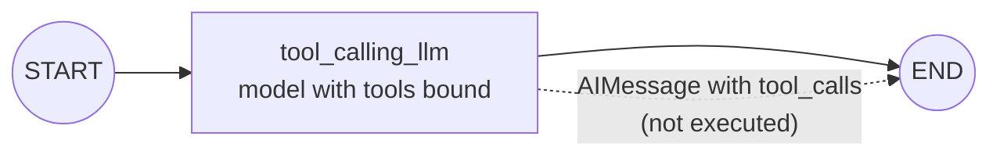

# Chains in LangGraph: The Complete Guide

> 📚 **Before you start**
>
> - [Sequential Workflows and Prompt Chaining](../03-workflow-patterns-in-langgraph/sequential-workflows-and-prompt-chaining.md), where nodes called a model and passed text along.
> - [The LangGraph Execution Model](../02-getting-started/the-langgraph-execution-model.md), for reducers.
> - [Function Calling Step by Step](../../agentic-ai-fundamentals/04-tools-and-function-calling/function-calling-step-by-step.md), for what a tool call and a tool result are.
> - [ChatPromptTemplate and Messages](../../langchain-complete-guide/course.md#m4) and [Tool Calling with bind_tools](../../langchain-complete-guide/course.md#m7) in the LangChain Complete Guide.

## Introduction

Think of a WhatsApp chat with your bank's support bot. Every reply the bot writes depends on the whole thread above it: your first question, its answer, the account number you typed two messages later. The thread *is* the context.

In module 3 your nodes passed plain strings around: an outline, a draft, a score. That works for pipelines, but chat models don't think in single strings. They take a **list of messages** (system, human, AI, tool) and return a new message. Once a graph's state is a list of messages, the same graph can hold a conversation, request tools, receive tool results and keep going.

This module builds up to a full agent in four small steps, each adding one idea:

| Lesson | Graph | New idea |
|---|---|---|
| **Chains** (this lesson) | `START → model → END` | Messages as state, tools bound to a model |
| [Routers](routers.md) | `model → tools or END` | Run the tool the model asked for |
| [Building Agents](building-agents.md) | `model ⇄ tools` | Loop until the model is done |
| [Agents with Memory](agents-with-memory.md) | same, plus a checkpointer | Remember earlier turns |

By the end of this lesson you'll be able to store a conversation in graph state with the `add_messages` reducer, use and extend `MessagesState`, write a node that calls a chat model, and bind tools to a model so it can ask for them.

> 💡 **Key Insight**
>
> A chat conversation is just a list that **grows**. The `add_messages` reducer makes a state field behave exactly like a chat thread: new messages are appended, a message with an existing id replaces the old one, and nothing is ever silently lost. Almost every LangGraph agent you'll meet is built on that one field.

---

## Core Explanation

### 1. Messages: the language of chat models

LangChain represents each turn of a conversation as a **message object**. The four you'll use constantly:

| Class | Role | Typical content |
|---|---|---|
| `SystemMessage` | Instructions for the model | "You are a helpful banking assistant." |
| `HumanMessage` | What the user said | "What's my balance?" |
| `AIMessage` | What the model replied | Text, and possibly **tool calls** |
| `ToolMessage` | The result of running a tool | "₹12,450.00", linked to a tool call by `tool_call_id` |

```python
from langchain_core.messages import AIMessage, HumanMessage, SystemMessage

conversation = [
    SystemMessage("You are a friendly cricket quiz host."),
    HumanMessage("Who has scored the most runs in Test cricket?", name="Asha"),
    AIMessage("Sachin Tendulkar, with 15,921 runs in 200 Tests."),
]
for m in conversation:
    m.pretty_print()
```

Output:

```
================================ System Message ================================

You are a friendly cricket quiz host.
================================ Human Message =================================
Name: Asha

Who has scored the most runs in Test cricket?
================================== Ai Message ==================================

Sachin Tendulkar, with 15,921 runs in 200 Tests.
```

`pretty_print()` is the quickest way to read a conversation while debugging. You'll see it throughout this module.

### 2. Why a plain list field doesn't work

Your first instinct might be a state with `messages: list` and a node that returns the model's reply. Watch what happens:

```python
from typing import TypedDict
from langgraph.graph import StateGraph, START, END

class PlainChatState(TypedDict):
    messages: list

def reply(state: PlainChatState):
    return {"messages": [AIMessage("Sachin Tendulkar.")]}

g = StateGraph(PlainChatState)
g.add_node(reply)
g.add_edge(START, "reply")
g.add_edge("reply", END)

result = g.compile().invoke({"messages": [HumanMessage("Most Test runs?")]})
print([m.content for m in result["messages"]])
```

Output:

```
['Sachin Tendulkar.']
```

The question vanished. A field with no reducer is **replaced** by each update (you saw this in [The LangGraph Execution Model](../02-getting-started/the-langgraph-execution-model.md)). For a conversation, that's exactly wrong.

### 3. The `add_messages` reducer

`operator.add` would append, but conversations need a little more than appending. LangGraph ships a reducer made for messages, `add_messages`:

```python
from typing import Annotated
from langgraph.graph import add_messages

history = [HumanMessage("Most Test runs?", id="m1"),
           AIMessage("Ricky Ponting.", id="m2")]

# Rule 1: new messages are appended
print([m.content for m in add_messages(history, [HumanMessage("Are you sure?", id="m3")])])

# Rule 2: a message with an id that already exists REPLACES the old one
print([m.content for m in add_messages(history, [AIMessage("Sachin Tendulkar.", id="m2")])])
```

Output:

```
['Most Test runs?', 'Ricky Ponting.', 'Are you sure?']
['Most Test runs?', 'Sachin Tendulkar.']
```

The second rule is what makes `add_messages` better than `operator.add`. Every message gets an `id` (LangGraph assigns a random one if you don't), so a node can **correct** an earlier message by returning a new message with the same id. That's how you'll edit messages for human review later in the platform.

Two more conveniences:

```python
from langchain_core.messages import RemoveMessage

# Rule 3: RemoveMessage(id=...) deletes a message
print([m.content for m in add_messages(history, [RemoveMessage(id="m1")])])

# Rule 4: shorthand tuples and dicts are converted to message objects
converted = add_messages([], [("user", "Namaste"), {"role": "assistant", "content": "Namaste! 🙏"}])
print([type(m).__name__ for m in converted])
```

Output:

```
['Ricky Ponting.']
['HumanMessage', 'AIMessage']
```

| What a node returns | Effect on the `messages` field |
|---|---|
| `[AIMessage("hi")]` (new id) | Appended |
| `[AIMessage("fixed", id="m2")]` | Replaces message `m2` in place |
| `[RemoveMessage(id="m1")]` | Deletes message `m1` |
| `[("user", "hello")]` | Converted to `HumanMessage`, appended |

Use it with `Annotated`, exactly like any other reducer:

```python
class ChatState(TypedDict):
    messages: Annotated[list, add_messages]
```

### 4. `MessagesState`: the shortcut

Because almost every chat graph needs that exact field, LangGraph provides it ready-made. `MessagesState` is a `TypedDict` with one key, `messages: Annotated[list[AnyMessage], add_messages]`.

```python
from langgraph.graph import MessagesState

print(list(MessagesState.__annotations__))
```

Output:

```
['messages']
```

In the LangGraph source the field is declared as `messages: Annotated[list[AnyMessage], add_messages]`. `AnyMessage` is a union of every message type, so this reads as "a list of messages, merged with `add_messages`". When you need more fields, **subclass** it:

```python
class QuizState(MessagesState):
    score: int          # plain field, replaced on update
    topic: str
```

`QuizState` has `messages` (with the reducer), `score` and `topic`. This is the pattern you'll use for most real agents: the conversation plus a few structured fields.

### 5. A one-node chain with a chat model

Now the simplest message graph: one node that sends the conversation to a chat model and returns its reply. We'll use the offline `FakeListChatModel` from module 3; it has the same `.invoke(messages)` interface as a real model.

```python
from langchain_core.language_models.fake_chat_models import FakeListChatModel

llm = FakeListChatModel(responses=["Sachin Tendulkar, with 15,921 Test runs."])

def chat_model(state: MessagesState):
    return {"messages": [llm.invoke(state["messages"])]}

builder = StateGraph(MessagesState)
builder.add_node(chat_model)
builder.add_edge(START, "chat_model")
builder.add_edge("chat_model", END)
chain = builder.compile()

result = chain.invoke({"messages": [HumanMessage("Who has the most Test runs?")]})
for m in result["messages"]:
    m.pretty_print()
```

Output:

```
================================ Human Message =================================

Who has the most Test runs?
================================== Ai Message ==================================

Sachin Tendulkar, with 15,921 Test runs.
```

Three details worth noticing:

- The node passes the **whole list** to the model. A chat model reads the conversation, not just the last line.
- The node returns a **one-item list**. `add_messages` appends it; you never rebuild the history yourself.
- The input can be shorthand too: `chain.invoke({"messages": [("user", "Who has the most Test runs?")]})` works the same.

### 6. A system prompt without polluting the state

Where should the system prompt live? You *could* put a `SystemMessage` into the state on the first call, but then it gets saved with every conversation, and changing the prompt later means editing stored data. The cleaner habit is to **prepend it inside the node**:

```python
SYSTEM = SystemMessage("You are a cricket quiz host. Answer in one sentence.")
llm = FakeListChatModel(responses=["Sachin Tendulkar holds the record."])
seen_by_model = []

def chat_model(state: MessagesState):
    prompt = [SYSTEM] + state["messages"]
    seen_by_model.append(len(prompt))
    return {"messages": [llm.invoke(prompt)]}

builder = StateGraph(MessagesState)
builder.add_node(chat_model)
builder.add_edge(START, "chat_model")
builder.add_edge("chat_model", END)
chain = builder.compile()

result = chain.invoke({"messages": [("user", "Most Test runs?")]})
print("model saw", seen_by_model[0], "messages; state holds", len(result["messages"]))
```

Output:

```
model saw 2 messages; state holds 2
```

The model saw the system prompt plus the question; the state stored only the question and the answer. The prompt is code, the conversation is data, and they stay separate.

### 7. Binding tools: letting the model *ask* for actions

A chat model can do more than reply with text. If you tell it which **tools** exist, it can reply with a **tool call**: "please run `multiply` with `a=12, b=7`". In LangChain you describe tools with the `@tool` decorator and attach them with `bind_tools`:

```python
from langchain_core.tools import tool

@tool
def multiply(a: int, b: int) -> int:
    """Multiply a by b."""
    return a * b

print(multiply.name, "|", multiply.description, "|", multiply.args)
```

Output:

```
multiply | Multiply a by b. | {'a': {'title': 'A', 'type': 'integer'}, 'b': {'title': 'B', 'type': 'integer'}}
```

The decorator read the function name, docstring and type hints and built a schema, the same thing your hand-written `@tool` decorator did in [Lab: Tool-using agent from scratch](../../agentic-ai-fundamentals/04-tools-and-function-calling/lab-tool-using-agent-from-scratch.md).

With a real model, binding looks like this:

```python
# not-run: needs `pip install langchain-anthropic` and ANTHROPIC_API_KEY
from langchain_anthropic import ChatAnthropic

llm = ChatAnthropic(model="claude-opus-5-5")
llm_with_tools = llm.bind_tools([multiply])
reply = llm_with_tools.invoke([HumanMessage("What is 12 times 7?")])
print(reply.tool_calls)
```

Example output:

```
[{'name': 'multiply', 'args': {'a': 12, 'b': 7}, 'id': 'toolu_01...', 'type': 'tool_call'}]
```

To run this offline we need a pretend model that can return tool calls. LangChain's `GenericFakeChatModel` returns whatever `AIMessage` objects you give it, in order. It doesn't implement `bind_tools`, so we add a two-line subclass where binding simply returns the same model. The script decides what the "model" says; the graph around it is exactly what you'd write for a real one.

```python
from langchain_core.language_models.fake_chat_models import GenericFakeChatModel

class ToolFake(GenericFakeChatModel):
    """A scripted chat model that accepts bind_tools, for offline examples."""
    def bind_tools(self, tools, **kwargs):
        return self

def scripted(*replies):
    return ToolFake(messages=iter(replies))

llm = scripted(
    AIMessage("", tool_calls=[{"name": "multiply", "args": {"a": 12, "b": 7}, "id": "call_1"}]),
)
llm_with_tools = llm.bind_tools([multiply])

def tool_calling_llm(state: MessagesState):
    return {"messages": [llm_with_tools.invoke(state["messages"])]}

builder = StateGraph(MessagesState)
builder.add_node(tool_calling_llm)
builder.add_edge(START, "tool_calling_llm")
builder.add_edge("tool_calling_llm", END)
tool_chain = builder.compile()

result = tool_chain.invoke({"messages": [("user", "What is 12 times 7?")]})
for m in result["messages"]:
    m.pretty_print()
```

Output:

```
================================ Human Message =================================

What is 12 times 7?
================================== Ai Message ==================================
Tool Calls:
  multiply (call_1)
 Call ID: call_1
  Args:
    a: 12
    b: 7
```

The AI message has **no text** and one **tool call**. Look at what's missing: nobody ran `multiply`. The graph ended right after the model asked. A chain can *request* an action but can't *take* it. Fixing that is the job of the next lesson.



### 8. Reading tool calls from the state

Every `AIMessage` has a `tool_calls` list. It's empty for a plain text reply and filled when the model wants tools. That one attribute is what every router and agent loop checks:

```python
last = result["messages"][-1]
print(type(last).__name__, "| text:", repr(last.content), "| calls:", len(last.tool_calls))
for call in last.tool_calls:
    print(call["name"], call["args"], call["id"])
```

Output:

```
AIMessage | text: '' | calls: 1
multiply {'a': 12, 'b': 7} call_1
```

Each call has a `name`, `args` (already parsed into a dict) and an `id`. The `id` matters: when the tool runs, its result goes back as a `ToolMessage` with the same `tool_call_id`, so the model can match answers to questions when it asked for several at once.

---

## Try It Yourself

1. **Predict the reducer.** Starting from `history` in section 3, what does `add_messages(history, [AIMessage("Sachin.", id="m2"), HumanMessage("Thanks!", id="m4")])` return? Check by running it.
2. **Extend the state.** Make a `CountingState(MessagesState)` with a `turns: int` field, and a node that returns the model reply **and** `turns + 1`. Run it once starting from `turns=0`.
3. **Text or tools?** Write a function `wants_tools(state)` that returns `True` if the last message is an AI message with at least one tool call. Test it on `result` from section 7 and on the plain chain's result from section 5.

<details>
<summary>Show answers</summary>

**1.** Message `m2` is replaced and `m4` is appended:

```python
print([m.content for m in add_messages(history, [AIMessage("Sachin.", id="m2"), HumanMessage("Thanks!", id="m4")])])
```

Output:

```
['Most Test runs?', 'Sachin.', 'Thanks!']
```

**2.**

```python
class CountingState(MessagesState):
    turns: int

llm = FakeListChatModel(responses=["Sachin Tendulkar."])

def counted_reply(state: CountingState):
    return {"messages": [llm.invoke(state["messages"])], "turns": state["turns"] + 1}

g = StateGraph(CountingState)
g.add_node(counted_reply)
g.add_edge(START, "counted_reply")
g.add_edge("counted_reply", END)
out = g.compile().invoke({"messages": [("user", "Most Test runs?")], "turns": 0})
print(out["turns"], [m.content for m in out["messages"]])
```

Output:

```
1 ['Most Test runs?', 'Sachin Tendulkar.']
```

**3.**

```python
def wants_tools(state):
    last = state["messages"][-1]
    return isinstance(last, AIMessage) and len(last.tool_calls) > 0

plain = FakeListChatModel(responses=["Hello!"])
g = StateGraph(MessagesState)
g.add_node("chat", lambda s: {"messages": [plain.invoke(s["messages"])]})
g.add_edge(START, "chat")
plain_result = g.compile().invoke({"messages": [("user", "hi")]})

print(wants_tools(result), wants_tools(plain_result))
```

Output:

```
True False
```

You've just written the heart of `tools_condition`, which you'll meet in the next lesson.

</details>

---

## Real-World Examples

- **Customer support chat**: the conversation lives in `messages`; extra fields like `customer_id` and `ticket_status` sit beside it in a `MessagesState` subclass.
- **Draft-and-correct flows**: a moderation node replaces an AI message that leaked a phone number by returning a redacted copy with the **same id**.
- **Tool-aware assistants**: a model bound to `get_train_status` and `book_ticket` answers small talk in text and returns tool calls when the user asks about the 12951 Rajdhani.

---

## Common Misconceptions

### "`MessagesState` is a special class with its own behaviour"

It's an ordinary `TypedDict` with one annotated field. Everything it does comes from the `add_messages` reducer.

### "Binding tools makes the model run them"

`bind_tools` only **describes** the tools to the model. The model replies with a request; your graph must run the tool. Section 7 shows a graph that ends with an unexecuted call.

### "The system prompt has to be stored in the state"

You can, but prepending it inside the node keeps saved conversations clean and lets you change the prompt without migrating stored data.

### "`operator.add` is just as good for messages"

It appends, but it can't replace or delete a message by id. Use `add_messages` for conversations.

---

## Interview Relevance

*"How do you represent a conversation in LangGraph state?"* A strong answer names `MessagesState` (or `Annotated[list, add_messages]`), explains that `add_messages` appends new messages, **replaces by id** and supports `RemoveMessage`, and mentions subclassing `MessagesState` to add structured fields.

*"What does `bind_tools` do?"* It sends tool schemas (name, description, JSON schema of the arguments) to the model with each call. The model may answer with `AIMessage.tool_calls`; executing them is the application's job, which in LangGraph is a separate node.

---

## Key Takeaways

- Chat graphs keep the conversation in a **`messages`** field: system, human, AI and tool messages.
- **`add_messages`** appends, **replaces by id**, deletes with `RemoveMessage`, and converts shorthand like `("user", "hi")`.
- **`MessagesState`** is that field ready-made; **subclass** it to add your own fields.
- Prepend the **system prompt inside the node** so it isn't saved with every conversation.
- **`bind_tools`** lets a model *ask* for tools via `AIMessage.tool_calls`; a chain alone never runs them.

---

**Up next:** [Routers](routers.md)
