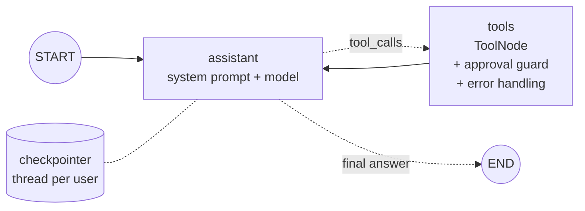

# Lab: Rebuild Your Scratch Agent in LangGraph

> 📚 **Before you start**
>
> - [Lab: Tool-using agent from scratch](../../agentic-ai-fundamentals/04-tools-and-function-calling/lab-tool-using-agent-from-scratch.md), the agent you're about to rebuild. Skim it again if it's been a while.
> - [Building Agents](building-agents.md), [Agents with Memory](agents-with-memory.md) and [Tools in LangGraph: ToolNode and tools_condition](tools-in-langgraph-toolnode-and-tools-condition.md), for every piece used here.

## What You'll Build

In Agentic AI Fundamentals you wrote an **expense assistant** from scratch: a `@tool` decorator, input validation, a pretend model speaking the API format, an agent loop with parallel tool calls, a round limit and approval for write tools. About 150 lines.

Now you'll rebuild the same assistant in LangGraph and compare. The user will say *"I spent 450 on lunch and 1200 on a train ticket today. How much have I spent on food this month?"* and the agent will log both expenses in parallel, total the food category and answer, exactly as before. Then you'll add two things the scratch version never had: **memory across turns** and a **saved, inspectable history**.



| Scratch agent | This lab |
|---|---|
| Hand-written `@tool` decorator and `validate()` | LangChain `@tool` (schema + validation) |
| `pretend_model` speaking the API format | A scripted chat model returning `AIMessage`s |
| `Agent.ask` loop and `stop_reason` check | `assistant ⇄ tools` edges and `tools_condition` |
| `run_tool` with errors as results | `ToolNode(handle_tool_errors=True)` |
| `approve` callback for write tools | A `wrap_tool_call` guard |
| `max_rounds` | `recursion_limit` |
| `self.messages` (lost when the object goes) | Checkpointed state per `thread_id` |

> 💡 **Key Insight**
>
> Nothing in the scratch agent disappears; each piece moves to a standard place. That's the real value of a framework: the next person who reads your agent already knows where the loop, the tools, the guardrails and the memory live.

Run the blocks in order in one file or notebook (`pip install langgraph langchain-core`).

---

## Step 1: The Expense Store

The same starting data and fixed date as the original lab, so the numbers match.

```python
from datetime import date

EXPENSES = [
    {"id": 1, "date": "2026-10-03", "amount": 320.0, "category": "food", "note": "groceries"},
    {"id": 2, "date": "2026-10-05", "amount": 2000.0, "category": "rent", "note": "share of WiFi and power"},
    {"id": 3, "date": "2026-10-08", "amount": 180.0, "category": "food", "note": "chai and snacks"},
]
TODAY = date(2026, 10, 11)
print(len(EXPENSES), "expenses so far")
```

Output:

```
3 expenses so far
```

---

## Step 2: The Tools

In the scratch version, a `choices` argument added an `enum` to the schema. Here a `Literal` type hint does the same job, and LangChain validates arguments against it before your function runs.

```python
from typing import Literal
from langchain_core.tools import tool

Category = Literal["food", "travel", "rent", "shopping", "other"]

@tool
def add_expense(amount: float, category: Category, note: str = "", day: str = "") -> str:
    """Record one expense. Use once per expense the user says they spent.
    day is YYYY-MM-DD and defaults to today. Do not use this to change existing expenses."""
    if amount <= 0:
        return "ERROR: amount must be greater than 0."
    new_id = max(e["id"] for e in EXPENSES) + 1
    EXPENSES.append({"id": new_id, "date": day or TODAY.isoformat(), "amount": float(amount),
                     "category": category, "note": note})
    return f"Added expense #{new_id}: ₹{amount:,.0f} {category} ({note or 'no note'})."

@tool
def total_by_category(category: Category, month: str = "") -> str:
    """Total spent in one category for a month (YYYY-MM, default this month).
    Use for 'how much did I spend on X' questions."""
    month = month or TODAY.strftime("%Y-%m")
    items = [e for e in EXPENSES if e["category"] == category and e["date"].startswith(month)]
    return f"{category} in {month}: ₹{sum(e['amount'] for e in items):,.0f} across {len(items)} expenses."

@tool
def list_recent(limit: int = 5) -> str:
    """List the most recent expenses, newest first, up to limit (max 10).
    Use when the user wants to see what they've logged."""
    rows = sorted(EXPENSES, key=lambda e: (e["date"], e["id"]), reverse=True)[:min(limit, 10)]
    return "\n".join(f"#{e['id']} {e['date']} ₹{e['amount']:,.0f} {e['category']} ({e['note']})" for e in rows)

TOOLS = [add_expense, total_by_category, list_recent]
WRITE_TOOLS = {"add_expense"}

import json
print(json.dumps(total_by_category.tool_call_schema.model_json_schema()["properties"], indent=1))
```

Output:

```
{
 "category": {
  "enum": [
   "food",
   "travel",
   "rent",
   "shopping",
   "other"
  ],
  "title": "Category",
  "type": "string"
 },
 "month": {
  "default": "",
  "title": "Month",
  "type": "string"
 }
}
```

The `enum` was generated from the type hint. And the validation from the scratch lab comes built in. Let's call the tool with the same bad input as before:

```python
try:
    add_expense.invoke({"amount": "450", "category": "lunch"})
except Exception as e:
    print(type(e).__name__)
    print("\n".join(line for line in str(e).splitlines() if "category" in line or "Input should" in line))
```

Output:

```
ValidationError
category
  Input should be 'food', 'travel', 'rent', 'shopping' or 'other' [type=literal_error, input_value='lunch', input_type=str]
```

Notice one difference: Pydantic **coerced** the string `"450"` to a number (it's a valid numeric string), and only the category was rejected. Your scratch validator was stricter. Neither is wrong; just know which behaviour you have.

---

## Step 3: A Scripted Model

The scratch lab's `pretend_model` inspected the messages and decided what to do. Here we script the same three replies as `AIMessage`s. A real model bound to `TOOLS` would produce this same sequence for this request.

```python
from langchain_core.language_models.fake_chat_models import GenericFakeChatModel
from langchain_core.messages import AIMessage, SystemMessage

class ToolFake(GenericFakeChatModel):
    """A scripted chat model that accepts bind_tools, for offline examples."""
    def bind_tools(self, tools, **kwargs):
        return self

def call(name, call_id, **args):
    return {"name": name, "args": args, "id": call_id}

def demo_script():
    return ToolFake(messages=iter([
        AIMessage("I'll log both expenses first.", tool_calls=[
            call("add_expense", "toolu_01", amount=450, category="food", note="lunch"),
            call("add_expense", "toolu_02", amount=1200, category="travel", note="train ticket"),
        ]),
        AIMessage("", tool_calls=[call("total_by_category", "toolu_03", category="food")]),
        AIMessage("Done! I logged lunch (₹450) and the train ticket (₹1,200). "
                  "So far this month you've spent ₹950 on food."),
    ]))
```

Notice the first reply has **both** text and tool calls, like a real model often produces.

---

## Step 4: The Approval Guard

The scratch agent took an `approve(name, args)` callback and refused write tools the user declined. In LangGraph that logic becomes a `wrap_tool_call` guard on the `ToolNode`. We build it from any `approve` function so you can swap policies:

```python
from langchain_core.messages import ToolMessage

def make_guard(approve):
    def guard(request, execute):
        call_ = request.tool_call
        if call_["name"] in WRITE_TOOLS and not approve(call_["name"], call_["args"]):
            return ToolMessage(f"The user did not approve {call_['name']}. Do not retry; "
                               "ask the user what to do.", tool_call_id=call_["id"], status="error")
        return execute(request)
    return guard

def approve_all(name, args):
    return True
```

The returned message is the same text the scratch agent used, so the model gets an identical explanation.

---

## Step 5: Build the Graph

```python
from langgraph.graph import StateGraph, MessagesState, START, END
from langgraph.prebuilt import ToolNode, tools_condition
from langgraph.checkpoint.memory import InMemorySaver

SYSTEM = SystemMessage("You help the user track expenses in INR. Always use tools for numbers.")
llm_with_tools = demo_script().bind_tools(TOOLS)

def assistant(state: MessagesState):
    return {"messages": [llm_with_tools.invoke([SYSTEM] + state["messages"])]}

def build_agent(approve=approve_all, checkpointer=None):
    builder = StateGraph(MessagesState)
    builder.add_node(assistant)
    builder.add_node("tools", ToolNode(TOOLS, handle_tool_errors=True, wrap_tool_call=make_guard(approve)))
    builder.add_edge(START, "assistant")
    builder.add_conditional_edges("assistant", tools_condition)
    builder.add_edge("tools", "assistant")
    return builder.compile(checkpointer=checkpointer)

agent = build_agent(checkpointer=InMemorySaver())
print(agent.get_graph().draw_mermaid().count("-->"), "solid edges,",
      agent.get_graph().draw_mermaid().count("-.->"), "conditional edges")
```

Output:

```
2 solid edges, 2 conditional edges
```

That's the whole agent. Compare it with the scratch `Agent` class: the loop, the `stop_reason` check and the result collection are gone, replaced by two edges and a prebuilt node.

---

## Step 6: Run It

`recursion_limit` plays the role of `max_rounds`. Six rounds in the scratch agent means about twelve super-steps here (model + tools per round), plus one for the final answer.

```python
config = {"configurable": {"thread_id": "user-sourabh"}, "recursion_limit": 13}
result = agent.invoke({"messages": [("user", "I spent 450 on lunch and 1200 on a train ticket today. "
                                             "How much have I spent on food this month?")]}, config)
print(result["messages"][-1].content)
```

Output:

```
Done! I logged lunch (₹450) and the train ticket (₹1,200). So far this month you've spent ₹950 on food.
```

Same answer, and the same check: groceries ₹320 + chai ₹180 + lunch ₹450 = ₹950, computed by your tool.

---

## Step 7: Read the Transcript

The scratch lab had a `show()` helper. Here's the LangGraph equivalent, reading from the **saved** state rather than an object in memory:

```python
def show(messages):
    for i, m in enumerate(messages, 1):
        if m.type == "tool":
            print(f"{i}. tool_result {m.tool_call_id}: {m.content}")
            continue
        if m.content:
            print(f"{i}. {m.type}: {m.content[:60]}{'...' if len(m.content) > 60 else ''}")
        for c in getattr(m, "tool_calls", []):
            print(f"{i}. ai tool_use {c['id']}: {c['name']}({c['args']})")

show(agent.get_state(config).values["messages"])
```

Output:

```
1. human: I spent 450 on lunch and 1200 on a train ticket today. How m...
2. ai: I'll log both expenses first.
2. ai tool_use toolu_01: add_expense({'amount': 450, 'category': 'food', 'note': 'lunch'})
2. ai tool_use toolu_02: add_expense({'amount': 1200, 'category': 'travel', 'note': 'train ticket'})
3. tool_result toolu_01: Added expense #4: ₹450 food (lunch).
4. tool_result toolu_02: Added expense #5: ₹1,200 travel (train ticket).
5. ai tool_use toolu_03: total_by_category({'category': 'food'})
6. tool_result toolu_03: food in 2026-10: ₹950 across 3 expenses.
7. ai: Done! I logged lunch (₹450) and the train ticket (₹1,200). S...
```

Line for line, this is the transcript from the scratch lab, with two differences in numbering: tool results are separate `ToolMessage`s (one per call) rather than blocks in a single user message, and the system prompt isn't in the history because the assistant node adds it on every call.

---

## Step 8: Approval in Action

Build a second agent whose user declines every write:

```python
def deny_writes(name, args):
    print(f"  [approval] {name}({args}) -> declined")
    return False

before = len(EXPENSES)
llm_with_tools = ToolFake(messages=iter([
    AIMessage("", tool_calls=[call("add_expense", "toolu_11", amount=450, category="food", note="lunch"),
                              call("add_expense", "toolu_12", amount=1200, category="travel", note="train ticket")]),
    AIMessage("I didn't log anything because you declined. Would you like me to record just one of them?"),
]))
cautious = build_agent(approve=deny_writes)
out = cautious.invoke({"messages": [("user", "I spent 450 on lunch and 1200 on a train ticket today.")]})
print(out["messages"][-1].content)
print("Expenses added:", len(EXPENSES) - before)
print([m.status for m in out["messages"] if m.type == "tool"])
```

Output:

```
  [approval] add_expense({'amount': 450, 'category': 'food', 'note': 'lunch'}) -> declined
  [approval] add_expense({'amount': 1200, 'category': 'travel', 'note': 'train ticket'}) -> declined
I didn't log anything because you declined. Would you like me to record just one of them?
Expenses added: 0
['error', 'error']
```

Nothing was written, both tool calls got an explanation marked as an error, and the model could pass that on to the user.

---

## Step 9: What the Scratch Agent Couldn't Do

**Remember the conversation.** Same thread, follow-up question with a pronoun:

```python
llm_with_tools = ToolFake(messages=iter([
    AIMessage("", tool_calls=[call("total_by_category", "toolu_21", category="travel")]),
    AIMessage("And on travel you've spent ₹1,200 this month, all of it that train ticket."),
]))
followup = agent.invoke({"messages": [("user", "And on travel?")]}, config)
print(followup["messages"][-1].content)
print(len(followup["messages"]), "messages in this thread")
```

Output:

```
And on travel you've spent ₹1,200 this month, all of it that train ticket.
11 messages in this thread
```

"And on travel?" only makes sense because the agent loaded the earlier turn from the checkpointer.

**Inspect the history step by step.** Every super-step was saved, so you can see exactly what the agent did and when:

```python
for snap in reversed(list(agent.get_state_history(config))):
    step = snap.metadata["step"]
    if step < 0:
        continue
    last = snap.values["messages"][-1]
    what = (f"calls {[c['name'] for c in last.tool_calls]}" if getattr(last, "tool_calls", None)
            else f"{last.type}: {last.content[:40]}")
    print(f"step {step:2}  next={snap.next}  last={what}")
```

Output:

```
step  0  next=('assistant',)  last=human: I spent 450 on lunch and 1200 on a train
step  1  next=('tools',)  last=calls ['add_expense', 'add_expense']
step  2  next=('assistant',)  last=tool: Added expense #5: ₹1,200 travel (train t
step  3  next=('tools',)  last=calls ['total_by_category']
step  4  next=('assistant',)  last=tool: food in 2026-10: ₹950 across 3 expenses.
step  5  next=()  last=ai: Done! I logged lunch (₹450) and the trai
step  6  next=('__start__',)  last=ai: Done! I logged lunch (₹450) and the trai
step  7  next=('assistant',)  last=human: And on travel?
step  8  next=('tools',)  last=calls ['total_by_category']
step  9  next=('assistant',)  last=tool: travel in 2026-10: ₹1,200 across 1 expen
step 10  next=()  last=ai: And on travel you've spent ₹1,200 this m
```

Steps 0 to 5 are the first turn and 7 to 10 the follow-up. Step 6, with `next=('__start__',)`, is the checkpoint saved the moment the second user message arrived, before any node ran. This history is what LangGraph Studio draws, what lets a crashed run resume, and what human-in-the-loop features rewind. You'll use it heavily in module 5.

---

## Step 10: With a Real Model

Swap the scripted model for a real one; the graph doesn't change.

```python
# not-run: needs `pip install langchain-anthropic` and ANTHROPIC_API_KEY
from langchain_anthropic import ChatAnthropic

llm_with_tools = ChatAnthropic(model="claude-opus-5-5").bind_tools(TOOLS)
agent = build_agent(checkpointer=InMemorySaver())
config = {"configurable": {"thread_id": "user-sourabh"}, "recursion_limit": 13}
print(agent.invoke({"messages": [("user", "I spent 450 on lunch today. Food total this month?")]},
                   config)["messages"][-1].content)
```

Or, if you don't need the custom guard, LangChain's prebuilt agent gets you most of the way in one call:

```python
# not-run: needs `pip install langchain langchain-anthropic` and ANTHROPIC_API_KEY
from langchain.agents import create_agent

agent = create_agent(model="anthropic:claude-opus-5-5", tools=TOOLS,
                     system_prompt="You help the user track expenses in INR. Always use tools for numbers.",
                     checkpointer=InMemorySaver())
```

---

## Try It Yourself

1. **New tool, no other changes.** Add a read tool `biggest_expense(month: str = "")` to `TOOLS`. Rebuild the agent, script a model that calls it, and run. What did you have to change besides the function itself?
2. **Approve small amounts only.** Write an approval function that allows `add_expense` under ₹5,000 and declines larger amounts. Script a call for ₹8,000 and check the `ToolMessage` status.
3. **Business rule vs validation.** Script a call `add_expense(amount=-5, category="food")`. Which layer catches it, and what status does the `ToolMessage` have? Why?

<details>
<summary>Show answers</summary>

**1.** Only the `TOOLS` list (so both the model binding and the `ToolNode` see it):

```python
@tool
def biggest_expense(month: str = "") -> str:
    """The single largest expense in a month (YYYY-MM, default this month)."""
    month = month or TODAY.strftime("%Y-%m")
    top = max((e for e in EXPENSES if e["date"].startswith(month)), key=lambda e: e["amount"])
    return f"#{top['id']} ₹{top['amount']:,.0f} {top['category']} ({top['note']}) on {top['date']}"

TOOLS.append(biggest_expense)
llm_with_tools = ToolFake(messages=iter([
    AIMessage("", tool_calls=[call("biggest_expense", "b1")]),
    AIMessage("Your biggest expense this month was ₹2,000 for rent."),
]))
out = build_agent().invoke({"messages": [("user", "Biggest expense?")]})
print(out["messages"][-2].content)
```

Output:

```
#2 ₹2,000 rent (share of WiFi and power) on 2026-10-05
```

**2.**

```python
def approve_small(name, args):
    return args.get("amount", 0) < 5000

llm_with_tools = ToolFake(messages=iter([
    AIMessage("", tool_calls=[call("add_expense", "big1", amount=8000, category="shopping", note="phone")]),
    AIMessage("That's above the auto-approve limit, so I haven't logged it."),
]))
out = build_agent(approve=approve_small).invoke({"messages": [("user", "Log 8000 for a phone")]})
print([(m.status, m.content[:30]) for m in out["messages"] if m.type == "tool"])
```

Output:

```
[('error', 'The user did not approve add_e')]
```

**3.**

```python
llm_with_tools = ToolFake(messages=iter([
    AIMessage("", tool_calls=[call("add_expense", "neg1", amount=-5, category="food")]),
    AIMessage("That amount looks wrong; expenses must be positive."),
]))
out = build_agent().invoke({"messages": [("user", "Log -5 for food")]})
tool_msg = [m for m in out["messages"] if m.type == "tool"][0]
print(tool_msg.status, "|", tool_msg.content)
```

Output:

```
success | ERROR: amount must be greater than 0.
```

The schema accepts −5 (it's a valid number), so the function's own check catches it. Because the function *returns* an error string instead of raising, `ToolNode` marks it `success`. If you want the status to say `error`, raise an exception inside the tool (with `handle_tool_errors=True` it becomes an error message) or return a `ToolMessage` with `status="error"` via `Command`.

</details>

---

## What You've Learned

- Every part of a scratch agent has a **standard home** in LangGraph: tools, loop, routing, errors, guardrails, limits.
- **`Literal`** type hints give tools an enum and validation for free (note Pydantic's type coercion).
- **`wrap_tool_call`** reproduces approval callbacks without touching the tools.
- **`recursion_limit`** replaces `max_rounds`; one round is two super-steps.
- A **checkpointer** adds memory and a step-by-step history the scratch agent never had.

---

**Up next:** [Building a Chatbot with LangGraph](../06-chatbots-and-persistence/building-a-chatbot-with-langgraph.md)
