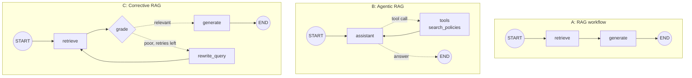

# RAG Inside a LangGraph Agent: The Complete Guide

> 📚 **Before you start**
>
> - [Building Agents](building-agents.md) and [Tools in LangGraph: ToolNode and tools_condition](tools-in-langgraph-toolnode-and-tools-condition.md), for the agent loop and tools.
> - [Retrieval-Augmented Generation (RAG)](../../retrieval-augmented-generation-rag/course.md#m2), for what embeddings, vector stores and retrievers are.
> - [Iterative (Looping) Workflows](../03-workflow-patterns-in-langgraph/iterative-looping-workflows.md), for the retry loop in section 6.

## Introduction

On your first week at a new job, you'll ask HR a dozen questions. A good HR person doesn't open the policy handbook when you say "good morning", but when you ask "how many casual leaves do I get?" they look it up, read the right page, and answer with the clause number. If your question is vague ("can I get my Ola money back?"), they rephrase it in policy language ("travel reimbursement") and look again.

**RAG** (retrieval-augmented generation) is the "look it up" part: fetch relevant documents and give them to the model so its answer is grounded in your data, not its memory. In the RAG course you built RAG as a fixed pipeline: retrieve, then generate, every time. Inside a LangGraph agent, retrieval becomes a **decision**: the model can retrieve when it needs to, skip it when it doesn't, and you can add steps that **check** the retrieved documents and **retry** with a better query.

In this lesson you'll build a small searchable policy handbook, then three graphs on top of it: an always-retrieve workflow, an agent that uses retrieval as a tool, and a corrective loop that grades results and rewrites poor queries.

> 💡 **Key Insight**
>
> In LangGraph, retrieval is just **a node or a tool**. As a node on a fixed edge, it runs every time (a RAG workflow). As a tool, the model decides when to call it (agentic RAG). Add a grading node with a conditional edge, and the graph can notice bad retrieval and try again, which a straight pipeline can't.

---

## Core Explanation

### 1. Three ways to put retrieval in a graph



| Shape | Retrieves when | Good for |
|---|---|---|
| **A: workflow** | Every time | Q&A over one knowledge base where almost every question needs it |
| **B: agentic** | The model decides | Assistants that also chat, use other tools, or search several sources |
| **C: corrective** | Every time, retried if poor | Vague user questions, noisy knowledge bases |

### 2. A small searchable handbook

A real app would use a real embedding model and a vector database. To run offline, we'll use LangChain's **`InMemoryVectorStore`** (a real vector store that keeps vectors in a Python list) with a tiny **keyword embedding** that we write ourselves. It turns text into a vector of counts for a few policy keywords. It's crude, but it behaves like an embedding: related texts get similar vectors.

```python
import math, re
from langchain_core.documents import Document
from langchain_core.embeddings import Embeddings
from langchain_core.vectorstores import InMemoryVectorStore

class KeywordEmbeddings(Embeddings):
    """Toy embedding: one dimension per keyword stem, plus a small constant. Offline stand-in only."""
    def __init__(self, stems):
        self.stems = stems

    def _embed(self, text):
        words = re.findall(r"[a-z]+", text.lower())
        vector = [float(sum(w.startswith(stem) for w in words)) for stem in self.stems]
        vector.append(0.1)                          # keeps unrelated text from being an all-zero vector
        norm = math.sqrt(sum(x * x for x in vector))
        return [x / norm for x in vector]

    def embed_documents(self, texts):
        return [self._embed(t) for t in texts]

    def embed_query(self, text):
        return self._embed(text)

STEMS = ["leave", "casual", "sick", "home", "remote", "office", "reimburs",
         "travel", "claim", "cab", "laptop", "holiday"]

handbook = InMemoryVectorStore(KeywordEmbeddings(STEMS))
handbook.add_documents([
    Document("Employees get 12 casual leaves and 10 sick leaves per calendar year. "
             "Unused casual leave does not carry forward.", metadata={"source": "leave-policy.pdf §2"}),
    Document("Work from home is allowed two days a week with your manager's approval.",
             metadata={"source": "remote-work.pdf §1"}),
    Document("Travel and cab expenses for client visits are reimbursed. File the claim within "
             "30 days with receipts.", metadata={"source": "travel-policy.pdf §4"}),
    Document("The office is closed on national holidays and on Diwali and Holi.",
             metadata={"source": "holiday-list.pdf"}),
], ids=["leave", "wfh", "travel", "holidays"])

for doc, score in handbook.similarity_search_with_score("How many casual leaves do I get?", k=2):
    print(f"{score:.2f}  {doc.metadata['source']}")
```

Output:

```
0.94  leave-policy.pdf §2
0.01  remote-work.pdf §1
```

The leave policy scores far higher than anything else, which is all a retriever needs to do. Swap `KeywordEmbeddings` for a real model and nothing else in this lesson changes:

```python
# not-run: needs `pip install langchain-huggingface sentence-transformers` (downloads a model)
from langchain_huggingface import HuggingFaceEmbeddings

handbook = InMemoryVectorStore(HuggingFaceEmbeddings(model_name="sentence-transformers/all-MiniLM-L6-v2"))
```

### 3. Shape A: the RAG workflow

The classic pipeline, written as a graph. The state carries the question, the retrieved documents and the answer:

```python
from typing import TypedDict
from langchain_core.language_models.fake_chat_models import FakeListChatModel
from langgraph.graph import StateGraph, START, END

class RAGState(TypedDict):
    question: str
    docs: list
    answer: str

prompts_sent = []
answer_llm = FakeListChatModel(responses=[
    "You get 12 casual leaves a year, and unused ones don't carry forward [leave-policy.pdf §2].",
])

def retrieve(state: RAGState):
    return {"docs": handbook.similarity_search(state["question"], k=2)}

def generate(state: RAGState):
    context = "\n".join(f"[{d.metadata['source']}] {d.page_content}" for d in state["docs"])
    prompt = ("Answer using only the context. Cite the source in brackets. "
              "If the answer isn't there, say so.\n\n"
              f"Context:\n{context}\n\nQuestion: {state['question']}")
    prompts_sent.append(prompt)
    return {"answer": answer_llm.invoke(prompt).content}

g = StateGraph(RAGState)
g.add_node(retrieve)
g.add_node(generate)
g.add_edge(START, "retrieve")
g.add_edge("retrieve", "generate")
g.add_edge("generate", END)
rag_workflow = g.compile()

out = rag_workflow.invoke({"question": "How many casual leaves do I get?"})
print(out["answer"])
print([d.metadata["source"] for d in out["docs"]])
print("---- prompt the model received ----")
print(prompts_sent[0])
```

Output:

```
You get 12 casual leaves a year, and unused ones don't carry forward [leave-policy.pdf §2].
['leave-policy.pdf §2', 'remote-work.pdf §1']
---- prompt the model received ----
Answer using only the context. Cite the source in brackets. If the answer isn't there, say so.

Context:
[leave-policy.pdf §2] Employees get 12 casual leaves and 10 sick leaves per calendar year. Unused casual leave does not carry forward.
[remote-work.pdf §1] Work from home is allowed two days a week with your manager's approval.

Question: How many casual leaves do I get?
```

Keeping `docs` in the state is a small but useful habit: your UI can show the sources next to the answer, and you can inspect exactly what the model was given when an answer looks wrong.

### 4. Shape B: retrieval as a tool (agentic RAG)

Now give the retriever to an agent as a tool. LangChain's `create_retriever_tool` wraps any retriever; we'll write the tool by hand instead so we control the format (source labels the model can cite):

```python
from langchain_core.language_models.fake_chat_models import GenericFakeChatModel
from langchain_core.messages import AIMessage
from langchain_core.tools import tool
from langgraph.graph import MessagesState
from langgraph.prebuilt import ToolNode, tools_condition

@tool
def search_policies(query: str) -> str:
    """Search the company HR handbook (leave, remote work, travel claims, holidays).
    Use for any question about company rules. Phrase the query in policy terms."""
    docs = handbook.similarity_search(query, k=2)
    return "\n".join(f"[{d.metadata['source']}] {d.page_content}" for d in docs)

class ToolFake(GenericFakeChatModel):
    """A scripted chat model that accepts bind_tools, for offline examples."""
    def bind_tools(self, tools, **kwargs):
        return self

llm_with_tools = None   # set before each run below

def assistant(state: MessagesState):
    return {"messages": [llm_with_tools.invoke(state["messages"])]}

builder = StateGraph(MessagesState)
builder.add_node(assistant)
builder.add_node("tools", ToolNode([search_policies]))
builder.add_edge(START, "assistant")
builder.add_conditional_edges("assistant", tools_condition)
builder.add_edge("tools", "assistant")
hr_agent = builder.compile()
```

Two questions: one that needs the handbook and one that doesn't.

```python
llm_with_tools = ToolFake(messages=iter([
    AIMessage("Good morning! Ask me anything about company policies."),
    AIMessage("", tool_calls=[{"name": "search_policies", "args": {"query": "work from home days"}, "id": "s1"}]),
    AIMessage("You can work from home two days a week with your manager's approval [remote-work.pdf §1]."),
]))

for question in ["Good morning!", "Can I work from home on Fridays?"]:
    result = hr_agent.invoke({"messages": [("user", question)]})
    path = [m.type for m in result["messages"][1:]]
    print(f"{question:34} path={path}")
    print("   ->", result["messages"][-1].content)
```

Output:

```
Good morning!                      path=['ai']
   -> Good morning! Ask me anything about company policies.
Can I work from home on Fridays?   path=['ai', 'tool', 'ai']
   -> You can work from home two days a week with your manager's approval [remote-work.pdf §1].
```

The greeting cost one model call and no retrieval. The policy question triggered a search with a query **the model rephrased** ("work from home days"), and the final answer cites the source. That's the main advantage of agentic RAG: the model chooses **whether** to search and **what** to search for. It can also call the tool several times (say, for leave *and* holidays) or combine it with other tools.

The trade-off is control. A model may skip retrieval when it shouldn't and answer from memory. Counter that with the tool's description ("use for any question about company rules"), the system prompt, and evaluation.

### 5. Retrieval results as structured state

The agent's tool results live only as text in `messages`. If your app needs the actual documents (to show source cards, or to grade them), store them in a state field too. A tool can do that by returning a `Command`, as you saw in the previous lesson:

```python
from langchain_core.messages import ToolMessage
from langgraph.prebuilt import ToolRuntime
from langgraph.types import Command

class HRState(MessagesState):
    sources: list

@tool
def search_policies_tracked(query: str, runtime: ToolRuntime) -> Command:
    """Search the company HR handbook (leave, remote work, travel claims, holidays)."""
    docs = handbook.similarity_search(query, k=2)
    text = "\n".join(f"[{d.metadata['source']}] {d.page_content}" for d in docs)
    return Command(update={
        "sources": runtime.state.get("sources", []) + [d.metadata["source"] for d in docs],
        "messages": [ToolMessage(text, tool_call_id=runtime.tool_call_id)],
    })

b = StateGraph(HRState)
b.add_node(assistant)
b.add_node("tools", ToolNode([search_policies_tracked]))
b.add_edge(START, "assistant")
b.add_conditional_edges("assistant", tools_condition)
b.add_edge("tools", "assistant")
tracked_agent = b.compile()

llm_with_tools = ToolFake(messages=iter([
    AIMessage("", tool_calls=[{"name": "search_policies_tracked", "args": {"query": "casual leave"}, "id": "t1"}]),
    AIMessage("12 casual leaves per year [leave-policy.pdf §2]."),
]))
out = tracked_agent.invoke({"messages": [("user", "How many casual leaves?")], "sources": []})
print(out["messages"][-1].content)
print("sources:", out["sources"])
```

Output:

```
12 casual leaves per year [leave-policy.pdf §2].
sources: ['leave-policy.pdf §2', 'remote-work.pdf §1']
```

### 6. Shape C: grade, rewrite, retry (corrective RAG)

Users don't speak in policy language. "Can I get my Ola money back?" shares no words with "travel and cab expenses are reimbursed", so a plain retriever fails and the model either guesses or says "I don't know".

A **corrective** loop checks the retrieval before generating. Here the grade is a similarity threshold (fast and free); a production system might use a small LLM call that answers "relevant: yes/no". If the grade is poor and retries remain, a rewrite node turns the question into policy terms and the graph retrieves again.

```python
from typing import Literal

class CRAGState(TypedDict):
    question: str
    query: str
    docs: list
    best_score: float
    rewrites: int
    answer: str

rewriter = FakeListChatModel(responses=["cab travel expense reimbursement claim"])
answer_llm = FakeListChatModel(responses=[
    "Yes. Cab expenses for client visits are reimbursed if you file the claim within 30 days "
    "with receipts [travel-policy.pdf §4].",
])
RELEVANT = 0.3

def c_retrieve(state: CRAGState):
    query = state.get("query") or state["question"]
    hits = handbook.similarity_search_with_score(query, k=2)
    return {"query": query, "docs": [d for d, _ in hits], "best_score": round(hits[0][1], 2)}

def grade(state: CRAGState) -> Literal["generate", "rewrite_query", "give_up"]:
    if state["best_score"] >= RELEVANT:
        return "generate"
    return "rewrite_query" if state["rewrites"] < 1 else "give_up"

def rewrite_query(state: CRAGState):
    better = rewriter.invoke(f"Rewrite as an HR policy search query: {state['question']}").content
    return {"query": better, "rewrites": state["rewrites"] + 1}

def c_generate(state: CRAGState):
    context = "\n".join(f"[{d.metadata['source']}] {d.page_content}" for d in state["docs"])
    return {"answer": answer_llm.invoke(f"Context:\n{context}\n\nQuestion: {state['question']}").content}

def give_up(state: CRAGState):
    return {"answer": "I couldn't find this in the HR handbook. Please ask hr@company.example."}

g = StateGraph(CRAGState)
g.add_node("retrieve", c_retrieve)
g.add_node(rewrite_query)
g.add_node("generate", c_generate)
g.add_node(give_up)
g.add_edge(START, "retrieve")
g.add_conditional_edges("retrieve", grade)
g.add_edge("rewrite_query", "retrieve")
g.add_edge("generate", END)
g.add_edge("give_up", END)
crag = g.compile()

for update in crag.stream({"question": "Can I get my Ola money back?", "rewrites": 0}, stream_mode="updates"):
    node, data = next(iter(update.items()))
    shown = {k: v for k, v in data.items() if k != "docs"}
    print(f"{node:14} {shown}")
```

Output:

```
retrieve       {'query': 'Can I get my Ola money back?', 'best_score': 0.1}
rewrite_query  {'query': 'cab travel expense reimbursement claim', 'rewrites': 1}
retrieve       {'query': 'cab travel expense reimbursement claim', 'best_score': 1.0}
generate       {'answer': 'Yes. Cab expenses for client visits are reimbursed if you file the claim within 30 days with receipts [travel-policy.pdf §4].'}
```

The first retrieval scored too low, so the graph rewrote the query and tried again; the second scored well and went to `generate`. The `rewrites` counter caps the loop at one retry, the same "two stopping rules" idea from [Iterative (Looping) Workflows](../03-workflow-patterns-in-langgraph/iterative-looping-workflows.md). A question the handbook can't answer ends at `give_up` instead of a made-up answer:

```python
rewriter = FakeListChatModel(responses=["canteen menu food options"])
out = crag.invoke({"question": "What's for lunch in the canteen?", "rewrites": 0})
print(out["best_score"], out["rewrites"], "->", out["answer"])
```

Output:

```
0.1 1 -> I couldn't find this in the HR handbook. Please ask hr@company.example.
```

This shape is the starting point for the advanced patterns (corrective RAG, self-RAG, adaptive RAG) you'll build in [Agentic RAG Systems](../../agentic-rag-systems/course.md).

### 7. Choosing between the shapes

- Start with the **workflow** (A) if nearly every request needs the knowledge base. It's predictable, cheap and easy to evaluate.
- Move to **agentic** (B) when the assistant also chats, uses other tools, or has several knowledge sources to choose from.
- Add **grading and rewriting** (C) when you see retrieval failures in your logs, especially with vague or colloquial questions.
- You can combine them: an agent whose `search_policies` tool is itself a small corrective subgraph. Module 9 shows how to nest graphs like that.

---

## Try It Yourself

1. **Two-source agent.** Script the HR agent to search twice in one turn (once for "casual leave", once for "holidays") using parallel tool calls, then answer. How many `ToolMessage`s are in the result?
2. **A stricter grade.** Change `RELEVANT` to `0.95` and run the corrective graph on "How many casual leaves do I get?". Which path does it take, and why is too strict a threshold a problem?
3. **Use `create_retriever_tool`.** Build a tool from `handbook.as_retriever(search_kwargs={"k": 1})` with `create_retriever_tool` and call it with `{"query": "remote work"}`. How does its output differ from `search_policies`?

<details>
<summary>Show answers</summary>

**1.**

```python
llm_with_tools = ToolFake(messages=iter([
    AIMessage("", tool_calls=[
        {"name": "search_policies", "args": {"query": "casual leave"}, "id": "p1"},
        {"name": "search_policies", "args": {"query": "holidays"}, "id": "p2"},
    ]),
    AIMessage("12 casual leaves a year, plus national holidays, Diwali and Holi off."),
]))
result = hr_agent.invoke({"messages": [("user", "How much time off do I get?")]})
print(sum(m.type == "tool" for m in result["messages"]))
```

Output:

```
2
```

**2.**

```python
RELEVANT = 0.95
rewriter = FakeListChatModel(responses=["casual leave entitlement per year"])
out = crag.invoke({"question": "How many casual leaves do I get?", "rewrites": 0})
print(out["best_score"], out["rewrites"], "->", out["answer"][:40])
RELEVANT = 0.3
```

Output:

```
0.94 1 -> I couldn't find this in the HR handbook.
```

Even a perfectly good match fails a threshold that high, so the graph wastes a rewrite and then gives up on a question it could have answered. Thresholds must be tuned on real questions.

**3.**

```python
from langchain_core.tools import create_retriever_tool

retriever_tool = create_retriever_tool(handbook.as_retriever(search_kwargs={"k": 1}),
                                       "search_handbook", "Search the HR handbook.")
print(retriever_tool.invoke({"query": "remote work"}))
```

Output:

```
Work from home is allowed two days a week with your manager's approval.
```

It returns only the page text, with no source label, so the model can't cite where the answer came from. Pass a `document_prompt` to `create_retriever_tool` to include metadata, or write the tool yourself as in section 4.

</details>

---

## Real-World Examples

- **Internal HR and IT helpdesks** use agentic RAG over policy documents, with the retriever as one tool alongside "raise a ticket".
- **Banking FAQ bots** use a corrective loop so colloquial questions ("my money got stuck in UPI") are rewritten into the bank's terminology before searching.
- **Legal and compliance tools** keep retrieved clauses in state so every answer can be shown with its exact sources for review.

---

## Common Misconceptions

### "Agentic RAG is always better than a fixed pipeline"

It's more flexible, but less predictable and often more expensive. If every question needs retrieval, the fixed workflow is simpler and easier to test.

### "Retrieval needs a special LangGraph component"

A retriever is just called from a node or a tool. LangGraph's contribution is the control flow around it: deciding, grading, retrying.

### "If retrieval returns something, the answer is grounded"

A retriever always returns its top *k*, even when nothing is relevant. Grading the results (by score or by a judge) is what catches irrelevant context.

---

## Interview Relevance

*"How would you implement RAG in LangGraph?"* Describe the three shapes: a retrieve → generate workflow; agentic RAG with a retriever tool in a `ToolNode` so the model decides when and what to search; and a corrective loop with a grading node, query rewriting and a retry cap. Mention storing retrieved documents in state for citations and debugging.

*"What can go wrong with agentic RAG?"* The model may skip retrieval, write poor queries, or loop. Mitigate with clear tool descriptions, grading, retry limits and evaluation on real questions.

---

## Key Takeaways

- Retrieval is **a node** (always runs) or **a tool** (the model decides).
- **Agentic RAG** lets the model choose whether and what to search, and combine search with other tools.
- Keep retrieved **documents or sources in state** for citations and debugging.
- A **grade → rewrite → retry** loop with a cap fixes many retrieval failures and avoids made-up answers.
- Start simple (a workflow), and add agency and correction when your logs show you need them.

---

**Up next:** [Lab: Rebuild your scratch agent in LangGraph](lab-rebuild-your-scratch-agent-in-langgraph.md)
