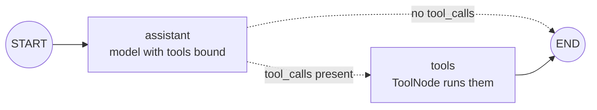

# Routers: The Complete Guide

> 📚 **Before you start**
>
> - [Chains in LangGraph](chains-in-langgraph.md), for `MessagesState`, `bind_tools` and `tool_calls`.
> - [Conditional Workflows](../03-workflow-patterns-in-langgraph/conditional-workflows.md), for routing functions and path maps.

## Introduction

Call the IRCTC helpline and say "hello" and the agent says hello back. Read out a PNR number and the agent types it into the system, reads the screen and tells you the status. Same agent, two very different paths, and the **caller's request** picks the path.

In the last lesson the model could *ask* for a tool, but the graph ended before anything ran. A **router** fixes that. After the model replies, a conditional edge looks at the reply: if it contains tool calls, the graph goes to a node that **runs the tools**; if it's plain text, the graph ends. The model itself has become the decision-maker in the routing.

By the end of this lesson you'll be able to use LangGraph's prebuilt `ToolNode` to execute tool calls, route with `tools_condition`, write your own version of both when you need custom behaviour, and explain why a router alone still isn't an agent.

> 💡 **Key Insight**
>
> In module 3 *you* wrote the routing rules ("if the amount is over ₹10,000…"). In a router, the **model's reply is the routing signal**: tool calls mean "go and act", no tool calls mean "I'm done". `tools_condition` is nothing more than a function that checks `last_message.tool_calls`.

---

## Core Explanation

### 1. The shape of a router



Two nodes and one conditional edge:

- **`assistant`** calls the model (with tools bound) on the conversation.
- **`tools`** runs whatever tools the model asked for and appends their results as `ToolMessage`s.
- The **conditional edge** after `assistant` chooses between them.

### 2. Tools and a scripted model

Our helpdesk gets one tool. The data is a small dictionary standing in for the railway's system.

```python
from langchain_core.language_models.fake_chat_models import GenericFakeChatModel
from langchain_core.messages import AIMessage, HumanMessage, ToolMessage
from langchain_core.tools import tool
from langgraph.graph import StateGraph, MessagesState, START, END

PNR_DB = {"4521873690": "CNF, coach B3 berth 41", "8812004517": "WL 12"}

@tool
def pnr_status(pnr: str) -> str:
    """Look up the booking status of a 10-digit Indian Railways PNR number."""
    return PNR_DB.get(pnr, f"No booking found for PNR {pnr}.")

class ToolFake(GenericFakeChatModel):
    """A scripted chat model that accepts bind_tools, for offline examples."""
    def bind_tools(self, tools, **kwargs):
        return self

def scripted(*replies):
    return ToolFake(messages=iter(replies))
```

As in the last lesson, `ToolFake` returns pre-written `AIMessage`s so everything runs offline. A real model bound to `pnr_status` would produce the same kinds of messages.

### 3. `ToolNode`: running the calls

`ToolNode` (from `langgraph.prebuilt`) is a ready-made node. Give it your tools; when it runs it:

1. Reads the **last message** in `messages`, which must be an `AIMessage`.
2. Runs **every** tool call in it (in parallel when there are several).
3. Returns one `ToolMessage` per call, with `tool_call_id` copied from the call and the tool's return value as `content`.

You can watch it on its own by putting it in a one-node graph:

```python
from langgraph.prebuilt import ToolNode, tools_condition

g = StateGraph(MessagesState)
g.add_node("tools", ToolNode([pnr_status]))
g.add_edge(START, "tools")
only_tools = g.compile()

request = AIMessage("", tool_calls=[
    {"name": "pnr_status", "args": {"pnr": "4521873690"}, "id": "call_a"},
    {"name": "pnr_status", "args": {"pnr": "8812004517"}, "id": "call_b"},
])
out = only_tools.invoke({"messages": [request]})
for m in out["messages"][1:]:
    print(type(m).__name__, m.tool_call_id, m.name, "->", m.content)
```

Output:

```
ToolMessage call_a pnr_status -> CNF, coach B3 berth 41
ToolMessage call_b pnr_status -> WL 12
```

Two calls in, two `ToolMessage`s out, each tagged with the id of the call it answers. That's exactly the `tool_use` / `tool_result` pairing you built by hand in [Agentic AI Fundamentals](../../agentic-ai-fundamentals/04-tools-and-function-calling/function-calling-step-by-step.md); `ToolNode` just does it for you.

### 4. `tools_condition`: the routing function

`tools_condition` is a routing function. It returns the string `"tools"` if the last message has tool calls and `END` (the string `"__end__"`) otherwise:

```python
text_reply = {"messages": [AIMessage("Namaste! How can I help?")]}
tool_reply = {"messages": [request]}
print(tools_condition(text_reply), tools_condition(tool_reply))
```

Output:

```
__end__ tools
```

Because it returns `"tools"`, the node that runs tools should be **named `"tools"`**. (Section 6 shows how to use another name.)

### 5. Building the router

```python
llm = scripted(
    AIMessage("Namaste! I can check PNR status for you. Please share the 10-digit PNR."),
    AIMessage("", tool_calls=[{"name": "pnr_status", "args": {"pnr": "8812004517"}, "id": "call_1"}]),
)
llm_with_tools = llm.bind_tools([pnr_status])

def assistant(state: MessagesState):
    return {"messages": [llm_with_tools.invoke(state["messages"])]}

builder = StateGraph(MessagesState)
builder.add_node(assistant)
builder.add_node("tools", ToolNode([pnr_status]))
builder.add_edge(START, "assistant")
builder.add_conditional_edges("assistant", tools_condition)
builder.add_edge("tools", END)
router = builder.compile()
```

First request: small talk. The model replies with text, so `tools_condition` returns `END`.

```python
for m in router.invoke({"messages": [("user", "Hello!")]})["messages"]:
    m.pretty_print()
```

Output:

```
================================ Human Message =================================

Hello!
================================== Ai Message ==================================

Namaste! I can check PNR status for you. Please share the 10-digit PNR.
```

Second request: a PNR. The model asks for the tool, the router sends the graph to `tools`, and the result is appended.

```python
for m in router.invoke({"messages": [("user", "Status of PNR 8812004517?")]})["messages"]:
    m.pretty_print()
```

Output:

```
================================ Human Message =================================

Status of PNR 8812004517?
================================== Ai Message ==================================
Tool Calls:
  pnr_status (call_1)
 Call ID: call_1
  Args:
    pnr: 8812004517
================================= Tool Message =================================
Name: pnr_status

WL 12
```

You can confirm which path each run took with `stream_mode="updates"`, which prints the node names in order. Here's a fresh model scripted for both runs:

```python
llm_with_tools = scripted(
    AIMessage("Namaste!"),
    AIMessage("", tool_calls=[{"name": "pnr_status", "args": {"pnr": "4521873690"}, "id": "call_2"}]),
)
for question in ["Hello!", "Status of PNR 4521873690?"]:
    path = [next(iter(chunk)) for chunk in router.stream({"messages": [("user", question)]}, stream_mode="updates")]
    print(f"{question!r:30} -> {path}")
```

Output:

```
'Hello!'                       -> ['assistant']
'Status of PNR 4521873690?'    -> ['assistant', 'tools']
```

(The `assistant` function looks up `llm_with_tools` when it runs, so reassigning the variable swaps the model without rebuilding the graph.)

### 6. Writing your own router

`tools_condition` is a convenience, not magic. Here's an equivalent you could write yourself:

```python
from typing import Literal

def my_tools_condition(state: MessagesState) -> Literal["tools", "__end__"]:
    last = state["messages"][-1]
    if isinstance(last, AIMessage) and last.tool_calls:
        return "tools"
    return END

print(my_tools_condition(text_reply), my_tools_condition(tool_reply))
```

Output:

```
__end__ tools
```

Writing your own is worth it when you need more than two destinations. Suppose `cancel_ticket` should never run without a human approving it. A custom router can send those calls somewhere else:

```python
def route_with_approval(state: MessagesState) -> Literal["tools", "needs_approval", "__end__"]:
    last = state["messages"][-1]
    if not last.tool_calls:
        return END
    if any(call["name"] == "cancel_ticket" for call in last.tool_calls):
        return "needs_approval"
    return "tools"

cancel = AIMessage("", tool_calls=[{"name": "cancel_ticket", "args": {"pnr": "4521873690"}, "id": "c9"}])
print(route_with_approval({"messages": [cancel]}), route_with_approval(tool_reply))
```

Output:

```
needs_approval tools
```

And if you'd rather name your tool node something other than `"tools"`, keep `tools_condition` and add a **path map** that translates its labels:

```python
# not-run: wiring sketch
builder.add_node("run_railway_tools", ToolNode([pnr_status]))
builder.add_conditional_edges("assistant", tools_condition, {"tools": "run_railway_tools", END: END})
```

### 7. Many tools, one `ToolNode`

You don't need a node per tool. One `ToolNode` can hold all of them and dispatches each call **by name**:

```python
@tool
def train_running_status(train_no: str) -> str:
    """Live running status of a train by its 5-digit number."""
    return {"12951": "Running 15 min late, last at Kota Jn"}.get(train_no, "Unknown train.")

g = StateGraph(MessagesState)
g.add_node("tools", ToolNode([pnr_status, train_running_status]))
g.add_edge(START, "tools")
mixed = AIMessage("", tool_calls=[
    {"name": "train_running_status", "args": {"train_no": "12951"}, "id": "t1"},
    {"name": "pnr_status", "args": {"pnr": "0000000000"}, "id": "t2"},
])
for m in g.compile().invoke({"messages": [mixed]})["messages"][1:]:
    print(m.name, "->", m.content)
```

Output:

```
train_running_status -> Running 15 min late, last at Kota Jn
pnr_status -> No booking found for PNR 0000000000.
```

Remember to bind the **same list** of tools to the model; the model can only ask for tools it has been told about, and `ToolNode` can only run tools it holds.

### 8. Why a router isn't enough

Look again at the PNR run in section 5. The conversation ends with a **`ToolMessage`** containing `WL 12`. The user asked a question and got back a raw database value. Nobody explained that "WL 12" means twelfth on the waiting list, or suggested checking again closer to the date.

The model never saw the tool result, because the edge `tools → END` ended the run. To let the model **read** the result and decide what to do next (answer, or call another tool), the tools node has to lead back to the model. That single edge change turns a router into an **agent**, and it's the next lesson.

| | Router | Agent |
|---|---|---|
| After `tools` | `END` | back to `assistant` |
| Model sees tool results? | No | Yes |
| Tool calls per request | At most one round | As many rounds as needed |
| Final message | Often a raw `ToolMessage` | The model's written answer |

---

## Try It Yourself

1. **Predict the condition.** What does `tools_condition` return when the last message is a `ToolMessage`? Run it to check.
2. **Rename the tool node.** Rebuild the router with the tool node named `"railway"` using a path map. Run it on a PNR question with a freshly scripted model and print the node path.
3. **Approval branch.** Wire `route_with_approval` into a graph with three nodes: `assistant`, `tools` and a `needs_approval` node that returns `{"messages": [AIMessage("Cancellation needs a supervisor's approval.")]}` and ends. Script the model to ask for `cancel_ticket` and show the final message.

<details>
<summary>Show answers</summary>

**1.** A `ToolMessage` has no `tool_calls`, so the result is `END`:

```python
print(tools_condition({"messages": [ToolMessage("WL 12", tool_call_id="call_1")]}))
```

Output:

```
__end__
```

**2.**

```python
llm_with_tools = scripted(
    AIMessage("", tool_calls=[{"name": "pnr_status", "args": {"pnr": "4521873690"}, "id": "r1"}]),
)
b = StateGraph(MessagesState)
b.add_node(assistant)
b.add_node("railway", ToolNode([pnr_status]))
b.add_edge(START, "assistant")
b.add_conditional_edges("assistant", tools_condition, {"tools": "railway", END: END})
b.add_edge("railway", END)
renamed = b.compile()
print([next(iter(c)) for c in renamed.stream({"messages": [("user", "PNR 4521873690?")]}, stream_mode="updates")])
```

Output:

```
['assistant', 'railway']
```

**3.**

```python
@tool
def cancel_ticket(pnr: str) -> str:
    """Cancel the booking for a PNR."""
    return f"Cancelled {pnr}."

llm_with_tools = scripted(cancel)

def needs_approval(state: MessagesState):
    return {"messages": [AIMessage("Cancellation needs a supervisor's approval.")]}

b = StateGraph(MessagesState)
b.add_node(assistant)
b.add_node("tools", ToolNode([pnr_status, cancel_ticket]))
b.add_node(needs_approval)
b.add_edge(START, "assistant")
b.add_conditional_edges("assistant", route_with_approval)
b.add_edge("tools", END)
b.add_edge("needs_approval", END)
out = b.compile().invoke({"messages": [("user", "Cancel PNR 4521873690")]})
print(out["messages"][-1].content)
```

Output:

```
Cancellation needs a supervisor's approval.
```

Notice that `cancel_ticket` never ran: the router sent the graph around it. Real approval flows pause and wait for a person; you'll build those in [Human-in-the-Loop with LangGraph](../course.md).

</details>

---

## Real-World Examples

- **FAQ bots with a lookup**: answer general questions directly, but route "where's my order?" to an order-status tool.
- **Intent routing**: a model bound to `search_flights`, `search_hotels` and `search_trains` chooses which one to call; a single `ToolNode` runs whichever it picked.
- **Safety routing**: a custom router sends any call to a write tool (refund, cancel, transfer) to a review node instead of straight to execution.

---

## Common Misconceptions

### "The router decides which tool to call"

The **model** chooses the tool and its arguments. The router only checks *whether* there are tool calls (and, in custom routers, which kind) and picks the next node.

### "Each tool needs its own node"

One `ToolNode` holds any number of tools and dispatches by name. Separate nodes only make sense when different tools need different handling.

### "`tools_condition` must point at a node called `tools`"

That's its default label. A path map like `{"tools": "my_node", END: END}` lets you use any name.

---

## Interview Relevance

*"What do `ToolNode` and `tools_condition` do?"* `ToolNode` executes every tool call in the last `AIMessage` (in parallel) and returns `ToolMessage`s with matching `tool_call_id`s. `tools_condition` is a routing function returning `"tools"` when the last message has tool calls and `END` otherwise.

*"What's the difference between a router and an agent?"* In a router the tool result ends the run; in an agent the tools node loops **back to the model**, which can read results and call more tools. Interviewers like it when you point out that the difference is a single edge.

---

## Key Takeaways

- A **router** sends the model's reply either to a **tools node** (if it has tool calls) or to **`END`**.
- **`ToolNode`** runs every call in the last `AIMessage` and returns `ToolMessage`s linked by **`tool_call_id`**.
- **`tools_condition`** returns `"tools"` or `END`; write your **own router** when you need extra branches like approvals.
- One `ToolNode` can hold **many tools**; bind the same list to the model.
- A router ends on the **raw tool result**; looping back to the model is what makes an agent.

---

**Up next:** [Building Agents](building-agents.md)
